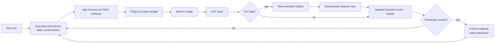
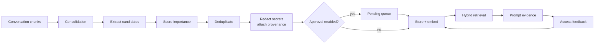
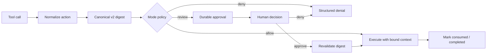

# Machina

**A self-hosted AI agent harness where context and memory are engineered, not improvised.**

Machina is a terminal AI workspace: chat beside your code, delegate to specialist agents, automate recurring work, and return to the same conversations after a restart. It runs on your machine and your PostgreSQL database, and it can talk to cloud providers, subscription accounts, or local models.

**In one sentence:** Machina keeps the model's working set small, its long-term memory governed, and its actions auditable — across a terminal UI, a CLI, an HTTP API, and MCP.


> **How to read this README.** [The hook](#the-hook-what-makes-this-harness-different) is the five-minute version of why the project exists and what is technically interesting about it. [One session, end to end](#one-session-end-to-end) shows the whole system in motion. The [deep dives](#deep-dive-1-context-management) are self-contained explanations of how the machinery works. The [rebuild guide](#rebuild-it-conceptually) is a blueprint for building your own. The [reference](#reference) is for installation and operations.

**Release status:** 0.2.0 development release candidate. See [release evidence and remaining deployment gates](docs/verification/RELEASE_READINESS.md) before operating a public service.

## Contents

- [The hook](#the-hook-what-makes-this-harness-different) — why this harness is interesting
- [One session, end to end](#one-session-end-to-end) — the whole system in a worked example
- [Feature tour](#feature-tour) — the headline capabilities
- [Deep dive 1: Context management](#deep-dive-1-context-management) — the model's working set
- [Deep dive 2: Memory management](#deep-dive-2-memory-management) — knowledge that survives sessions
- [Deep dive 3: The permission kernel](#deep-dive-3-the-permission-kernel) — approvals that bind to an exact action
- [Deep dive 4: The agent loop](#deep-dive-4-the-agent-loop) — turns, tools, delegation, and recovery
- [Deep dive 5: Providers and accounting](#deep-dive-5-providers-and-accounting) — one interface, many models
- [Deep dive 6: Surfaces and integrations](#deep-dive-6-surfaces-and-integrations) — TUI, CLI, HTTP, MCP, skills, jobs
- [Reliability and testing](#reliability-and-testing) — how the project is kept honest
- [Rebuild it conceptually](#rebuild-it-conceptually) — a blueprint for building your own
- [Get started](#get-started) — install and run
- [Reference](#reference) — commands, providers, configuration, API, Docker, development

## The hook: what makes this harness different

Every agent demo eventually hits the same wall.

The conversation gets long. A test run produces a megabyte of output. The process restarts. A tool wants to delete a file. The model that felt brilliant in a five-minute demo starts repeating itself, forgetting decisions, and asking for permission to do the wrong thing.

Machina is built around that wall.

A model call is easy. A **harness** is hard: it has to decide what the model sees, what it remembers, what it is allowed to do, and what happens when something fails halfway through. Machina treats those as four first-class systems rather than glue code around a chat endpoint.

| The hard problem | The naive version | What Machina does |
|---|---|---|
| **Context is finite and expensive** | Resend the transcript until the provider truncates it | Stores typed context chunks, sends a budgeted *projection*, compacts at safe boundaries, and keeps large tool results recoverable as artifacts |
| **Memory is not chat history** | Dump embeddings into a vector table and hope | Runs a memory lifecycle: extract, score, dedupe, redact, attach provenance, approve, retrieve, reinforce, decay |
| **Tools are dangerous** | Ask "are you sure?" with a tool name | Binds approval to a canonical cryptographic digest of the exact action, revalidates at execution, and consumes it once |
| **Processes die and humans are slow** | Hold a transaction open and hope | Uses turn leases, durable jobs, resumable approvals, and explicit pause states across every surface |
| **Every surface drifts** | Reimplement the loop in the CLI, UI, and API | Runs one core behind four adapters: terminal UI, CLI, HTTP, and MCP |

### The two flagship ideas

**Context is a working set, not a transcript.** The model is stateless; every request is its whole world. That world is small, expensive, and degrades when cluttered. Machina stores the full conversation in PostgreSQL, but sends only a curated view. Older material is summarized into a checkpoint, originals are archived, oversized tool output is stored verbatim as an artifact, and the model receives a deterministic smaller view plus a handle it can use to recover the details. If the original could not be stored, Machina says so instead of pretending the text is recoverable.

**Memory is a lifecycle, not a vector bucket.** Chat history answers "what just happened?" Memory answers "what should still be true next week?" Machina extracts candidate memories after turns, scores their importance, removes duplicates, redacts secrets, records provenance, optionally queues them for human approval, and retrieves them with hybrid search. Retrieval is relevance-first; recency and importance only break ties. Forgetting is a retrieval weight, not silent deletion, so a memory can be inspected, corrected, or restored.

### What a reviewer should look at

| If you review for… | Start here | The interesting part |
|---|---|---|
| **Distributed systems** | [Turn ownership](#turn-ownership-and-cancellation), [jobs](machina/core/scheduler.py), [approval resume](machina/core/approval_resume.py) | Exactly-once effects across crashes, restarts, and human waits; leases, fencing, and cancellation-safe cleanup |
| **ML / inference infrastructure** | [Context](#deep-dive-1-context-management), [memory](#deep-dive-2-memory-management), [usage ledger](docs/TOKEN_EFFICIENCY.md) | Bounded prompts with honest recovery, hybrid retrieval, token accounting that distinguishes missing data from zero |
| **Security / systems** | [Permission kernel](#deep-dive-3-the-permission-kernel), [SECURITY.md](SECURITY.md) | TOCTOU-resistant approvals, canonical digests, confused-deputy resistance, redaction boundaries |
| **Product / UX** | [Surfaces](#surfaces), [workspace](docs/design/WORKSPACE.md) | The same semantics across a terminal UI, a CLI, HTTP/SSE, and an MCP server |
| **Testing / rigor** | [Reliability](#reliability-and-testing) | 6,400+ backend tests, real-PostgreSQL suites, architecture ratchets, and performance gates |

### At a glance

| Metric | This checkout |
|---|---|
| Python backend | ~105,000 lines across 282 files |
| Backend tests | 6,464 passed, 2 skipped (DevTools suite, real PostgreSQL) |
| Providers | 15 built-in connection types, plus custom OpenAI-compatible endpoints |
| Bundled skills | 77 `SKILL.md` packages, plus learned and installed skills |
| Surfaces | Terminal UI, CLI, HTTP API + SSE, MCP server/client |
| CLI cold start | `machina version` measured at ~0.6 seconds on the development machine |

Counts are snapshots, not promises. The release gates live in [RELEASE_READINESS.md](docs/verification/RELEASE_READINESS.md).

## One session, end to end

Here is what the machinery feels like in practice. Suppose you ask Machina to fix a failing test suite.

1. **The turn starts with ownership.** Machina claims the session with a lease so two surfaces cannot write the same conversation at once. It builds an agent from its definition (role, tools, model) intersected with the session's authority.
2. **The prompt is assembled, not dumped.** The model receives the system instructions, two relevant skills, the recent conversation, a few high-relevance memories, and selected document excerpts. Everything is fitted to the model's input budget before the request is sent.
3. **A big tool result does not flood the window.** `pytest` produces 1.2 MB of output. Machina stores the verbatim result as an artifact first, then publishes a deterministic reducer view: the pass/fail counts, the failing test names, and the decisive stack-trace lines, plus an `artifact_read` handle. The model can page or search the original later instead of re-running the tests.
4. **The context crosses its threshold.** At a safe turn boundary, automatic compaction archives the replaced chunks and writes a checkpoint: objective, expected artifact, constraints, findings, open questions, and next action. Recent chunks stay native; the summary anchors the older work. The next request targets a much smaller working set.
5. **A risky action pauses.** The agent asks to edit a file outside the workspace. The permission broker canonicalizes the action, hashes every material field, and creates a durable approval. The terminal UI shows the exact arguments, working directory, backend, timeout, and a redacted content preview. You approve it once. Execution revalidates the digest and consumes the approval.
6. **The turn ends with accounting.** Usage is recorded by provider, model, purpose, session, and agent. Input, cached input, cache writes, and output are normalized. Unknown prices stay unknown rather than becoming zero.
7. **Memory is consolidated.** In the background, an extractor reads the new conversation chunks and proposes durable memories: a decision ("the project uses PostgreSQL because of pgvector"), a preference, a fact. Candidates are scored, deduplicated, redacted, given provenance, and stored.
8. **A week later, a new session asks "which database did we choose?"** The transcript is not replayed. Hybrid retrieval finds the decision memory, relevance-first, and adds it to the prompt with its provenance. The answer survives the session that produced it.

That is the whole thesis: **the transcript is an event log, the prompt is a projection, and memory is a separate, governed lifecycle.**

## Feature tour

| Capability | What it gives you | Deep dive |
|---|---|---|
| **Context management** | Long tasks stay coherent inside a finite window; large outputs remain recoverable | [Context](#deep-dive-1-context-management) |
| **Long-term memory** | Preferences, decisions, and lessons carry across sessions without replaying history | [Memory](#deep-dive-2-memory-management) |
| **Permission kernel** | Sensitive actions are approved once, for an exact canonical action, and revalidated | [Permissions](#deep-dive-3-the-permission-kernel) |
| **Agent orchestration** | Main agents delegate to specialists with inherited authority and separate accounting | [Agent loop](#deep-dive-4-the-agent-loop) |
| **Provider layer** | One runtime across cloud APIs, subscription accounts, and local models | [Providers](#deep-dive-5-providers-and-accounting) |
| **Skills** | Instruction packages loaded by task stage instead of stuffing every procedure into every prompt | [Surfaces](#skills-catalog-first-bodies-on-demand) |
| **MCP, both directions** | Bring external tools in, or expose Machina to another assistant as a bounded tool server | [Surfaces](#mcp-catalog-first-tool-use) |
| **Durable automation** | Interval, cron, heartbeat, and operator-approved script jobs that survive restarts | [Surfaces](#jobs-that-survive-restarts) |
| **Observability** | Audit events, traces, metrics, usage accounting, and redaction at the boundary | [Reliability](#reliability-and-testing) |

Built-in tools cover file reads and writes, terminal commands, repository and code intelligence, document indexing and search, web search/extraction/crawls, artifacts, memory, skills, delegation, and MCP. Remote MCP tool schemas are browsed catalog-first rather than injected wholesale into every request.

## Deep dive 1: Context management

### The problem in plain language

The model has a **desk**. It can only read what is on the desk. The desk is small, it is expensive to rent, and the model pays less attention when it is covered in papers.

A naive agent keeps every sheet forever. Eventually the desk overflows: the provider rejects the request, silently truncates it, or the model loses the thread. The usual fixes are equally bad: delete old work, summarize everything into mush, or resend the same huge tool output on every turn.

Machina is the librarian. It keeps the archive in the basement (PostgreSQL and the artifact store), puts a curated folder on the desk, summarizes old folders, and labels anything it removed so the model can ask for it back.

### The vocabulary

| Term | Meaning here |
|---|---|
| **Token** | The unit models read and bill. Roughly four English characters, but very different for code, CJK text, and emoji. |
| **Context window** | The maximum tokens a model can read and write in one request. |
| **Chunk** | The storage unit: a message, tool call, tool result, document, or summary, with a type, payload, token count, and timestamp. |
| **Working set** | The subset of chunks actually sent to the model this turn. |
| **Projection** | The deterministic process that builds the working set: dedupe, budget, preserve required groups, disclose omissions. |
| **Compaction** | Replacing older chunks with a summary checkpoint while keeping originals in the archive. |
| **Artifact** | A verbatim, durable copy of a large tool result with paged, authorized recovery. |
| **Reducer** | A deterministic, format-aware smaller view of a large output. No model call. |

### The pipeline



Each stage exists because the one before it is not enough on its own.

### 1. Storage: typed chunks, not a blob

Conversation state lives in PostgreSQL. Each row is a typed chunk with a token count and ordering metadata. The main tables are:

- `context_chunks` — live conversation, tool activity, documents, and summaries.
- `context_archive` — originals displaced by compaction or eviction.
- `tool_artifacts` — verbatim oversized tool results.
- `sessions` — session metadata, pins, and atomically updated state fields.

Typed storage is what makes the rest possible. You cannot budget, deduplicate, summarize, or recover what you cannot identify.

### 2. Measurement: tokens are not characters

Token counts drive every decision, so Machina counts with `tiktoken` (a tokenizer library) when available and falls back to a deterministic multilingual heuristic when it is not. The fallback is documented and bounded: CJK, kana, hangul, and emoji get realistic weights instead of the old "four characters per token" assumption, and non-empty text can never count as zero. It is a degraded mode, not a precision claim, and the code says so.

### 3. Compaction: summarize, preserve, archive

Automatic compaction runs at a **safe turn boundary**, never in the middle of a tool call. It takes a durable mutation claim so two workers cannot compact the same session at once. If the session is busy, compaction defers to a later boundary instead of queueing behind live work.

The defaults are deliberately conservative:

| Setting | Default | Meaning |
|---|---|---|
| `compression_enabled` | `true` | Allow older context to be compressed |
| `compression_threshold` | `0.8` | Trigger when the estimated request reaches 80% of the budget |
| `compression_target_ratio` | `0.5` | Aim to leave roughly half the window free |
| `compression_preserve_recent` | `3` | Keep the newest chunks native |
| `auto_compaction_enabled` | `true` | Check after turns |

The output is a **checkpoint**, not free-form prose. It records the objective, expected artifact, constraints, read-only scope, findings (with counts), unresolved questions, and next action. The prompt also states that the latest explicit user instruction overrides the checkpoint. That sentence matters: a summary is a fallback, not a higher authority than the human.

The replacement is transactional and exact:

1. Snapshot the exact chunk IDs being replaced.
2. Archive the originals.
3. Write the summary chunk.
4. Replace only those IDs in one transaction.

Concurrent inserts survive. A stale snapshot aborts instead of deleting someone else's work. A no-progress guard stops the system from compacting forever without shrinking the prompt.

### 4. Continuity: the conversation must not "reset"

Compaction is not the same as continuity. If every request only sees "summary + last three chunks", the model loses the natural shape of the recent dialogue and providers lose a stable prefix for prompt caching.

Machina keeps a separate **native continuity window**:

- The window starts at a persisted compaction boundary, so the prefix stays append-only between compactions.
- It triggers at a high watermark: `min(8,000 tokens, context_budget / 3)` or more than 50 messages.
- It retains the newest clean, user-aligned tail at a low watermark: `min(4,000 tokens, context_budget / 6)` or 25 messages.
- Evicted turns fold into a bounded deterministic summary (4,000 characters max), stored atomically in session state with the boundary ID.
- Older cold tool output in the dynamic tail becomes one-line tombstones so it is not paid for repeatedly.

This is the "sawtooth": a stable prefix, a periodic fold, and a recent tail that always starts on a user turn. It is boring by design. Boring is what you want in continuity code.

### 5. Artifacts: store before you lose anything

A tool result can be larger than the entire context window. Blind truncation is destructive: the model may need the one stack trace that was cut off.

Machina's rule is **store before publish**:

1. Persist the original verbatim as an artifact.
2. Only then publish a smaller view.
3. Include a handle in the model-visible text.
4. Reauthorize every read against the session ancestry.

Artifacts support character paging, literal search, and metadata inspection through `artifact_read`, `artifact_search`, and `artifact_describe`. Handles are opaque UUIDs, not bearer tokens. Reads are checked again on every call. A session can read artifacts in its delegation tree, never unrelated sessions. Cursors bind the artifact revision, scope, filters, order, and retention observed when the cursor was issued; a stale cursor is rejected explicitly instead of silently paging a different evidence basis.

The defaults are 30 days of retention, 500 artifacts per session, and 2,000,000 characters per artifact. Quotas **refuse new stores** rather than evicting live evidence. If storage fails, is disabled, or the result exceeds the limit, the caller keeps its ordinary bounded output and no recovery claim is made. A producer that had already truncated its own output is recorded as `upstream_truncated=true`; completeness is never invented.

### 6. Reducers: smaller views without a model call

A reducer turns a large, structured result into a bounded view that preserves the decision-relevant parts:

| Format | What the view keeps |
|---|---|
| Test output | Pass/fail counts, failing test names, decisive failure blocks, zero-collected flags |
| Logs | Repetition groups, `ERROR`/`WARN` lines verbatim, counts |
| JSON | Outline, types, counts, a verbatim head that preserves lexical forms such as large integers |
| CSV | Row count, numeric min/max, missingness, samples |
| Diff | File and hunk counts, representative changes |
| Code | Structural outline rather than the whole file |
| Anything else | Head + tail with an explicit omission seam |

Reducers are deterministic, never call a model, and fail open: if parsing fails or the view is not smaller, the original behavior is kept. A reduced view is published only when the exact original was durably retained first. The head-and-tail fallback always keeps the verdict tail, because the last line of a test run is often the most important one.

### 7. Projection: fit the evidence, disclose the omissions

The final working set is a projection, not a concatenation. Two deterministic passes run over memory facts, RAG excerpts, and archived-context hits:

1. **Exact deduplication.** Entries whose text is byte-identical after whitespace folding are the same evidence; the first occurrence wins. Conflicting statements and different versions are preserved. Only literal repetition is removed.
2. **Token-budgeted coverage.** Entries stay in priority order (memory, then RAG, then archive) until the budget is spent. Compaction and checkpoint summaries are protected and always survive. Omitted entries are counted and disclosed to the model, so a trimmed view is never mistaken for the full evidence set.

RAG has its own reading budget (`retrieval_token_budget`, default 6,000 tokens). Lower-ranked excerpts that do not fit are omitted and reported, not silently dropped.

### 8. Failure semantics you can reason about

| Failure | Behavior |
|---|---|
| Artifact store unavailable or quota full | Keep the ordinary bounded output; do not claim recoverability |
| Result already truncated upstream | Mark it as such; never call it the exact original |
| Compaction cannot acquire the claim | Defer to a later boundary; never block the live turn |
| Continuity history read fails | Fall back to the recent window; the turn continues |
| Summary missing or degenerate | Scan a bounded number of recent summary rows for a usable one; never fabricate |
| Projection produces an empty fit | Keep the first entry even at zero budget, so protected evidence is not silently erased |
| Provider context limit differs from estimate | Use the session's effective window and the provider's configured limit, not a global guess |

### Rebuild it: the context manager in six steps

1. **Store events, not prompts.** Every message, tool call, result, and document becomes a typed row with a token count and stable ordering.
2. **Always build a projection.** Never send the table. Budget in priority order and disclose what did not fit.
3. **Measure before cutting.** Use a real tokenizer when possible; make the fallback deterministic and documented.
4. **Preserve before lossy publication.** Store the original artifact first. If that fails, keep the old behavior and say nothing about recovery.
5. **Compact with a checkpoint.** Summarize objective, constraints, findings, and next action; archive originals; replace exact IDs transactionally; keep a recent native tail.
6. **Make continuity explicit.** Persist the boundary and summary; keep the prefix append-only between compactions; start the retained tail on a user turn.

Read the implementation in [`core/context.py`](machina/core/context.py), [`core/compression.py`](machina/core/compression.py), [`core/continuity.py`](machina/core/continuity.py), [`core/artifacts.py`](machina/core/artifacts.py), [`core/reducers.py`](machina/core/reducers.py), and [`core/projection.py`](machina/core/projection.py). The contract-level map is [docs/TOKEN_EFFICIENCY.md](docs/TOKEN_EFFICIENCY.md).

## Deep dive 2: Memory management

### The problem in plain language

Context is what the model is thinking about. **Memory is what the system knows.**

Mixing them is the most common design mistake in agent systems. If you call the transcript "memory", you get an agent that can quote last Tuesday's conversation but cannot answer "what did we decide about the database?" without replaying everything. If you call a vector table "memory", you get an agent that retrieves plausible text with no notion of whether it is a preference, a decision, a fact, an event, or something the user explicitly retracted.

Machina treats memory as a lifecycle with its own data model, safety rules, and retrieval policy.

### Three different things

| Store | Answers | Lifetime | Example |
|---|---|---|---|
| **Context** | What just happened in this session? | Current turn / compacted window | The failing test output from ten minutes ago |
| **Memory** | What should still be true next week? | Durable, with decay and review | "This project uses PostgreSQL because of pgvector" |
| **Documents (RAG)** | What do the indexed sources say? | Until the document is removed | The architecture section of a PDF you indexed |

RAG stands for retrieval-augmented generation: selected source passages are added to the prompt instead of expecting the model to know your documents already.

They share retrieval machinery where useful, but they are not the same table, the same lifecycle, or the same authority.

### The memory lifecycle



### 1. Extraction: durable, not chatty

After a turn, consolidation reads conversation chunks that have not been processed yet. A watermark (`mem_consolidated_up_to`) makes repeated runs idempotent. The extractor is instructed to propose durable material:

- **Preferences** — "the user prefers concise explanations."
- **Decisions** — "PostgreSQL was chosen over MongoDB for vector search."
- **Facts** — "the service listens on port 8000."
- **Events / outcomes** — "the migration was completed on Friday."

The schema also supports a `transient` category, but the extractor is explicitly told to skip small talk and ephemeral state.

Each candidate gets an importance score, a category, and a source. The watermark only advances on a fully processed contiguous range. A partial extraction leaves the range retryable; it never claims success it did not achieve.

### 2. Safety before storage

Memory is a durable write, so it gets the same suspicion as any other write:

- **Secret redaction** runs before storage and before embedding. If redaction cannot be completed, a marker replaces the content. This is a safeguard, not permission to put credentials in prompts.
- **Provenance** records where the memory came from (session, agent, source), so a retrieved fact can be audited rather than treated as gospel.
- **Identity gates and quarantine** can hold suspicious or low-trust entries out of normal retrieval.
- **Approval is optional** (`memory_approval_enabled`, default `false`). When enabled, writes go to a pending queue and a human approves or rejects them. CLI controls include `memory-pending`, `memory-approve`, `memory-reject`, and bulk variants.

### 3. Deduplication: the same fact should not accumulate

Candidates are normalized (lowercased, whitespace-collapsed, punctuation-trimmed) and compared. A cosine similarity at or above `0.85` is treated as a duplicate. The goal is not aggressive merging; it is preventing a long-running installation from storing the same preference twenty times with slightly different wording.

### 4. Retrieval: relevance first, everything else as a tie-breaker

Memory retrieval is hybrid:

1. Dense vector search over embeddings, when an embedder is configured.
2. Sparse keyword search over the memory text.
3. Merge the candidate sets.
4. Re-rank with the configured reranker, if any.
5. Return the top K (default 5), scoped to the agent and filtered by persona/authority.

The ranking contract is explicit: **relevance is primary**. Keyword matches are scored as a fraction of the query terms. Catalog or echo content (a memory that merely repeats a tool description, for example) is demoted, never silently dropped. Recency, importance, and a forgetting-curve strength only break ties. This stops a highly "important" but irrelevant memory from crowding out the instruction the user just gave.

If no embedder is configured, retrieval degrades honestly to keyword-only and reports that mode. An empty result and a total retrieval outage are different states; the latter raises a typed error instead of claiming "no relevant memory exists."

### 5. Reinforcement and forgetting

Each memory tracks `importance`, `base_strength`, `last_accessed`, and `access_count`. Access updates the reinforcement signal. Forgetting is implemented as a **retrieval weight**, not a scheduled deletion: a faded memory becomes less likely to surface, but it remains inspectable, correctable, and restorable. That is a deliberate tradeoff. Silent deletion is cheap and impossible to audit; decay is slightly more complex and much easier to trust.

### 6. Growth and personality are bounded

Machina also stores agent-owned preferences and lessons ("growth"). These are not model weights and they do not grant authority. They are bounded notes with revisions, feedback, and rollback. The related RSI feature adjusts saved strategy guidance and retrieval policy from recorded outcomes; it does not retrain the model, change tool permissions, or make an agent more powerful. `/growth` exposes the state; `rollback` restores an earlier revision.

### 7. What memory is not

- It is **not** a transcript archive. Use sessions and documents for that.
- It is **not** a fine-tune. Nothing here changes model weights.
- It is **not** infallible. Memories can be incomplete or wrong; the inspection, correction, and forgetting controls exist for that reason.
- It is **not** shared across installations. Persistence is local to the configured database, and the HTTP surface uses a shared API key rather than per-user accounts.

### Rebuild it: the memory system in six steps

1. **Separate the tables.** Context chunks, memories, and documents have different lifecycles. Do not overload one table.
2. **Extract after the turn.** Read only new chunks, advance a watermark only on complete processing, and make retries idempotent.
3. **Score and categorize.** Not every sentence deserves to be remembered; importance and category drive later ranking.
4. **Redact and attach provenance before the write.** A memory without a source is a rumor.
5. **Retrieve with a relevance-first policy.** Use recency and importance as tie-breakers, never as a substitute for relevance.
6. **Make forgetting reversible.** Decay the retrieval weight; keep the row; provide inspect, forget, and restore paths.

Read the implementation in [`memory/consolidator.py`](machina/memory/consolidator.py), [`memory/store.py`](machina/memory/store.py), [`memory/retriever.py`](machina/memory/retriever.py), [`memory/approval.py`](machina/memory/approval.py), and [`memory/growth.py`](machina/memory/growth.py).

## Deep dive 3: The permission kernel

### The problem in plain language

An agent with tools is a program that can change your machine. "Are you sure?" is not a security model. The interesting failures are not a user clicking the wrong button; they are:

- **Time-of-check to time-of-use.** You approve "run the tests", and by execution time the command has changed.
- **Confused deputy.** A web page, a skill, or a remote MCP server convinces the agent to do something the human never approved.
- **Replay.** An old approval is reused for a new action.
- **Surface drift.** The CLI approves one thing and the HTTP API executes another.
- **Waits that hold resources.** A human takes ten minutes; the database transaction or turn lease must not be held open.

Machina's answer is a small permission kernel: every action is canonicalized, hashed, decided, and executed as a separate step.

### The request flow



### What an approval binds

An approval is not a tool name. It is a capability token for **one canonical action**. The v2 digest is a length-prefixed SHA-256 over every material field:

- mode and execution backend
- operation and concrete tool name
- sorted capabilities
- exact argv (never a bare shell string when argv is available)
- shell payload, when applicable
- canonical working directory and targets
- content digest for writes
- network declarations, including the opaque-network flag
- timeout
- workspace identity

Length-prefixing matters. Separator-joined fields can collide: `["echo", "a|b"]` and `["echo", "a", "b"]` must not hash the same. The digest version is part of the hash, so old approvals fail closed and require a fresh decision.

### Modes are presets, not security claims

| Mode | Behavior |
|---|---|
| `ask` (default) | Routine project actions can proceed; risky or unclassified actions require review |
| `workspace` | Project work can proceed; actions crossing configured boundaries require review |
| `sandbox` | Terminal commands run through the configured Docker sandbox |
| `full` | An explicit session grant allows host operations without further approval, including destructive actions |

`ask` does **not** mean "ask before every write." Tools declare effects and the broker checks the specific action. Routine project work is allowed; opaque execution, boundary crossings, and sensitive capabilities are not. Host execution is never a sandbox merely because a workspace is open.

Command classification follows the same principle. Literal commands joined by `;`, newlines, `&&`, `||`, or pipes can be routine. Expansion, redirection, background jobs, compound syntax, or unknown commands require review. Even a redirection such as `2>/dev/null` changes the classification. Quoted operators remain ordinary argument text.

### The approval lifecycle

1. **Proposal.** The broker normalizes the action and computes the digest.
2. **Decision.** The policy returns allowed, denied, or pending.
3. **Durable pending record.** A pending request stores the canonical proposal and a sanitized display card.
4. **Human resolution.** Approve, deny, cancel, or expire. The human principal is recorded.
5. **Execution.** The backend receives a broker-stamped immutable execution context, revalidates the digest, and consumes the approval exactly once.
6. **Audit.** Approval and execution are separate recorded steps.

An agent principal can never approve its own request. Remote RPC cannot gain host control: `approvals.resolve` requires a human principal and a session binding. A denial is a structured result, not a prompt loop that asks again forever.

### Pausing without holding the world open

The same pause semantics exist on every surface:

- **Terminal UI:** an approval card with the exact arguments, working directory, backend, timeout, network declarations, and a redacted content preview/diff for edits. Allow once or deny.
- **HTTP:** `needs_approval` events, `GET /api/v1/approvals`, `POST /api/v1/approvals/{id}/resolve`, then an explicit `/resume` with the reviewed arguments. Resolving and executing are separate operations.
- **Headless CLI:** exits with code `3` and a structured pause instead of waiting forever.
- **Scheduler jobs:** park in a durable `paused_approval` state, excluded from due claims, and resume only through `jobs.resume`.

No SQL transaction is held across a human wait. Compute and approval deadlines are tracked separately: a human thinking for ten minutes does not consume the turn's compute budget, but the approval itself is still bounded by `approval_timeout`.

### Rebuild it: the permission kernel in five steps

1. **Declare effects.** A tool says what it reads, writes, executes, or contacts; do not infer safety from a name.
2. **Canonicalize the action.** Resolve paths against one workspace root; separate argv from shell text; normalize targets.
3. **Hash every material field.** Length-prefix the fields; version the digest; fail closed on old versions.
4. **Separate decision from execution.** Persist the proposal; revalidate at execution; consume once.
5. **Make the human wait explicit.** Pause, persist, release resources, and resume through a fresh fenced claim.

Read [`permissions/policy.py`](machina/permissions/policy.py), [`permissions/broker.py`](machina/permissions/broker.py), [`permissions/store.py`](machina/permissions/store.py), and [`core/approval_resume.py`](machina/core/approval_resume.py). The threat model is in [SECURITY.md](SECURITY.md).

## Deep dive 4: The agent loop

### The shape of a turn

```text
claim session lease
  build agent = definition ∩ session authority
  assemble prompt = system + skills + recent context + memory + RAG
  loop:
      call provider (stream)
      for each tool call:
          broker decision → allow / deny / pause
          execute with bounded output
          store artifact if large; publish reduced view
          append result to context
      stop when the model returns a final answer or a budget/timeout ends the turn
  finalize: usage, save, release lease
  post-turn: compaction, memory consolidation, growth, optional learning review
```

### Turn ownership and cancellation

Two writers on one session produce corrupted history. Machina uses a durable turn claim (a lease) plus fencing tokens (monotonic ownership markers). The gateway, REST API, CLI, scheduler, and delegation all go through the same coordinator. If a worker loses ownership, its effects are cancelled and the terminal success event is not emitted. A crash leaves an expired claim that another worker can reclaim.

Cancellation is treated as a first-class outcome, not a failure. Expected `CancelledError` from an already-cancelled task is not recorded as an error; cleanup still runs; the lease is released in an independent `finally`.

### Delegation

A subagent is not a second copy of the main agent. It is a child session with:

- its own model/provider choice from the definition,
- tools intersected with the parent's authority (`cap_child_authority`),
- its own usage accounting,
- the same broker, coordinator, and cancellation path.

The parent can inspect the child's result without merging every child message into its own transcript. Delegation can run sequentially or in parallel. Creating a subagent does not bypass a budget, an approval, or a tool restriction.

### Post-turn maintenance

When the answer is complete, the turn releases its lease and then performs enabled maintenance **after ownership is released**: automatic compaction, memory consolidation, growth updates, and optional skill-learning review. This ordering is deliberate. Maintenance must not extend the critical path or hold the session against the next user turn.

### Rebuild it: the agent loop in five steps

1. **One owner per session.** Use a lease with a fencing token, not an in-process lock.
2. **Build the agent from data.** Role, tools, model, and limits live in a definition; intersect with session authority.
3. **Make every tool call a transaction.** Decide, execute, record, and consume separately.
4. **Bound every loop.** Tokens, requests, wall time, approval time, and tool output all need ceilings.
5. **Release before maintenance.** The user sees the answer; compaction and memory extraction happen after.

## Deep dive 5: Providers and accounting

### One interface, many dialects

Every provider speaks a slightly different dialect: message shapes, tool-call formats, streaming events, reasoning controls, cache accounting, and error semantics. Machina puts them behind a provider interface and a factory. The runtime asks for a completion; the adapter handles the wire format.

| Provider ID | Credential or connection | Bundled default |
|---|---|---|
| `openrouter` | `OPENROUTER_API_KEY` | `openrouter/free` |
| `openai` | `OPENAI_API_KEY` | `gpt-4o-mini` |
| `anthropic` | `ANTHROPIC_API_KEY` | `claude-3-5-sonnet-20241022` |
| `deepseek` | `DEEPSEEK_API_KEY` | `deepseek-chat` |
| `xai` | `XAI_API_KEY` | `grok-4` |
| `groq` | `GROQ_API_KEY` | `llama-3.3-70b-versatile` |
| `together` | `TOGETHER_API_KEY` | `meta-llama/Llama-3.3-70B-Instruct-Turbo` |
| `mistral` | `MISTRAL_API_KEY` | `mistral-small-latest` |
| `google` | `GOOGLE_API_KEY` | `gemini-2.0-flash` |
| `opencode` | `OPENCODE_API_KEY`; optional `OPENCODE_BASE_URL` | `big-pickle` through OpenCode Zen |
| `kimi` | `KIMI_API_KEY` | `kimi-for-coding` |
| `chatgpt` | `machina auth login` | Choose from the account's model catalog |
| `copilot` | `machina auth copilot login` | Choose a model available to your account |
| `ollama` | A running Ollama service | `llama3.1`; the model must be installed |
| `custom` | `CUSTOM_BASE_URL`, optional `CUSTOM_API_KEY` | Supply your server's model ID |

Model IDs are application defaults, not a guarantee of account access, pricing, or tool support.

### Usage is normalized, not guessed

The usage ledger records one row per model call with:

- **Logical input** = uncached input + cache reads + cache writes.
- **Output** tokens.
- **Usage basis**: provider, provider-partial, local estimate, missing, or failed.
- **Attribution**: requested model, resolved model, purpose (agent, compression summary, memory rerank, consolidation, skill learning), session, and agent.
- **Cost** only when a dated price record or explicit override exists. Unknown price stays `NULL`, never zero and never a sibling model's rate.

Missing usage is not the same as zero usage. Estimates never release a conservative reservation and are never presented as bills. Retries and auxiliary calls count toward cost; only a natural, successful turn-final completion is marked as an accepted completion.

### Budgets and caching

Session and agent limits can cap tokens or request counts (`0` means unlimited). These are application budgets, not a replacement for a provider-side spending limit.

Prompt caching is opt-in (`prompt_cache_enabled`, default `false`). Where a provider supports it, Machina adds cache markers to stable prefixes for supported paths. The off-path payload stays byte-identical. No fixed savings or speedup is promised; the ledger's cache columns exist so the claim can be measured on real turns.

### Reasoning effort

Reasoning effort is provider-specific. Common tiers are `low`, `medium`, and `high`; some catalogs expose additional tiers. An unset value means "provider default." A higher tier is not a promise of a better answer.

## Deep dive 6: Surfaces and integrations

### Surfaces

| Surface | Transport | Why it exists |
|---|---|---|
| **Terminal UI** | JSON-RPC over stdio to the gateway | Interactive work beside the code, streaming, approval cards, editor, explorer |
| **CLI** | Direct calls into the shared services | Scripting, headless work, automation, recovery |
| **HTTP API** | REST + server-sent events | Integrations, dashboards, remote clients |
| **MCP server** | Model Context Protocol | Let other assistants use a bounded slice of Machina |
| **MCP client** | stdio or HTTP | Bring external tools into Machina's catalog |

Every surface shares the same agent factory, turn coordinator, permission broker, and accounting. The gateway is not a second implementation; it is an authenticated message interface to the same core. The terminal UI talks to the gateway over JSON-RPC on stdio: named operations and notifications over the child process's input and output streams.

### Skills: catalog first, bodies on demand

A skill is an instruction package, usually a `SKILL.md` file. It is guidance, not executable code and not a permission grant.

The context-window problem with skills is obvious: a large catalog can consume more prompt than the task. Machina keeps a compact catalog in the prompt and loads the body only when needed (`skill_read`). Stage-aware loading means a planning stage gets planning instructions and prerequisites, not every later implementation or review section. Routing uses metadata (task types, languages, tools, exclusions, sections) and deterministic ranking, so matching does not require another model call. Malformed metadata is rejected or ignored; instructions can never expand authority.

Learning new skills after turns is opt-in (`learning_review_enabled`, default `false`). When enabled, proposals can be auto-applied under a per-agent daily cap or staged for review. Published learned skills have revisions and a revert path.

### MCP: catalog-first tool use

MCP tools are not injected wholesale into every request. The agent:

1. Lists the available tool catalog.
2. Reads a selected tool's description.
3. Requests a specific call.

This keeps remote schemas out of prompts until they are relevant. Remote tool calls still go through ordinary approvals. Server-provided descriptions and results are data, never authority. A namespaced allowlist entry such as `firecrawl__firecrawl_scrape` is matched against both the remote name and the namespaced tool name, so "allow this read-only scrape" actually means what it says.

The other direction is `machina harnesses`: register Machina's MCP server with supported external assistants. It exposes status, session creation, and a bounded text chat task, not a remote copy of every UI feature.

### Jobs that survive restarts

| Job type | Use |
|---|---|
| Interval prompt | Check a project every N seconds |
| Cron prompt | Run on a five-field UTC schedule |
| Heartbeat | Nudge an agent to continue its goal |
| Script job | Run an operator-approved script on a schedule |

Jobs are stored in PostgreSQL and scheduled by the running backend. They use the normal agent and permission paths. Script jobs require an operator-owned `.script-policy.json` outside the agent workspace, listing allowed entry files and dependencies; hashes are checked again before execution. Adding a path to a prompt is not authorization.

A job that needs approval parks in `paused_approval`, is excluded from due claims, and resumes only through an explicit `jobs.resume`. This is what makes unattended automation honest: it cannot silently self-approve.

### Workspace and language intelligence

The terminal UI includes a file editor, tabs, a project explorer, Quick Open, and a problems panel. Workspace file access uses a server-created workspace identity and resolved paths; symlinks and `..` are resolved before containment checks. Language servers are optional separate programs (`pyright-langserver`, `typescript-language-server`) that provide completion, hover, definitions, references, and diagnostics. A missing server is reported as missing; ordinary editing still works.

<details>
<summary>Terminal UI essentials</summary>

| Action | Command or shortcut |
|---|---|
| Send a message / add a new line | `Enter` / `Shift+Enter` |
| Find commands | `/help` |
| Open a project | `/workspace open <path>` |
| Find a file | `Ctrl+P` or `/quickopen` |
| Save / close the active editor tab | `Ctrl+S` / `Ctrl+W` |
| Show or hide the file explorer | `Ctrl+T` or `/explorer` |
| Change pane focus | `F6` / `Shift+F6` |
| Show code completion | `Ctrl+Space` or `/editor complete` |
| Go to definition / find references | `F12` / `Shift+F12` |
| Maximize / restore chat | `Ctrl+Right` / `Ctrl+Left` |
| Paste an image | `Ctrl+V` |
| Stop a response | `Esc` after dismissing any open popup |
| See keyboard shortcuts | `F1` or `?` on empty input |

Some terminals or operating systems intercept shortcuts; the slash commands are the fallbacks. See the [workspace guide](docs/design/WORKSPACE.md) for the full interaction model.

</details>

## Reliability and testing

### The source of truth

PostgreSQL with pgvector is the durable store for sessions, context, archives, memories, documents, approvals, jobs, usage, and artifacts. Schema initialization is explicit (`machina init`); additive runtime migrations handle compatible upgrades. The gateway does not self-migrate, so a code + schema deployment must run initialization before starting workers. That is documented in [OPERATIONS.md](OPERATIONS.md) because ignoring it is a real outage.

### Observability

- **Audit events** for permission decisions, approvals, and privileged operations.
- **Traces and metrics** for turn stages, provider latency, retrieval, compaction, and errors.
- **Usage ledger** with normalized token categories and cost provenance.
- **Diagnostics** that record failures without crashing optional work.
- **Redaction** at the boundary: known secrets are removed from supported output paths; logs drop raw conversation and tool payloads by default.

### The test strategy

The backend suite lives in the separate [Machina-DevTools repository](https://github.com/kiazh/Machina-DevTools). It runs against a real PostgreSQL test database, not only mocks. The current checkout passes **6,464 tests with 2 skipped**. The terminal UI has its own TypeScript checks and Node tests.

The suite is not just feature coverage. It includes:

- **Architecture ratchets** that fail if layer boundaries drift or a god file grows past its ratified ceiling.
- **A deferred-import census** that makes startup-cost regressions visible.
- **Performance evidence** with explicit latency gates for prompt assembly, section indexing, and plan disclosure.
- **Failure-injection tests** for cancellation, ownership loss, stale snapshots, quota refusal, redaction, and provider errors.
- **Real-database tests** for vector batches, approvals, resume, compaction, and jobs.

### Design tradeoffs, stated honestly

- **Self-hosted, not multi-tenant.** The HTTP API uses a shared API key. It is not a per-user account system.
- **Host execution is not a sandbox.** The Docker sandbox is a specific execution backend. A workspace being open does not sandbox language servers or host commands.
- **Summaries are lossy.** Artifacts and archives make recovery honest where enabled; they do not make compaction lossless.
- **Memory can be wrong.** Inspection, correction, forgetting, provenance, and optional approval exist for that reason.
- **Embeddings and reranking are optional.** Search is keyword-only by default and reports its degraded mode rather than fabricating vectors.
- **Prompt caching is opt-in.** The project does not claim savings it has not measured.

## Rebuild it conceptually

You do not need Machina's full surface area to build the same idea. Here is the smallest coherent version, in the order that keeps the system honest.

### Step 0: Pick the invariants

Write these down before writing code:

1. The model is stateless. Every request must be assembled from durable state.
2. The transcript is an event log. The prompt is a projection of it.
3. Nothing lossy is published before the original is stored.
4. An approval binds to an exact canonical action, not a tool name.
5. A turn has exactly one owner.
6. Every optional subsystem degrades honestly and never fabricates success.

### Step 1: Model the event log

A minimal schema:

```sql
CREATE TABLE sessions (
    id UUID PRIMARY KEY,
    title TEXT,
    state JSONB NOT NULL DEFAULT '{}',
    created_at TIMESTAMPTZ NOT NULL DEFAULT now()
);

CREATE TABLE context_chunks (
    id UUID PRIMARY KEY,
    session_id UUID NOT NULL REFERENCES sessions(id) ON DELETE CASCADE,
    chunk_type TEXT NOT NULL,          -- user | assistant | tool_call | tool_result | document | summary
    payload JSONB NOT NULL,
    token_count INT NOT NULL,
    created_at TIMESTAMPTZ NOT NULL DEFAULT now()
);

CREATE TABLE artifacts (
    id UUID PRIMARY KEY,
    session_id UUID NOT NULL REFERENCES sessions(id) ON DELETE CASCADE,
    content TEXT NOT NULL,
    content_revision INT NOT NULL,
    complete BOOLEAN NOT NULL,
    upstream_truncated BOOLEAN,
    created_at TIMESTAMPTZ NOT NULL DEFAULT now()
);

CREATE TABLE memories (
    id UUID PRIMARY KEY,
    agent_id TEXT NOT NULL,
    content TEXT NOT NULL,
    category TEXT NOT NULL,
    importance REAL NOT NULL,
    embedding VECTOR(1536),
    provenance JSONB,
    created_at TIMESTAMPTZ NOT NULL DEFAULT now()
);
```

Add indexes for `(session_id, created_at, id)` and a vector index on memory embeddings. The `VECTOR` column assumes the pgvector extension is installed.

### Step 2: Build the turn loop

```python
async def run_turn(session_id, user_text):
    lease = await claim_turn(session_id)
    try:
        await append_chunk(session_id, "user", user_text)
        while True:
            prompt = await assemble_prompt(session_id)
            response = await provider.complete(prompt, tools=allowed_tools())
            if response.tool_calls:
                for call in response.tool_calls:
                    decision = await broker.check(call)
                    if decision.pending:
                        await pause_for_approval(call, decision)
                        return
                    result = await execute(call)
                    await append_tool_result(session_id, call, result)
                continue
            await append_chunk(session_id, "assistant", response.text)
            return response.text
    finally:
        await release_turn(lease)
```

The important details are not in the sketch: leases, fencing, cancellation, usage accounting, and cleanup. Add them one at a time, with tests.

### Step 3: Build the context assembler

```python
async def assemble_prompt(session_id):
    system = load_system_prompt()
    skills = select_skill_catalog_and_sections(task)
    history = await recent_native_turns(session_id)
    memory = await retrieve_memories(task, limit=5)
    docs = await retrieve_documents(task, budget=6000)
    evidence = project(memory + docs, token_budget=remaining())
    return fit(system, skills, history, evidence, model_window())
```

Rules:

- Budget every section, not just the total.
- Deduplicate exact repeated evidence.
- Keep tool-call groups together.
- Disclose omitted evidence.
- Never let a summary outrank the latest explicit user instruction.

### Step 4: Add compaction

Store a checkpoint with a stable shape:

```json
{
  "objective": "Fix the failing test suite",
  "expected_artifact": "A passing test run",
  "constraints": ["Do not change public APIs"],
  "read_only_scope": "src/legacy/**",
  "findings": [{"count": 1, "finding": "The failure is in the retry path"}],
  "unresolved_questions": ["Is the timeout budget configurable?"],
  "next_action": "Patch the retry guard and rerun the focused tests"
}
```

Compact only at a safe boundary. Archive originals. Replace exact IDs in one transaction. Keep a recent native tail. Persist the continuity boundary.

### Step 5: Add artifacts and reducers

When a tool result exceeds a threshold:

1. Store it verbatim.
2. If the store fails, use the old bounded behavior and say nothing about recovery.
3. Otherwise, produce a deterministic view and include the artifact handle.
4. Reauthorize every read; bind paging cursors to the revision.

Start with one reducer for the format you see most (usually test output). Add formats only when you can keep the "no net saving means no change" rule.

### Step 6: Add memory

Start with explicit memories, not automatic extraction:

- A `remember` tool that writes a scored, categorized, redacted row.
- A `recall` tool that retrieves hybrid results.
- A review command to inspect and forget.

Only then add post-turn consolidation. Automatic extraction is where a memory system becomes noisy; the watermark, dedupe, and approval queue are what keep it trustworthy.

### Step 7: Add the permission broker

```python
action = normalize(tool_call, workspace_root)
action.digest = sha256_versioned(
    action.mode, action.backend, action.operation, action.tool,
    sorted(action.capabilities), action.argv, action.shell_payload,
    action.cwd, action.targets, action.content_digest,
    action.network, action.timeout, action.workspace_root,
)
decision = policy.evaluate(action)
if decision == "pending":
    approval = persist_pending(action)
    raise PausedForApproval(approval.id)
if decision == "allowed":
    revalidate(action)
    consume_once(action)
    execute(action)
```

Test the failure cases, not just the happy path: changed argument, changed directory, changed workspace, replay, wrong principal, expired approval, concurrent consumption.

### Step 8: Add surfaces

Build the CLI first. It forces the core to be usable without a UI. Then add HTTP/SSE for integrations. Then add the terminal UI. Keep the semantics identical: the same pause shape, the same approval identity, the same exit codes, the same usage records.

### Step 9: Add observability and ratchets

Before the codebase grows, add:

- A usage ledger with missing/unknown as first-class states.
- Audit records for every permission decision.
- A test that fails when a module grows past its agreed size.
- A test that fails when an import crosses a layer boundary.
- A performance test with a generous but real threshold.

Ratchets are cheap. Retrofitting them after a codebase has drifted is not.

### Minimum viable vs. Machina

| Concern | Weekend prototype | Production harness |
|---|---|---|
| Context | Last N messages | Typed chunks, token budget, projection, compaction, continuity, artifacts |
| Memory | One `notes` table | Extraction, scoring, dedupe, provenance, approval, hybrid retrieval, decay |
| Permissions | Yes/no dialog | Canonical digest, durable approval, revalidation, one-time consumption |
| Concurrency | One process, one lock | Leases, fencing, cancellation-safe cleanup |
| Surfaces | CLI | TUI, CLI, HTTP/SSE, MCP with parity tests |
| Reliability | Try/except | Failure injection, real-database tests, architecture and performance ratchets |

## Get started

### Requirements

| Component | Required for |
|---|---|
| Python 3.11+ | Backend and command line |
| PostgreSQL 16+ with pgvector | Sessions, context, memory, approvals, usage, artifacts (pgvector is the vector extension) |
| Node.js 22.19+ and npm | Terminal UI |
| An AI provider or local model | Responses and agent tools |

The installer supports macOS, Linux, and Git Bash on Windows. It can provision a local database with Docker, or Homebrew on macOS. The terminal UI needs an interactive terminal; Node.js is optional for CLI and HTTP use.

### Install and launch

```bash
curl -fsSL https://raw.githubusercontent.com/kiazh/Machina-Harness/main/install.sh | bash

machina setup     # choose a provider and configure credentials
machina init      # initialize the configured database
machina doctor    # check the database, provider, and prerequisites
machina           # open the terminal UI
```

The installer creates a Python environment, installs backend and UI dependencies, prepares `.env`, attempts database initialization, and adds a `machina` launcher to your path. Open a new shell if the launcher is not found. From an existing checkout, use `bash install.sh`. Run the installer with `--help` for the full option set.

<details>
<summary>Installer options</summary>

| Option | What it changes |
|---|---|
| `--dir DIR` | Choose where Machina is installed |
| `--dev` | Include Python development and testing tools |
| `--no-ui` | Install only the backend and command line |
| `--interactive` | Allow setup questions even when the script is piped into Bash |
| `--yes` | Run without setup questions |
| `--with-docker-db` / `--no-docker-db` | Use or avoid Docker for database provisioning |
| `--no-auto-db` | Leave all database provisioning to you |
| `--no-shell-rc` | Do not edit your shell startup files |
| `--skip-init` | Leave database initialization to you |
| `--interop auto\|all\|none` | Control registration with detected external AI assistants |

</details>

<details>
<summary>Install manually from source</summary>

```bash
git clone https://github.com/kiazh/Machina-Harness.git machina
cd machina
python3 -m venv .venv
source .venv/bin/activate
pip install -e .
npm ci --ignore-scripts --prefix ui

umask 077
cp .env.example .env
chmod 600 .env
# Set DATABASE_URL in .env to your PostgreSQL database.
machina setup
machina init
machina doctor
machina
```

Optional extras: `pip install -e ".[dev,embeddings-onnx,rerank]"` adds development tools, local ONNX embeddings, and reranking.

</details>

### First task

In the UI, ask something concrete:

```text
Explain how this project is organized and where its main entry point is.
```

Use `/help` for the searchable command menu. `/workspace open .` browses the current project, `/models` chooses a model, and `/sessions` returns to earlier work.

For a single response without the UI:

```bash
machina chat "Summarize the repository layout"
machina chat -c "Continue from the last session"
machina chat -s "<session-id>" "Resume this conversation"
```

Headless chat exits `0` for completion, `1` for failure, `3` for an approval pause, and `130` for interruption.

## Reference

### Commands

| Group | UI commands |
|---|---|
| Session | `/new`, `/resume`, `/sessions`, `/search`, `/recall`, `/rename`, `/fork`, `/delete`, `/export`, `/clear` |
| Task | `/goal`, `/review`, `/init`, `/delegate`, `/agents` |
| Workspace | `/workspace`, `/editor`, `/explorer`, `/lsp`, `/problems`, `/quickopen`, `/attach` |
| Memory and instructions | `/memory`, `/growth`, `/persona`, `/skills` |
| Context | `/context`, `/compress` |
| Automation | `/jobs` |
| Models and setup | `/auth`, `/keys`, `/models`, `/default-model`, `/provider`, `/effort`, `/config`, `/theme`, `/profile`, `/profiles`, `/mode`, `/approvals`, `/interop`, `/harnesses` |
| Information | `/status`, `/usage`, `/output`, `/mcp`, `/music`, `/help`, `/exit` |

Aliases: `/settings` → `/config`, `/model` → `/default-model`, `/providers` → `/provider`, `/compact` → `/compress`.

The CLI mirrors these capabilities: `machina sessions`, `sessions-search`, `export`, `fork`, `delete`, `memory-list`, `memory-search`, `memory-forget`, `memory-pending`, `memory-approve`, `memory-reject`, `skills`, `providers`, `auth`, `growth`, `usage`, `config`, `config-set`, `doctor`, `serve`, and `harnesses`. Run any command with `--help`.

### Providers and model selection

Override the provider and model for one command:

```bash
machina chat -p deepseek -m deepseek-chat "Explain this project"
```

| Command | Purpose |
|---|---|
| `/provider` / `/provider list` | Show or change the provider; list connections |
| `/provider add` | Save a named OpenAI-compatible endpoint |
| `/models` / `/models catalog` | Choose a model; inspect the selected catalog |
| `/default-model` | Save a default choice |
| `/effort` | Adjust reasoning effort where supported |
| `/auth` / `/keys` | Account sign-in or provider keys |

New sessions resolve explicit choices first, then agent-definition defaults, then global defaults. Existing session pins stay in force until changed. Provider and model are resolved together so switching one does not silently carry over an incompatible model.

### Permissions and approvals

Use `/mode` to inspect or change the session mode and `/approvals` to review pending requests. `/approvals revoke` revokes session grants and returns the session to `ask`.

```bash
machina mode                  # show the current execution mode
machina mode workspace        # set it for future sessions
machina mode --revoke         # revoke grants and return to ask
```

Use `/approvals` in the terminal UI to review pending requests. Headless and HTTP callers receive a structured pause: resolve the decision through the approval API, then resume explicitly. Resolving a decision and executing it are separate operations.

### Configuration

Use `machina config` to inspect settings and `machina config-set <key> <value> --persist` to save a non-secret setting. `/config` and `/settings` provide interactive controls.

Precedence: explicit overrides > environment variables > saved configuration > defaults. Secrets resolve separately through explicit overrides, environment variables, mounted `<ENV_NAME>_FILE` files, and configured secret backends. YAML credential fields are ignored.

<details>
<summary>Key defaults</summary>

| Setting | Default | Meaning |
|---|---|---|
| `provider` / `model` | `openrouter` / `openrouter/free` | Global fallback AI connection |
| `temperature` / `max_tokens` | `0.7` / `4096` | Sampling and response ceiling |
| `execution_mode` | `ask` | Default authority preset for new sessions |
| `turn_timeout` / `approval_timeout` | `300` / `300` | Turn and approval-wait limits, in seconds |
| `rate_limit_calls_per_minute` | `10` | Model-call throttle; `0` disables |
| `compression_enabled` | `true` | Allow older context to be compressed |
| `compression_threshold` / `compression_target_ratio` | `0.8` / `0.5` | Trigger and target proportions |
| `compression_preserve_recent` | `3` | Recent chunks preserved by compression |
| `auto_compaction_enabled` | `true` | Check for compaction after turns |
| `artifacts_enabled` | `true` | Save large tool results for recovery |
| `artifact_retention_days` | `30` | Retention; `0` disables expiry |
| `artifact_max_per_session` | `500` | Artifact quota; `0` removes it |
| `artifact_max_chars` | `2000000` | Largest retained artifact |
| `request_projection_enabled` | `true` | Send the budgeted working view |
| `retrieval_token_budget` | `6000` | Retrieved-evidence reading budget |
| `memory_enabled` | `true` | Long-term memory integration |
| `memory_approval_enabled` | `false` | Hold memory writes for approval |
| `memory_consolidation_enabled` | `true` | Extract candidates from conversations |
| `embedding_backend` | `off` | `off`, `local`, `onnx`, `openai`, or `auto` |
| `reranker_backend` | `none` | `none`, `local`, `cohere`, `http`, or `auto` |
| `learning_review_enabled` | `false` | Opt into post-turn skill proposals |
| `prompt_cache_enabled` | `false` | Opt into provider cache markers |
| `output_policy` | `legacy` | `concise` requests answer-first responses |

</details>

Common environment groups:

| Purpose | Variables |
|---|---|
| Database | `DATABASE_URL` or `MACHINA_DATABASE_URL`; `MACHINA_TEST_DATABASE_URL` for tests |
| Default model | `MACHINA_PROVIDER`, `MACHINA_MODEL` |
| HTTP authentication | `MACHINA_API_KEY` |
| Workspace and scripts | `MACHINA_WORKSPACE_ROOT`, `MACHINA_SCRIPTS_DIR` |
| Embeddings | `MACHINA_EMBEDDING_BACKEND`, `MACHINA_EMBEDDING_MODEL`, `MACHINA_EMBEDDING_BASE_URL` |
| Reranking | `MACHINA_RERANKER_BACKEND`, `MACHINA_RERANKER_HTTP_URL`, `COHERE_API_KEY` |
| Token/request budgets | `MACHINA_USAGE_SESSION_TOKEN_LIMIT`, `MACHINA_USAGE_SESSION_REQUEST_LIMIT`, `MACHINA_USAGE_AGENT_TOKEN_LIMIT`, `MACHINA_USAGE_AGENT_REQUEST_LIMIT` |
| Skill directories | `MACHINA_SKILLS_DIR`, `MACHINA_LEARNED_SKILLS_DIR` |
| Web services | `SEARXNG_URL`; optional Firecrawl stack settings in config |
| MCP OAuth storage | `MACHINA_OAUTH_MASTER_KEY` (base64-encoded 32-byte key) |

See [.env.example](.env.example) and [`core/config.py`](machina/core/config.py) for the full set.

### HTTP API

```bash
export MACHINA_API_KEY="$(openssl rand -hex 32)"
machina serve --host 127.0.0.1 --port 8000
```

Authenticate with `Authorization: Bearer <MACHINA_API_KEY>`. `/health` and `/ready` are public; `/metrics` requires authentication.

```bash
curl -sS http://127.0.0.1:8000/api/v1/sessions \
  -H "Authorization: Bearer $MACHINA_API_KEY" \
  -H "Content-Type: application/json" \
  -d '{"title":"API example"}'

curl -N "http://127.0.0.1:8000/api/v1/sessions/<session-id>/prompt" \
  -H "Authorization: Bearer $MACHINA_API_KEY" \
  -H "Content-Type: application/json" \
  -d '{"text":"Explain this project","protocolVersion":2}'
```

The prompt endpoint streams SSE progress and result events. If it pauses for approval, resolve the pending request through `POST /api/v1/approvals/{id}/resolve`, then use the corresponding `/resume` endpoint with the session, turn, and reviewed arguments.

Gateway feature methods are also available through `POST /rpc`; `prompt.submit`, `prompt.cancel`, and `shutdown` are not dispatched through that bridge. Turns use the session prompt endpoints. The gateway uses JSON-RPC 2.0 over stdio for the terminal UI and authenticates with `MACHINA_GATEWAY_TOKEN`.

See [the gateway protocol](communications/ui-gateway-protocol.md), [event definitions](machina/protocol/events.json), and [HTTP routes](machina/api/routes/).

### Docker Compose

From a source checkout, prepare `.env` from [.env.example](.env.example), configure your provider, and set the required API key. For MCP OAuth in a headless container, also provide the encryption key:

```bash
export MACHINA_API_KEY="$(openssl rand -hex 32)"
export MACHINA_OAUTH_MASTER_KEY="$(python3 -c 'import base64,secrets; print(base64.b64encode(secrets.token_bytes(32)).decode())')"
docker compose up -d --build
```

Compose launches PostgreSQL and the HTTP backend on `127.0.0.1:8000`; it does not launch the terminal UI. The app container runs with a read-only root filesystem, dropped capabilities, a writable application-home volume, and temporary storage. The tool sandbox is a separate image:

```bash
docker build -f Dockerfile.sandbox -t machina-tool-sandbox:latest .
```

Use [OPERATIONS.md](OPERATIONS.md) for deployment configuration, migrations, backups, restore checks, monitoring, and upgrades.

### Development

The Python backend suite lives in the separate [Machina-DevTools repository](https://github.com/kiazh/Machina-DevTools). The terminal UI tests live in [`ui/test/`](ui/test/).

```bash
# From a Machina-DevTools checkout, point its runner at this source tree:
MACHINA_REPO=/path/to/machina ./run-tests.sh tests/ -q

# From this repository, with development dependencies installed:
python -m ruff check machina/ tools/
python -m ruff format --check machina/ tools/
npm --prefix ui run check
```

Database-backed tests require a separate test database configured with `MACHINA_TEST_DATABASE_URL`. The DevTools runner isolates `HOME` and `MACHINA_HOME`; do not point test configuration at an application database.

CI covers locked dependencies, style and formatting, security scanning, release artifacts, the backend suite against a test PostgreSQL service, UI typecheck/tests/lint/audit, and Docker image builds.

### Source map

```text
machina/
  cli/              Commands, setup, and the terminal UI launcher
  core/             Agent loop, context, continuity, compression, artifacts, providers, jobs
  api/              HTTP application and resource routes
  gateway/          Local JSON-RPC server and feature handlers
  protocol/         Shared event definitions and TypeScript generation
  db/               PostgreSQL connection and schema
  memory/           Memory storage, retrieval, growth, and consolidation
  rag/              Document ingestion, embeddings, search, and reranking
  skills/           Skill discovery, metadata, routing, learning, and revisions
  tools/            Agent tools and their registry
  permissions/      Action policy, approval broker, and durable decisions
  security/         Credentials, provider sign-in, and secret storage
  connectors/       MCP clients, HTTP transport, and OAuth
  mcp_server/       Machina tools exposed to other AI assistants
  workspace/        Project file access and language-server integration
  observability/    Logging, diagnostics, tracing, and metrics
  bundled_agents/   Shipped specialist definitions
skills/             Bundled instruction packages, including curated ECC skills
ui/                 TypeScript UI source and Node tests
communications/     Gateway protocol reference
docs/               Feature guides, design details, and verification records
tools/              Release checks and repository maintenance tools
scripts/            Operator script mount point and setup guidance
```

[pyproject.toml](pyproject.toml) defines packaging and extras; `uv.lock` records the dependency resolution. [FEATURE_LEDGER.md](FEATURE_LEDGER.md) maps implementation surfaces, and [CHANGELOG.md](CHANGELOG.md) records release changes.

### Documentation

| Guide | What you will find |
|---|---|
| [Context and token efficiency](docs/TOKEN_EFFICIENCY.md) | Summaries, artifacts, reducers, projection, recovery, accounting |
| [Workspace](docs/design/WORKSPACE.md) | Editor, files, language servers, layout, shortcuts |
| [UI design](docs/design/TUI_DESIGN.md) / [themes](docs/design/THEME_COLORS.md) | Interface behavior, appearance, color roles |
| [Personality and growth](docs/PERSONALITY_GROWTH.md) | Preferences, feedback, rollback, SoulSpec identities |
| [MCP](docs/MCP.md) / [MCP OAuth](docs/MCP_OAUTH.md) | Tool connections and browser sign-in |
| [Gateway protocol](communications/ui-gateway-protocol.md) | JSON-RPC methods, events, client integration |
| [Security](SECURITY.md) | Permissions, secrets, trust boundaries |
| [Operations](OPERATIONS.md) | Deployment, backups, migrations, recovery |
| [Release evidence](docs/verification/RELEASE_READINESS.md) | Verification scope and open operational gates |
| [Changelog](CHANGELOG.md) | Release changes |

### Troubleshooting

| Problem | Start here |
|---|---|
| Database connection or initialization fails | Check `DATABASE_URL`, confirm PostgreSQL and pgvector, run `machina init` and `machina doctor` |
| Terminal UI will not start | Check Node.js 22.19+, an interactive terminal, and `npm ci --ignore-scripts --prefix ui` |
| A model will not respond | Check `/provider`, `/models`, and `/keys`; confirm account access and quota |
| Code completion is missing | Check `/lsp status`; language servers must be installed separately; on macOS, try `/editor complete` if `Ctrl+Space` is intercepted |
| Search only matches keywords | That is the default. Configure an embedding backend and the appropriate extras |
| A headless task pauses for approval | Resolve the pending request, then resume through the approval API |
| The music bar is empty or prompts for permission | Check platform support and macOS Automation permissions, or hide it with `/music off` |

## License and credits

Machina is [MIT licensed](LICENSE). The bundled ECC skills and agents retain their upstream attribution and licenses; see [THIRD_PARTY_NOTICES.md](THIRD_PARTY_NOTICES.md).
