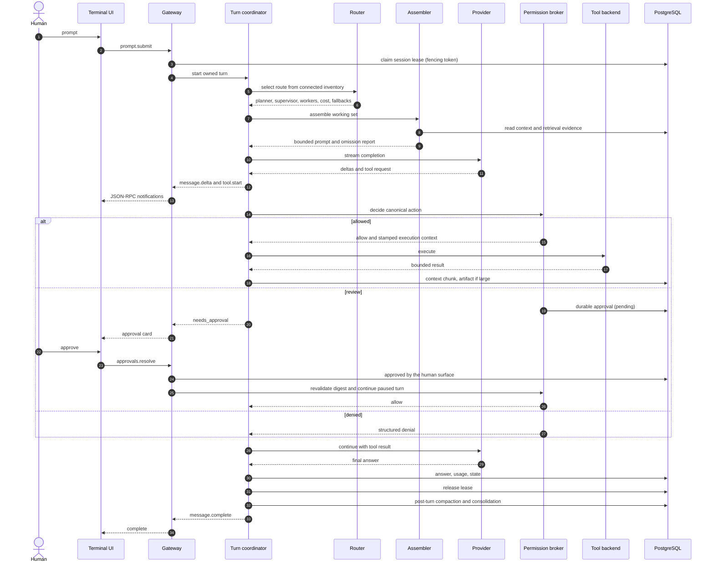
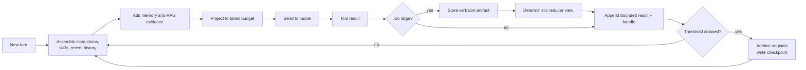
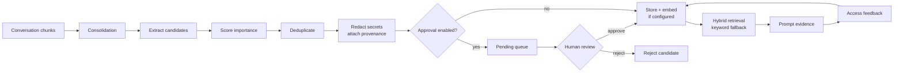
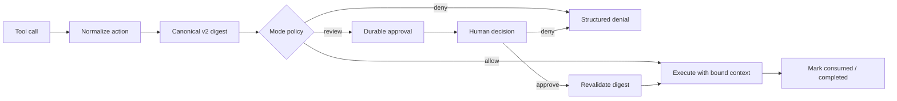
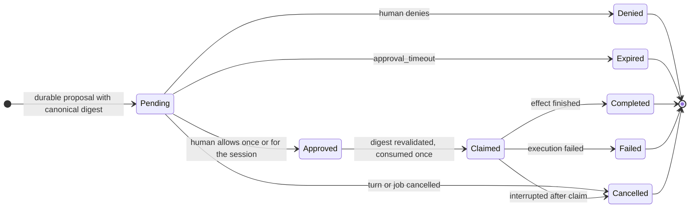
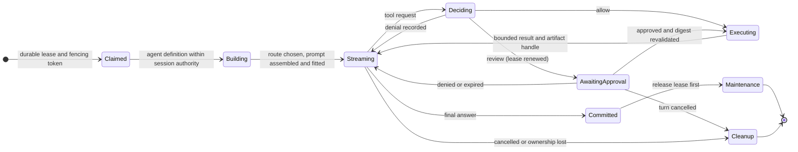
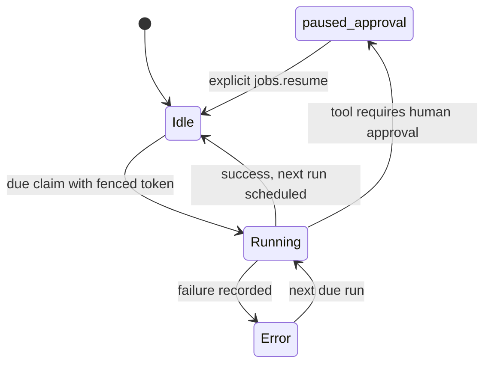
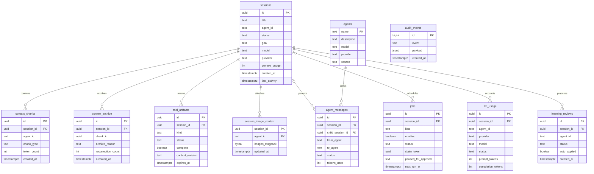

# Machina

**A self-hosted AI agent harness where context, memory, and model routing are engineered, not improvised.**

Machina is a terminal-first coding agent that runs entirely on your own machine and your own PostgreSQL database. You chat beside your code; the agent reads and writes files, runs commands, searches and verifies the web in a real browser, indexes documents, and delegates to specialist sub-agents in parallel. It drives cloud APIs, your existing subscription accounts (ChatGPT, Grok, GitHub Copilot, Kiro), or local models, and you come back to the same conversations after a restart.

### Why Machina, and not another terminal agent

Most terminal agents are a loop around a chat API. They resend the transcript until it overflows, forget everything when the session ends, run whatever model you hard-coded, and treat a tool's name as its security boundary. That is fine for a quick one-off. It falls apart on long tasks, across days, and on actions you cannot undo.

Machina is built as a **state-management system** instead. The model is the only stateless part; a PostgreSQL + pgvector database (32 tables) is the source of truth, and the harness manages a bounded, governed, auditable view of it so the agent stays coherent over hours and across sessions.

**The parts that are automatic, not your job to babysit:**

- **Context manages itself.** The transcript is a typed event log; the prompt the model sees is a *projection* of it, fitted to each model's token budget every turn. Machina compacts at safe boundaries and spills large tool results (a 1.2 MB `pytest` run) to recoverable artifacts with a paged read handle, so the window stays small and cheap instead of drowning in its own history. You never run `/compact` by hand.
- **Memory outlives the session.** Decisions, preferences, and lessons are extracted into durable claims that are scored, deduplicated, redacted, given provenance, and retrieved by relevance. Ask "which database did we choose?" a week later and it answers from memory, not by replaying the transcript.
- **Skills load on demand.** 77 bundled instruction packages are matched to the task by deterministic ranking (no extra model call) and loaded stage-aware, so a planning step gets planning guidance and the prompt never carries procedures it doesn't need.
- **Model routing is chosen, not configured.** Machina builds a live inventory from your connected credentials and picks a model per role — planner, supervisor, worker, utility — by fit and cost, deterministically. Multi Auto is the default: the selected model anchors the session while delegated and parallel work is routed automatically. No overpaying for trivial work, no underpowering the hard parts.
- **Parallel delegation is planned, not hoped for.** Say "do these in parallel" and the orchestrator builds a dependency plan, validates it for cycles and duplicate output ownership, runs bounded workers, and has a supervisor synthesize their reports — instead of hoping the model emits N delegate calls.

**The parts that make it safe and durable:**

- **A real permission kernel.** Every risky action is canonicalized and bound to a SHA-256 digest of its exact arguments; approval is revalidated at execution and consumed once. A reviewed action can't be swapped after you approve it, an agent can never approve its own request, and a tool name never stands in for a security boundary.
- **It survives interruptions like a database.** Turn leases with fencing, durable jobs, and resumable approvals mean a crash, a slow human approval, or a restarted cron job never corrupts a conversation. Scheduled jobs (interval, cron, heartbeat, operator-approved scripts) persist across restarts and park for approval instead of self-approving.

**The parts that make it reach further than one terminal:**

- **One core, four surfaces.** The same engine runs behind the terminal UI, a CLI, an HTTP API with SSE, and an MCP server, with parity tested between them. Pause the same action on two surfaces and the approval identity matches.
- **It controls other harnesses, both ways.** Register Machina's MCP server so OpenCode, Codex, or Hermes orchestrate durable Machina sub-agents; or set `worker_transport=mcp` and delegate Machina's own work out to an installed harness. Neither direction bypasses Machina's permissions or accounting.
- **Reach it from anywhere.** `machina host` keeps the terminal UI alive in a persistent tmux session behind a token-protected browser bridge on loopback, reached over an SSH forward, Tailscale, or Cloudflare Access — the gateway itself never opens a new network port. `machina serve` exposes the HTTP API with a bearer key for remote clients and dashboards.
- **It improves its own strategy, within bounds.** Agent "growth" and RSI adjust saved strategy guidance and retrieval policy from recorded outcomes, with revisions, feedback, and one-command rollback. This is bounded, auditable configuration — it does **not** retrain the model, change tool permissions, or grant an agent more authority.

**At a glance:** ~130,000 lines of Python · 670 focused local tests · latest external DevTools snapshot 6,487 · 18 provider types · 71 agent definitions · 77 skill packages · 46 built-in tools · 166 RPC methods · one-command install on Windows, macOS, and Linux.


**Benchmark status:** token-efficient on measured tasks, but there is no valid new held-out ranking. The latest accepted held-out run (2026-11-10) had Machina **5/10** versus OpenCode **9/10**. A 2026-11-20 rerun was excluded after an integrity audit found future-history and live-upstream access. The synthetic long-horizon suite passed 3/3 with a Machina token advantage. See [benchmark evidence](#benchmark-evidence-and-head-to-head-results).

## Install

**Windows (native PowerShell — no WSL):**

```powershell
irm https://raw.githubusercontent.com/kiazh/Machina-Harness/main/install.ps1 | iex
```

**macOS / Linux:**

```bash
curl -fsSL https://raw.githubusercontent.com/kiazh/Machina-Harness/main/install.sh | bash
```

The Windows installer uses winget to install missing Python/Node/Git when available, creates the `.venv`, installs the UI, configures `.env`, starts Docker Desktop when it is installed, creates or reuses the pgvector `machina-db` container, initializes the schema, and adds the `machina` command to your user PATH. If Docker Desktop is missing, the installer attempts a winget install before falling back to manual database setup.

When you launch `machina`, run `machina serve`, or run `machina init`, Machina checks the database: it starts Docker Desktop/Engine if needed, starts an existing `machina-db` container, or creates and initializes one when the loopback `DATABASE_URL` is the installer default. If a native PostgreSQL server is already reachable but the `machina` database is missing, `machina init` creates the database and enables the required extensions. If port 5432 is already occupied, the Windows installer provisions Docker on a free port and writes both `DATABASE_URL` and `MACHINA_DB_PORT` accordingly.

**Requirements:** Python 3.11+, Node.js 22.19+, and PostgreSQL with pgvector. On Windows, Docker Desktop is the simplest database option. The installer can also use an existing local PostgreSQL with pgvector.

Interactive launches check `origin/main` at most once every 15 minutes and fast-forward a clean source checkout before opening the UI; a short animated status line reports whether the checkout is current, updating, or skipped, and later launches repeat the cached result instantly. Set `MACHINA_AUTO_UPDATE=0` to opt out. The `/auth` page manages ChatGPT, Grok, GitHub Copilot, and Kiro account sign-in in one place.

See [Get started](#get-started) for manual setup, options, and Docker.

> **How to read this README.** The [technical overview](#technical-overview) explains the problems a harness has to solve and the design position Machina takes. The [architecture](#architecture-in-one-chart) is the complete system map. [One session, end to end](#one-session-end-to-end) shows the system in motion. The [deep dives](#deep-dive-1-context-management) explain the mechanisms, failure modes, and design reasoning. The [conceptual blueprint](#conceptual-blueprint) describes how to build the same system without prescribing an implementation. The [reference](#reference) covers installation, commands, and operations; the [appendices](#appendices) hold the complete RPC, tool, schema, configuration, event, route, command, failure, test, and module catalogs.

**Release status:** **1.2.14 open-source release.** `main` also carries post-release work recorded in the [changelog](CHANGELOG.md). Self-hosted, bring your own model/provider keys; integrations may still change. See [1.2.14 release notes](docs/verification/RELEASE_1.2.14.md). There is no hosted service, data-recovery guarantee, or production SLA.

## Contents

- [Install](#install) — one-command setup
- [Technical overview](#technical-overview) — the problems a harness must solve
- [Architecture in one chart](#architecture-in-one-chart) — every subsystem in one map
- [One session, end to end](#one-session-end-to-end) — the whole system in a worked example
- [Feature tour](#feature-tour) — the headline capabilities
- [Deep dive 1: Context management](#deep-dive-1-context-management) — the model's working set
- [Deep dive 2: Memory management](#deep-dive-2-memory-management) — knowledge that survives sessions
- [Deep dive 3: The permission kernel](#deep-dive-3-the-permission-kernel) — approvals that bind to an exact action
- [Deep dive 4: The agent loop](#deep-dive-4-the-agent-loop) — turns, routing, tools, delegation, and recovery
- [Deep dive 5: Providers and accounting](#deep-dive-5-providers-and-accounting) — one interface, many models
- [Deep dive 6: Surfaces and integrations](#deep-dive-6-surfaces-and-integrations) — TUI, CLI, HTTP, MCP, skills, jobs
- [Reliability and testing](#reliability-and-testing) — how the project is kept honest
- [Benchmark evidence and head-to-head results](#benchmark-evidence-and-head-to-head-results) — what the comparisons do and do not prove
- [Ecosystem integration status](#ecosystem-integration-status) — what is integrated, compatible, or intentionally not claimed
- [Conceptual blueprint](#conceptual-blueprint) — how to build a harness like this
- [Get started](#get-started) — installation, requirements, first task
- [Reference](#reference) — commands, configuration, API, deployment, source map
- [Appendices](#appendices) — complete RPC, tool, schema, configuration, event, route, command, failure, test, and module references
- [Troubleshooting](#troubleshooting) — common failures and where to look

## Technical overview

A chat API solves one problem: given a sequence of messages, return a completion. An agent harness solves the problems around it.

| Problem | Why it is hard | The design position |
|---|---|---|
| **What the model sees** | The context window is finite, priced per token, and degrades when it is filled with irrelevant or repetitive material. The naive approach resends the transcript until the provider truncates it. | Store typed events, build a budgeted projection for each request, compact at safe boundaries, and keep large results recoverable as artifacts. |
| **What the system remembers** | A transcript is episodic. Durable knowledge has to survive the session that produced it, stay correctable, and remain retrievable without drowning the current instruction. | Run a memory lifecycle: extract, score, categorize, deduplicate, redact, attach provenance, optionally approve, retrieve with relevance first, and decay reversibly. |
| **What the agent may do** | A tool call is a real action on a real machine. A tool name is not a security boundary. | Canonicalize the exact action, bind approval to a digest of every material field, revalidate at execution, and consume the approval once. |
| **Which model does which part** | One global model ranking is either overpaying for simple work or underpowered for hard work. A hard-coded model choice also ignores what the account can actually reach today. | Build a live inventory from connected credentials, score planner/supervisor/worker/utility fit per task, and choose deterministically with cost tiers, pins, and fallbacks. |
| **What happens when something interrupts** | Processes crash, users take time to approve, and scheduled jobs restart mid-flight. A held transaction does not survive any of that. | Use turn leases with fencing, durable jobs, resumable approvals, and explicit pause states. |
| **How the surfaces stay consistent** | Reimplementing the loop in each surface produces four subtly different harnesses. | Keep one core behind the terminal UI, CLI, HTTP/SSE, and MCP adapters, and test parity between them. |

The central design claim is that an agent harness is a **state-management system**, not a prompt-engineering system. The model is the only stateless component. Everything else exists to give it a coherent, bounded, auditable view of durable state.

### Architecture in one chart

This is the whole runtime on one page: surfaces, protocol edge, turn engine, context, memory, permissions, tools, connected-model routing, operations, and durable state. Follow an arrow to see which layer owns a decision; follow a dashed arrow to see events or telemetry.

```mermaid
flowchart TB
    subgraph SURF["Surfaces and entry points"]
        direction LR
        TUI["Terminal UI<br/>chat, editor, explorer<br/>approval cards"]
        CLI["CLI<br/>chat, sessions, memory<br/>jobs, routing"]
        API["HTTP API + SSE<br/>35 functional REST routes<br/>approval pause"]
        MCPS["MCP server<br/>bounded Machina tools<br/>for other agents"]
        EXT["External harnesses<br/>OpenCode, Codex<br/>Hermes"]
    end

    subgraph EDGE["Edge protocol"]
        direction LR
        GW["Gateway<br/>JSON-RPC 2.0 over stdio"]
        FEATURES["152 feature methods<br/>memory, skills, MCP<br/>auth, workspace"]
        REST["REST + event stream<br/>sessions, jobs<br/>approvals"]
    end

    subgraph TURN["Turn engine"]
        direction LR
        OWN["Turn ownership<br/>lease, fencing<br/>cancellation"]
        FACTORY["Agent factory<br/>71 definitions<br/>intersected with authority"]
        LOOP["Agent loop<br/>stream, tools<br/>recovery, budgets"]
        ORCH["Orchestrator<br/>delegation, parallel plan<br/>supervisor synthesis"]
        REPAIR["Repair controller<br/>caps, evidence<br/>verify gate"]
    end

    subgraph CTX["Context: working set"]
        direction LR
        BUDGET["Token budget + windows<br/>per-model limits"]
        ASM["Assembler<br/>system, skills, history"]
        PROJ["Projection<br/>dedupe, fit<br/>disclose omissions"]
        COMP["Compaction + continuity<br/>checkpoint, archive<br/>native tail"]
        REDUCERS["Reducers + artifacts<br/>deterministic views<br/>paged recovery"]
    end

    subgraph MEM["Memory: durable claims"]
        direction LR
        MEXTRACT["Consolidator<br/>extract, watermark"]
        MSAFE["Score, dedupe, redact<br/>provenance, quarantine"]
        MAPPROVE["Pending queue<br/>optional approval"]
        MRETRIEVE["Hybrid retrieval<br/>dense, sparse, rerank"]
        MGROWTH["Growth + persona<br/>revisions, rollback"]
    end

    subgraph PERM["Permission kernel"]
        direction LR
        POLICY["Canonical policy<br/>effects, modes<br/>SHA-256 v2 digest"]
        BROKER["Broker<br/>allow, deny, review"]
        APPROVALS["Durable approvals<br/>human principal<br/>one-time use"]
        EXECCTX["Execution context<br/>digest revalidation"]
    end

    subgraph TOOLS["Tools and integrations"]
        direction LR
        TOOLREG["Tool registry<br/>46 built-in tools"]
        WORKSPACE["Workspace + LSP<br/>files, completion<br/>diagnostics"]
        RAG["Documents + RAG<br/>ingest, embed<br/>search, rerank"]
        SKILLS["Skills<br/>77 packages<br/>catalog-first"]
        MCPCLIENT["MCP clients + browser<br/>stdio, HTTP, OAuth<br/>web verification"]
    end

    subgraph ROUTE["Routing, providers, and credentials"]
        direction LR
        INVENTORY["Model inventory<br/>credentials, role fit"]
        ROUTER["Deterministic router<br/>planner, supervisor<br/>worker, utility"]
        SECRETS["Secrets + auth<br/>.env 0600, keyring<br/>subscription OAuth"]
        PROVIDERS["18 provider adapters<br/>cloud, subscription<br/>local"]
        USAGE["Usage + pricing<br/>normalized tokens<br/>budgets"]
    end

    subgraph OPS["Operations"]
        direction LR
        SCHED["Scheduler + jobs<br/>interval, cron<br/>heartbeat, scripts"]
        OBS["Observability<br/>audit, traces<br/>metrics, diagnostics"]
    end

    PG[("PostgreSQL 16 + pgvector<br/>32 tables + migrations")]
    EXTERNAL["Cloud APIs, subscription accounts<br/>local models, remote MCP servers"]

    TUI --> GW
    CLI --> LOOP
    API --> REST
    MCPS --> LOOP
    EXT <--> MCPS
    GW --> FEATURES
    GW --> LOOP
    REST --> LOOP
    GW -. events .-> TUI

    LOOP --> OWN
    OWN --> FACTORY
    FACTORY --> LOOP
    LOOP --> ORCH
    ORCH --> LOOP
    REPAIR --> LOOP

    LOOP --> BUDGET
    BUDGET --> ASM
    ASM --> PROJ
    PROJ --> LOOP
    ASM --> COMP
    COMP --> ASM
    LOOP --> REDUCERS
    ASM --> MRETRIEVE
    ASM --> RAG
    ASM --> SKILLS

    MEXTRACT --> MSAFE
    MSAFE --> MAPPROVE
    MAPPROVE --> MRETRIEVE
    MSAFE --> MRETRIEVE
    MGROWTH -. policy .-> MRETRIEVE
    MRETRIEVE --> ASM

    LOOP --> POLICY
    ORCH --> POLICY
    POLICY --> BROKER
    BROKER -- allow --> EXECCTX
    BROKER -- review --> APPROVALS
    APPROVALS --> EXECCTX
    EXECCTX --> TOOLREG

    TOOLREG --> WORKSPACE
    TOOLREG --> RAG
    TOOLREG --> SKILLS
    TOOLREG --> MCPCLIENT

    LOOP --> ROUTER
    ORCH --> ROUTER
    INVENTORY --> ROUTER
    ROUTER --> PROVIDERS
    PROVIDERS --> USAGE
    SECRETS --> PROVIDERS
    PROVIDERS --> EXTERNAL
    MCPCLIENT --> EXTERNAL

    SCHED --> LOOP
    LOOP -. outcomes .-> MGROWTH
    LOOP -. stages .-> OBS
    BROKER -. decisions .-> OBS
    PROVIDERS -. latency .-> OBS

    CTX --> PG
    MEM --> PG
    PERM --> PG
    TOOLS --> PG
    ROUTE --> PG
    OPS --> PG
```



### How a turn moves through the system

The chart above is the static structure. This is the dynamic path for one turn, including the approval branch. The numbers are message order, not model iterations.



The turn coordinator holds the lease for the sequence. A denial is recorded as a structured tool result. A review decision pauses the turn while logical ownership is renewed; execution revalidates the digest and consumes the capability once before the effect runs. On HTTP, recording the verdict does not execute anything: the client must post the reviewed arguments to `/resume`, which revalidates the proposal first.

| Layer | What it owns | Where it lives |
|---|---|---|
| **Surfaces** | Transport, interaction, and approval presentation | [`ui/src`](ui/src), [`cli`](machina/cli), [`api`](machina/api), [`mcp_server`](machina/mcp_server), [`interop.py`](machina/interop.py) |
| **Edge** | JSON-RPC methods, events, REST routes, and the protocol contract | [`gateway`](machina/gateway), [`protocol/events.json`](machina/protocol/events.json), [`api/routes`](machina/api/routes) |
| **Turn engine** | Ownership, agent construction, the model loop, delegation, and repair | [`core/turns.py`](machina/core/turns.py), [`core/agent_factory.py`](machina/core/agent_factory.py), [`core/turn_engine.py`](machina/core/turn_engine.py), [`core/orchestrator.py`](machina/core/orchestrator.py), [`core/orchestration`](machina/core/orchestration), [`core/task_run.py`](machina/core/task_run.py) |
| **Context** | Token budget, assembly, projection, compaction, continuity, artifacts, reducers | [`core/assembler.py`](machina/core/assembler.py), [`core/context.py`](machina/core/context.py), [`core/compression.py`](machina/core/compression.py), [`core/continuity.py`](machina/core/continuity.py), [`core/projection.py`](machina/core/projection.py), [`core/reducers.py`](machina/core/reducers.py), [`core/artifacts.py`](machina/core/artifacts.py) |
| **Memory** | Extraction, safety, approval, retrieval, digest, growth | [`memory/`](machina/memory) |
| **Permission kernel** | Canonicalization, policy, approvals, execution revalidation | [`permissions/`](machina/permissions), [`core/approval_resume.py`](machina/core/approval_resume.py) |
| **Tools** | Built-in tools, workspace/LSP, RAG, skills, MCP, browser verification | [`tools/`](machina/tools), [`workspace/`](machina/workspace), [`rag/`](machina/rag), [`skills/`](machina/skills), [`connectors/`](machina/connectors) |
| **Routing** | Connected-model inventory, role selection, provider adapters, usage | [`core/routing`](machina/core/routing), [`core/provider`](machina/core/provider), [`core/usage.py`](machina/core/usage.py), [`core/pricing.py`](machina/core/pricing.py) |
| **Operations** | Scheduling, audit, traces, metrics, secrets, subscription auth | [`core/scheduler.py`](machina/core/scheduler.py), [`observability/`](machina/observability), [`security/`](machina/security) |
| **Durable state** | PostgreSQL schema, pgvector indexes, and additive migrations | [`db/`](machina/db) |

**What persists.** The database is not a cache. It is the source of truth for the graph of evidence:

| Group | Tables |
|---|---|
| **Session and context** | `sessions`, `context_chunks`, `context_archive`, `tool_artifacts`, `session_image_context` |
| **Memory and identity** | `memories`, `memory_entities`, `memory_entity_mentions`, `memory_edges`, `pending_memories`, `memory_provenance`, `shared_memory_deliveries`, `persona_memories`, `user_profiles`, `agent_beliefs`, `agent_belief_history` |
| **Agents and learning** | `agents`, `agent_messages`, `learning_reviews`, `agent_growth`, `growth_episodes`, `rsi_profiles`, `rsi_revisions`, `rsi_episodes` |
| **Authority and audit** | `permission_grants`, `permission_approvals`, `audit_events` |
| **Work and accounting** | `jobs`, `llm_usage`, `semantic_cache_entries`, `optimization_shadow_events` |

### The two core systems

**Context: storage versus working set.** The durable transcript is an event log. The prompt is a projection of that log, assembled for one request. The two have different requirements. The log must be complete, ordered, and recoverable. The working set must be small, relevant, and cheap. Compaction is the bridge: it replaces old events with a checkpoint and archives the originals. Artifacts handle the case where one event is too large to send but too important to lose. Projection decides which evidence fits and discloses what was omitted. The result is a cache hierarchy for attention: durable storage, a bounded working set, and an explicit recovery path.

**Memory: claims versus facts.** A memory is not a transcript line and not a document. It is a durable claim extracted from experience, with a category, an importance, a source, and a history of use. The lifecycle is extraction, scoring, deduplication, redaction, provenance, optional approval, hybrid retrieval, reinforcement, and decay. The design assumes memories can be wrong. That is why inspection, correction, forgetting, and approval exist. The goal is not to remember everything; it is to keep the useful subset trustworthy and retrievable.

Both systems share the same discipline: **store the original, project a bounded view, and be explicit about what was lost.** Context applies that discipline to the conversation; memory applies it to knowledge. Routing applies the same honesty to model choice: show the inventory, the role fit, the cost estimate, and the reason.

### Engineering map

| Area | Where to start | Why it is hard |
|---|---|---|
| **Distributed systems** | [Turn ownership](#turn-ownership-and-cancellation), [jobs](machina/core/scheduler.py), [approval resume](machina/core/approval_resume.py) | Exactly-once effects across crashes, restarts, and human waits; leases, fencing, and cancellation-safe cleanup |
| **ML / inference infrastructure** | [Context](#deep-dive-1-context-management), [memory](#deep-dive-2-memory-management), [routing](#connected-model-routing), [usage ledger](docs/TOKEN_EFFICIENCY.md) | Bounded prompts with honest recovery, hybrid retrieval, role-aware model selection, token accounting that distinguishes missing data from zero |
| **Security / systems** | [Permission kernel](#deep-dive-3-the-permission-kernel), [SECURITY.md](SECURITY.md) | TOCTOU-resistant approvals, canonical digests, confused-deputy resistance, redaction boundaries |
| **Product / UX** | [Surfaces](#surfaces), [workspace](docs/design/WORKSPACE.md) | The same semantics across a terminal UI, a CLI, HTTP/SSE, and an MCP server |
| **Testing / rigor** | [Reliability](#reliability-and-testing) | 6,400+ backend tests, real-PostgreSQL suites, architecture ratchets, and performance gates |

### At a glance

| Metric | This checkout |
|---|---|
| Python backend | ~130,239 lines across 363 files |
| Backend tests | 670 passed, 9 skipped in this checkout; 1,264 UI tests (1,254 passed, 10 skipped); latest recorded DevTools snapshot 6,487 passed / 27 skipped / 8 deselected (2026-10-26, real PostgreSQL) |
| Providers | 18 built-in connection types, plus user-added OpenAI-compatible providers |
| Agents and skills | 71 built-in agent definitions; 77 bundled `SKILL.md` packages |
| Tools and commands | 46 built-in tools; 47 top-level CLI commands (39 one-shot + 8 groups); 52 slash commands |
| Protocol and API | 166 RPC methods (14 core + 152 feature); 35 functional REST routes (38 with docs); 25 protocol events |
| Configuration | 134 keys with defaults (Appendix D) |
| Storage | PostgreSQL 16 + pgvector, 32 tables |
| Surfaces | Terminal UI, CLI, HTTP API + SSE, MCP server/client, external harness interop |
| CLI cold start | `machina --version` measured at ~0.12 s; `machina --help` at ~0.24 s on this checkout with a warm filesystem cache; first run after install is slower |

Counts are snapshots, not promises. Current release status is in [CHANGELOG.md](CHANGELOG.md); historical release-gate evidence is in [RELEASE_READINESS.md](docs/verification/RELEASE_READINESS.md).

## One session, end to end

Here is what the machinery feels like in practice. Suppose you ask Machina to fix a failing test suite.

1. **The turn starts with ownership.** Machina claims the session with a lease so two surfaces cannot write the same conversation at once. It builds an agent from its definition (role, tools, model) intersected with the session's authority.
2. **The route is chosen from what you actually have.** In the default Multi Auto mode, the connected-model inventory supplies a planner, a supervisor, and a bounded pool of workers. The currently selected model remains the session anchor. No model call is made to choose a model; the router explains its choice, estimated cost, fallbacks, and warnings.
3. **The prompt is assembled, not dumped.** The model receives the system instructions, two relevant skills, the recent conversation, a few high-relevance memories, and selected document excerpts. Everything is fitted to the model's input budget before the request is sent.
4. **A big tool result does not flood the window.** `pytest` produces 1.2 MB of output. Machina stores the verbatim result as an artifact first, then publishes a deterministic reducer view: the pass/fail counts, the failing test names, and the decisive stack-trace lines, plus an `artifact_read` handle. The model can page or search the original later instead of re-running the tests.
5. **The context crosses its threshold.** At a safe turn boundary, automatic compaction archives the replaced chunks and writes a checkpoint: objective, expected artifact, constraints, findings, open questions, and next action. Recent chunks stay native; the summary anchors the older work. The next request targets a much smaller working set.
6. **A risky action pauses.** The agent asks to edit a file outside the workspace. The permission broker canonicalizes the action, hashes every material field, and creates a durable approval. The terminal UI shows the exact arguments, working directory, backend, timeout, and a redacted content preview. You approve it once. Execution revalidates the digest and consumes the approval.
7. **Independent work fans out.** If the request names parallel tracks, the orchestrator plans them once, validates the dependency graph, runs bounded worker sessions, and has the supervisor synthesize their reports. A repair task gets the narrow controller: phase tracking, evidence checks, turn and token caps, repeated-loop stops, and a final verification gate. Web artifacts can be checked in a real headless browser rather than by reading the HTML.
8. **The turn ends with accounting.** Usage is recorded by provider, model, purpose, session, and agent. Input, cached input, cache writes, and output are normalized. Unknown prices stay unknown rather than becoming zero.
9. **Memory is consolidated.** In the background, an extractor reads the new conversation chunks and proposes durable memories: a decision ("the project uses PostgreSQL because of pgvector"), a preference, a fact. Candidates are scored, deduplicated, redacted, given provenance, and stored.
10. **A week later, a new session asks "which database did we choose?"** The transcript is not replayed. Hybrid retrieval finds the decision memory, relevance-first, and adds it to the prompt with its provenance. The answer survives the session that produced it.

That is the whole thesis: **the transcript is an event log, the prompt is a projection, memory is a separate governed lifecycle, and model choice is an explicit routing decision.**

## Feature tour

| Capability | What it gives you | Deep dive |
|---|---|---|
| **Context management** | Long tasks stay coherent inside a finite window; large outputs remain recoverable | [Context](#deep-dive-1-context-management) |
| **Long-term memory** | Preferences, decisions, and lessons carry across sessions without replaying history; multi-fact queries use a bounded query-conditioned digest | [Memory](#deep-dive-2-memory-management), [digest](docs/MEMORY_DIGEST.md) |
| **Permission kernel** | Sensitive actions are approved once, for an exact canonical action, and revalidated | [Permissions](#deep-dive-3-the-permission-kernel) |
| **Connected-model routing** | A live inventory of credentialed models, role-specific fit, deterministic selection, cost tiers, pins, and fallbacks | [Routing](#connected-model-routing) |
| **Parallel delegation** | Explicit parallel requests become a validated dependency plan with bounded workers and a supervisor synthesis | [Agent loop](#routing-and-parallel-delegation) |
| **Repair controller** | Narrow tool catalog, phase/evidence tracking, turn and token caps, repeated-loop stops, and a final verification gate | [Controller](docs/TASK_RUN_CONTROLLER.md) |
| **Snapshots and undo** | Per-turn file snapshots, conflict-aware restore, unified diff, and a CLI undo path | [Snapshots](docs/OPENCODE_PARITY.md#workspace-snapshots) |
| **Post-write formatters** | Optional `formatter: auto` runs the repository's detected formatter after file-tool writes | [Parity](docs/OPENCODE_PARITY.md#formatters) |
| **Project defaults** | Nearest `machina.json`/`.machina.json` chooses model, provider, formatter, snapshots, compaction, and retrieval without granting authority or storing secrets | [Parity](docs/OPENCODE_PARITY.md#project-config) |
| **Opt-in plugins** | Package entry points load only when named in `MACHINA_PLUGINS`; CLI/headless turns now use the same hooks as the gateway | [Parity](docs/OPENCODE_PARITY.md#plugins) |
| **ACP editor bridge** | `machina acp` exposes sessions, streaming updates, modes, and approval cards to ACP clients such as Zed | [Parity](docs/OPENCODE_PARITY.md#acp-editor-bridge) |
| **Background service** | `machina service start/status/stop/restart` runs the HTTP API detached with lease-backed status and health checks | [Parity](docs/OPENCODE_PARITY.md#background-service) |
| **Shell completions** | `machina completions bash|zsh|fish` prints a script generated from the installed lazy command table | [Parity](docs/OPENCODE_PARITY.md#shell-completions) |
| **Provider layer** | One runtime across cloud APIs, subscription accounts, and local models | [Providers](#deep-dive-5-providers-and-accounting) |
| **Skills** | Instruction packages loaded by task stage instead of stuffing every procedure into every prompt | [Surfaces](#skills-catalog-first-bodies-on-demand) |
| **MCP, both directions** | Bring external tools in, or expose Machina to another assistant as a bounded tool server | [Surfaces](#mcp-catalog-first-tool-use) |
| **Harness interop** | Let OpenCode, Codex, or Hermes use Machina as an MCP server, or delegate Machina work to an installed external harness | [Surfaces](#harness-interop) |
| **Durable automation** | Interval, cron, heartbeat, and operator-approved script jobs that survive restarts | [Surfaces](#jobs-that-survive-restarts) |
| **Workspace and LSP** | Editor, tabs, explorer, Quick Open, diagnostics, and optional language servers | [Surfaces](#workspace-and-language-intelligence) |
| **Capability awareness** | A compact generated orientation each turn; `tool_load` and `harness_catalog` expose full tool and provider details on demand | [Self-knowledge](#self-knowledge-the-capability-catalog) |
| **Dynamic tool loading** | Eight core schemas plus on-demand schemas; the full 46-tool surface stays out of the ordinary prompt | [Token efficiency](docs/TOKEN_EFFICIENCY.md) |
| **A2A and OIDC** | A2A 1.0 agent card and task bridge, CloudEvents envelopes, optional OIDC/JWT verification, and the protected OpenAPI 3.2.1 document | [HTTP API](#http-api) |
| **Isolation and evidence** | Docker, gVisor, Kata, Kata-Firecracker, and WASI backends; audit/usage ledger, OTLP export, CycloneDX SBOM, and release-workflow Sigstore/SLSA provenance | [Docker](#docker-compose) |
| **Observability** | Audit events, traces, metrics, usage accounting, and redaction at the boundary | [Reliability](#reliability-and-testing) |

Built-in tools cover file reads and writes, terminal commands, repository and code intelligence, document indexing and search, web search/extraction/crawls, browser verification, artifacts, memory, skills, delegation, routing explanation, MCP, and the capability catalog itself. Remote MCP tool schemas are browsed catalog-first rather than injected wholesale into every request.

## Deep dive 1: Context management

### The problem in plain language

The model has a **desk**. It can only read what is on the desk. The desk is small, it is expensive to rent, and the model pays less attention when it is covered in papers.

A naive agent keeps every sheet forever. Eventually the desk overflows: the provider rejects the request, silently truncates it, or the model loses the thread. The usual fixes are equally bad: delete old work, summarize everything into mush, or resend the same huge tool output on every turn.

Machina is the librarian. It keeps the archive in the basement (PostgreSQL and the artifact store), puts a curated folder on the desk, summarizes old folders, and labels anything it removed so the model can ask for it back.

### The vocabulary

| Term | Meaning here |
|---|---|
| **Token** | The unit models read and bill. Roughly four English characters, but very different for code, CJK text, and emoji. |
| **Context window** | The maximum tokens a model can read and write in one request. |
| **Chunk** | The storage unit: a message, tool call, tool result, document, or summary, with a type, payload, token count, and timestamp. |
| **Working set** | The subset of chunks actually sent to the model this turn. |
| **Projection** | The deterministic process that builds the working set: dedupe, budget, preserve required groups, disclose omissions. |
| **Compaction** | Replacing older chunks with a summary checkpoint while keeping originals in the archive. |
| **Artifact** | A verbatim, durable copy of a large tool result with paged, authorized recovery. |
| **Reducer** | A deterministic, format-aware smaller view of a large output. No model call. |

### The pipeline



### The mental model

Think of the system as three layers with different jobs:

1. **Durable storage** holds everything that happened. It must be complete, ordered, and recoverable. It is allowed to be large.
2. **The working set** is what the model sees this turn. It must be small, relevant, and within budget. It is allowed to be lossy, but only if the loss is disclosed and the original is recoverable.
3. **Attention** is the model's actual capacity to use the working set. It is not a database field; it is the reason padding a prompt with irrelevant text is counterproductive even when the tokens fit.

Most context bugs come from collapsing these layers. Sending the transcript confuses storage with the working set. Summarizing without archiving confuses the working set with storage. Truncating without a handle makes the loss invisible. The pipeline above keeps the layers separate.

The budget is also not one number. It is a set of reserved envelopes: system instructions and tool schemas, recent native turns, skills, memory, documents, and artifacts. The sum must leave room for the model's output. A section that overflows is trimmed by policy, not by whichever string happens to be last.

Each stage exists because the one before it is not enough on its own.

### 1. Storage: typed chunks, not a blob

Conversation state lives in PostgreSQL. Each row is a typed chunk with a token count and ordering metadata. The main tables are:

- `context_chunks` — live conversation, tool activity, documents, and summaries.
- `context_archive` — originals displaced by compaction or eviction.
- `tool_artifacts` — verbatim oversized tool results.
- `sessions` — session metadata, pins, and atomically updated state fields.

Typed storage is what makes the rest possible. You cannot budget, deduplicate, summarize, or recover what you cannot identify.

### 2. Measurement: tokens are not characters

Token counts drive every decision, so Machina counts with `tiktoken` (a tokenizer library) when available and falls back to a deterministic multilingual heuristic when it is not. The fallback is documented and bounded: CJK, kana, hangul, and emoji get realistic weights instead of the old "four characters per token" assumption, and non-empty text can never count as zero. It is a degraded mode, not a precision claim, and the code says so.

### 3. Compaction: summarize, preserve, archive

Automatic compaction runs at a **safe turn boundary**, never in the middle of a tool call. It takes a durable mutation claim so two workers cannot compact the same session at once. If the session is busy, compaction defers to a later boundary instead of queueing behind live work.

The defaults are deliberately conservative:

| Setting | Default | Meaning |
|---|---|---|
| `compression_enabled` | `true` | Allow older context to be compressed |
| `compression_threshold` | `0.8` | Trigger when the estimated request reaches 80% of the budget |
| `compression_target_ratio` | `0.5` | Aim to leave roughly half the window free |
| `compression_preserve_recent` | `3` | Keep the newest chunks native |
| `auto_compaction_enabled` | `true` | Check after turns |

The output is a **checkpoint**, not free-form prose. It records the objective, expected artifact, constraints, read-only scope, findings (with counts), unresolved questions, and next action. The prompt also states that the latest explicit user instruction overrides the checkpoint. That sentence matters: a summary is a fallback, not a higher authority than the human.

The replacement is transactional and exact:

1. Snapshot the exact chunk IDs being replaced.
2. Archive the originals.
3. Write the summary chunk.
4. Replace only those IDs in one transaction.

Concurrent inserts survive. A stale snapshot aborts instead of deleting someone else's work. A no-progress guard stops the system from compacting forever without shrinking the prompt.

### 4. Continuity: the conversation must not "reset"

Compaction is not the same as continuity. If every request only sees "summary + last three chunks", the model loses the natural shape of the recent dialogue and providers lose a stable prefix for prompt caching.

Machina keeps a separate **native continuity window**:

- The window starts at a persisted compaction boundary, so the prefix stays append-only between compactions.
- It triggers at a high watermark: `min(8,000 tokens, context_budget / 3)` or more than 50 messages.
- It retains the newest clean, user-aligned tail at a low watermark: `min(4,000 tokens, context_budget / 6)` or 25 messages.
- Evicted turns fold into a bounded deterministic summary (4,000 characters max), stored atomically in session state with the boundary ID.
- Older cold tool output in the dynamic tail becomes one-line tombstones so it is not paid for repeatedly.

This is the "sawtooth": a stable prefix, a periodic fold, and a recent tail that always starts on a user turn. It is boring by design. Boring is what you want in continuity code.

### 5. Artifacts: store before you lose anything

A tool result can be larger than the entire context window. Blind truncation is destructive: the model may need the one stack trace that was cut off.

Machina's rule is **store before publish**:

1. Persist the original verbatim as an artifact.
2. Only then publish a smaller view.
3. Include a handle in the model-visible text.
4. Reauthorize every read against the session ancestry.

Artifacts support character paging, literal search, and metadata inspection through `artifact_read`, `artifact_search`, and `artifact_describe`. Handles are opaque UUIDs, not bearer tokens. Reads are checked again on every call. A session can read artifacts in its delegation tree, never unrelated sessions. Cursors bind the artifact revision, scope, filters, order, and retention observed when the cursor was issued; a stale cursor is rejected explicitly instead of silently paging a different evidence basis.

The defaults are 30 days of retention, 500 artifacts per session, and 2,000,000 characters per artifact. Quotas **refuse new stores** rather than evicting live evidence. If storage fails, is disabled, or the result exceeds the limit, the caller keeps its ordinary bounded output and no recovery claim is made. A producer that had already truncated its own output is recorded as `upstream_truncated=true`; completeness is never invented.

### 6. Reducers: smaller views without a model call

A reducer turns a large, structured result into a bounded view that preserves the decision-relevant parts:

| Format | What the view keeps |
|---|---|
| Test output | Pass/fail counts, failing test names, decisive failure blocks, zero-collected flags |
| Logs | Repetition groups, `ERROR`/`WARN` lines verbatim, counts |
| JSON | Outline, types, counts, a verbatim head that preserves lexical forms such as large integers |
| CSV | Row count, numeric min/max, missingness, samples |
| Diff | File and hunk counts, representative changes |
| Code | Structural outline rather than the whole file |
| Anything else | Head + tail with an explicit omission seam |

Reducers are deterministic, never call a model, and fail open: if parsing fails or the view is not smaller, the original behavior is kept. A reduced view is published only when the exact original was durably retained first. The head-and-tail fallback always keeps the verdict tail, because the last line of a test run is often the most important one.

### 7. Projection: fit the evidence, disclose the omissions

The final working set is a projection, not a concatenation. Two deterministic passes run over memory facts, RAG excerpts, and archived-context hits:

1. **Exact deduplication.** Entries whose text is byte-identical after whitespace folding are the same evidence; the first occurrence wins. Conflicting statements and different versions are preserved. Only literal repetition is removed.
2. **Token-budgeted coverage.** Entries stay in priority order (memory, then RAG, then archive) until the budget is spent. Compaction and checkpoint summaries are protected and always survive. Omitted entries are counted and disclosed to the model, so a trimmed view is never mistaken for the full evidence set.

RAG has its own reading budget (`retrieval_token_budget`, default 6,000 tokens). Lower-ranked excerpts that do not fit are omitted and reported, not silently dropped.

### 8. Failure semantics you can reason about

| Failure | Behavior |
|---|---|
| Artifact store unavailable or quota full | Keep the ordinary bounded output; do not claim recoverability |
| Result already truncated upstream | Mark it as such; never call it the exact original |
| Compaction cannot acquire the claim | Defer to a later boundary; never block the live turn |
| Continuity history read fails | Fall back to the recent window; the turn continues |
| Summary missing or degenerate | Scan a bounded number of recent summary rows for a usable one; never fabricate |
| Projection produces an empty fit | Keep the first entry even at zero budget, so protected evidence is not silently erased |
| Provider context limit differs from estimate | Use the session's effective window and the provider's configured limit, not a global guess |

### What breaks if a stage is missing

| Missing stage | What eventually happens |
|---|---|
| Typed events | You cannot budget, deduplicate, or recover; every optimization becomes a string heuristic |
| Token measurement | The request silently exceeds the window, and the provider truncates the part that mattered |
| Compaction | The session becomes unusable, or you delete history and lose the task |
| Continuity | The recent dialogue loses its shape, prompt caches break, and answers become disjointed |
| Artifacts | Large results are lost or re-fetched; the model cannot recover the one detail it needs |
| Reducers | The window fills with repetitive output and the decisive line is buried |
| Projection | Duplicate evidence crowds out the instruction, and the model cannot tell what was omitted |

### Design principles for a context manager

The implementation follows from six decisions, listed in dependency order: each one makes the next possible.

1. **Store events, not prompts.** Every message, tool call, result, and document becomes a typed row with a token count and stable ordering.
2. **Always build a projection.** Never send the table. Budget in priority order and disclose what did not fit.
3. **Measure before cutting.** Use a real tokenizer when possible; make the fallback deterministic and documented.
4. **Preserve before lossy publication.** Store the original artifact first. If that fails, keep the old behavior and say nothing about recovery.
5. **Compact with a checkpoint.** Summarize objective, constraints, findings, and next action; archive originals; replace exact IDs transactionally; keep a recent native tail.
6. **Make continuity explicit.** Persist the boundary and summary; keep the prefix append-only between compactions; start the retained tail on a user turn.

The order matters. Without typed events you cannot measure tokens; without measurement you cannot budget; without budgeting, compaction and projection are guesswork. The invariant that ties the stages together is **store the original before publishing a lossy view**.

Read the implementation in [`core/context.py`](machina/core/context.py), [`core/compression.py`](machina/core/compression.py), [`core/continuity.py`](machina/core/continuity.py), [`core/artifacts.py`](machina/core/artifacts.py), [`core/reducers.py`](machina/core/reducers.py), and [`core/projection.py`](machina/core/projection.py). The contract-level map is [docs/TOKEN_EFFICIENCY.md](docs/TOKEN_EFFICIENCY.md).

## Deep dive 2: Memory management

### The problem in plain language

Context is what the model is thinking about. **Memory is what the system knows.**

Mixing them is the most common design mistake in agent systems. If you call the transcript "memory", you get an agent that can quote last Tuesday's conversation but cannot answer "what did we decide about the database?" without replaying everything. If you call a vector table "memory", you get an agent that retrieves plausible text with no notion of whether it is a preference, a decision, a fact, an event, or something the user explicitly retracted.

Machina treats memory as a lifecycle with its own data model, safety rules, and retrieval policy.

### Three different things

| Store | Answers | Lifetime | Example |
|---|---|---|---|
| **Context** | What just happened in this session? | Current turn / compacted window | The failing test output from ten minutes ago |
| **Memory** | What should still be true next week? | Durable, with decay and review | "This project uses PostgreSQL because of pgvector" |
| **Documents (RAG)** | What do the indexed sources say? | Until the document is removed | The architecture section of a PDF you indexed |

RAG stands for retrieval-augmented generation: selected source passages are added to the prompt instead of expecting the model to know your documents already.

They share retrieval machinery where useful, but they are not the same table, the same lifecycle, or the same authority.

### The mental model

Memory is not a second transcript and it is not an unbounded knowledge graph. It is a **small set of durable claims** that the system believes are worth carrying forward, plus a bounded entity/time index (`memory_entities`, `memory_entity_mentions`, `memory_edges`) used only to expand retrieval through explicit names, relations, and temporal proximity. Each claim has four properties that matter as much as its text:

- **Category** — is this a preference, a decision, a fact, an event, or something transient?
- **Provenance** — where did it come from, and who or what asserted it?
- **Confidence and importance** — how strongly should it compete for attention?
- **History** — when was it last used, and has it been reinforced or contradicted?

Retrieval is then a ranking problem: given the current task, which few claims are relevant enough to justify their tokens? Relevance comes first. Importance, recency, and strength are tie-breakers. A memory that is important but irrelevant is still noise.

Forgetting is a feature, not a failure. A system that can only add memories eventually becomes a hoarder: retrieval quality falls, contradictions accumulate, and users lose trust. Decay keeps the store useful without destroying the audit trail.

### The memory lifecycle



### 1. Extraction: durable, not chatty

After a turn, consolidation reads conversation chunks that have not been processed yet. A watermark (`mem_consolidated_up_to`) makes repeated runs idempotent. The extractor is instructed to propose durable material:

- **Preferences** — "the user prefers concise explanations."
- **Decisions** — "PostgreSQL was chosen over MongoDB for vector search."
- **Facts** — "the service listens on port 8000."
- **Events / outcomes** — "the migration was completed on Friday."

The schema also supports a `transient` category, but the extractor is explicitly told to skip small talk and ephemeral state.

Each candidate gets an importance score, a category, and a source. The watermark only advances on a fully processed contiguous range. A partial extraction leaves the range retryable; it never claims success it did not achieve.

### 2. Safety before storage

Memory is a durable write, so it gets the same suspicion as any other write:

- **Secret redaction** runs before storage and before embedding. If redaction cannot be completed, a marker replaces the content. This is a safeguard, not permission to put credentials in prompts.
- **Provenance** records where the memory came from (session, agent, source), so a retrieved fact can be audited rather than treated as gospel.
- **Identity gates and quarantine** can hold suspicious or low-trust entries out of normal retrieval.
- **Approval is optional** (`memory_approval_enabled`, default `false`). When enabled, writes go to a pending queue and a human approves or rejects them. CLI controls include `memory-pending`, `memory-approve`, `memory-reject`, and bulk variants.

### 3. Deduplication: the same fact should not accumulate

Candidates are normalized (lowercased, whitespace-collapsed, punctuation-trimmed) and compared. A cosine similarity at or above `0.85` is treated as a duplicate. The goal is not aggressive merging; it is preventing a long-running installation from storing the same preference twenty times with slightly different wording.

### 4. Retrieval: relevance first, everything else as a tie-breaker

Memory retrieval is hybrid:

1. Dense vector search over embeddings, when an embedder is configured.
2. Sparse keyword search over the memory text.
3. Merge the candidate sets.
4. Re-rank with the configured reranker, if any.
5. Return the top K (default 5), scoped to the agent and filtered by persona/authority.

The ranking contract is explicit: **relevance is primary**. Keyword matches are scored as a fraction of the query terms. Catalog or echo content (a memory that merely repeats a tool description, for example) is demoted, never silently dropped. Recency, importance, and a forgetting-curve strength only break ties. This stops a highly "important" but irrelevant memory from crowding out the instruction the user just gave.

For multi-fact questions, a bounded **query-conditioned digest** can select up to six relevant facts and render a hard-limited text block (`memory_digest_max_chars`, default 1,200) instead of dumping every candidate. It is a reading aid, not a second memory store; the provenance remains on the underlying rows.

If no embedder is configured, retrieval degrades honestly to keyword-only and reports that mode. An empty result and a total retrieval outage are different states; the latter raises a typed error instead of claiming "no relevant memory exists."

### 5. Reinforcement and forgetting

Each memory tracks `importance`, `base_strength`, `last_accessed`, and `access_count`. Access updates the reinforcement signal. Forgetting is implemented as a **retrieval weight**, not a scheduled deletion: a faded memory becomes less likely to surface, but it remains inspectable, correctable, and restorable. That is a deliberate tradeoff. Silent deletion is cheap and impossible to audit; decay is slightly more complex and much easier to trust.

### 6. Growth and personality are bounded

Machina also stores agent-owned preferences and lessons ("growth"). These are not model weights and they do not grant authority. They are bounded notes with revisions, feedback, and rollback. The related RSI feature adjusts saved strategy guidance and retrieval policy from recorded outcomes; it does not retrain the model, change tool permissions, or make an agent more powerful. `/growth` exposes the state; `rollback` restores an earlier revision. SoulSpec identities are stored as reviewed configuration, not as hidden prompt mutations.

### 7. What memory is not

- It is **not** a transcript archive. Use sessions and documents for that.
- It is **not** a fine-tune. Nothing here changes model weights.
- It is **not** infallible. Memories can be incomplete or wrong; the inspection, correction, and forgetting controls exist for that reason.
- It is **not** shared across installations. Persistence is local to the configured database; the HTTP surface uses a shared API key by default, with optional OIDC verification for external principals.

### What breaks if a stage is missing

| Missing stage | What eventually happens |
|---|---|
| Categorization | Preferences, facts, and transient chatter compete in one ranking |
| Scoring | Every sentence is equally memorable, so the store fills with noise |
| Deduplication | The same claim accumulates in slightly different forms and dominates retrieval |
| Redaction | Secrets become durable and retrievable |
| Provenance | A wrong memory cannot be traced or corrected |
| Approval (when enabled) | The store becomes an unreviewed write path |
| Relevance-first ranking | High-importance but irrelevant memories crowd out the current instruction |
| Reversible decay | The only way to remove a memory is deletion, which destroys the audit trail |

### Design principles for a memory system

The lifecycle is a sequence of filters. Each one removes a different kind of error before it becomes durable.

1. **Separate the tables.** Context chunks, memories, and documents have different lifecycles. Do not overload one table.
2. **Extract after the turn.** Read only new chunks, advance a watermark only on complete processing, and make retries idempotent.
3. **Score and categorize.** Not every sentence deserves to be remembered; importance and category drive later ranking.
4. **Redact and attach provenance before the write.** A memory without a source is a rumor.
5. **Retrieve with a relevance-first policy.** Use recency and importance as tie-breakers, never as a substitute for relevance.
6. **Make forgetting reversible.** Decay the retrieval weight; keep the row; provide inspect, forget, and restore paths.

The result is not a database of everything the user ever said. It is a small, reviewable set of claims that can be retrieved when relevant and corrected when wrong.

Read the implementation in [`memory/consolidator.py`](machina/memory/consolidator.py), [`memory/store.py`](machina/memory/store.py), [`memory/retriever.py`](machina/memory/retriever.py), [`memory/digest.py`](machina/memory/digest.py), [`memory/approval.py`](machina/memory/approval.py), and [`memory/growth.py`](machina/memory/growth.py).

## Deep dive 3: The permission kernel

### The problem in plain language

An agent with tools is a program that can change your machine. "Are you sure?" is not a security model. The interesting failures are not a user clicking the wrong button; they are:

- **Time-of-check to time-of-use.** You approve "run the tests", and by execution time the command has changed.
- **Confused deputy.** A web page, a skill, or a remote MCP server convinces the agent to do something the human never approved.
- **Replay.** An old approval is reused for a new action.
- **Surface drift.** The CLI approves one thing and the HTTP API executes another.
- **Waits that hold resources.** A human takes ten minutes; the database transaction or turn lease must not be held open.

Machina's answer is a small permission kernel: every action is canonicalized, hashed, decided, and executed as a separate step.

### The mental model

Think of an approval as a **single-use capability for one exact action**, not as a role or a blanket permission. The capability has an identity: the canonical digest. Everything else follows from that idea:

- If the action changes, the identity changes, and the old capability no longer applies.
- If the capability is replayed, the system can see that it was already consumed.
- If the decision is durable, a restart does not erase it.
- If the wait is a state rather than a blocked thread, the process can release its resources.

The broker is a reference monitor: every effect goes through it, it sees the exact action, and it fails closed when it cannot decide.

### The request flow



### What an approval binds

An approval is not a tool name. It is a capability token for **one canonical action**. The v2 digest is a length-prefixed SHA-256 over every material field:

- mode and execution backend
- operation and concrete tool name
- sorted capabilities
- exact argv (never a bare shell string when argv is available)
- shell payload, when applicable
- canonical working directory and targets
- content digest for writes
- network declarations, including the opaque-network flag
- timeout
- workspace identity

Length-prefixing matters. Separator-joined fields can collide: `["echo", "a|b"]` and `["echo", "a", "b"]` must not hash the same. The digest version is part of the hash, so old approvals fail closed and require a fresh decision.

### Modes are presets, not security claims

| Mode | Behavior |
|---|---|
| `ask` (default) | Routine project actions can proceed; risky or unclassified actions require review |
| `workspace` | Project work can proceed; actions crossing configured boundaries require review |
| `sandbox` | Terminal commands run through the configured isolated backend (Docker, gVisor, Kata, Kata-Firecracker, or WASI) |
| `full` | An explicit session grant allows host operations without further approval, including destructive actions |

`ask` does **not** mean "ask before every write." Tools declare effects and the broker checks the specific action. Routine project work is allowed; opaque execution, boundary crossings, and sensitive capabilities are not. Host execution is never a sandbox merely because a workspace is open.

Command classification follows the same principle. Literal commands joined by `;`, newlines, `&&`, `||`, or pipes can be routine. Expansion, redirection, background jobs, compound syntax, or unknown commands require review. Even a redirection such as `2>/dev/null` changes the classification. Quoted operators remain ordinary argument text.

### The approval lifecycle

1. **Proposal.** The broker normalizes the action and computes the digest.
2. **Decision.** The policy returns allowed, denied, or pending.
3. **Durable pending record.** A pending request stores the canonical proposal and a sanitized display card.
4. **Human resolution.** Approve, deny, cancel, or expire. The human principal is recorded.
5. **Execution.** The backend receives a broker-stamped immutable execution context, revalidates the digest, and consumes the approval exactly once.
6. **Audit.** Approval and execution are separate recorded steps.

The durable state machine makes the pause inspectable and the replay impossible:



An agent principal can never approve its own request. Remote RPC cannot gain host control: `approvals.resolve` requires a human principal and a session binding. A denial is a structured result, not a prompt loop that asks again forever.

### Pausing without holding the world open

The same pause semantics exist on every surface:

- **Terminal UI:** an approval card with the exact arguments, working directory, backend, timeout, network declarations, and a redacted content preview/diff for edits. Allow once or deny.
- **HTTP:** `needs_approval` events, `GET /api/v1/approvals`, `POST /api/v1/approvals/{id}/resolve`, then an explicit `/resume` with the reviewed arguments. Resolving and executing are separate operations.
- **Headless CLI:** exits with code `3` and a structured pause instead of waiting forever.
- **Scheduler jobs:** park in a durable `paused_approval` state, excluded from due claims, and resume only through `jobs.resume`.

No SQL transaction is held across a human wait. Compute and approval deadlines are tracked separately: a human thinking for ten minutes does not consume the turn's compute budget, but the approval itself is still bounded by `approval_timeout`.

### Why each control exists

| Control | The failure it prevents |
|---|---|
| Effect declarations | Safety inferred from a tool name |
| Canonicalization | Approving one path while executing another |
| Versioned digest | Replay and silent field substitution |
| Durable approval | The pause dying with the process |
| Revalidation at execution | A changed action running under an old approval |
| One-time consumption | Reusing a grant |
| Human principal | The agent approving itself |
| Releasing resources during the wait | Connection and lease exhaustion |

### Design principles for a permission kernel

The kernel is small on purpose. Its job is to turn an ambiguous request into one exact action, decide that action, and make the decision durable.

1. **Declare effects.** A tool says what it reads, writes, executes, or contacts; do not infer safety from a name.
2. **Canonicalize the action.** Resolve paths against one workspace root; separate argv from shell text; normalize targets.
3. **Hash every material field.** Length-prefix the fields; version the digest; fail closed on old versions.
4. **Separate decision from execution.** Persist the proposal; revalidate at execution; consume once.
5. **Make the human wait explicit.** Pause, persist, release resources, and resume through a fresh fenced claim.

The test of the design is not the happy path. It is whether a changed argument, a changed directory, a replayed approval, or a second consumer is rejected for a specific, explainable reason.

Read [`permissions/policy.py`](machina/permissions/policy.py), [`permissions/broker.py`](machina/permissions/broker.py), [`permissions/store.py`](machina/permissions/store.py), and [`core/approval_resume.py`](machina/core/approval_resume.py). The threat model is in [SECURITY.md](SECURITY.md).

## Deep dive 4: The agent loop

### The shape of a turn

```text
claim session lease
  choose a route from the connected-model inventory
  build agent = definition ∩ session authority
  assemble prompt = system + skills + recent context + memory + RAG
  loop:
      call provider (stream)
      for each tool call:
          broker decision → allow / deny / pause
          execute with bounded output
          store artifact if large; publish reduced view
          append result to context
      stop when the model returns a final answer or a budget/timeout ends the turn
  finalize: usage, save, release lease
  post-turn: compaction, memory consolidation, growth, optional learning review
```

The same lifecycle as a state machine. These are operational states, not a database enum: the durable facts are the lease, the approval row, and the persisted turn result.



### The mental model

A turn is a **transaction over a conversation**, and the model is a stateless function called inside it. The transaction has an owner, a budget, a commit point, and a cleanup path. Tool calls are effects inside the transaction: they must be decided, executed, and recorded without pretending they are just another message.

This framing explains most of the loop's design. Ownership prevents two transactions from interleaving. Fencing prevents an old transaction from committing after a new one started. Cancellation is a rollback path, not an error. Maintenance runs after commit because it is bookkeeping, not part of the user's answer.

### Turn ownership and cancellation

Two writers on one session produce corrupted history. Machina uses a durable turn claim (a lease) plus fencing tokens (opaque owner tokens, unique per claim). The gateway, REST API, CLI, scheduler, and delegation all go through the same coordinator. If a worker loses ownership, its effects are cancelled and the terminal success event is not emitted. A crash leaves an expired claim that another worker can reclaim.

Cancellation is treated as a first-class outcome, not a failure. Expected `CancelledError` from an already-cancelled task is not recorded as an error; cleanup still runs; the lease is released in an independent `finally`.

### Delegation

A subagent is not a second copy of the main agent. It is a child session with:

- its own model/provider choice from the definition or the route plan,
- tools intersected with the parent's authority (`cap_child_authority`),
- its own usage accounting,
- the same broker, coordinator, and cancellation path.

The parent can inspect the child's result without merging every child message into its own transcript. Delegation can run sequentially or in parallel. Creating a subagent does not bypass a budget, an approval, or a tool restriction.

### Routing and parallel delegation

Routing is a control-plane decision made before the model call, not a prompt suggestion.

- **Inventory.** `machina routes` builds the live catalog from every provider that currently has a usable credential or signed-in subscription. Each model gets planner/supervisor/worker/utility fit scores from metadata, capabilities, context window, cost, and observed availability.
- **Deterministic choice.** `machina route "<prompt>" --mode multi_model --workers 4` classifies the task, applies the cost tier, honors definition and session pins, and prints the planner, supervisor, worker routes, fallbacks, estimated cost, and warnings. No model is called to choose a route.
- **Multi Auto is the default.** `/routing mode` lets you choose **Multi Auto** or **Single Model**; `/models` (alias `/model`) chooses concrete models. Multi Auto sets `orchestration_mode=multi_model` + `model_selection=auto`; the selected model remains the session/planner anchor while delegated and parallel work is routed automatically. `orchestration_mode=single_model` copies the effective session route to every role; set `single_model_auto_parallel=true` to fan an explicit parallel request out on that same route.
- **Bounded workers.** `worker_count=0` auto-sizes; values up to 64 are accepted and capped by `max_delegate_concurrency` (default 8). At most `max_worker_routes` (default 4) distinct worker routes are reused per plan to preserve cache and review coherence.
- **Transports.** `worker_transport=native|proxy|mcp` selects in-process delegation, an OpenAI-compatible route, or an installed external harness (OpenCode, Codex, Hermes) through Machina's MCP registration.
- **Explicit parallel plans.** An explicit "in parallel" request in `multi_model` mode (or `single_model` with `single_model_auto_parallel=true`) is planned once and JSON-validated for cycles, duplicate artifact ownership, and task count. A dependency-aware scheduler runs the first wave up to the worker limit. The supervisor route performs a bounded final synthesis, falling back to the deterministic summary if it fails. Workers paused for approval are reported as awaiting approval, never as completed.
- **Truthful roles.** Route capability is reported explicitly: a model that cannot carry tool schemas is never used as a tool-capable worker or supervisor. `route_explain` and `model_inventory` expose the same decision inside chat; `/routing mode` is the switch, and `/routing <prompt>` only explains a route.

The plan is only as good as the inventory. A provider that is configured but has no usable credential is reported as a warning, not silently treated as available. A model ID is a request, not a guarantee of account access or tool support.

### Repair tasks are narrower on purpose

A failing test or a broken build is not an open-ended feature request. The TaskRun controller tracks the repair phase, the evidence gathered, the number of repeated failures, and the remaining turn and token budget. It may switch to a lean tool catalog, nudge the model to page a large artifact, require a final verification gate, or stop a loop that keeps retrying the same failing action. The controller does not grant authority; it constrains an already-authorized turn.

### Post-turn maintenance

When the answer is complete, the turn releases its lease and then performs enabled maintenance **after ownership is released**: automatic compaction, memory consolidation, growth updates, and optional skill-learning review. This ordering is deliberate. Maintenance must not extend the critical path or hold the session against the next user turn.

### Why each control exists

| Control | The failure it prevents |
|---|---|
| Durable lease | Two writers corrupting one session |
| Fencing token | A stale worker committing after losing ownership |
| Cancellation as an outcome | False failures and leaked leases |
| Bounded loops | Runaway tool calls and unbounded spend |
| Deterministic route | A global ranking that ignores credentials, role fit, or cost |
| Validated parallel plan | Cycles, duplicate ownership, and unbounded fan-out |
| Post-commit maintenance | Maintenance blocking the next user turn |
| Child authority cap | Delegation becoming a privilege escalation |

### Design principles for the agent loop

The loop is a state machine, not a while-loop around a model call. Each transition has an owner, a budget, and a defined failure behavior.

1. **One owner per session.** Use a lease with a fencing token, not an in-process lock.
2. **Build the agent from data.** Role, tools, model, and limits live in a definition; intersect with session authority.
3. **Make every tool call a transaction.** Decide, execute, record, and consume separately.
4. **Route before you call.** Choose from the models that are actually reachable; explain the choice; never hide a fallback.
5. **Bound every loop.** Tokens, requests, wall time, approval time, worker count, and tool output all need ceilings.
6. **Release before maintenance.** The user sees the answer; compaction and memory extraction happen after.

The difference between a demo and a harness is here: the demo handles the successful path; the harness defines what happens on the other paths.

## Deep dive 5: Providers and accounting

### One interface, many dialects

Every provider speaks a slightly different dialect: message shapes, tool-call formats, streaming events, reasoning controls, cache accounting, and error semantics. Machina puts them behind a provider interface and a factory. The runtime asks for a completion; the adapter handles the wire format.

The mental model is a **translation boundary**, not a place to store policy. The runtime should be able to say "complete this request with these tools" without knowing how a vendor encodes tool calls, streaming chunks, or cache usage. Everything provider-specific is normalized at the edge: message shape, stop reason, usage fields, and errors.

Two rules keep the boundary honest. Missing usage is a distinct state, not zero; a provider that does not report cache reads has not reported zero cache reads. And a model ID is a request, not a guarantee: the resolved model, the account's access, and the actual price can all differ. Accounting records what happened, not what was asked for.

| Provider ID | Credential or connection | Bundled default |
|---|---|---|
| `openrouter` | `OPENROUTER_API_KEY` | `openrouter/free` |
| `openai` | `OPENAI_API_KEY` | `gpt-6.1-sol` |
| `anthropic` | `ANTHROPIC_API_KEY` | `claude-3-5-sonnet-20241022` |
| `deepseek` | `DEEPSEEK_API_KEY` | `deepseek-v4-flash` |
| `xai` | `XAI_API_KEY` | `grok-4.7` |
| `groq` | `GROQ_API_KEY` | `qwen/qwen3.8-27b` |
| `together` | `TOGETHER_API_KEY` | `meta-llama/Llama-3.3-70B-Instruct-Turbo` |
| `mistral` | `MISTRAL_API_KEY` | `mistral-large-4` |
| `google` | `GOOGLE_API_KEY` | `gemini-4-argon` |
| `opencode` | `OPENCODE_API_KEY`; optional `OPENCODE_BASE_URL` | `big-pickle` through OpenCode Zen |
| `kimi` | `KIMI_API_KEY` | `kimi-for-coding` |
| `kiro` | Kiro account via a local OpenAI-compatible proxy (no Kiro API key); `/auth kiro start`, `/auth kiro usage`; fallback `MACHINA_KIRO_FALLBACK` — [setup](docs/KIRO_PROXY.md) | `auto`; full alias catalog |
| `chatgpt` | `/auth chatgpt sign-in` or `machina auth login` | Choose from the account's model catalog |
| `copilot` | `/auth copilot sign-in` or `machina auth copilot login` | Choose a model available to your account |
| `grok` | `/auth grok sign-in` or `machina auth grok login` | Grok subscription models via OAuth device flow (`grok-4.7` default) |
| `ollama` | A running Ollama service | `llama3.1`; the model must be installed |
| `custom` | `CUSTOM_BASE_URL`, optional `CUSTOM_API_KEY` | Supply your server's model ID |

Model IDs are application defaults, not a guarantee of account access, pricing, or tool support. User-added named providers use the same OpenAI-compatible transport and are stored outside the fixed table.

### Connected-model routing

Machina can route work across every model you have actually connected rather than assuming one global ranking. `machina routes` lists the live inventory and its planner/supervisor/worker/utility fit. `machina route "<prompt>" --mode multi_model` explains the deterministic choice for a task, including fallbacks, estimated cost, and warnings. No model call is made to choose a route.

- **Multi Auto is the default.** Choose it with `/routing mode` (alongside **Single Model**); `/models`/`/model` lists concrete models only. It sets `multi_model` + `model_selection=auto`; the selected model remains the session/planner anchor while delegated and parallel work is routed automatically. `orchestration_mode=single_model` copies the effective session route to every role; set `single_model_auto_parallel=true` to fan an explicit parallel request out on that same route.
- `model_selection=auto|pinned` controls whether the router may choose or must honor an explicit route. A definition-level provider/model pin always wins.
- `worker_count=0` auto-sizes; values up to 64 are accepted. Concurrency is capped by `max_delegate_concurrency` (default 8), and at most `max_worker_routes` distinct worker routes are reused per plan.
- `cost_tier=low|balanced|high` shifts the ranking without changing the task classification. Route pins and fallbacks are explicit in the explanation.
- `worker_transport=native|proxy|mcp` selects in-process delegation, the OpenAI-compatible route, or an installed external harness (OpenCode, Codex, Hermes) through Machina's MCP registration.
- Explicit "in parallel" requests in `multi_model` mode (or `single_model` with `single_model_auto_parallel=true`) are planned and executed by the harness, not left to whether the model happens to emit N `delegate` calls. Plans are JSON-validated, dependency-aware, and reject duplicate artifact ownership or cycles. The selected supervisor route performs a bounded final synthesis of the worker reports, falling back to the deterministic summary if it fails.
- Route capability is reported explicitly: a model that cannot carry tool schemas is never used as a tool-capable worker or supervisor. `route_explain` and `model_inventory` expose the same decision inside chat.
- `machina usage` reports prompt-cache support separately from counters. Kiro reports `unsupported` instead of a misleading zero-read miss.
- For web artifacts, `web_verify` starts a loopback static server and runs a real headless Chrome/Edge check (DOM, clicks, storage, console/page errors, viewport). Install with `pip install 'Machina[browser]'`; an existing Chrome or Edge channel is used before any download.

The full modes, transport, free-OpenCode, and verification contract is in [docs/ROUTING.md](docs/ROUTING.md).

`kiro` is a community interoperability path, not an AWS-supported provider. Kiro authenticates upstream with your account login, but its terms prohibit third-party harnesses that route requests outside its native interfaces. Machina does not implement the login or bundle the proxy: run a reviewed local gateway such as [jwadow/kiro-gateway](https://github.com/jwadow/kiro-gateway) after `kiro-cli login`, and review the risks before using it. The proxy's local password is not a Kiro API key; it defaults to the gateway's documented `dummy-local-only` value and can be overridden with `KIRO_API_KEY`.

### Usage is normalized, not guessed

The usage ledger records one row per model call with:

- **Logical input** = uncached input + cache reads + cache writes.
- **Output** tokens.
- **Usage basis**: `provider`, `provider_partial`, `local_estimate`, `missing`, or `failed`.
- **Attribution**: requested model, resolved model, purpose (agent, compression summary, memory rerank, consolidation, skill learning), session, and agent.
- **Cost** only when a dated price record or explicit override exists. Unknown price stays `NULL`, never zero and never a sibling model's rate.

Missing usage is not the same as zero usage. Estimates never release a conservative reservation and are never presented as bills. Retries and auxiliary calls count toward cost; only a natural, successful turn-final completion is marked as an accepted completion.

### Budgets and caching

Session and agent limits can cap tokens or request counts (`0` means unlimited). These are application budgets, not a replacement for a provider-side spending limit.

Prompt caching is opt-in (`prompt_cache_enabled`, default `false`). Where a provider supports it, Machina adds cache markers to stable prefixes for supported paths. The off-path payload stays byte-identical. No fixed savings or speedup is promised; the ledger's cache columns exist so the claim can be measured on real turns.

### Reasoning effort

Reasoning effort is provider-specific. Common tiers are `low`, `medium`, and `high`; some catalogs expose additional tiers. An unset value means "provider default." A higher tier is not a promise of a better answer.

## Deep dive 6: Surfaces and integrations

### Surfaces

| Surface | Transport | Why it exists |
|---|---|---|
| **Terminal UI** | JSON-RPC over stdio to the gateway | Interactive work beside the code, streaming, approval cards, editor, explorer |
| **CLI** | Direct calls into the shared services | Scripting, headless work, automation, recovery, route inspection |
| **HTTP API** | REST + server-sent events | Integrations, dashboards, remote clients |
| **MCP server** | Model Context Protocol | Let other assistants use a bounded slice of Machina |
| **MCP client** | stdio or HTTP | Bring external tools into Machina's catalog |
| **External harnesses** | MCP registration and delegated child runs | Let OpenCode, Codex, or Hermes orchestrate durable Machina work |

Every surface shares the same agent factory, turn coordinator, permission broker, routing inventory, and accounting. The gateway is not a second implementation; it is an authenticated message interface to the same core. The terminal UI talks to the gateway over JSON-RPC on stdio: named operations and notifications over the child process's input and output streams. The installed console script is lazy: `machina --help` renders a static command table, and invoking a command imports only that feature module instead of the full CLI stack. Factory-built agents also start with a core tool surface plus `tool_load`; a task can request any remaining schema from the compact catalog on its next step, so ordinary turns and short answers do not pay for all 46 tool schemas.

The mental model is an **adapter over shared semantics**, not an implementation of the harness. The surfaces differ in transport, authentication, and interaction style. They must not differ in what a turn means, what an approval authorizes, or what a usage record contains. The test of a surface is parity: pause the same action in two surfaces and the approval identity should be the same.

### Self-knowledge: the capability catalog

The model cannot use a capability it does not know exists, and it should not guess at one that does not. The always-on prompt carries a **compact generated orientation**, not the whole manual:

- the six surfaces (terminal UI, CLI, HTTP, MCP server, MCP client, external harness interop);
- the mechanisms (sessions, steering, questions, terminal, context, memory, permissions, routing, orchestration, repair, jobs, skills, RAG, workspace, web, artifacts, MCP, interop, media, observability, accounting);
- tool categories, with eight always-on core schemas (including `tool_load`); the rest load on demand;
- 24 short feature briefs and the current configuration flags;
- the exact tools currently offered to this agent.

`tool_load` lists the tools outside the core surface and loads their schemas for the next model step. Execution permissions are still enforced after loading. **Exists is not the same as callable now:** the catalog tells the model what it can request, while the current schema and the agent/session authority decide what it can actually run.

`harness_catalog` returns the detailed, read-only inventory on demand: surfaces, mechanisms, every built-in tool with effects, providers, modes, job types, approval states, route roles, transports, cost tiers, memory categories, and reducer formats. `harness_status` adds live settings, persona, and this agent’s learning/RSI state; `harness_features` covers external harnesses; `model_inventory` covers connected models. These tools read no secrets. A local test pins every registered tool and routing vocabulary to the catalog, so adding a capability without describing it fails the suite.

The compact prompt and the full catalog are separate on purpose. The compact brief is optimized for ordinary work; the full catalog is a tool call for self-knowledge questions. Neither is allowed to invent a feature or claim a tool ran.

### Skills: catalog first, bodies on demand

A skill is an instruction package, usually a `SKILL.md` file. It is guidance, not executable code and not a permission grant.

The context-window problem with skills is obvious: a large catalog can consume more prompt than the task. Machina keeps a compact catalog in the prompt and loads the body only when needed (`skill_read`). Stage-aware loading means a planning stage gets planning instructions and prerequisites, not every later implementation or review section. Routing uses metadata (task types, languages, tools, exclusions, sections) and deterministic ranking, so matching does not require another model call. Malformed metadata is rejected or ignored; instructions can never expand authority.

The checkout bundles 77 `SKILL.md` packages, including the curated ECC set. Learning new skills after turns is opt-in (`learning_review_enabled`, default `false`). When enabled, proposals can be auto-applied under a per-agent daily cap or staged for review. Published learned skills have revisions and a revert path.

### MCP: catalog-first tool use

MCP tools are not injected wholesale into every request. The agent:

1. Lists the available tool catalog.
2. Reads a selected tool's description.
3. Requests a specific call.

This keeps remote schemas out of prompts until they are relevant. Remote tool calls still go through ordinary approvals. Server-provided descriptions and results are data, never authority. A namespaced allowlist entry such as `firecrawl__firecrawl_scrape` is matched against both the remote name and the namespaced tool name, so "allow this read-only scrape" actually means what it says.

The other direction is `machina harnesses`: register Machina's MCP server with supported external assistants. It exposes status, session creation, a bounded text chat task, agent listing, and single/bounded-batch child delegation. That lets OpenCode or Codex act as the orchestrator while Machina runs durable specialist subagents; it is not a remote copy of every UI feature.

### Harness interop

There are two directions, and they are deliberately separate:

- **Machina as the server.** `machina harnesses setup` detects supported OpenCode, Codex, and Hermes installations and registers Machina's MCP server; `/harnesses` lists them and manages one harness at a time (`enable`, `disable`, `run`). The external harness can list agents, create a session, run a bounded chat turn, or delegate a task back into Machina's durable runtime.
- **Machina as the delegator.** `worker_transport=mcp` and `harness_delegate` send a bounded task to an installed harness, then report that task's route and status. This is for work that genuinely belongs in another harness, not a way to bypass Machina's permissions or accounting.

`machina interop` exposes the same detection and registration surface for scripts. Detection is read-only and cached; registration edits only the selected harness's own configuration.

### Jobs that survive restarts

| Job type | Use |
|---|---|
| Interval prompt | Check a project every N seconds |
| Cron prompt | Run on a five-field UTC schedule |
| Heartbeat | Nudge an agent to continue its goal |
| Script job | Run an operator-approved script on a schedule |



The `enabled` flag is separate from status: setting it false removes the job from due claims without rewriting `idle`, `running`, `error`, or `paused_approval`. Re-enabling makes it eligible for the next scheduled claim.

Jobs are stored in PostgreSQL and scheduled by the running backend. They use the normal agent and permission paths. Script jobs require an operator-owned `.script-policy.json` outside the agent workspace, listing allowed entry files and dependencies; hashes are checked again before execution. Adding a path to a prompt is not authorization.

A job that needs approval parks in `paused_approval`, is excluded from due claims, and resumes only through an explicit `jobs.resume`. This is what makes unattended automation honest: it cannot silently self-approve.

### Workspace and language intelligence

The terminal UI includes a file editor, tabs, a project explorer, Quick Open, and a problems panel. Workspace file access uses a server-created workspace identity and resolved paths; symlinks and `..` are resolved before containment checks. Language servers are optional separate programs (`pyright-langserver`, `typescript-language-server`) that provide completion, hover, definitions, references, and diagnostics. A missing server is reported as missing; ordinary editing still works.

<details>
<summary>Terminal UI essentials</summary>

| Action | Command or shortcut |
|---|---|
| Send a message / add a new line | `Enter` / `Shift+Enter` |
| Find commands | `/help` |
| Open a project | `/workspace open <path>` |
| Find a file | `Ctrl+P`, `Ctrl+N` then `O`, or `/quickopen` |
| Attach the editor selection | `Ctrl+Shift+A`, `Ctrl+N` then `V`, or `/attach` |
| Save / close the active editor tab | `Ctrl+S` / `Ctrl+W` (or `Ctrl+N` then `X`) |
| Show or hide the file explorer | `Ctrl+T`, `Ctrl+Shift+E` (browser-safe), `Ctrl+N` then `T`, or `/explorer` |
| Change pane focus | `Ctrl+N`, then `N` / `P` |
| Rename symbol | `Ctrl+N`, then `M` |
| Show code completion | `Ctrl+Space`, `Ctrl+N` then `I`, or `/editor complete` |
| Go to definition / find references | `Ctrl+N`, then `G` / `R` |
| Maximize chat / editor / restore split | `Ctrl+N`, then `C` / `E` / `S` |
| Switch between agents | `Ctrl+N`, then `J` / `K` |
| Change keyboard shortcuts | `/settings` → Keyboard shortcuts |
| Paste an image | `Ctrl+V` |
| Stop a response | `Esc` after dismissing any open popup |
| See keyboard shortcuts | `Ctrl+N`, then `H`; or `?` on empty input |

Some terminals or operating systems intercept shortcuts; the slash commands and `Ctrl+N`-prefixed fallbacks remain available. On macOS, `Ctrl+Space` may be the input-source switch and `Ctrl+Left/Right` may be Mission Control; use the prefixed forms or `/editor complete`. On Windows, `Ctrl+Space` may be captured by the IME and `Ctrl+T`/`Ctrl+W` may be terminal/browser actions; use the prefixed forms. See the [workspace guide](docs/design/WORKSPACE.md) for the full interaction model.

</details>

## Reliability and testing

### The mental model

Reliability is a property of the failure paths, not the happy path. The design question is not "does a turn work?" but "what happens when the provider times out, the lease is lost, the approval never comes, the artifact store is full, or the schema is one version behind?" Each of those has a defined behavior, and the test suite exists to keep those behaviors from regressing.

### The source of truth

PostgreSQL with pgvector is the durable store for sessions, context, archives, memories, documents, approvals, jobs, usage, and artifacts. Base schema creation is explicit (`machina init`), which applies `schema.sql` and the additive schema files. On connect, the gateway and shared runtime apply the idempotent additive migrations to an already-initialized database; they do not create the base schema. A deployment against a new database must run initialization first. The upgrade path is documented in [OPERATIONS.md](OPERATIONS.md).

### Observability

- **Audit events** for permission decisions, approvals, and privileged operations.
- **Traces and metrics** for turn stages, provider latency, retrieval, compaction, and errors.
- **Usage ledger** with normalized token categories and cost provenance.
- **Diagnostics** that record failures without crashing optional work.
- **Redaction** at the boundary: known secrets are removed from supported output paths; logs drop raw conversation and tool payloads by default.

### The test strategy

The full backend suite lives in the separate [Machina-DevTools repository](https://github.com/kiazh/Machina-DevTools); this checkout also carries focused tests in [`tests/`](tests/). The DevTools suite runs against a real PostgreSQL test database, not only mocks. The latest recorded CI run (2026-10-26) passed **6,487 tests with 27 skipped and 8 deselected**; a separate workflow-trial selection passed **8**. This is a release snapshot, not a promise that every local platform collects the same set. The terminal UI has its own TypeScript checks and Node tests.

The suite is not just feature coverage. It includes:

- **Architecture ratchets** that fail if layer boundaries drift or a god file grows past its ratified ceiling.
- **A deferred-import census** that makes startup-cost regressions visible.
- **Performance evidence** with explicit latency gates for prompt assembly, section indexing, and plan disclosure.
- **Failure-injection tests** for cancellation, ownership loss, stale snapshots, quota refusal, redaction, and provider errors.
- **Real-database tests** for vector batches, approvals, resume, compaction, and jobs.

### Design tradeoffs, stated honestly

- **Self-hosted, not multi-tenant.** The HTTP API uses a shared API key by default; optional OIDC verifies external principals for approvals. Neither mode provisions per-user accounts or tenants.
- **Host execution is not a sandbox.** The container/WASI backends are specific execution backends. A workspace being open does not sandbox language servers or host commands.
- **Summaries are lossy.** Artifacts and archives make recovery honest where enabled; they do not make compaction lossless.
- **Memory can be wrong.** Inspection, correction, forgetting, provenance, and optional approval exist for that reason.
- **Routing is only as good as the inventory.** A configured provider without a usable credential is reported, not assumed. Model access and pricing can change between runs.
- **Embeddings and reranking are optional.** Search is keyword-only by default and reports its degraded mode rather than fabricating vectors.
- **Prompt caching is opt-in.** The project does not claim savings it has not measured.

## Benchmark evidence and head-to-head results

**The honest answer is no, not yet in general.** The current evidence does **not** support the claim that Machina is "better" than OpenCode, Hermes, Pi, or Claude Code across coding work. It supports narrower claims: Machina is substantially more token-efficient, and its code-repair accuracy is competitive; the latest accepted held-out run is **5/10 versus OpenCode's 9/10**. A 2026-11-20 rerun was attempted but excluded after an integrity audit. This section records the negative results alongside the wins.

### Evidence ledger

| Evidence | Result | What it supports |
|---|---|---|
| [2026-11-20 held-out attempt: integrity audit](docs/verification/HOLDOUT_RERUN_2026-11-20.md) | **Excluded, no ranking.** Future git history and live upstream access were observed; a controlled rerun was not completed. | Demonstrates the benchmark protocol, not a harness result. |
| [Held-out SWE-bench Lite, DeepSeek V4.1 Flash, 2026-11-10](docs/verification/HELDOUT_SWE_2026-11-10.md) | Machina **5/10**, OpenCode **9/10**, Hermes **6/10**. Mean wall 687.8 s / 58.2 s / 285.0 s. Machina hit the 900 s cap on 5 tasks. | Historical negative result before the current repair/tooling build. |
| [Held-out SWE-bench Lite, Haiku 5.5](docs/verification/HELDOUT_SWE_2026-11-10.md) | Machina **3/6**, Kiro **4/6**, Hermes **4/6**. Mean wall 249.0 s / 79.0 s / 229.2 s. | **No general accuracy or speed claim.** |
| [Fresh four-task post-change check](docs/verification/HELDOUT_SWE_2026-11-10.md) | Machina **3/4**, OpenCode **4/4**, Hermes **3/4**. Total wall 964.82 s / 189.43 s / 640.11 s. | Shell and nudge fixes helped, but did not establish a lead. |
| [Fresh two-task clean-history check](docs/verification/SWE_HOLDOUT_2026-11-12.md) | All **2/2**. Machina 205.4 s and **279,735 tokens**; OpenCode 166.1 s and **996,249 tokens**; Hermes 374.0 s. | **Token efficiency**; OpenCode still faster. One trial per task. |
| [Easy seven-task suite](docs/verification/HARNESS_HEAD_TO_HEAD_2026-11-08.md) | All **7/7**. Kiro 124.34 s, Machina 375.59 s, Hermes 454.84 s. | Suite hit its ceiling; it ranks neither correctness nor general capability. |
| [Development SWE-bench subset](docs/verification/SWE_BENCH_LITE_SUBSET_2026-11-08.md) | Machina **5/6**, Kiro **3/6**, Hermes **3/6**. | Development-set only. The same tasks guided harness changes; not held-out evidence. |
| [Portable microbenchmark](#portable-microbenchmark-2026-11-20) | Exact and one-file repair tasks: equal pass rates. Machina uses **59% fewer** processed prompt tokens on the exact task and **39% fewer** on code repair than OpenCode; exact is faster, code is **13% slower**. | **Overhead/token efficiency** on two small task shapes. Not a coding benchmark. |
| [Multi-stage long-horizon suite](docs/verification/LONG_HORIZON_2026-11-20.md) | Three synthetic tasks; all harnesses **3/3**. Machina used **6.4% fewer** processed prompt tokens than OpenCode and was **6.4% slower**; Hermes was **2.6x slower** and used ~**4.8x** the processed tokens. | Equal accuracy on a small synthetic suite; overhead/latency tradeoff. |
| [Harbor Terminal-Bench adapter](docs/verification/HELDOUT_SWE_2026-11-10.md#harbor-terminal-bench-adapter) | One task completed, reward **0.0**, no infrastructure exception. | The adapter works; no Terminal-Bench score or comparison is claimed. |

The 2026-11-20 attempt is excluded. The runner exposed future commits and live upstream access was possible; those results cannot be used for a ranking. A valid held-out rerun requires a single-base Git snapshot, an outbound network policy that blocks source hosts while allowing only the model API and test fixture services, and a task environment that does not require live httpbin. The 2026-11-10 result remains the latest accepted held-out baseline, not a claim about the current build.

### The claim the evidence supports

Machina is a **self-hosted, durable, permissioned harness with low prompt overhead on measured tasks**. That is a real advantage, but it is not the same as being the best coding agent. The defensible scoped sentence is:

> On the latest accepted held-out set (2026-11-10), Machina solved 5/10 versus OpenCode 9/10. On three synthetic long-horizon tasks all harnesses passed; Machina used 6.4% fewer processed tokens than OpenCode and was 6.4% slower.

Do not shorten that to "Machina is better." The 2026-11-20 held-out attempt is excluded as contaminated, and the 2026-11-10 result is not an accuracy win. Pi and Claude Code were not part of these runs, so they are outside any comparative claim.

### Portable microbenchmark (2026-11-20)

This is a **harness overhead microbenchmark**, not a SWE-bench ranking. It measures the complete request path and the verified outcome on two task shapes.

**Protocol**

- Model: DeepSeek V4.1 Flash (`deepseek/deepseek-v4-flash`).
- Host: Windows 11, Python 3.12, local PostgreSQL where the harness uses one.
- Each trial starts from a fresh temporary Git repository.
- The code task is verified by an **external pytest run**, never by the agent's self-report.
- Exact task and external harnesses: 3 trials. Machina code build: 5 trials.
- Machina ran with `MACHINA_EXECUTION_MODE=full`, memory and RAG disabled, and a fresh workspace.
- OpenCode ran with `--standalone --auto --format json`.
- Hermes ran with `--provider deepseek --model deepseek-v4-flash --reasoning none -z`.

The task prompts were:

```text
Reply with exactly: OK
```

```text
You are in a small Python repository. Fix the bug in calc.py so test_calc.py
would pass. Do not edit tests. Make the smallest source edit only.
Reply with exactly one line: TEST: PASS or TEST: FAIL.
```

**Results (medians)**

| Task | Harness | Verified pass | Wall | Processed prompt | Visible completion |
|---|---|---:|---:|---:|---:|
| Exact answer | **Machina** | 3/3 | **3.26 s** | **2,923** | 2 |
| Exact answer | OpenCode | 3/3 | 3.51 s | 7,148 | 8 |
| Exact answer | Hermes | 3/3 | 5.11 s | 16,754 | 1 |
| Code repair | **Machina** | **5/5** | 12.12 s | **17,481** | 721 |
| Code repair | OpenCode | 3/3 | **10.68 s** | 28,498 | 357 |
| Code repair | Hermes | 3/3 | 17.96 s | 90,305 | 355 |

`Processed prompt` includes provider cache reads. OpenCode reports uncached input and cache reads separately, so its normalized value is `input + cache.read`. Machina and Hermes report cached input inside their input token count. Median cache reads were 2,688 / 3,328 / 4,736 for the exact task and 16,512 / 23,936 / 74,368 for the code task. Completion excludes provider reasoning tokens where they are reported separately.

**What the numbers support**

- **Exact answer:** Machina uses **~59% fewer processed prompt tokens than OpenCode** and **~83% fewer than Hermes**, and is the fastest of the three.
- **Code repair:** Machina uses **~39% fewer processed prompt tokens than OpenCode** and **~81% fewer than Hermes**. OpenCode is **~13% faster in wall time**; Hermes is ~33% slower than Machina.
- **Accuracy:** all code trials passed the external verifier for every harness. Machina passed 5/5; OpenCode and Hermes passed 3/3. This does **not** show an accuracy advantage.

The raw trial values, fixture, and limitations are in [the portable benchmark report](docs/verification/PORTABLE_HARNESS_BENCHMARK_2026-11-20.md).

**Reproducing**

Use the task prompts above and isolate the workspace. Representative commands:

```bash
# Machina
MACHINA_WORKSPACE_ROOT="$TASK_DIR" MACHINA_EXECUTION_MODE=full \
MACHINA_MEMORY_ENABLED=false MACHINA_RAG_ENABLED=false \
machina chat --provider deepseek --model deepseek-v4-flash --quiet "$PROMPT"

# OpenCode
opencode run --standalone --auto --format json \
  --model deepseek/deepseek-v4-flash "$PROMPT"

# Hermes
hermes --provider deepseek --model deepseek-v4-flash --reasoning none \
  -z "$PROMPT" --usage-file /tmp/hermes-usage.json
```

Use `git diff` and pytest for the code task; do not accept the agent's claimed PASS as evidence.

### What would make a broad claim rigorous

Run a pre-registered suite with at least 10 fresh held-out tasks, 3 trials each, the same model, reasoning effort, tool policy, and network policy, external verifiers, and untouched test splits. Report pass@1, pass^3, tokens per resolved task, cache-hit ratio, known cost, p50/p95 latency, timeout rate, and verifier integrity. Include Pi and Claude Code adapters if they are part of the comparison. Use an official harness where feasible (SWE-bench, Terminal-Bench, OSWorld, tau3) and keep failure cases in the result.

[`docs/BENCHMARKING.md`](docs/BENCHMARKING.md) defines the ledger, lockbox, and gates. The current bar is explicit: a pass-rate gain that costs more than 1.5x the best same-model harness's tokens per resolved task is not a competitive gain, and a latency claim needs a fair distribution, not one fast run. Until those gates are met, this README keeps the scoped claim and the negative evidence visible.

## Ecosystem integration status

The landscape contains standards, frameworks, and hardware specifications at very different levels. Machina integrates a small set with real lifecycle behavior and deliberately does **not** claim the rest. A name in the landscape is not a feature.

The shipped integrations are not decorative:

- `AGENTS.md` and Agent Skills reduce repeated prompt instructions; the compact tool catalog keeps ordinary turns from carrying every schema.
- JSON-Schema tool contracts and the protected OpenAPI 3.2.1 document give clients a typed surface; OAuth/OIDC and Vault/AWS bind credentials and approvals without putting secrets in the prompt.
- Audit events, the usage ledger, OTLP export, CycloneDX SBOM, and the Sigstore/SLSA release workflow make a turn and a release traceable.
- A2A 1.0, MCP, CloudEvents 1.0, and the OpenCode/Codex/Hermes adapters make Machina usable as a server or a delegate without a second runtime.
- The entity/time memory graph extends retrieval beyond flat claims; Docker, gVisor, Kata, Kata-Firecracker, and WASI provide selectable execution isolation.
- The headless Chrome/Edge check verifies rendered web artifacts instead of trusting HTML inspection.

| Area | Integrated and exercised here | Not integrated / not claimed |
|---|---|---|
| **Intent and contracts** | `AGENTS.md` global/workspace instructions; Agent Skills catalog and on-demand bodies; JSON-Schema tool contracts; OpenAPI 3.2.1 document and protected Swagger/ReDoc | A declared JSON Schema 2020-12 dialect for every extension; GNAP; a policy DSL |
| **Identity and access** | API-key auth; optional OIDC/JWT/JWS resource-server verification with JWKS; OAuth 2.0 flows for MCP providers; Vault and AWS Secrets Manager secret backends; keyring-backed OAuth keys | SCIM 2.0, W3C DID Core, W3C VC 2.0, OPA/Rego, Cedar, Keycloak, OpenBao, SPIFFE/SPIRE, OpenFGA, GNAP |
| **Trace and evidence** | CycloneDX 1.7 SBOM generation; optional OTLP/HTTP trace export; audit events and usage ledger; Promptfoo/Ragas/DeepEval gate configurations; keyless Sigstore bundles and SLSA build provenance in the tagged-release workflow | EAT, native in-toto attestations (the release workflow uses GitHub attestations), Langfuse, Obelisk, Phoenix, RATS, SCITT, SPDX 3.0.1, W3C PROV |
| **Harness and turns** | Durable sessions, fenced turn leases, approvals, steering, delegation, repair controller, usage accounting; external interop with OpenCode, Codex, and Hermes | AtomCode, Microsoft Agent Framework, Codex SDK, CrewAI, Dapr Agents, DeerFlow, Google ADK, Goose, LangChain, Mastra, Octos, OpenClaw, OpenHands, openJiuwen, Pi-Mono, Pydantic AI, Rig, ZeroClaw |
| **Memory and context** | Durable claim memory, optional approval, provenance, hybrid retrieval, digest, growth/RSI, and a bounded entity/time graph | Cognee, Graphiti, JiuwenMemory, Letta, Mem0, MemoryOS, MemOS as external memory backends |
| **Agent RL and self-improvement** | Bounded strategy guidance and retrieval/skill RSI from recorded outcomes; no weight or permission rewriting | Agent Lightning, AHE, ART, DSPy, JIT-Agent, PenguinHarness, PhyAgentOS, RAGEN, SkyRL |
| **Builders and interfaces** | Terminal UI, CLI, HTTP/SSE, MCP server/client, A2A 1.0 task bridge, CloudEvents 1.0 envelope option | A2UI, AG-UI, Agent TARS, Coze Studio, Dify, LibreChat, Makepad, Octop, Open WebUI, TuyaOpen |
| **Operating systems and durable execution** | Windows, macOS, and Linux host support; PostgreSQL-backed sessions, turns, and scheduled jobs | A custom OS or endpoint stack (Linux, Omarchy, openEuler, OpenHarmony, OpenVela); AX, Dora, LangGraph, Temporal as execution engines |
| **Execution environment** | Host execution; Docker, gVisor, Kata, Kata-Firecracker, and WASI/Wasmtime sandbox backends; OCI-compatible container invocation; WASI module execution | Bubblewrap, containerd, E2B, Moby, Pyodide, full OCI Distribution/Image/Runtime APIs, POSIX kernel isolation |
| **Action execution** | A real headless Chrome/Edge check for web artifacts (`web_verify`), plus file/terminal actions through the permission kernel | browser-use, BrowserGym, Playwright, Playwright MCP, UI-TARS Desktop |
| **Connectivity** | A2A 1.0, MCP, CloudEvents 1.0, HTTP/SSE, OAuth 2.0 | AgentConnect, ANP, DHTTP, Matrix, NATS, OpenAgents, Robrix, Zenoh, SRv6, QUIC/HTTP3, DNSSEC, SVCB/HTTPS, network standards and drafts |
| **Inference infrastructure** | Provider adapters for hosted, subscription, and local OpenAI-compatible endpoints; normalized usage and pricing | CANN, FlagOS, PyTorch, ROCm, TileLang, Triton, Dynamo, KTransformers, llama.cpp, llm-d, MindIE-LLM, MLC-LLM, SGLang, vLLM, KV-cache fabrics, CXL/UALink/UCIe/Ultra Ethernet, Slurm/Kubernetes/Volcano, BMC/Redfish/YANG/OpenConfig |
| **Open models** | Model IDs and provider access, including local/Ollama-compatible endpoints | Weight training, fine-tuning frameworks, model formats (GGUF/SafeTensors/ONNX), Hugging Face/ModelScope distribution |

Why this boundary: a protocol is integrated only when there is a real request/response path, failure behavior, authorization boundary, and a test that proves it. Labels for unimplemented standards would be dead code and false documentation. The out-of-scope categories are intentionally omitted rather than scaffolded.

## Conceptual blueprint

This section describes the concepts and the order of decisions, not an implementation. The point is to show what has to be true for a harness to behave like this, and why each layer exists.

### 1. Choose the invariants first

Write these down before choosing a database, a framework, or a model provider:

1. The model is stateless. Every request is assembled from durable state.
2. The transcript is an event log. The prompt is a projection of it.
3. Nothing is published as recoverable before the original is stored.
4. An approval binds to an exact canonical action, not a tool name.
5. A turn has exactly one owner.
6. A route is chosen from reachable models, and the choice is explainable.
7. Every optional subsystem degrades honestly and never fabricates success.

These are not implementation details. They are the rules that make failures diagnosable. If you break one, the symptom appears much later as "the model forgot" or "the agent did something unexpected," and there is no clean place to look. The invariants turn vague misbehavior into a specific violated contract.

### 2. Model durable state around questions

A useful way to design the schema is to ask what question each record answers:

| Record | Question it answers | Why it must be durable |
|---|---|---|
| **Session** | What conversation is this, and what state belongs to it? | Resume, ownership, pinning, and cancellation |
| **Context event** | What happened, in what order, and what did it cost? | Replay, budgeting, compaction, and audit |
| **Artifact** | What was the exact original of a large result? | Recovery after truncation, without re-running the tool |
| **Memory** | What claim should survive this session? | Cross-session recall, correction, and forgetting |
| **Approval** | What exact action did a human authorize? | Safe execution and an auditable decision |
| **Usage record** | What did each model call consume? | Budgets, cost attribution, and capacity planning |
| **Job** | What work is scheduled or in flight? | Restart-safe automation and delegation |

The relationships matter as much as the records. Events belong to sessions. Artifacts are referenced by events. Memories carry provenance back to the sessions and chunks that produced them. Approvals reference the canonical action, not a chat message. Usage rows reference the model call and the session or agent that caused it. The result is a graph of evidence, not a pile of tables: every derived view can be traced back to an original.

### 3. Make the turn a transaction

A turn needs a beginning, a commit point, and a cleanup path:

- **Claim.** Acquire a lease for the session. The lease answers "who may write?" and carries a fencing token so a stale worker cannot commit after ownership moved.
- **Assemble.** Build the working set from durable state.
- **Act.** Call the model. For each tool request, decide, execute, and record.
- **Commit.** Persist the final answer, usage, and any state changes.
- **Release.** Free the lease.
- **Maintain.** Do compaction, consolidation, and other optional work after the commit, never inside it.

The exact sequence is less important than the failure behavior at each stage. A crash before commit leaves a reclaimable lease. A crash after commit leaves a complete turn. A cancellation releases the lease without recording a false failure. A lost lease cancels effects and prevents a stale success. This is the difference between a loop that works in a demo and one that survives a laptop lid closing.

### 4. Design the working set as a budget

The prompt is a resource-allocation problem, not a string concatenation. Decide the budget for each section before deciding the content:

- system instructions and tool schemas: fixed and protected;
- recent native turns: reserved for continuity;
- skills: catalog first, bodies on demand;
- memory: relevance-ranked;
- documents: relevance-ranked with their own retrieval budget;
- artifacts and reduced views: bounded, with handles.

Then apply three rules:

1. **Deduplicate exact evidence.** Repetition wastes budget and dilutes attention.
2. **Preserve groups.** A tool call and its result must travel together; a summary must not be separated from the constraints it summarizes.
3. **Disclose omissions.** If evidence did not fit, say so. Silent truncation teaches the model that the visible set is complete when it is not.

The model cannot reason about evidence it cannot see, but it also cannot reason well when the evidence is buried. Budgeting is how you choose what deserves attention.

### 5. Compact with a checkpoint

When the working set crosses its threshold, do not ask the model to "summarize the conversation" and hope. Replace a defined set of old events with a checkpoint that answers:

- What is the objective?
- What artifact or outcome is expected?
- What constraints and read-only scopes apply?
- What findings are established, and how many times were they seen?
- What is unresolved?
- What is the next action?

Then archive the originals, replace the exact IDs in one transaction, keep a recent native tail, and persist a continuity boundary so the next request has a stable prefix. Retain one rule above all: the latest explicit user instruction outranks the checkpoint.

A summary without these properties is just another lossy message. A checkpoint is a contract about what was lost and what still matters.

### 6. Treat recovery as part of the data model

Large outputs create a tension: the model needs the information, but the window cannot hold it. The resolution is not "truncate harder." It is:

- store the original verbatim;
- publish a deterministic reduced view;
- attach a handle;
- authorize every read;
- disclose completeness.

This implies three commitments:

- **Store before publish.** If storage fails, fall back to bounded behavior and do not claim recovery.
- **Deterministic reduction.** The same input produces the same view; no model call, no hidden variability.
- **Revision-bound cursors.** A page must refer to the same revision, scope, and filters; otherwise page two can silently read different evidence.

The conceptual test is simple: if the user asks "what did the tool actually print?", the system should answer with the original, not with a plausible reconstruction.

### 7. Build memory as a lifecycle with a review surface

Memory is where a harness becomes opinionated. A workable design has six stages:

1. **Capture** new conversation material.
2. **Extract** candidate claims with categories and importance.
3. **Deduplicate** against existing claims.
4. **Redact and attach provenance** before persistence.
5. **Approve** if the installation wants human control.
6. **Retrieve and reinforce** with a relevance-first policy.

Two decisions deserve emphasis:

- **Forgetting should be reversible.** Decay the retrieval weight rather than deleting the row; keep inspection, correction, and restore paths.
- **Relevance should outrank importance.** A high-importance memory that does not match the query is noise. Recency and importance are tie-breakers, not the primary ranking.

The deeper point: memory is a claim, not a fact. The system should record where the claim came from, how confident it is, and whether a human has reviewed it. That is what lets a wrong memory be corrected instead of silently propagating.

### 8. Make authority a first-class object

Do not model permission as a boolean attached to a tool. Model it as a canonical action:

- What operation, tool, arguments, working directory, targets, and network destinations are involved?
- What execution backend and timeout apply?
- What workspace identity applies?
- What content, exactly, will be written?

Canonicalize those fields, hash them, and treat the hash as the identity of the request. Then policy decides whether the action may proceed. A pending action becomes a durable approval. A human decision is recorded against the digest. Execution revalidates the digest and consumes the approval once.

This prevents "approve the tool, execute something else." It also produces a natural audit record: the thing the human approved and the thing that ran are the same object.

### 9. Keep one core behind every surface

A terminal UI, a CLI, an HTTP API, and an MCP server have different transports and different user experiences. They should not have different semantics. Put the agent factory, turn coordinator, permission broker, routing inventory, and accounting in one core. Make each surface an adapter:

- the terminal UI renders events and approval cards;
- the CLI exposes headless commands and exit codes;
- HTTP maps the same events to SSE and REST;
- MCP exposes a bounded subset as tools.

Then test parity: the same pause must produce the same approval identity, the same usage record, and the same resume behavior on every surface.

### 10. Route across the models you actually have

Model selection is an inventory problem before it is a preference problem. A production harness should:

- **Build from credentials.** Enumerate only the providers that can actually serve a request right now. Treat configured-but-unusable providers as warnings, not capacity.
- **Score roles separately.** A model that plans well is not automatically the best worker, and a cheap utility model is not a supervisor. Keep planner, supervisor, worker, and utility profiles distinct.
- **Classify the task.** Debugging, coding, research, review, and simple chat stress different capabilities and context sizes.
- **Make cost explicit.** Apply a named cost tier, estimate from the same price table used for accounting, and show the estimate before the run.
- **Honor pins and explain fallbacks.** A definition or session pin wins. If the preferred route is unavailable, say which fallback was used and why.
- **Validate the fan-out.** Parallel work needs a dependency graph, bounded worker count, route reuse, and a synthesis step. Duplicate artifact ownership and cycles are planning errors, not runtime surprises.

The route is part of the audit trail. "The model did it" is not an explanation; "this planner, these workers, this cost tier, and this fallback" is.

### 11. Operate it like a system

The least visible layer is the one that keeps the rest honest:

- **Observability:** audit decisions, trace turn stages, record usage, and distinguish missing data from zero.
- **Failure semantics:** every optional subsystem needs a defined degraded mode.
- **Migration discipline:** initialize the schema explicitly; make runtime migrations additive and idempotent.
- **Tests as ratchets:** architecture boundaries, file-size ceilings, import counts, and performance thresholds should fail the build when they drift.
- **Redaction:** secrets must be removed at the boundary, not trusted never to appear.

### Minimum viable vs. production harness

| Concern | Weekend prototype | Production harness |
|---|---|---|
| Context | Last N messages | Typed chunks, token budget, projection, compaction, continuity, artifacts |
| Memory | One `notes` table | Extraction, scoring, dedupe, provenance, approval, hybrid retrieval, decay |
| Permissions | Yes/no dialog | Canonical digest, durable approval, revalidation, one-time consumption |
| Routing | One hard-coded model | Credential-aware inventory, role fit, cost tiers, pins, fallbacks, plan validation |
| Concurrency | One process, one lock | Leases, fencing, cancellation-safe cleanup, bounded workers |
| Surfaces | CLI | TUI, CLI, HTTP/SSE, MCP with parity tests |
| Reliability | Try/except | Failure injection, real-database tests, architecture and performance ratchets |

### The order is the point

You can build these in a different order, but the dependency structure is real:

- Context without recovery is truncation with extra steps.
- Memory without provenance and review is a rumor engine.
- Permissions without canonicalization are a dialog, not a control.
- A turn loop without ownership is a race.
- Routing without credential truth is a fantasy ranking.
- Surface parity without a shared core is four implementations waiting to diverge.

## Get started

### Requirements

| Component | Required for |
|---|---|
| Python 3.11+ | Backend and command line |
| PostgreSQL 16+ with pgvector | Sessions, context, memory, approvals, usage, artifacts (pgvector is the vector extension) |
| Node.js 22.19+ and npm | Terminal UI |
| An AI provider or local model | Responses and agent tools |

`install.sh` supports macOS, Linux, and Git Bash on Windows; `install.ps1` is the native Windows path. The installer can provision a local database with Docker, or Homebrew on macOS. The terminal UI needs an interactive terminal; Node.js is optional for CLI and HTTP use.

### Install and launch

```bash
curl -fsSL https://raw.githubusercontent.com/kiazh/Machina-Harness/main/install.sh | bash

machina setup     # choose a provider and configure credentials
machina init      # initialize the configured database
machina doctor    # check the database, provider, and prerequisites
machina           # open the terminal UI
```

The installer creates a Python environment, installs backend and UI dependencies, prepares `.env`, attempts database initialization, and adds a `machina` launcher to your path. Open a new shell if the launcher is not found. From an existing checkout, use `bash install.sh`. Run the installer with `--help` for the full option set.

<details>
<summary>Installer options</summary>

| Option | What it changes |
|---|---|
| `--dir DIR` | Choose where Machina is installed |
| `--dev` | Include Python development and testing tools |
| `--no-ui` | Install only the backend and command line |
| `--interactive` | Allow setup questions even when the script is piped into Bash |
| `--yes` | Run without setup questions |
| `--with-docker-db` / `--no-docker-db` | Use or avoid Docker for database provisioning |
| `--no-auto-db` | Leave all database provisioning to you |
| `--no-shell-rc` | Do not edit your shell startup files |
| `--skip-init` | Leave database initialization to you |
| `--interop auto\|all\|none` | Control registration with detected external AI assistants |

</details>

<details>
<summary>Install manually from source</summary>

```bash
git clone https://github.com/kiazh/Machina-Harness.git machina
cd machina
python3 -m venv .venv
source .venv/bin/activate
pip install -e .
npm ci --ignore-scripts --prefix ui

umask 077
cp .env.example .env
chmod 600 .env
# Set DATABASE_URL in .env to your PostgreSQL database.
machina setup
machina init
machina doctor
machina
```

Optional extras: `pip install -e ".[dev,embeddings-onnx,rerank,browser]"` adds development tools, local ONNX embeddings, reranking, and headless browser verification.

</details>

### First task

In the UI, ask something concrete:

```text
Explain how this project is organized and where its main entry point is.
```

Use `/help` to print every command with its full usage and explanation. `/workspace open .` browses the current project, `/models` chooses a concrete model, `/routing mode` chooses **Multi Auto** or **Single Model**, and `/sessions` returns to earlier work. `/routing <prompt>` explains how a prompt would be routed without changing the selection.

For a single response without the UI:

```bash
machina chat "Summarize the repository layout"
machina chat -c "Continue from the last session"
machina chat -s "<session-id>" "Resume this conversation"
machina run "Run one prompt headlessly"
machina session list
machina snapshots list
machina snapshots diff
machina undo
machina mcp list
machina api GET /health
machina acp
machina service start
machina completions bash
machina route "Fix the parser bug and run its tests" --mode multi_model --workers 4
```

Headless chat exits `0` for completion, `1` for failure, `3` for an approval pause, and `130` for interruption. `machina route` makes no model call and exits `0` with an explanation (or `1` when no valid route exists).

## Reference

### Commands

Run `/help` to print the full command reference: every registered command with its usage and a plain-language description. A bare `/` also lists the full registry, and typing filters it. The terminal UI exposes 52 slash commands, plus the short aliases below.

Aliases: `/settings` → `/config`, `/model` → `/models`, `/providers` → `/provider`, `/compact` → `/compress`, `/mem` → `/memory`, `/ls` → `/sessions`.

The CLI mirrors these capabilities with 47 top-level commands (39 one-shot commands plus 8 groups) and additional invocable paths once grouped subcommands are counted. The main groups are:

| Group | Commands |
|---|---|
| **Work** | `chat`, `repl`, `status`, `sessions`, `sessions-search`, `export`, `fork`, `delete`, `context`, `compress` |
| **Routing and providers** | `route`, `routes`, `providers`, `auth` |
| **Memory and identity** | `memory-list`, `memory-search`, `memory-forget`, `memory-pending`, `memory-approve`, `memory-reject`, `memory-approve-all`, `memory-reject-all`, `memory-stats`, `user-profile`, `user-profile-update`, `user-profile-list`, `growth` |
| **Skills and learning** | `skills`, `learn`, `curator`, `hub` |
| **Operations** | `setup`, `init`, `doctor`, `serve`, `host`, `stop`, `audit`, `config`, `config-set`, `usage`, `optimization`, `harnesses`, `interop`, `uninstall`, `version` |

<details>
<summary>All 47 top-level CLI commands</summary>

| Command | Purpose |
|---|---|
| `chat` | Send one message to the agent (or open the UI with -i). |
| `compress` | Compress context for a session. Reduces token usage while preserving key information. |
| `config` | Show current configuration. |
| `config-set` | Set a configuration value. |
| `auth` | Manage provider authentication. |
| `growth` | Inspect growth and memory learning. |
| `context` | View context chunks for a session. |
| `curator` | Run skill curator — background maintenance for skills. |
| `delete` | Permanently delete a session and all its context chunks. |
| `doctor` | Check Machina dependencies and configuration. |
| `export` | Export a conversation as markdown. |
| `fork` | Fork a session — create a new session with copied state and context. |
| `host` | Run a persistent tmux shell with an optional ttyd browser bridge. |
| `harnesses` | Register external harnesses. |
| `interop` | Register external harnesses. |
| `hub` | Skill hub — community-curated skill sharing. |
| `init` | Initialize Machina — create the database schema. |
| `learn` | Learn a new skill from a source (file, URL, or existing skill). |
| `memory-approve` | Approve a pending memory. |
| `memory-approve-all` | Approve all pending memories. |
| `memory-forget` | Delete a memory by ID. |
| `memory-list` | List all memories. |
| `memory-pending` | List pending memories awaiting approval. |
| `memory-reject` | Reject a pending memory. |
| `memory-reject-all` | Reject all pending memories. |
| `memory-search` | Search memories by relevance. |
| `memory-stats` | Show memory approval statistics. |
| `optimization` | Inspect optimization data. |
| `mode` | Show or set the execution mode. |
| `providers` | Manage providers. |
| `repl` | Open the interactive UI (same as running `machina` with no arguments). |
| `route` | Explain the connected-model route for a prompt without calling a model. |
| `routes` | List connected models and their role-fit scores. |
| `serve` | Start the Machina HTTP API server. |
| `sessions` | List recent sessions. |
| `sessions-search` | Full-text search over session titles. |
| `setup` | First-launch setup — create the .env file and configure API keys. |
| `skills` | Manage skills. |
| `status` | Show Machina status: database, sessions, tools and API key. |
| `audit` | Show recent sanitized audit events, optionally as JSON. |
| `stop` | Stop Machina clients in order, then stop the managed database. |
| `uninstall` | Uninstall Machina — answers yes to everything and nothing is left. |
| `usage` | Show durable LLM usage and remaining budgets. |
| `user-profile` | Show or create a user profile. |
| `user-profile-list` | List all user profiles. |
| `user-profile-update` | Update a user profile preference. |
| `version` | Show Machina version. |

</details>

<details>
<summary>All invocable CLI paths, including grouped subcommands</summary>

| Command path | Purpose |
|---|---|
| `auth chatgpt login` | Sign in with your ChatGPT account (browser PKCE flow). |
| `auth chatgpt logout` | Remove Machina's ChatGPT token store (never ~/.codex/auth.json). |
| `auth chatgpt status` | Show ChatGPT sign-in status; exit 0 when signed in, 1 otherwise. |
| `auth copilot login` | Sign in with GitHub's device flow (no browser listener needed). |
| `auth copilot logout` | Remove Machina's Copilot token store (never gh's credential store). |
| `auth copilot status` | Show Copilot sign-in status; exit 0 when signed in, 1 otherwise. |
| `auth grok login` | Sign in with a SuperGrok / X Premium+ subscription (device flow). |
| `auth grok logout` | — |
| `auth grok status` | — |
| `auth grok-login` | Sign in with a SuperGrok / X Premium+ subscription (device flow). |
| `auth grok-logout` | — |
| `auth grok-status` | — |
| `auth login` | Sign in with your ChatGPT account (browser PKCE flow). |
| `auth logout` | Remove Machina's ChatGPT token store (never ~/.codex/auth.json). |
| `auth status` | Show ChatGPT sign-in status; exit 0 when signed in, 1 otherwise. |
| `chat` | Send one message to the agent (or open the UI with -i). |
| `compress` | Compress context for a session. Reduces token usage while preserving key information. |
| `config` | Show current configuration. |
| `config-set` | Set a configuration value. |
| `context` | View context chunks for a session. |
| `curator` | Run skill curator — background maintenance for skills. |
| `delete` | Permanently delete a session and all its context chunks. |
| `doctor` | Check Machina dependencies and configuration. |
| `export` | Export a conversation as markdown. |
| `fork` | Fork a session — create a new session with copied state and context. |
| `growth export-policy` | Export live weights in the offline trainer's JSON format. |
| `growth export-soul` | Export the session's effective SoulSpec persona; lessons require opt-in. |
| `growth feedback` | Rate a completed memory decision (-1 to +1), once per turn. |
| `growth forget` | Remove one learned note using its kind:key name. |
| `growth import-policy` | Install validated weights produced by the existing offline RL trainer. |
| `growth import-soul` | Import identity into this agent; keep ownership and permissions unchanged. |
| `growth rollback` | Restore an owned persona/policy revision from the retained history. |
| `growth show` | Show learned notes, policy weights and recent decision IDs. |
| `growth teach` | Teach a preference, style request or verified lesson. |
| `harnesses disable` | Remove Machina's MCP server registration (manual where unsupported). |
| `harnesses enable` | Register Machina's MCP server for a harness (idempotent). |
| `harnesses run` | Delegate a task to an installed harness headlessly and print the result. |
| `harnesses setup` | Detect harnesses and register Machina's MCP server (best-effort). |
| `harnesses status` | Show which harnesses are installed, running, registered, and enabled. |
| `host attach` | Attach this terminal to the persistent tmux session. |
| `host start` | Create or reuse the persistent shell and browser bridge. |
| `host status` | Show whether the persistent shell and browser bridge are alive. |
| `host stop` | Stop the browser bridge and, unless asked, the tmux shell. |
| `host url` | Print the local URL and SSH access command. |
| `hub` | Skill hub — community-curated skill sharing. |
| `init` | Initialize Machina — create the database schema. |
| `interop disable` | Remove Machina's MCP server registration (manual where unsupported). |
| `interop enable` | Register Machina's MCP server for a harness (idempotent). |
| `interop run` | Delegate a task to an installed harness headlessly and print the result. |
| `interop setup` | Detect harnesses and register Machina's MCP server (best-effort). |
| `interop status` | Show which harnesses are installed, running, registered, and enabled. |
| `learn` | Learn a new skill from a source (file, URL, or existing skill). |
| `memory-approve` | Approve a pending memory. |
| `memory-approve-all` | Approve all pending memories. |
| `memory-forget` | Delete a memory by ID. |
| `memory-list` | List all memories. |
| `memory-pending` | List pending memories awaiting approval. |
| `memory-reject` | Reject a pending memory. |
| `memory-reject-all` | Reject all pending memories. |
| `memory-search` | Search memories by relevance. |
| `memory-stats` | Show memory approval statistics. |
| `mode` | Show or set the execution mode. |
| `optimization prefix-plan` | Estimate paid prefix-warming economics without making a provider call. |
| `optimization status` | Show configured modes and, optionally, shadow decision counts. |
| `providers add` | Register a provider, store its key, and pull its model catalog. |
| `providers list` | List built-in and user-added providers (keys are never shown). |
| `providers models` | Print a provider's model catalog (chatgpt: live, with efforts). |
| `providers remove` | Remove a provider and every trace: store, .env key line, cached models. |
| `repl` | Open the interactive UI (same as running `machina` with no arguments). |
| `route` | Explain the connected-model route for a prompt without calling a model. |
| `routes` | List connected models and their role-fit scores. |
| `serve` | Start the Machina HTTP API server. |
| `sessions` | List recent sessions. |
| `sessions-search` | Full-text search over session titles. |
| `setup` | First-launch setup — create the .env file and configure API keys. |
| `skills enrich` | Generate missing schema-v2 metadata for installed/local skills. |
| `status` | Show Machina status: database, sessions, tools and API key. |
| `audit` | Show recent sanitized audit events from PostgreSQL. |
| `stop` | Stop Machina clients in order, then stop the managed database. |
| `uninstall` | Uninstall Machina — answers yes to everything and nothing is left. |
| `usage` | Show durable LLM usage and remaining budgets. |
| `user-profile` | Show or create a user profile. |
| `user-profile-list` | List all user profiles. |
| `user-profile-update` | Update a user profile preference. |
| `version` | Show Machina version. |

</details>

<details>
<summary>All 52 terminal UI slash commands</summary>

`/activity`, `/agents`, `/approvals`, `/attach`, `/auth`, `/clear`, `/compress`, `/config`, `/context`, `/delegate`, `/delete`, `/editor`, `/effort`, `/exit`, `/explorer`, `/export`, `/fork`, `/goal`, `/growth`, `/harnesses`, `/help`, `/init`, `/interop`, `/jobs`, `/keys`, `/lsp`, `/mcp`, `/memory`, `/mode`, `/models`, `/music`, `/new`, `/output`, `/persona`, `/problems`, `/profile`, `/profiles`, `/provider`, `/quickopen`, `/recall`, `/rename`, `/resume`, `/review`, `/routing`, `/search`, `/sessions`, `/settings`, `/skills`, `/status`, `/theme`, `/usage`, `/workspace`

</details>

Run any command with `--help`. `machina route` explains one prompt; `machina routes` lists the connected inventory and role fit.

### Launch and updates

Interactive launches check `origin/main` at most once every 15 minutes. A clean source checkout fast-forwards and re-executes into the new code; a short animated status line reports checking, updating, refreshing dependencies, or up to date. Later launches inside the cache window print the stored result with its age instead of staying silent.

The updater refuses to discard work: dirty checkouts, branches with local commits, non-git installs, non-TTY launches, and `CI` skip the pull with an explicit reason. Set `MACHINA_AUTO_UPDATE=0` to disable the check entirely. Installed copies that are not a git checkout are not updated.

### Providers and model selection

Override the provider and model for one command:

```bash
machina chat -p deepseek -m deepseek-chat "Explain this project"
```

| Command | Purpose |
|---|---|
| `/provider` | Manage provider URLs and credentials; add or remove custom endpoints |
| `/models` / `/models catalog` | Choose and save a concrete model; inspect the selected catalog |
| `/routing mode` | Choose **Multi Auto** or **Single Model** |
| `/routing <prompt>` | Explain the deterministic route for one prompt; does not switch modes |
| `/effort` | Adjust reasoning effort where supported |
| `/auth` / `/keys` | Account sign-in or provider keys |

New sessions resolve explicit choices first, then existing session pins, then agent-definition defaults, then global defaults. Existing session pins stay in force until changed. Provider and model are resolved together so switching one does not silently carry over an incompatible model.

Routing defaults live in configuration and can be inspected without a model call:

```bash
machina routes
machina route "Fix the parser bug and run its tests" --mode multi_model --workers 4
machina config-set orchestration_mode multi_model --persist
machina config-set model_selection auto --persist
machina config-set worker_count 20 --persist
machina config-set max_worker_routes 4 --persist
machina config-set cost_tier balanced --persist
machina config-set worker_transport native --persist
```

### Permissions and approvals

Use `/mode` to inspect or change the session mode and `/approvals` to review pending requests. `/approvals revoke` revokes session grants and returns the session to `ask`.

```bash
machina mode                  # show the current execution mode
machina mode workspace        # set it for future sessions
machina mode --revoke         # revoke grants and return to ask
```

Use `/approvals` in the terminal UI to review pending requests. Headless and HTTP callers receive a structured pause: resolve the decision through the approval API, then resume explicitly. Resolving a decision and executing it are separate operations.

### Configuration

Use `machina config` to inspect settings and `machina config-set <key> <value> --persist` to save a non-secret setting. `/config` and `/settings` provide interactive controls.

Precedence: explicit overrides > environment variables > saved configuration > defaults. Secrets resolve separately through explicit overrides, environment variables, mounted `<ENV_NAME>_FILE` files, and configured secret backends. YAML credential fields are ignored.

<details>
<summary>Key defaults</summary>

| Setting | Default | Meaning |
|---|---|---|
| `provider` / `model` | `openrouter` / `openrouter/free` | Global fallback AI connection |
| `temperature` / `max_tokens` | `0.7` / `16384` | Sampling and response ceiling |
| `orchestration_mode` | `multi_model` | Connected-model role routing |
| `model_selection` | `auto` | Router chooses, or `pinned` honors explicit routes |
| `worker_count` | `0` | Auto-size plan workers (up to 64) |
| `max_delegate_concurrency` | `8` | Child agents active at once in a parallel batch |
| `max_worker_routes` | `4` | Distinct worker routes reused per plan |
| `worker_transport` | `native` | `native`, `proxy`, or `mcp` |
| `cost_tier` | `balanced` | `low`, `balanced`, or `high` route ranking |
| `single_model_auto_parallel` | `false` | Fan explicit parallel work out on one route |
| `execution_mode` | `ask` | Default authority preset for new sessions |
| `turn_timeout` / `approval_timeout` | `0` / `300` | Optional turn limit (`0` disables it) and approval-wait limit, in seconds |
| `rate_limit_calls_per_minute` | `10` | Model-call throttle; `0` disables |
| `compression_enabled` | `true` | Allow older context to be compressed |
| `compression_threshold` / `compression_target_ratio` | `0.8` / `0.5` | Trigger and target proportions |
| `compression_preserve_recent` | `3` | Recent chunks preserved by compression |
| `auto_compaction_enabled` | `true` | Check for compaction after turns |
| `artifacts_enabled` | `true` | Save large tool results for recovery |
| `artifact_retention_days` | `30` | Retention; `0` disables expiry |
| `artifact_max_per_session` | `500` | Artifact quota; `0` removes it |
| `artifact_max_chars` | `2000000` | Largest retained artifact |
| `request_projection_enabled` | `true` | Send the budgeted working view |
| `retrieval_token_budget` | `6000` | Retrieved-evidence reading budget |
| `memory_enabled` | `true` | Long-term memory integration |
| `memory_digest_enabled` | `true` | Query-conditioned multi-fact memory digest |
| `memory_digest_max_chars` | `1200` | Hard text bound for the digest |
| `memory_digest_max_facts` | `6` | Maximum selected memory facts |
| `memory_digest_candidates` | `16` | Candidate over-fetch before selection |
| `memory_approval_enabled` | `false` | Hold memory writes for approval |
| `memory_consolidation_enabled` | `true` | Extract candidates from conversations |
| `embedding_backend` | `off` | `off`, `local`, `onnx`, `openai`, or `auto` |
| `reranker_backend` | `none` | `none`, `local`, `cohere`, `http`, or `auto` |
| `learning_review_enabled` | `false` | Opt into post-turn skill proposals |
| `prompt_cache_enabled` | `false` | Opt into provider cache markers |
| `output_policy` | `legacy` | `concise` requests answer-first responses |

</details>

Common environment groups:

| Purpose | Variables |
|---|---|
| Database | `DATABASE_URL` or `MACHINA_DATABASE_URL`; `MACHINA_TEST_DATABASE_URL` for tests |
| Default model | `MACHINA_PROVIDER`, `MACHINA_MODEL` |
| Routing | `MACHINA_ORCHESTRATION_MODE`, `MACHINA_MODEL_SELECTION`, `MACHINA_WORKER_COUNT`, `MACHINA_MAX_WORKER_ROUTES`, `MACHINA_COST_TIER`, `MACHINA_WORKER_TRANSPORT` |
| HTTP authentication | `MACHINA_API_KEY`, `MACHINA_OIDC_ISSUER`, `MACHINA_OIDC_AUDIENCE`, optional `MACHINA_OIDC_JWKS_URL`, `MACHINA_OIDC_ALGORITHMS`, `MACHINA_OIDC_SUBJECT_CLAIM` |
| Workspace and scripts | `MACHINA_WORKSPACE_ROOT`, `MACHINA_SCRIPTS_DIR` |
| Embeddings | `MACHINA_EMBEDDING_BACKEND`, `MACHINA_EMBEDDING_MODEL`, `MACHINA_EMBEDDING_BASE_URL` |
| Reranking | `MACHINA_RERANKER_BACKEND`, `MACHINA_RERANKER_HTTP_URL`, `COHERE_API_KEY` |
| Token/request budgets | `MACHINA_USAGE_SESSION_TOKEN_LIMIT`, `MACHINA_USAGE_SESSION_REQUEST_LIMIT`, `MACHINA_USAGE_AGENT_TOKEN_LIMIT`, `MACHINA_USAGE_AGENT_REQUEST_LIMIT` |
| Skill directories | `MACHINA_SKILLS_DIR`, `MACHINA_LEARNED_SKILLS_DIR` |
| Web services | `SEARXNG_URL`; optional Firecrawl stack settings in config |
| MCP OAuth storage | `MACHINA_OAUTH_MASTER_KEY` (base64-encoded 32-byte key) |
| Trace export | `MACHINA_OTLP_ENDPOINT` (optional OTLP/HTTP collector base URL) |
| Interactive updates | `MACHINA_AUTO_UPDATE` (default `1`; fast-forwards a clean checkout) |

See [.env.example](.env.example) and [`core/config.py`](machina/core/config.py) for the full set.

### Project instructions

The agent loads the global `~/.machina/AGENTS.md` and the selected workspace's
`AGENTS.md` as bounded project guidance. These files are labeled as untrusted
project instructions: they can describe conventions and task context, but they
cannot widen tool permissions, approvals, secrets, or security policy. The
`machina audit` command reads the durable sanitized audit trail, and setting
`MACHINA_OTLP_ENDPOINT` exports completed turn traces to an OTLP/HTTP collector.

### HTTP API

The API's OpenAPI 3.2.1 document and Swagger/ReDoc pages use the same bearer
key as every data route. The prompt stream accepts
`{"eventFormat":"cloudevents"}` to wrap each SSE event in a CloudEvents 1.0
envelope; the default remains the native event shape.

A2A 1.0 discovery is available at `/.well-known/agent-card.json`. The
authenticated `/a2a` JSON-RPC surface maps `message/send`, `tasks/get`, and
`tasks/cancel` onto the existing durable session and turn lifecycle; A2A
tasks are Machina session IDs and are not a separate execution engine.

```bash
export MACHINA_API_KEY="$(openssl rand -hex 32)"
machina serve --host 127.0.0.1 --port 8000
```

Authenticate with `Authorization: Bearer <MACHINA_API_KEY>`. `/health` and `/ready` are public; `/metrics` requires authentication.

For an external identity provider, install the optional OIDC extra
(`pip install -e '.[oidc]'`) and set `MACHINA_OIDC_ISSUER` and
`MACHINA_OIDC_AUDIENCE` (plus `MACHINA_OIDC_JWKS_URL` when the issuer does not
advertise one). Bearer JWTs are verified against the issuer's JWKS and resolve
approvals as `oidc:<subject>`; the local API key remains accepted as a
fallback. OIDC is a resource-server check, not a user database: identity still
comes from the token, and Machina does not provision accounts.

```bash
curl -sS http://127.0.0.1:8000/api/v1/sessions \
  -H "Authorization: Bearer $MACHINA_API_KEY" \
  -H "Content-Type: application/json" \
  -d '{"title":"API example"}'

curl -N "http://127.0.0.1:8000/api/v1/sessions/<session-id>/prompt" \
  -H "Authorization: Bearer $MACHINA_API_KEY" \
  -H "Content-Type: application/json" \
  -d '{"text":"Explain this project","protocolVersion":2}'
```

The prompt endpoint streams SSE progress and result events. If it pauses for approval, resolve the pending request through `POST /api/v1/approvals/{id}/resolve`, then use the corresponding `/resume` endpoint with the session, turn, and reviewed arguments.

Gateway methods are also available through `POST /rpc`; `prompt.submit`, `prompt.cancel`, and `shutdown` are not dispatched through that bridge. Turns use the session prompt endpoints. The gateway uses JSON-RPC 2.0 over stdio for the terminal UI and authenticates with `MACHINA_GATEWAY_TOKEN`.

See [the gateway protocol](communications/ui-gateway-protocol.md), [event definitions](machina/protocol/events.json), and [HTTP routes](machina/api/routes/).

### Remote host shell

`machina host` keeps the terminal UI in a persistent `tmux` session and serves a token-protected `ttyd` browser bridge on loopback. It does not introduce a new network protocol; the gateway stays local to the host.

```bash
machina host start --workspace ~/work --mode ask
machina host status
machina host attach
machina host stop
```

Reach it through an SSH port forward, Tailscale, or Cloudflare Access. Do not expose the bridge port directly. In the TUI, `/host` runs the guided one-shot setup, including Tailscale Serve, OpenSSH restricted to the tailnet, client-key onboarding, and restart-safe resume; `/host advanced` exposes the port, session, and full-mode options. Starting the host asks whether to **host the current Machina session** (keeping the conversation; a true terminal mirror when already in tmux) or **start a new Machina session**, and you can switch on the next start without rerunning setup. `machina host stop` leaves a borrowed tmux session running. See [docs/REMOTE_HOST.md](docs/REMOTE_HOST.md) for setup, security notes, and troubleshooting.

### Shutdown

```bash
machina stop
```

This stops `machina serve` first, then the TUI/gateway, then the managed `machina-db` Docker container — only after every Machina client has released its database lease. The next `machina` or `machina serve` starts the container again automatically. Native/external PostgreSQL is never stopped. Set `MACHINA_DB_MANAGE=0` to opt out of Docker container management.

### Docker Compose

From a source checkout, prepare `.env` from [.env.example](.env.example), configure your provider, and set the required API key. For MCP OAuth in a headless container, also provide the encryption key:

```bash
export MACHINA_API_KEY="$(openssl rand -hex 32)"
export MACHINA_OAUTH_MASTER_KEY="$(python3 -c 'import base64,secrets; print(base64.b64encode(secrets.token_bytes(32)).decode())')"
docker compose up -d --build
```

Compose launches PostgreSQL and the HTTP backend on `127.0.0.1:8000`; it does not launch the terminal UI. The app container runs with a read-only root filesystem, dropped capabilities, a writable application-home volume, and temporary storage. The tool sandbox is a separate image:

```bash
docker build -f Dockerfile.sandbox -t machina-tool-sandbox:latest .
```

`terminal_sandbox` selects the isolation backend: `docker` uses runc,
`gvisor` adds `--runtime runsc`, `kata` adds `--runtime kata-runtime`, and
`firecracker` uses the host's Kata-Firecracker runtime (override with
`MACHINA_FIRECRACKER_RUNTIME`; it defaults to `kata-runtime`). Override the
other runtime names with `MACHINA_GVISOR_RUNTIME` and
`MACHINA_KATA_RUNTIME`. The container backends keep the same no-network,
read-only-root, dropped-capability contract.

`wasm` is a separate WASI backend: set `terminal_wasm_module` to a `.wasm`
command module, install the `wasmtime` CLI, and commands are passed as argv to
that module with the workspace mounted read/write at `/workspace` and no
network. It is deliberately a module runner, not a POSIX shell; use it for
precompiled WASI tools rather than arbitrary host commands.

Use [OPERATIONS.md](OPERATIONS.md) for deployment configuration, migrations, backups, restore checks, monitoring, and upgrades.

### Development

The full backend suite lives in the separate [Machina-DevTools repository](https://github.com/kiazh/Machina-DevTools); local focused tests live in [`tests/`](tests/). The terminal UI tests live in [`ui/test/`](ui/test/).

```bash
# From a Machina-DevTools checkout, point its runner at this source tree:
MACHINA_REPO=/path/to/machina ./run-tests.sh tests/ -q

# From this repository, with development dependencies installed:
python -m ruff check machina/ tools/
python -m ruff format --check machina/ tools/
npm --prefix ui run check
```

Database-backed tests require a separate test database configured with `MACHINA_TEST_DATABASE_URL`. The DevTools runner isolates `HOME` and `MACHINA_HOME`; do not point test configuration at an application database.

CI covers locked dependencies, style and formatting, security scanning, release artifacts, the backend suite against a test PostgreSQL service, UI typecheck/tests/lint/audit, and Docker image builds. Tagged releases additionally produce a CycloneDX SBOM, keyless Sigstore bundles for every artifact, and GitHub SLSA build provenance; the release workflow uploads all three alongside the wheel and source distribution. Generation-quality gates for Promptfoo, Ragas, and DeepEval live in [`evals/`](evals/README.md) and run on demand with a model credential.

### Source map

```text
machina/
  cli/              Commands, setup, and the terminal UI launcher
  core/             Agent loop, turns, context, continuity, compression, artifacts,
                    routing, providers, delegation, repair, jobs, usage
  api/              HTTP application and resource routes
  gateway/          Local JSON-RPC server and feature handlers
  protocol/         Shared event definitions and TypeScript generation
  db/               PostgreSQL connection, schema, and additive migrations
  bench/            Benchmark harnesses and performance ledgers
  memory/           Memory storage, retrieval, digest, growth, and consolidation
  rag/              Document ingestion, embeddings, search, and reranking
  skills/           Skill discovery, metadata, routing, learning, and revisions
  tools/            Agent tools and their registry
  permissions/      Action policy, approval broker, and durable decisions
  security/         Credentials, provider sign-in, and secret storage
  connectors/       MCP clients, HTTP transport, and OAuth
  mcp_server/       Machina tools exposed to other AI assistants
  workspace/        Project file access and language-server integration
  observability/    Logging, diagnostics, tracing, and metrics
  controller/       Task triage, complexity, and repair-controller wiring
  desktop/          Desktop-shell bootstrap around the gateway
  plugins/          Plugin loading and registry
  repomap/          Repository map and symbol navigation
  research/         Benchmarks, evaluation, and workflow trials
  soulspec/         Reviewed persona/identity schema and lifecycle
  bundled_agents/   Shipped specialist definitions
skills/             Bundled instruction packages, including curated ECC skills
ui/                 TypeScript UI source and Node tests
communications/     Gateway protocol reference
docs/               Feature guides, design details, and verification records
tools/              Release checks and repository maintenance tools
scripts/            Operator script mount point and setup guidance
```

[pyproject.toml](pyproject.toml) defines packaging and extras; `uv.lock` records the dependency resolution. [FEATURE_LEDGER.md](FEATURE_LEDGER.md) maps implementation surfaces, and [CHANGELOG.md](CHANGELOG.md) records release changes.

### Documentation

| Guide | What you will find |
|---|---|
| [Context and token efficiency](docs/TOKEN_EFFICIENCY.md) | Summaries, artifacts, reducers, projection, recovery, accounting |
| [Connected-model routing](docs/ROUTING.md) | Modes, role selection, transports, cost tiers, route explanation |
| [Full repository audit](docs/audits/2026-11-16-full-repo-audit.md) | Dead code, performance, bloat, CI and release hardening |
| [TaskRun controller](docs/TASK_RUN_CONTROLLER.md) | Repair phases, caps, evidence, and verification gates |
| [Memory digest](docs/MEMORY_DIGEST.md) | Query-conditioned multi-fact memory selection |
| [Workspace](docs/design/WORKSPACE.md) | Editor, files, language servers, layout, shortcuts |
| [UI design](docs/design/TUI_DESIGN.md) / [themes](docs/design/THEME_COLORS.md) | Interface behavior, appearance, color roles |
| [Personality and growth](docs/PERSONALITY_GROWTH.md) | Preferences, feedback, rollback, SoulSpec identities |
| [MCP](docs/MCP.md) / [MCP OAuth](docs/MCP_OAUTH.md) | Tool connections and browser sign-in |
| [Meta-harness routing](docs/META_HARNESS.md) | Local prompt-to-harness routing and approval-gated external runs |
| [Gateway protocol](communications/ui-gateway-protocol.md) | JSON-RPC methods, events, client integration |
| [Benchmarking](docs/BENCHMARKING.md) | Ledger, lockbox, and gates; [portable benchmark](docs/verification/PORTABLE_HARNESS_BENCHMARK_2026-11-20.md), [held-out integrity audit](docs/verification/HOLDOUT_RERUN_2026-11-20.md), and [long-horizon suite](docs/verification/LONG_HORIZON_2026-11-20.md) |
| [Evaluation gates](evals/README.md) | Promptfoo, Ragas, DeepEval, and metric-baseline regressions |
| [Security](SECURITY.md) | Permissions, secrets, trust boundaries |
| [Operations](OPERATIONS.md) | Deployment, backups, migrations, recovery |
| [Release evidence](docs/verification/RELEASE_READINESS.md) | Verification scope and open operational gates |
| [Changelog](CHANGELOG.md) | Release changes |

### Troubleshooting

| Problem | Start here |
|---|---|
| Database connection or initialization fails | Check `DATABASE_URL`, confirm PostgreSQL and pgvector, run `machina init` and `machina doctor` |
| Terminal UI will not start | Check Node.js 22.19+, an interactive terminal, and `npm ci --ignore-scripts --prefix ui` |
| A model will not respond | Check `/provider`, `/models`, and `/keys`; confirm account access and quota |
| A route chose an unexpected model | Run `machina route "<prompt>" --json` for the decision and `machina routes` for the connected inventory, then inspect the cost tier, pins, and warnings |
| No workers were planned | Check `orchestration_mode`, `model_selection`, `worker_count`, and whether the task actually contains independent tracks |
| Code completion is missing | Check `/lsp status`; language servers must be installed separately; on macOS, try `/editor complete` if `Ctrl+Space` is intercepted |
| Search only matches keywords | That is the default. Configure an embedding backend and the appropriate extras |
| A headless task pauses for approval | Resolve the pending request, then resume through the approval API |
| The launcher skips the update check | A dirty checkout, local-ahead branch, non-TTY launch, or `CI` skips the pull; within 15 minutes of Machina's own check, the cached result is printed instead |
| The music bar is empty or prompts for permission | On macOS check Automation permissions; on Windows confirm the app publishes a System Media Transport Controls session and that the WinRT media packages installed. Hide it with `/music off` |

## Appendices

These appendices are reference material. Catalogs and counts were checked against the code at this commit; they are snapshots, so regenerate them from the source rather than trusting a stale copy.

| Appendix | Contents |
|---|---|
| [A](#appendix-a-rpc-method-catalog) | 166 RPC methods |
| [B](#appendix-b-tool-catalog) | 46 tools and their effects |
| [C](#appendix-c-database-catalog) | 32 tables and two ER diagrams |
| [D](#appendix-d-configuration-reference) | 134 configuration keys |
| [E](#appendix-e-protocol-events) | 25 protocol events |
| [F](#appendix-f-wire-examples) | JSON-RPC, SSE, and approval examples |
| [G](#appendix-g-failure-semantics) | Failure and degradation matrix |
| [H](#appendix-h-verification-map) | Test coverage by area |
| [I](#appendix-i-module-map) | Package-level module map |
| [J](#appendix-j-extension-points) | How to extend each surface |
| [K](#appendix-k-glossary) | 42 terms |
| [L](#appendix-l-http-route-catalog) | 35 functional HTTP routes (38 with docs) |
| [M](#appendix-m-slash-command-catalog) | 52 slash commands |

### Appendix A: RPC method catalog

The gateway exposes **166** JSON-RPC methods: **14 core** methods handled directly by `gateway/server.py` and **152 feature** methods registered from `gateway/features/`. The same dispatch surface is reachable through `POST /rpc` on the HTTP API; `prompt.submit`, `prompt.cancel`, and `shutdown` are blocked there, and turns use the session prompt stream.

**Core methods**

| Core method | Purpose |
|---|---|
| `initialize` | handshake, protocol version, capabilities |
| `session.create` | create a session with provider/model defaults |
| `session.list` | list recent sessions |
| `session.family` | delegation family for a session |
| `session.resume` | reopen a session |
| `usage.get` | usage and budget summary |
| `prompt.submit` | start an owned turn |
| `prompt.cancel` | cancel the running turn |
| `prompt.steer` | queue guidance for the running turn |
| `prompt.steering` | read pending and delivered guidance |
| `question.answer` | answer a structured question waiting in a running turn |
| `shell.jobs` | list background shell jobs |
| `config.set` | set a non-secret setting (optionally persist it) |
| `shutdown` | stop the gateway |

**Feature namespaces**

| Namespace | Feature methods |
|---|---|
| **agents** (5) | `agents.delete`, `agents.history`, `agents.list`, `agents.run`, `agents.save` |
| **approvals** (2) | `approvals.list`, `approvals.resolve` |
| **auth** (16) | `auth.chatgpt.importCodex`, `auth.chatgpt.login`, `auth.chatgpt.logout`, `auth.chatgpt.status`, `auth.copilot.importGh`, `auth.copilot.login`, `auth.copilot.logout`, `auth.copilot.status`, `auth.grok.login`, `auth.grok.logout`, `auth.grok.status`, `auth.kiro.fallback`, `auth.kiro.start`, `auth.kiro.status`, `auth.kiro.stop`, `auth.kiro.usage` |
| **config** (1) | `config.get` |
| **context** (2) | `context.compress`, `context.get` |
| **growth** (6) | `growth.feedback`, `growth.forget`, `growth.get`, `growth.installPolicy`, `growth.rollback`, `growth.teach` |
| **interop** (6) | `interop.communications`, `interop.disable`, `interop.enable`, `interop.list`, `interop.run`, `interop.status` |
| **jobs** (5) | `jobs.create`, `jobs.delete`, `jobs.list`, `jobs.resume`, `jobs.setEnabled` |
| **learning** (4) | `learning.approve`, `learning.list`, `learning.reject`, `learning.revert` |
| **mcp** (17) | `mcp.catalog`, `mcp.config`, `mcp.configure`, `mcp.connect`, `mcp.disconnect`, `mcp.list`, `mcp.oauth.cancel`, `mcp.oauth.forget`, `mcp.oauth.open`, `mcp.oauth.preview`, `mcp.oauth.start`, `mcp.oauth.status`, `mcp.oauth.url`, `mcp.preview`, `mcp.remove`, `mcp.status`, `mcp.tools` |
| **memory** (11) | `memory.add`, `memory.approve`, `memory.approveAll`, `memory.forget`, `memory.list`, `memory.pending`, `memory.reject`, `memory.rejectAll`, `memory.search`, `memory.share`, `memory.stats` |
| **meta** (2) | `meta.harnesses`, `meta.route` |
| **mode** (3) | `mode.get`, `mode.revoke`, `mode.set` |
| **model** (2) | `model.inventory`, `model.route` |
| **models** (2) | `models.list`, `models.setEffort` |
| **nowplaying** (2) | `nowplaying.command`, `nowplaying.get` |
| **operations** (3) | `operations.cancel`, `operations.get`, `operations.start` |
| **profile** (3) | `profile.get`, `profile.list`, `profile.set` |
| **providers** (3) | `providers.add`, `providers.list`, `providers.remove` |
| **runtime** (2) | `runtime.capabilities`, `runtime.selectWorkspace` |
| **secrets** (3) | `secrets.clear`, `secrets.list`, `secrets.set` |
| **session** (10) | `session.delete`, `session.export`, `session.fork`, `session.history`, `session.recall`, `session.recall.window`, `session.rename`, `session.search`, `session.setGoal`, `session.setModel` |
| **skills** (12) | `skills.curator`, `skills.delete`, `skills.learn`, `skills.list`, `skills.marketplace.discover`, `skills.marketplace.install`, `skills.marketplace.preview`, `skills.marketplace.search`, `skills.preview_route`, `skills.search`, `skills.section`, `skills.show` |
| **status** (1) | `status` |
| **workspace** (15) | `workspace.changes`, `workspace.close`, `workspace.diff`, `workspace.documentChange`, `workspace.documentClose`, `workspace.documentOpen`, `workspace.intelligence`, `workspace.list`, `workspace.lspControl`, `workspace.lspStatus`, `workspace.open`, `workspace.quickOpen`, `workspace.quickOpenCancel`, `workspace.read`, `workspace.save` |

### Appendix B: Tool catalog

The registry exposes **46** built-in tools. `effects` is broker metadata (`fs.read`, `fs.write`, `exec`, `net`, `memory`, `delegate`, `context.read`, `rag.read`, `rag.write`, `skill.read`); it is never sent to the model. A dash means no declared mutating effect. Connected MCP tools are additional and appear only after a server is connected.

| Tool | Effects | What it does |
|---|---|---|
| `artifact_describe` | `context.read` | Show metadata for a retained artifact (kind, size, status, completeness, source/revision binding, retention) without reading its content. |
| `artifact_read` | `context.read` | Read a retained tool-result artifact by its handle (character paging). |
| `artifact_search` | `context.read` | Search retained artifacts (one handle, or the session's recent artifacts) for a case-insensitive substring. |
| `ask_user` | — | Ask the user a short multiple-choice question; the turn pauses for an inline answer. |
| `browser_verify` | — | Run a real headless-browser check against a local web app. |
| `code_intelligence` | `fs.read` | Read-only workspace code intelligence: diagnostics, definition, references, symbols, or hover via the editor's language server. |
| `delegate` | `delegate` | Hand a self-contained task to another agent and get its result. |
| `delegate_status` | — | Check whether one of your delegated workers is queued, running, finished, or interrupted. |
| `harness_catalog` | — | Return Machina's complete capability catalog: surfaces, mechanisms, every built-in tool with effects, providers, modes, job types, approval states, route roles, transports, cost tiers, memory categories, and reducer formats. |
| `harness_delegate` | `exec`, `delegate` | Run one bounded task in an installed external agent harness. |
| `harness_features` | — | Inspect the live capability inventory of installed external harnesses: available models, agents, MCP servers, auth providers, and plugins. |
| `harness_status` | — | Read current harness configuration, persona, and this agent's saved learning/RSI state. |
| `index_document` | `fs.read` | Index a document into the RAG pipeline for semantic search. |
| `learn_directory` | `fs.read` | Learn a workspace directory: a bounded, deterministic inventory digest (files, modules, LOC, packages, largest modules, import hubs, entry points, tests). |
| `learn_personality` | `memory` | Persist an evidenced user preference, requested conversational style, or verified reusable lesson across sessions. |
| `list_agents` | — | Find delegation specialists by task keyword. |
| `list_files` | `fs.read` | List files in a directory. |
| `mcp_call` | `net` | Call a connected MCP tool by its namespaced name with complete JSON arguments. |
| `mcp_connect` | `net`, `exec` | Add and connect an MCP server, then report the tools it exposes. |
| `mcp_describe` | — | Read the validated input schema for one namespaced MCP tool. |
| `mcp_disconnect` | `fs.write` | Remove an MCP server by name: disconnects it and deletes its saved configuration (set remove=false to only close the connection). |
| `mcp_list` | — | List configured MCP servers with enabled/trust/state and cached tool counts, or a page of tools on one connected server. |
| `model_inventory` | — | List connected models with their role-fit scores, context, tool support, and whether the route is native/proxy/MCP. |
| `read_file` | `fs.read` | Read the contents of a file. |
| `recall` | `memory` | Retrieve relevant memories. |
| `remember` | `memory` | Store a memory for future reference. |
| `repo_activate` | `fs.write` | Install staged repo skills for an exact reviewed digest from repo_stage. |
| `repo_stage` | `net`, `fs.write` | Stage a GitHub repo link for skill installation. |
| `route_explain` | — | Inspect the connected-model inventory and the role-specific route Machina would choose for a prompt. |
| `search_documents` | `rag.read` | Search indexed documents using hybrid search (PostgreSQL full-text ranking + dense vector + RRF fusion). |
| `search_files` | `fs.read` | Search file contents recursively with regex. |
| `session_recall` | `context.read` | Find evidence in your own past conversation transcripts. |
| `session_recall_window` | `context.read` | Read messages around a session_recall hit from one of your past conversations. |
| `share_memory` | `memory` | Share one signed memory you own with another agent. |
| `skill_list` | `skill.read` | Search and rank skills for a task by query (4 per page). |
| `skill_read` | `skill.read` | Read skill instructions. |
| `skill_resource` | `skill.read` | List or read ECC supporting files. |
| `terminal` | `exec` | Execute a shell command for git, builds, tests, etc. |
| `terminal_job` | — | Inspect, wait for, or stop a background command in this session. |
| `tool_load` | — | Load full schemas for tools not in the current core surface from the compact catalog. Execution permissions still apply. |
| `web_crawl` | `net`, `rag.write` | Crawl a site from a starting URL, following links up to max_pages/max_depth, and save each page's text to the active session's RAG context for later turns. |
| `web_extract` | `net` | Extract text from a public URL using static HTTP. |
| `web_research` | `net`, `rag.write` | Search the public web, fetch up to three pages, and save their text to the active session's RAG context for later turns. |
| `web_search` | `net` | Search the web for information |
| `web_verify` | — | Start a temporary loopback static server for a built web artifact and run a real headless-browser check. |
| `write_file` | `fs.write` | Write content to a file. |

### Appendix C: Database catalog

PostgreSQL with pgvector is the durable store. `machina init` applies `schema.sql` plus the additive schema files (`growth_schema.sql`, `delegation_schema.sql`, `image_context_schema.sql`, `soulspec_schema.sql`). On connect, the gateway applies those idempotent additive migrations to an already-initialized database; it does not create the base schema. The catalog below covers all **32** tables.

| Group | Table | What it holds |
|---|---|---|
| **Session and context** | `schema_meta` | Internal additive-migration version marker; lets repeated CLI launches skip already-applied runtime DDL |
| | `sessions` | One conversation: title, agent, goal, pinned provider/model, serialized state, status, activity time |
| | `context_chunks` | Typed live events: user/assistant messages, tool calls and results, documents, summaries, with token counts and embeddings |
| | `context_archive` | Originals displaced by compaction or eviction, with the reason and resurrection history |
| | `tool_artifacts` | Verbatim oversized tool results with kind, completeness, revision, retention, and access counters |
| | `session_image_context` | Attached image context per session and agent |
| **Agents, work, accounting** | `agents` | Saved agent definitions: prompt, tools, model/provider, source |
| | `agent_messages` | Parent/child delegation records with task, response, status, and tokens used |
| | `jobs` | Interval, cron, and heartbeat jobs: schedule, enabled flag, claim token, approval pause, last error |
| | `llm_usage` | One row per model call or reservation: token categories, basis, status, attribution |
| | `audit_events` | Append-only security, lifecycle, and privileged-operation events |
| | `learning_reviews` | Proposed learned skills with trigger, status, reviewer, and auto-apply flag |
| | `semantic_cache_entries` | Optional semantic response cache: scope, request hash, response, expiry, hit count |
| | `optimization_shadow_events` | Shadow decisions from semantic cache, compression, and warming experiments |
| **Memory and identity** | `memory_entities` | Durable entity nodes extracted from memory content, with normalized names and first/last evidence times |
| | `memory_entity_mentions` | Memory-to-entity graph edges used for bounded retrieval expansion |
| | `memory_edges` | Explicit subject-relation-object edges between entities and their source memory |
| | `memories` | Durable claims with category, importance, strength, embedding, access history, quarantine flag |
| | `pending_memories` | Approval queue holding a candidate memory, redactions, and review status before it becomes durable |
| | `memory_provenance` | Source agent, signature, and parent memory for a stored claim |
| | `shared_memory_deliveries` | Signed memory deliveries between agents and their acceptance status |
| | `persona_memories` | Persona interpretation and emotional weighting of a memory fact |
| | `user_profiles` | Durable user preferences, topics, and interaction counts |
| | `agent_beliefs` | Current versioned belief for an agent |
| | `agent_belief_history` | Belief revisions with drift score and containment outcome |
| **Growth** | `agent_growth` | Learned notes, policy weights, interaction and feedback counters per agent |
| | `growth_episodes` | Recorded actions with features, probability, completion, and reward |
| | `rsi_profiles` | Stable and trial revision pointers plus metrics per agent |
| | `rsi_revisions` | Strategy/policy revisions with reason, status, and episode counts |
| | `rsi_episodes` | Episodes that evaluate one revision: domain, strategy, tokens, reward |
| **Authority** | `permission_grants` | Reusable session authority: capability, scope, digest, expiry, revocation |
| | `permission_approvals` | Exact proposal, digest, human principal, status, and one-time consumption flag |

#### Relationships: conversation and work

`context_chunks`, `context_archive`, `tool_artifacts`, `jobs`, `llm_usage`, `learning_reviews`, `agent_messages`, and `session_image_context` all hang off a session. Delegation messages also reference the child session. Usage rows attribute a call to a session and agent; artifacts are addressed by the session ancestry.



#### Relationships: knowledge and authority

Memories carry provenance, optional review, persona interpretations, and signed sharing. Growth revisions build on recorded episodes. Permission grants and approvals both reference a session; `sessions` is shown in the previous diagram.

```mermaid
erDiagram
    memories ||--o| memory_provenance : sourced_by
    memories o|--o{ persona_memories : interpreted_as
    memories ||--o{ shared_memory_deliveries : source
    memories o|--o{ pending_memories : reviewed_as
    agent_beliefs ||--o{ agent_belief_history : versions
    agent_growth ||--o{ growth_episodes : records
    agent_growth ||--o| rsi_profiles : owns
    agent_growth ||--o{ rsi_revisions : revises
    growth_episodes ||--o| rsi_episodes : learns_from

    memories {
        uuid id PK
        uuid session_id
        text agent_id
        text content
        text category
        float importance
        float base_strength
        boolean quarantined
        timestamptz created_at
    }
    pending_memories {
        uuid id PK
        uuid memory_id FK
        uuid session_id
        text content
        text status
        text review_note
        timestamptz reviewed_at
    }
    memory_provenance {
        uuid memory_id PK
        text source_agent
        text signature
        uuid parent_memory_id
        timestamptz created_at
    }
    shared_memory_deliveries {
        uuid source_memory_id PK
        text recipient_agent PK
        uuid target_memory_id
        text status
        text reason
    }
    persona_memories {
        uuid id PK
        uuid fact_id FK
        text persona_id
        text interpretation
        float confidence
    }
    user_profiles {
        uuid id PK
        text user_id
        text display_name
        jsonb preferences
        int interaction_count
    }
    agent_beliefs {
        text agent_id PK
        jsonb belief
        int version
        timestamptz updated_at
    }
    agent_belief_history {
        uuid id PK
        text agent_id
        int from_version
        int to_version
        double drift_score
        boolean contained
    }
    agent_growth {
        text agent_id PK
        jsonb notes
        jsonb policy
        bigint feedback_count
        timestamptz updated_at
    }
    growth_episodes {
        uuid id PK
        text agent_id
        uuid session_id
        text action
        double reward
        boolean completed
    }
    rsi_profiles {
        text agent_id PK
        bigint revision
        bigint stable_revision
        bigint trial_revision
        jsonb metrics
    }
    rsi_revisions {
        text agent_id PK
        bigint revision PK
        jsonb notes
        jsonb policy
        text status
        timestamptz created_at
    }
    rsi_episodes {
        uuid id PK
        bigint revision
        text domain
        text strategy
        bigint tokens
        double automatic_reward
    }
    permission_grants {
        uuid id PK
        uuid session_id FK
        text agent_id
        text mode
        text capability
        text digest
        boolean revoked
        timestamptz expires_at
    }
    permission_approvals {
        uuid id PK
        text request_id
        uuid session_id
        text turn_id
        text agent_id
        text principal
        text digest
        text status
        boolean consumed
    }
    semantic_cache_entries {
        uuid id PK
        uuid session_id
        text provider
        text model
        text request_hash
        text response_content
        timestamptz expires_at
        int hit_count
    }
    optimization_shadow_events {
        uuid id PK
        text subsystem
        text mode
        text decision
        uuid session_id
        bigint tokens_before
        bigint tokens_after
        timestamptz created_at
    }
```



### Appendix D: Configuration reference

**134** keys are defined in `DEFAULTS` (`machina/core/config.py`). Precedence is explicit override, environment (`MACHINA_<KEY>`), saved configuration, then default. Secrets resolve separately and are never read from YAML. The table below is the complete default set; the main reference explains the operationally important keys. `temp` is a legacy compatibility alias for `temperature`.

<details>
<summary>All 134 keys and defaults</summary>

#### Model, routing, and identity

| Key | Default |
|---|---|
| `provider` | `openrouter` |
| `model` | `openrouter/free` |
| `agent_id` | `harness` |
| `temperature` | `0.7` |
| `max_tokens` | `16384` |
| `context_budget` | `8000` |
| `reasoning_effort` | `""` |
| `output_policy` | `legacy` |
| `rate_limit_calls_per_minute` | `10` |
| `turn_timeout` | `0` |
| `pricing_table_json` | `""` |
| `prompt_cache_enabled` | `false` |
| `orchestration_mode` | `multi_model` |
| `model_selection` | `auto` |
| `worker_count` | `0` |
| `max_delegate_concurrency` | `8` |
| `max_worker_routes` | `4` |
| `worker_transport` | `native` |
| `cost_tier` | `balanced` |
| `auto_parallel_delegation` | `true` |
| `single_model_auto_parallel` | `false` |
| `delegate_inline_wait_seconds` | `120` |
| `temp` | `""` |

#### Context, retrieval, and artifacts

| Key | Default |
|---|---|
| `compression_enabled` | `true` |
| `compression_llm_summarize` | `true` |
| `compression_preserve_recent` | `3` |
| `compression_target_ratio` | `0.5` |
| `compression_threshold` | `0.8` |
| `auto_compaction_enabled` | `true` |
| `reducers_enabled` | `true` |
| `request_projection_enabled` | `true` |
| `retrieval_selection_enabled` | `true` |
| `retrieval_token_budget` | `6000` |
| `rrf_dense_weight` | `0.25` |
| `rrf_keyword_weight` | `1.0` |
| `artifacts_enabled` | `true` |
| `artifact_max_chars` | `2000000` |
| `artifact_max_per_session` | `500` |
| `artifact_retention_days` | `30` |
| `eviction_max_tokens` | `0` |
| `rag_enabled` | `true` |
| `skills_disclosure_planner` | `true` |

#### Memory, persona, and growth

| Key | Default |
|---|---|
| `memory_enabled` | `true` |
| `memory_approval_enabled` | `false` |
| `memory_consolidation_enabled` | `true` |
| `memory_digest_enabled` | `true` |
| `memory_digest_candidates` | `16` |
| `memory_digest_max_chars` | `1200` |
| `memory_digest_max_facts` | `6` |
| `memory_graph_enabled` | `true` |
| `persona_default_emotion` | `trust` |
| `persona_description` | `""` |
| `persona_memory_enabled` | `true` |
| `personality_growth_enabled` | `true` |
| `rsi_enabled` | `true` |
| `learning_review_enabled` | `false` |
| `learning_review_auto_apply` | `true` |
| `learning_review_auto_apply_per_day` | `5` |
| `learning_review_max_per_session` | `3` |

#### Execution, workspace, and storage

| Key | Default |
|---|---|
| `execution_mode` | `ask` |
| `workspace_root` | `""` |
| `workspace_ui_state` | `""` |
| `machina_home` | `""` |
| `tmpdir` | `""` |
| `terminal_sandbox` | `disabled` (or `local`, `docker`, `gvisor`, `kata`, `firecracker`, `wasm`) |
| `terminal_image` | `machina-tool-sandbox:latest` |
| `terminal_wasm_module` | `""` (WASI module for the `wasm` backend) |
| `dynamic_tool_loading` | `true` (core schemas plus `tool_load`; set `MACHINA_DYNAMIC_TOOL_LOADING=0` for eager schemas) |
| `skill_query_expansion_enabled` | `false` (opt-in extra model call for skill-routing vocabulary) |
| `browser_verification` | `auto` |
| `approval_timeout` | `300` |
| `meta_harness_enabled` | `true` |
| `meta_harness_hint` | `true` |
| `database_url` | `""` |

#### Providers and credentials

| Key | Default |
|---|---|
| `openrouter_api_key` | `""` |
| `openai_api_key` | `""` |
| `anthropic_api_key` | `""` |
| `deepseek_api_key` | `""` |
| `xai_api_key` | `""` |
| `groq_api_key` | `""` |
| `together_api_key` | `""` |
| `mistral_api_key` | `""` |
| `google_api_key` | `""` |
| `opencode_api_key` | `""` |
| `opencode_base_url` | `""` |
| `kimi_api_key` | `""` |
| `kiro_api_key` | `""` |
| `kiro_base_url` | `""` |
| `kiro_autostart` | `true` |
| `kiro_fallback` | `""` |
| `kiro_gateway_command` | `""` |
| `kiro_gateway_dir` | `""` |
| `custom_base_url` | `""` |
| `custom_api_key` | `""` |

#### Embeddings and reranking

| Key | Default |
|---|---|
| `embedding_backend` | `off` |
| `embedding_base_url` | `""` |
| `embedding_model` | `""` |
| `reranker_backend` | `none` |
| `reranker_http_model` | `""` |
| `reranker_http_url` | `""` |
| `reranker_local_model` | `""` |
| `reranker_timeout` | `10.0` |
| `cohere_api_key` | `""` |

#### Web research and Firecrawl

| Key | Default |
|---|---|
| `searxng_url` | `""` |
| `firecrawl_autostart` | `false` |
| `firecrawl_home` | `~/firecrawl` |
| `firecrawl_stop_on_exit` | `true` |

#### Optimization

| Key | Default |
|---|---|
| `optimization_emergency_disabled` | `false` |
| `optimization_semantic_cache_mode` | `off` |
| `optimization_semantic_cache_similarity_threshold` | `0.975` |
| `optimization_semantic_cache_ttl_seconds` | `86400` |
| `optimization_semantic_cache_max_entries` | `10000` |
| `optimization_semantic_cache_allow_cross_session_aux` | `false` |
| `optimization_warmers_startup_enabled` | `true` |
| `optimization_warmers_prompt_cache_mode` | `off` |
| `optimization_warmers_min_prefix_tokens` | `4096` |
| `optimization_compression_mode` | `off` |
| `optimization_compression_backend` | `llmlingua2` |
| `optimization_compression_min_trigger_tokens` | `8192` |
| `optimization_compression_trigger_ratio` | `0.5` |
| `optimization_compression_target_ratio` | `0.6` |
| `optimization_compression_min_ratio` | `0.4` |
| `optimization_compression_min_embedding_similarity` | `0.88` |
| `optimization_compression_max_latency_ms` | `75` |
| `optimization_shadow_retention_days` | `30` |

#### Budgets and usage

| Key | Default |
|---|---|
| `usage_session_token_limit` | `0` |
| `usage_session_request_limit` | `0` |
| `usage_agent_token_limit` | `0` |
| `usage_agent_request_limit` | `0` |

#### Interface and media

| Key | Default |
|---|---|
| `keybindings` | `""` |
| `theme` | `codex` |
| `transparent_background` | `false` |
| `ui_preferences` | `""` |
| `nowplaying_enabled` | `true` |

</details>

### Appendix E: Protocol events

The protocol declares **25** events in `machina/protocol/events.json`; `machina/protocol` generates the TypeScript types consumed by the UI. Payload fields are exact keys from the contract; `?` marks optional fields.

| Event | Payload |
|---|---|
| `message.start` | — |
| `turn.started` | — |
| `message.delta` | `text` |
| `message.stopping` | `reason` |
| `tool.start` | `id`, `name`, `args` |
| `tool.complete` | `id`, `name`, `result`, `isError`, `truncated?`, `outcome?` |
| `usage` | `tokens`, `contextTokens?`, `contextPercent?`, `creditsUsed?` |
| `growth.status` | `stage`, `detail?` |
| `agent.child` | `childSessionId`, `phase`, `value` |
| `steering.update` | `items`, `delivered` |
| `question.asked` | `requestId`, `question`, `options`, `allowOther` |
| `shell.job` | `job` |
| `message.complete` | `text`, `tokens`, `iterations`, `toolCalls`, `cancelled`, `needsApproval?` |
| `error` | `message` |
| `needs_approval` | `requestId`, `operation`, `target`, `argv`, `cwd`, `backend`, `capabilities`, `tool?`, `shell?`, `timeout?`, `network?`, `contentDigest?`, `contentPreview?`, `contentLength?`, `fileDiff?`, `durable?`, `status?`, `originTurnId?` |
| `approval.resolved` | `requestId`, `status`, `originTurnId?` |
| `approval.resumed` | `requestId`, `originTurnId` |
| `turn.ownership_lost` | `reason?` |
| `turn.cleanup_pending` | `reason?` |
| `auth.chatgpt.completed` | `account_id`, `expiry` |
| `auth.chatgpt.failed` | `reason` |
| `auth.grok.completed` | `account_id`, `expiry` |
| `auth.grok.failed` | `reason` |
| `auth.copilot.completed` | `account_id`, `token_family` |
| `auth.copilot.failed` | `reason` |

### Appendix F: Wire examples

The gateway speaks newline-delimited JSON-RPC 2.0 over stdio. The HTTP API uses REST plus SSE. Identifiers below are placeholders.

**Handshake**

```json
{"jsonrpc":"2.0","id":1,"method":"initialize","params":{"protocolVersion":2}}
```

```json
{
  "jsonrpc": "2.0",
  "id": 1,
  "result": {
    "version": "1.2.14",
    "protocolVersion": 2,
    "model": "openrouter/free",
    "provider": "openrouter",
    "cwd": "machina",
    "branch": "main"
  }
}
```

**Start a turn and receive events**

```json
{"jsonrpc":"2.0","id":2,"method":"prompt.submit","params":{"sessionId":"<session-id>","text":"Fix the parser bug and run its tests"}}
```

```json
{
  "jsonrpc": "2.0",
  "method": "event",
  "params": {
    "protocolVersion": 2,
    "type": "message.delta",
    "sessionId": "<session-id>",
    "turnId": "<turn-id>",
    "text": "I will start by"
  }
}
```

```json
{
  "jsonrpc": "2.0",
  "method": "event",
  "params": {
    "protocolVersion": 2,
    "type": "tool.start",
    "sessionId": "<session-id>",
    "turnId": "<turn-id>",
    "id": "call_1",
    "name": "terminal",
    "args": {"command": "pytest -q", "background": false}
  }
}
```

The terminal event is `message.complete`, carrying the redacted final text, token count, iterations, tool calls, and whether the turn was cancelled or needs approval.

**HTTP SSE**

```text
data: {"protocolVersion":2,"type":"turn.started","sessionId":"<session-id>","turnId":"<turn-id>"}

data: {"protocolVersion":2,"type":"tool.complete","sessionId":"<session-id>","turnId":"<turn-id>","id":"call_1","name":"terminal","result":"42 passed","isError":false}

data: [DONE]
```

**Approval pause and resume**

```bash
curl -sS -X POST "http://127.0.0.1:8000/api/v1/approvals/$REQUEST_ID/resolve" \
  -H "Authorization: Bearer $MACHINA_API_KEY" \
  -H "Content-Type: application/json" \
  -d '{"verdict":"approved","sessionId":"<session-id>","grant":"once"}'
```

```bash
curl -N -X POST "http://127.0.0.1:8000/api/v1/approvals/$REQUEST_ID/resume" \
  -H "Authorization: Bearer $MACHINA_API_KEY" \
  -H "Content-Type: application/json" \
  -d '{"protocolVersion":2,"sessionId":"<session-id>","turnId":"<turn-id>","toolArgs":{"path":"src/parser.py","content":"..."}}'
```

Resolving records the decision. Resuming is separate: the endpoint revalidates the digest against `toolArgs`, refuses a consumed or denied approval or a session mismatch, and requires fresh approval when the arguments changed.

### Appendix G: Failure semantics

Every optional subsystem has a defined degraded mode. The table consolidates the behaviors described in the deep dives; it is the checklist used when a failure is reported.

| Failure | Defined behavior |
|---|---|
| Provider times out or returns a transient error | Retry policy applies where configured; the turn fails with a typed error instead of emitting a false completion |
| Provider reports no usage | Usage basis is `missing`; counters are not fabricated as zero |
| Model has no known price | Cost stays `NULL`; never zero and never a sibling model's rate |
| Artifact storage unavailable | The ordinary bounded tool result is kept; no recovery claim is made |
| Artifact quota or retention refuses a store | New evidence is refused; live evidence is not evicted to make room |
| Tool result was already truncated upstream | Stored with `upstream_truncated=true`; completeness is never invented |
| Compaction cannot take its claim | Deferred to a later safe boundary; the live turn is not blocked |
| Compaction stops shrinking the prompt | A no-progress guard stops further compaction |
| Continuity history read fails | Falls back to the recent native window; the turn continues |
| No usable summary row exists | A bounded scan of recent summaries runs; nothing is fabricated |
| Projection fits nothing at zero budget | The first protected entry is kept rather than silently erased |
| Embedding backend is off | Retrieval degrades to keyword-only and reports the mode |
| Retrieval is entirely unavailable | A typed error is raised, distinct from a legitimate empty result |
| Approval wait exceeds `approval_timeout` | Approval becomes `expired`; execution refuses it |
| Action changed after approval | Digest mismatch fails closed and requires a fresh decision |
| Approval is replayed after consumption | `approval.unavailable` / denied; the effect cannot run twice |
| An agent tries to approve its own action | Rejected; resolution requires a human principal bound to the session |
| Turn ownership is lost | Effects are cancelled and no terminal success event is emitted |
| User cancels a turn | Cleanup runs, the lease is released, and the CLI exits `130` |
| A delegated worker fails | Its error is recorded and reported; other workers are bounded by the plan |
| A delegated worker pauses for approval | Reported as awaiting approval, never as completed |
| A job needs approval | Parks in `paused_approval`, is excluded from due claims, resumes only via `jobs.resume` |
| A cron expression cannot be rescheduled | A bounded retry is scheduled and the error is surfaced; `next_run_at` is not set to `NULL` |
| Schema is one version behind | Additive migrations apply on connect; a new database or a base-schema change still requires `machina init` |
| Database is unreachable | Startup fails closed with diagnostics; there is no in-memory fallback store |
| An MCP server is unavailable | The call fails explicitly; no fabricated tool result |
| Headless browser is unavailable | Verification reports the missing backend; it does not claim a pass |
| Update checkout is dirty or local-ahead | The pull is skipped with an explicit reason; local work is never discarded |

### Appendix H: Verification map

The local suite (`tests/`, 655 passed / 9 skipped at this commit) covers contracts and fast regression paths; the larger backend suite runs from [Machina-DevTools](https://github.com/kiazh/Machina-DevTools) against real PostgreSQL. The UI suite lives in `ui/test/`.

| Area | Representative coverage | What it proves |
|---|---|---|
| Routing and plans | `test_model_routing.py`, `test_orchestration_plan.py`, `test_gateway_routing.py` | Deterministic role selection, cost tiers, dependency-aware plans |
| Context and tokens | `test_token_budget.py`, `test_prompt_token_pressure.py`, `test_archive_ordering.py`, `test_context_window_catalog.py` | Budgets, compaction ordering, window resolution |
| Memory | `test_memory_digest.py`, `test_experience_brief.py` | Bounded multi-fact digest and experience rendering |
| Permissions | `test_permission_ask_room.py`, DevTools approval suites | Ask-mode classification, canonical decisions, resume |
| Turn control | `test_steering.py`, `test_questions.py`, `test_shell_jobs.py`, `test_empty_final_recovery.py` | Steering delivery, structured questions, background jobs, empty-final recovery |
| Delegation | `test_subagent_efficiency.py`, `test_subagent_followup.py`, `test_live_child_observer.py` | Child accounting, follow-up, live observation |
| Repair controller | `test_task_run.py`, `test_task_descriptor.py`, `test_repair_gate.py`, `test_swe_repair_protocol.py` | Phase tracking, caps, verification gate |
| Benchmark evidence | [Portable harness benchmark](docs/verification/PORTABLE_HARNESS_BENCHMARK_2026-11-20.md), [held-out audit](docs/verification/HOLDOUT_RERUN_2026-11-20.md), [long-horizon suite](docs/verification/LONG_HORIZON_2026-11-20.md) | Token efficiency, exclusion decisions, and failure cases are retained |
| Providers | `test_provider_catalog_fast.py`, `test_kiro_provider.py`, `test_kiro_gateway.py` | Catalog normalization and subscription adapters |
| MCP and interop | `test_interop_fast.py`, `test_meta_harness.py`, `test_harness_inventory.py`, `test_researcher_mcp_web.py` | Registration, routing, bounded external delegation |
| Web and browser | `test_web_extract_validation.py`, `test_web_search_fallback.py`, `test_browser_verify.py` | Untrusted extraction, fallback, real browser checks |
| Skills | `test_skill_catalog.py`, `test_skill_install_durability.py` | Catalog ranking, durable installs, revisions |
| Workspace | `test_workspace_git_review.py`, `test_windows_lsp_launch.py` | Git review, language-server launch |
| Launch and configuration | `test_entrypoint.py`, `test_update.py`, `test_config_home.py`, `test_cli_output_markers.py` | Fast path, updater cache, config root, CLI markers |
| Gateway and protocol | `test_gateway_operations.py`, `test_gateway_branch.py`, `test_contracts.py` | Operation lifecycle, branch behavior, contracts |
| Self-knowledge | `test_capability_catalog.py` | Catalog covers every registered tool, provider, and routing vocabulary; the prompt index stays complete and bounded |
| UI behavior | `gateway.e2e`, `protocol-parity`, `approval`, `r4-approval-expiry`, `editor-*`, `workspace-*`, `nowplaying-*`, `themes-extended` | End-to-end parity, approval expiry, editor/workspace/media behavior |

The DevTools suite adds architecture ratchets (layer boundaries, file-size ceilings), a deferred-import census, performance gates for assembly and indexing, failure injection for cancellation/ownership/stale snapshots, and real-database tests for vectors, approvals, resume, compaction, and jobs.

### Appendix I: Module map

| Path | Responsibility |
|---|---|
| `machina/__main__.py`, `entrypoint.py` | Process entry, fast interactive path, UI launch |
| `machina/update.py` | Cached `origin/main` update check, fast-forward, re-exec |
| `machina/services.py` | Shared session/compression/export services |
| `machina/interop.py` | External harness detection and registration |
| `machina/fsops.py` | Atomic filesystem helpers |
| `machina/api/` | FastAPI app, auth, REST routes, SSE streaming |
| `machina/gateway/` | JSON-RPC server, feature dispatch, serializers, errors |
| `machina/protocol/` | Event contract and TypeScript generation |
| `machina/core/` | Turns, agent loop, assembly, context, continuity, compaction, artifacts, reducers, projection, delegation, repair, scheduling, usage, pricing |
| `machina/core/routing/` | Connected-model inventory, role scoring, deterministic router |
| `machina/core/orchestration/` | Task classification, plans, parallel execution |
| `machina/core/provider/` | Provider adapters, factory, transport, retry, rate limits, SSE, caching |
| `machina/core/optimization/` | Semantic cache, compression, prefix warming, shadow evaluation |
| `machina/db/` | Pool, lifecycle leases, provisioning, schema and additive migrations |
| `machina/memory/` | Consolidation, scoring, redaction, retrieval, digest, approval, growth, RSI |
| `machina/permissions/` | Policy, canonical digests, broker, durable store, shell classification |
| `machina/tools/` | Tool registry and all built-in tools |
| `machina/skills/` | Catalog, metadata, stage-aware selection, learning, revisions, marketplace |
| `machina/rag/` | Loaders, chunking, embeddings, search, reranking, evaluation |
| `machina/connectors/` | MCP clients, HTTP transport, OAuth, policy, registry |
| `machina/mcp_server/` | Machina's MCP server for other assistants |
| `machina/workspace/` | Files, documents, git review, LSP, quick open, intelligence |
| `machina/observability/` | Audit, traces, metrics, diagnostics, safe logging |
| `machina/security/` | Credential stores, provider sign-in, secret backends |
| `machina/controller/` | Complexity triage and repair-controller wiring |
| `machina/desktop/` | Desktop-shell gateway bootstrap |
| `machina/plugins/` | Plugin loading and registry |
| `machina/repomap/` | Repository map and symbol navigation |
| `machina/research/` | Benchmarks, head-to-head evaluation, workflow trials |
| `machina/soulspec/` | Reviewed identity schema, merge, lifecycle |
| `machina/bundled_agents/` | 71 shipped agent definitions, including ECC |
| `machina/bench/` | Benchmark harness entry points |
| `ui/src/` | Terminal UI, editor, explorer, transcript, protocol client |
| `ui/test/` | Node/TypeScript UI suite |
| `skills/` | 77 bundled `SKILL.md` packages |
| `docs/` | Design contracts, routing, memory, MCP, operations, verification |
| `communications/` | Gateway protocol reference |
| `tools/`, `scripts/` | Release checks and operator scripts |

### Appendix J: Extension points

| Extension | Where it lives | Contract |
|---|---|---|
| **Built-in tool** | `machina/tools/` | Register with `@registry.register`; declare `effects` for the broker; import the module from `machina/tools/__init__.py` so it registers at startup |
| **OpenAI-compatible provider** | `machina/core/provider/specs.py` | Add a `ProviderSpec` (name, base URL, key env, default model, reasoning mode, usage flag); the shared direct transport handles the rest |
| **Native provider dialect** | `machina/core/provider/` | Subclass the provider interface, normalize streaming/usage/tool calls, add a `factory.py` branch, and store credentials through `security/` |
| **User-added provider** | Runtime store | `machina providers add` or `/provider`; stored outside the fixed table, no code change |
| **Agent definition** | `machina/bundled_agents/` or `agents.save` | YAML frontmatter with `name`, `description`, `tools`, optional `model`/`provider`; an empty tool list means every registered tool, always intersected with session authority |
| **Skill** | `skills/`, `MACHINA_SKILLS_DIR`, or the marketplace | `SKILL.md` plus optional metadata, references, and scripts; catalog-first selection; `machina skills enrich` validates metadata |
| **Plugin** | Entry point group `agent_harness.plugins` | Duck-typed object with a non-empty `name` and any of `pre_agent_run`, `post_agent_run`, `on_tool_call`, `on_tool_result`, `on_memory_extract`; enabled with `MACHINA_PLUGINS=a,b`; failures are isolated and circuit-broken |
| **Gateway method** | `machina/gateway/features/` | Async `handler(gw, params)` returning a JSON-serializable dict, registered in `METHODS`; add protocol/UI handling if it is user-visible, and broker approval if it has effects |
| **Remote MCP tool** | Runtime connectors | `mcp.connect` or `/mcp`; HTTP/stdio, optional OAuth; schemas are browsed catalog-first and calls are approved |
| **UI command** | `ui/src/features/` | Add a command with `name`, `description`, `argumentHint`, and `run(args, host)`, then register it in `features/index.ts`; add protocol support for new backend calls |
| **Recurring automation** | Jobs | Interval, cron, heartbeat, or operator-approved script; runs through the normal agent and permission paths |

A minimal tool:

```python
from machina.tools.base import registry

@registry.register(
    name="read_issue",
    description="Read one issue from the project tracker.",
    effects=("net",),  # broker metadata, never sent to the model
)
async def read_issue(issue_id: int) -> str:
    ...
```

A minimal plugin:

```python
class AuditPlugin:
    name = "audit-plugin"

    def on_tool_call(self, tool_name, arguments):
        ...
```

Extension rules that do not bend: an extension cannot expand session authority, a tool name is not a permission, and remote or third-party content is data rather than instruction. New side-effecting tools must declare effects or they fall through to approval as unknown mutating operations.

### Appendix K: Glossary

| Term | Meaning in this codebase |
|---|---|
| **Harness** | The runtime around the model: state, tools, permissions, routing, recovery, and surfaces |
| **Session** | One durable conversation and its pins, goal, state, and ownership record |
| **Turn** | One transaction over a session: claim, assemble, act, commit, release, maintain |
| **Turn lease** | Durable claim that gives exactly one worker permission to write a session |
| **Fencing token** | Unique owner token that prevents a stale worker from committing or releasing after a new claim |
| **Chunk** | Typed durable event: message, tool call, tool result, document, image context, or summary |
| **Working set** | The subset of chunks actually sent to the model for one request |
| **Projection** | Deterministic construction of the working set: dedupe, budget, preserve groups, disclose omissions |
| **Token budget** | The allocation of the model's input capacity across system, skills, history, memory, documents, and output |
| **Compaction** | Replacing older chunks with a checkpoint while archiving the originals |
| **Checkpoint** | Structured summary of objective, constraints, findings, open questions, and next action |
| **Continuity window** | The recent native tail kept between compactions so dialogue shape and prompt caching survive |
| **Artifact** | Verbatim durable copy of a large tool result with authorized, revision-bound paging |
| **Reducer** | Deterministic format-aware smaller view of a large result, without a model call |
| **Memory** | A durable, categorized claim with importance, provenance, and a usage history |
| **Consolidation** | Post-turn extraction of candidate memories from chunks not yet processed |
| **Memory digest** | Bounded query-conditioned selection of a few relevant facts for multi-fact queries |
| **Provenance** | The source session/agent/signature attached to a memory so it can be audited |
| **Quarantine** | A held-out memory state for suspicious or low-trust content |
| **Hybrid retrieval** | Dense vector search plus keyword search, merged with reciprocal rank fusion and optional reranking |
| **Embedding** | Vector representation used for semantic retrieval; optional and off by default |
| **Reranker** | Optional second-stage relevance model over retrieved candidates |
| **Skill** | Instruction package (`SKILL.md`) loaded by task stage; guidance, not authority |
| **MCP** | Model Context Protocol: a standard way to expose tools to or from an agent |
| **Harness interop** | Registering Machina with OpenCode, Codex, or Hermes, or delegating work to them |
| **Canonical action** | Normalized, length-prefixed representation of exactly what a tool will do |
| **Action digest** | SHA-256 identity of a canonical action, binding approval to every material field |
| **Approval** | Durable, single-use human decision for one action digest |
| **Grant** | Explicit reusable session authority for an operation and scope, with content re-approval |
| **Execution context** | Broker-stamped immutable context that revalidates the digest at execution |
| **Route** | Deterministic choice of planner, supervisor, worker, and utility models for a task |
| **Planner / supervisor / worker / utility** | Distinct role profiles scored against model metadata and task class |
| **Cost tier** | `low`, `balanced`, or `high` ranking preference for route selection |
| **Worker transport** | `native` in-process delegation, OpenAI-compatible `proxy`, or external `mcp` harness |
| **Job** | Durable interval, cron, heartbeat, or script task with a fenced claim and next-run time |
| **Paused approval** | Job state that waits for a human without remaining eligible for due claims |
| **Audit event** | Append-only record of a permission, approval, or privileged operation |
| **Usage basis** | Whether token counts came from the provider, a partial report, a local estimate, or are missing |
| **Shadow event** | Recorded optimization decision that did not alter the user-visible response |
| **SoulSpec** | Reviewed persona/identity schema with merge and lifecycle rules, never hidden prompt mutation |
| **Growth / RSI** | Bounded learned notes, policy revisions, and rollback for an agent; not model weights |
| **ECC** | The bundled curated set of engineering skills and agents, retained with upstream attribution |

### Appendix L: HTTP route catalog

The HTTP API exposes **35** functional routes (38 with the OpenAPI/Swagger/ReDoc endpoints). `/health` and `/ready` are public; every other route requires `Authorization: Bearer $MACHINA_API_KEY`. `POST /rpc` bridges feature methods; the turn and shutdown methods are not dispatched through it.

| Method | Path | Purpose |
|---|---|---|
| `GET` | `/agents` | List all agents. |
| `GET` | `/api/v1/approvals` | List pending human approvals for a session (poll-based recovery). |
| `POST` | `/api/v1/approvals/{request_id}/resolve` | Resolve a pending approval. Ownership enforced via stored session binding. |
| `POST` | `/api/v1/approvals/{request_id}/resume` | Validate an approved continuation and stream it, requiring fresh approval on changes. |
| `POST` | `/api/v1/documents` | Index a document into the RAG pipeline. |
| `GET` | `/api/v1/documents/search` | Search indexed documents. |
| `DELETE` | `/api/v1/jobs/{job_id}` | Delete a scheduled job and its claim. |
| `POST` | `/api/v1/memory` | Create a new memory entry in the store. |
| `GET` | `/api/v1/memory/search` | Search memories by hybrid semantic + keyword similarity. |
| `POST` | `/api/v1/persona-memory` | Create a persona-specific interpretation of an existing fact. |
| `GET` | `/api/v1/sessions` | List sessions. |
| `POST` | `/api/v1/sessions` | Create a new session. |
| `DELETE` | `/api/v1/sessions/{session_id}` | Delete a session by ID (mutation claim; live turns reject first). |
| `GET` | `/api/v1/sessions/{session_id}` | Get a session by ID. |
| `PATCH` | `/api/v1/sessions/{session_id}` | Update session title, goal, or emotion state. |
| `POST` | `/api/v1/sessions/{session_id}/chat` | Stream a prompt turn as SSE (same handler as `/prompt`). |
| `GET` | `/api/v1/sessions/{session_id}/context` | Read context chunks, token total, budget, and goal. |
| `GET` | `/api/v1/sessions/{session_id}/jobs` | List jobs for a session. |
| `POST` | `/api/v1/sessions/{session_id}/jobs` | Create a new job. |
| `POST` | `/api/v1/sessions/{session_id}/prompt` | Stream a prompt turn as SSE. |
| `GET` | `/api/v1/sessions/{session_id}/usage` | Get token usage summary for a session, optionally filtered by agent. |
| `GET` | `/health` | Return service health status and version. |
| `GET` | `/metrics` | Return Prometheus-formatted metrics including LLM usage totals. |
| `GET` | `/ready` | Check if the database is connected and schema is initialized. |
| `POST` | `/rpc` | Generic JSON-RPC dispatch to gateway methods (turns and shutdown excluded). |
| `GET` | `/.well-known/agent-card.json` | A2A 1.0 agent card. Public discovery metadata only. |
| `POST` | `/a2a` | Authenticated A2A JSON-RPC task bridge over durable sessions and turns. |
| `GET` | `/sessions` | List sessions. |
| `POST` | `/sessions` | Create a new session. |
| `GET` | `/sessions/{session_id}` | Get a session by ID. |
| `GET` | `/sessions/{session_id}/context` | Legacy alias for the v1 context route. |
| `GET` | `/sessions/{session_id}/jobs` | Legacy alias for the v1 job list. |
| `POST` | `/sessions/{session_id}/jobs` | Legacy alias for the v1 job create route. |
| `GET` | `/sessions/{session_id}/memory` | List memories for a session. |
| `POST` | `/sessions/{session_id}/prompt` | Legacy alias for the v1 prompt stream. |

### Appendix M: Slash command catalog

The terminal UI registers **52** slash commands. A bare `/` lists the registry, typing filters it, and `/help` prints every command with its usage and description.

| Command | Usage | Description |
|---|---|---|
| `/activity` | `/activity` | Open the live status tab; `/activity list` views queued steering, background commands, and agents |
| `/agents` | `/agents [list\|show\|save\|history\|delete\|sessions\|switch]` | Agents: list, show, save, history, delete · sessions switches subagents (↓ on empty input, or Ctrl+N then J/K) |
| `/approvals` | `/approvals [list\|allow <id>\|deny <id>\|revoke]` | List pending approvals, or allow/deny one |
| `/attach` | `/attach` | Attach the editor selection to the next message |
| `/auth` | `/auth [chatgpt\|grok\|copilot\|kiro] [status\|sign-in\|start\|stop]` | Sign in to ChatGPT, Grok, or Copilot — or manage the Kiro local proxy |
| `/clear` | `/clear` | Clear the terminal and start a new chat |
| `/compress` | `/compress` | Summarize older context to free up tokens |
| `/config` | `/config [list\|<key> [value] [--save]]` | Settings menu, or get/set one key (--save to keep it) |
| `/context` | `/context` | Show what the agent remembers in this session |
| `/delegate` | `/delegate [agent] [task]` | Choose an agent and delegate a task |
| `/delete` | `/delete [id]` | Select sessions to delete |
| `/editor` | `/editor [maximize\|restore\|complete\|close]` | Maximize or restore the editor pane |
| `/effort` | `/effort [low\|medium\|high\|xhigh\|max\|off]` | Show or set reasoning effort (provider-specific tiers) |
| `/exit` | `/exit` | Quit Machina |
| `/explorer` | `/explorer [toggle\|open\|close]` | Toggle the workspace file explorer |
| `/export` | `/export [file.md]` | Save this conversation and its subagents as Markdown |
| `/fork` | `/fork [title]` | Copy this session and continue in the copy |
| `/goal` | `/goal [goal]` | Show or set the session goal |
| `/growth` | `/growth [show\|teach\|feedback\|forget\|rollback]` | Manage learned personality, feedback, and reversible improvement |
| `/harnesses` | `/harnesses [<harness>]` | List external agent harnesses; register, unregister or run a task |
| `/help` | `/help` | List every command with its description |
| `/host` | `/host [status \| setup \| advanced \| resume \| add-key \| access \| clients \| credentials \| start \| stop \| restart]` | Set up and manage remote access to this Machina host |
| `/init` | `/init` | Create an AGENTS.md file with instructions for the agent |
| `/interop` | `/interop [status \| enable <platform> [--scope global\|project] [--dry-run] \| disable <platform>]` | Register Machina's MCP server with OpenCode, Codex or Hermes |
| `/jobs` | `/jobs [list\|add\|script\|heartbeat\|cron\|on\|off\|delete]` | Scheduled jobs: list, add, script, heartbeat, cron, on, off, delete |
| `/keys` | `/keys [list\|set KEY VALUE [--no-save]\|clear KEY]` | Manage API keys: list, set or clear (menu when empty) |
| `/lsp` | `/lsp [status\|start\|stop\|restart] [profile]` | Language-server status and control |
| `/mcp` | `/mcp [list \| status <id>]` | Add, connect, inspect and remove MCP servers |
| `/memory` | `/memory [list\|search\|add\|forget\|share\|pending\|approve\|reject\|stats]` | Long-term memory: list, search, add, forget, share, pending, approve, reject, stats |
| `/mode` | `/mode [ask\|workspace\|sandbox\|full]` | Show or set execution mode (ask\|workspace\|sandbox\|full) |
| `/models` | `/models [search\|catalog]` | Pick a concrete model by provider |
| `/music` | `/music [toggle\|next\|prev\|status\|on\|off]` | Show and control what's playing on this computer |
| `/new` | `/new [title]` | Start a new session |
| `/output` | `/output [tool-id]` | Inspect retained tool output (menu when empty) |
| `/persona` | `/persona [description\|--clear]` | Manage your default persona (menu when empty) |
| `/problems` | `/problems` | Open the Problems pane (diagnostics) |
| `/profile` | `/profile [key value]` | View, create, or switch your profile (menu when empty) |
| `/profiles` | `/profiles` | List all user profiles |
| `/provider` | `/provider [provider name]` | Manage provider URLs and credentials |
| `/quickopen` | `/quickopen` | Open Quick Open (also Ctrl+P) |
| `/recall` | `/recall <words>` | Search past conversation text and inspect a match |
| `/rename` | `/rename <title>` | Rename the current session |
| `/resume` | `/resume [id]` | Resume a session (menu when empty) |
| `/review` | `/review [focus]` | Review my current changes and find issues |
| `/routing` | `/routing [mode\|<prompt>]` | Choose Multi Auto or Single Model, or explain the planner/supervisor/worker route for a prompt |
| `/search` | `/search <words>` | Find sessions by title |
| `/sessions` | `/sessions` | Resume a session (menu when empty) |
| `/skills` | `/skills [list\|search\|show\|learn\|proposals\|approve\|reject\|revert\|delete\|curator]` | Skills: browse, list, search, show, learn, proposals, approve, reject, revert, delete, curator |
| `/status` | `/status` | Database, counts and configuration health |
| `/theme` | `/theme [skin]` | Switch UI skin (menu when empty) |
| `/usage` | `/usage` | Token and request usage for this session |
| `/workspace` | `/workspace [split\|chat\|editor\|ratio\|side\|open <path>\|status\|close]` | Show or change the integrated workspace |

## License and credits

Machina is [MIT licensed](LICENSE). The bundled ECC skills and agents retain their upstream attribution and licenses; see [THIRD_PARTY_NOTICES.md](THIRD_PARTY_NOTICES.md).

