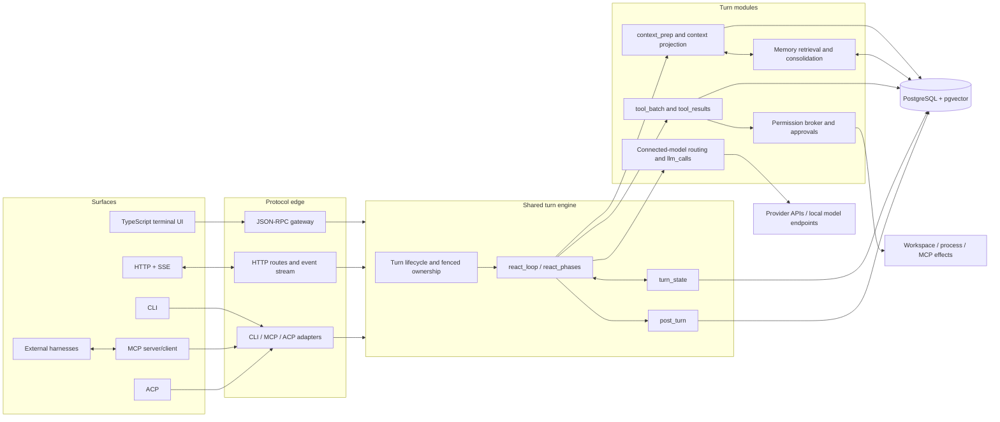

# Machina

Machina is a self-hosted, local-first agent harness for developers and operators who need work to persist across turns, sessions, surfaces, and interruptions—not another chat wrapper or a single-surface coding agent. Its thesis is simple: **an agent harness is a state-management system**. The model is the only stateless part; the harness gives it a bounded, auditable, recoverable view of durable state and constrains real side effects.

Machina combines a Python turn engine, PostgreSQL with pgvector, and a TypeScript terminal UI. The same engine is available through a CLI, HTTP/SSE, MCP server, ACP bridge, and external-harness interop. There is no hosted Machina service or SLA; you operate the runtime, database, and provider connections.

## Why this exists

- **A prompt is a view, not the database.** Turns and tool activity persist as typed records. Each request gets a budgeted context projection; compaction archives replaced history, and large outputs can remain recoverable as artifacts.
- **Memory is a separate lifecycle.** Durable claims have sources and can be searched, corrected, approved, or forgotten. A transcript is not silently treated as truth.
- **Approval names an action, not a tool.** The permission broker canonicalizes the proposed effect, binds approval to a versioned digest, and revalidates it before execution.
- **Routing follows available connections.** Machina builds an inventory from configured credentials and connected local or remote models, then selects by role and constraints. It does not promise that a provider is reachable or that every route is cheaper or better.
- **Interruptions are part of the model.** Turn ownership is leased and fenced; approvals and jobs persist. Uncertain ownership blocks protected effects instead of guessing.
- **One engine, several transports.** The TUI, CLI, HTTP, MCP, and ACP paths share turn policy and durable state rather than implementing separate agent loops.

## What you get

Counts below are from this checkout’s registries and checked-in files; they describe bundled defaults, not limits on user-added providers, tools, skills, or agents.

| Capability | What it means |
|---|---|
| Durable turns | PostgreSQL stores sessions, context events, tool results, approvals, jobs, usage, and other state. |
| Context projection and compaction | Build a model-specific bounded working set; archive old chunks during compaction; retain large tool outputs as paged artifacts when storage succeeds. |
| Memory lifecycle | Extract and retrieve durable claims with provenance, deduplication, optional review, and forgetting controls. |
| Digest-bound approvals | Action digest v3 binds the reviewed action, including the target’s base revision; execution revalidates and consumes approval once. |
| Connected-model routing | Inventory configured model connections and choose role-specific routes with cost/fit information and fallbacks where available. |
| Providers | 18 built-in provider names, plus user-added named OpenAI-compatible providers. Availability and terms depend on the provider. |
| Tools | 48 built-in tools, plus tools from explicitly connected MCP servers. |
| Skills | 77 bundled `SKILL.md` packages; task selection is catalog-first and bodies load on demand. |
| Agents | 71 bundled ECC specialist definitions plus 3 core built-ins (74 bundled built-ins total); user definitions can add more. |
| Surfaces | Terminal UI, CLI, HTTP + SSE, MCP server/client, ACP, and external-harness interop. |
| Jobs | Durable scheduled jobs, including interval/cron/heartbeat and reviewed script jobs; job execution is at-least-once. |
| Observability | Sanitized audit events, diagnostics, operation metrics, traces, and durable usage accounting. |

## Install and first run

The installer bootstraps the checkout and runtime; `machina setup` is the first-launch configuration and database verification step. Setup can collect provider credentials, write a private `.env`, provision the supported managed local database when applicable, initialize the schema, and report whether that schema is ready. A successful install command alone is not proof that the application is ready.

**macOS / Linux**

```bash
curl -fsSL https://raw.githubusercontent.com/kiazh/Machina-Harness/main/install.sh | bash
machina setup
machina doctor
machina
```

**Windows PowerShell (native; no WSL required)**

```powershell
irm https://raw.githubusercontent.com/kiazh/Machina-Harness/main/install.ps1 | iex
machina setup
machina doctor
machina
```

After the installer finishes, open a new terminal so the installed launcher is
on `PATH`. A piped macOS/Linux installer cannot change the parent shell's
environment; it prints the exact `PATH` hint if the current shell needs it.

`machina doctor` checks runtime dependencies, configured keys, and database connectivity. It does not prove that a provider will accept a request. To verify an end-to-end route, open the TUI and send a small prompt using the provider you configured.

**Requirements and setup behavior**

- Network access to download the checkout and dependencies. Git and Python 3.11+ are required. Node.js 22.19+ and npm are required for the terminal UI.
- PostgreSQL 16+ with `vector` and `pg_trgm`, or a Docker-backed local database. Installers/setup provision dependencies where their platform path supports it; an existing database can be selected with `DATABASE_URL`.
- The installer creates a Python environment, installs the Python package and UI dependencies, seeds `.env`, adds a `machina` launcher where supported, and attempts database initialization. `machina setup` then prompts for or preserves configuration and verifies schema setup. Optional integrations may still require an unavoidable provider login or consent.
- The installer can detect/register supported external agent harnesses. Interop is best-effort; it does not make those external programs part of Machina or guarantee their availability.

For manual deployment, upgrade, backups, and environment settings, see [Operations](OPERATIONS.md). This project has no hosted service, managed backups, data-recovery guarantee, or production SLA.

## Architecture

The model receives a request and returns a response. Machina owns everything around that exchange: durable state, context selection, authority, tool execution, routing, and recovery.



### One turn

```mermaid
sequenceDiagram
  actor Human
  participant Surface
  participant Edge as Protocol adapter
  participant Engine as Turn engine
  participant Context as Context preparer
  participant Router
  participant Broker as Permission broker
  participant Tool
  participant DB as PostgreSQL
  participant Model as Provider

  Human->>Surface: submit prompt
  Surface->>Edge: turn request
  Edge->>DB: claim session lease + fencing token
  Edge->>Engine: run owned turn
  Engine->>Context: prepare bounded working set
  Context->>DB: read session, context, memory/RAG evidence
  Context-->>Engine: messages + omission information
  Engine->>Router: select role/model route
  Router-->>Engine: selected provider and model
  Engine->>Model: request / stream
  Model-->>Engine: response or tool calls
  Engine->>Broker: authorize canonical action
  alt action requires review
    Broker->>DB: persist pending approval
    Engine-->>Surface: pause with approval request
    Human->>Surface: resolve approval
    Surface->>DB: record human decision
    Engine->>Broker: revalidate digest and claim once
  else allowed or denied
    Broker-->>Engine: stamped execution context or denial
  end
  Engine->>Tool: execute permitted action
  Tool->>DB: record result / artifact
  Tool-->>Engine: bounded result
  Engine->>Model: continue with tool result
  Model-->>Engine: final response
  Engine->>DB: persist response and usage; release ownership
  Engine->>DB: schedule post-turn maintenance
  Engine-->>Surface: completion or explicit non-success state
```

The diagram is intentionally simplified: HTTP approval resume submits the original tool arguments and reconstructs the proposal before execution; it does not ask the model to recreate the approved action. A human wait does not hold a database transaction open.

### Deep modules and seams

A **module** is defined by its **interface**—including ordering, invariants, and error behavior—not just its Python signature. A useful **seam** lets the implementation change or be tested without spreading policy into every caller. These modules are deep where one small interface owns a consequential behavior; that gives callers leverage and keeps change local.

| Module | Interface / owned behavior | Why the module has depth |
|---|---|---|
| [`react_loop.py`](machina/core/react_loop.py) + [`react_phases.py`](machina/core/react_phases.py) | `react_loop(...)` coordinates a turn and forwards phase events in order. Phases own preparation, model calls, tool calls, answer handling, and terminal cleanup. | The interface preserves one event/phase order; callers do not reimplement retry, cancellation, repair, or terminal policy. |
| [`context_prep.py`](machina/core/context_prep.py) | `ContextPreparer.prepare(...)` returns a session and assembled messages; it owns context, evidence retrieval, projection, and image handling. | One seam centralizes the expensive/lossey prompt construction and its fallback behavior. |
| [`tool_batch.py`](machina/core/tool_batch.py) | `ToolBatchExecutor` validates a batch, emits starts in request order, bounds concurrency, and records in provider order. | Authorization, ordering, bounded execution, and cancellation cleanup stay together rather than leaking to each tool caller. |
| [`tool_results.py`](machina/core/tool_results.py) | `ToolResultRecorder` records results, artifact views, tool messages, and approval retirement. | Retention-before-publication and idempotent recording are enforced in one place. |
| [`llm_calls.py`](machina/core/llm_calls.py) | `LLMCaller.complete/stream` own transient retry and usage settlement. | It makes the retry contract testable without constructing a whole agent; streamed output is not replayed after deltas. |
| [`turn_state.py`](machina/core/turn_state.py) | `TurnState` and `TurnBudget` own mutable turn state, counters, budget checks, and stop precedence. | The loop uses explicit state rather than an expanding collection of loosely related locals. |
| [`post_turn.py`](machina/core/post_turn.py) | `PostTurn` schedules and runs consolidation/learning work off the response path. | Maintenance failures are isolated from the already-decided user response. |
| [`agent.py`](machina/core/agent.py) | `ReActAgent.run/run_stream` remains the public facade and wires the modules. | It gives callers a stable entry point while internals move; it is not where each caller rebuilds turn behavior. |

The deletion test is practical: deleting one of these modules should make its policy reappear across callers or erase a testable contract. If deletion only removes a pass-through, that module was not earning its keep. Current decomposition status and characterization plan are recorded in [ADR 0004](docs/adr/0004-god-object-decomposition.md) and the [decomposition plan](plans/refactor-god-objects/PLAN.md).

### Engineering map

| Concern | Start here |
|---|---|
| Turn ownership / fencing | [`machina/core/turns.py`](machina/core/turns.py), [`machina/core/turn_engine.py`](machina/core/turn_engine.py) |
| Agent construction | [`machina/core/agent_factory.py`](machina/core/agent_factory.py), [`machina/core/agent_def.py`](machina/core/agent_def.py) |
| Context and compaction | [`machina/core/context_prep.py`](machina/core/context_prep.py), [`machina/core/projection.py`](machina/core/projection.py), [`machina/core/compression.py`](machina/core/compression.py), [`machina/core/artifacts.py`](machina/core/artifacts.py) |
| Memory | [`machina/memory/`](machina/memory) |
| Permissions and approvals | [`machina/permissions/`](machina/permissions), [`machina/core/approval_resume.py`](machina/core/approval_resume.py) |
| Tools and workspace | [`machina/tools/`](machina/tools), [`machina/workspace/`](machina/workspace) |
| Providers and routing | [`machina/core/provider/`](machina/core/provider), [`machina/core/routing/`](machina/core/routing) |
| Protocol and HTTP | [`machina/gateway/`](machina/gateway), [`machina/api/`](machina/api), [`machina/protocol/events.json`](machina/protocol/events.json) |
| Terminal UI | [`ui/src/`](ui/src) |
| Durable schema | [`machina/db/`](machina/db) |

## The five hard problems

### 1. Context: preserve the archive, curate the desk

**Plain language:** the model has a finite desk; a durable conversation can be much larger. The system must decide what is on the desk without pretending the rest never happened.

**Mechanism:** session activity is stored as typed context records. Context preparation assembles history, skills, memory, and document evidence, measures it against an effective model window, and projects a bounded request. Omitted evidence is disclosed. Safe-boundary compaction archives replaced chunks and writes a checkpoint. Oversized tool output is stored before a reduced view is published; artifact storage can fail or hit quota, in which case Machina does not claim the original is recoverable. See [`context_prep.py`](machina/core/context_prep.py), [`projection.py`](machina/core/projection.py), [`compression.py`](machina/core/compression.py), and [`artifacts.py`](machina/core/artifacts.py).

### 2. Memory: keep claims, not an unexamined transcript

**Plain language:** old conversation is evidence about what happened, not automatically a durable fact. Useful memory must stay attributable and correctable.

**Mechanism:** consolidation extracts candidate claims from new context, applies scoring/deduplication/redaction and provenance, and can place candidates in a review queue when configured. Retrieval combines relevance signals and applies a bounded prompt budget. Memory can be inspected, changed, or forgotten. Extraction is fallible; Machina does not guarantee that every candidate is true or that every useful detail will be retrieved. See [`machina/memory/`](machina/memory) and [memory lifecycle notes](docs/MEMORY_DIGEST.md).

### 3. Permissions: authorize the reviewed effect

**Plain language:** approving a tool name is not the same as approving what that tool will do. Arguments, targets, bytes, workspace, and execution mode matter.

**Mechanism:** policy maps a tool proposal to declared effects and canonical action material. Digest v3 covers the action identity, mode/backend, capabilities, target/argv or payload, working directory, timeout/network declarations, workspace identity, content digest, and file base revision. A human resolves a durable request; agents cannot approve their own actions. Execution reconstructs and compares the action, checks the target revision, and consumes the approval atomically once. Changed inputs or an old digest version require fresh approval.

### 4. Routing: choose from connections, not a magic model name

**Plain language:** one model is not equally suitable for planning, worker tasks, synthesis, and small utility calls—and credentials may change what is available.

**Mechanism:** the inventory combines built-in provider adapters, configured credentials, subscription connections, local endpoints, and user-added named providers. The router scores available choices by role fit and configured cost/constraints and can report its reason and fallback. A selected route is still an external dependency: authentication, rate limits, model features, price data, and uptime are not guaranteed by Machina. Unknown usage or pricing stays unknown instead of being silently represented as zero.

### 5. Interruption: make pause and recovery explicit

**Plain language:** a process can exit, a person can take time to approve, or a provider can hang. Keeping a database transaction open does not solve that.

**Mechanism:** turns claim a leased session with a fencing token and periodically renew ownership. Approval rows survive restart; human waits do not hold a long transaction. Resume revalidates the reviewed proposal. Cancellation retires work and flushes durable chunks through cleanup paths. Scheduled jobs survive restart but are at-least-once, not exactly-once. An external process or provider request that already began cannot always be undone.

## Failure semantics

| Event | What Machina does | What it does not promise |
|---|---|---|
| Process crash | Durable chunks and approvals already committed remain. A turn claim can expire; a successor uses a new fencing token. | It cannot infer whether an external side effect completed immediately before the crash. |
| Turn/tool timeout | Configured deadlines stop the owned operation where cancellation is supported; cleanup and ownership release are attempted. | Python cancellation cannot guarantee termination of resistant tasks, providers, or child processes. |
| Provider failure | A transient call may be retried once before any stream delta; 429s and failures after emitted deltas are not blindly replayed. Failure is surfaced as a non-success result. | No provider availability or exactly-once request guarantee. |
| User cancellation | Stop is surfaced; completed tool results and pending user context use cancellation-safe persistence/cleanup paths. | Cancellation cannot reverse a side effect already performed. If cleanup/release is unconfirmed, the turn is not reported as successful. |
| Approval wait | The request is durable and the turn pauses without holding a database transaction. Ownership is renewed; resume checks the same action digest and consumes approval once. | A changed target/action or expired/legacy approval does not get silently reused. |
| Repeated/no-progress tool calls | Stagnation checks can stop repeated no-progress behavior; repair/task policies also have their own stop conditions. | The general ReAct loop is not globally bounded by a fixed iteration count. |
| Database loss | Ownership or durable authorization that cannot be confirmed fails closed; writes/claims fail and cleanup uncertainty is reported. | The in-memory process is not a substitute source of truth; an in-flight external effect may already have happened. |

## Security model and limits

Machina runs agent-proposed actions on a host controlled by its operator. The default `ask` mode is an authorization policy, not a host sandbox. Read [SECURITY.md](SECURITY.md) before exposing interfaces or enabling privileged execution.

- **Digest v3 and TOCTOU checks.** Approval binds the exact canonical action, session/agent/turn, workspace identity, and target base revision. Resume rebuilds the proposal from original arguments, compares it, checks current target bytes/revision, and claims the approval once. Approvals stored under earlier digest versions do not resume; they need fresh review.
- **Filesystem and process checks.** Workspace paths are canonicalized with symlink/parent traversal and file-identity defenses. Command parsing distinguishes known project workflows from opaque shell payloads; host execution still runs code with the operator’s privileges unless an actual sandbox backend is selected.
- **Outbound fetch pinning.** Web fetch validates resolved public addresses and connects to the validated address while preserving HTTP Host/TLS hostname identity. Redirect destinations are revalidated; response size, headers, and deadlines are bounded. This is not a general egress firewall for every provider or plugin connection.
- **Sandbox is explicit and fail-closed.** Selected container/WASI backends do not silently fall back to host execution when unavailable. The Compose app has no Docker CLI/socket mount, so terminal sandbox execution is unavailable in Compose by design. Isolation depends on the chosen runtime, image, mounts, and network policy.
- **Local RPC is not automatically authenticated.** The TUI provisions a gateway token; the stdio gateway can run unauthenticated if `MACHINA_GATEWAY_TOKEN` is absent and must then remain trusted local stdio. Do not expose that gateway, PostgreSQL, or a Docker socket to untrusted clients. HTTP uses `MACHINA_API_KEY`; bind locally or use a correctly configured trusted TLS edge.
- **Local-first is not local-only.** Providers receive the prompts/tool results sent to them. Plugins execute in-process with host privileges. Administrators can read process memory and database contents. Redaction cannot identify every unknown, encoded, or transformed secret. Protect `.env`, PostgreSQL, backups, logs, and the workspace.

## Operations

### Docker Compose

Compose starts PostgreSQL 16 with pgvector and the Machina HTTP app. The app port is bound to loopback (`127.0.0.1:8000`); configure `MACHINA_API_KEY` in the operator’s environment before starting it.

```bash
docker compose up --build
```

The Compose app container is read-only except for its application-home volume and temporary storage, runs without Linux capabilities, and does not mount the Docker socket. This is a deployment shape, not a hosted service or a universal sandbox. For Docker sandbox execution, run a host installation with a configured, available sandbox runtime. See [Compose and operations requirements](OPERATIONS.md#configuration-contract).

### Health and readiness

- `GET /health` is a liveness response.
- `GET /ready` verifies database connection and required schema tables. It does **not** verify a provider, Docker daemon, OAuth login, or external search endpoint.
- `GET /metrics` is authenticated and exports bounded operation metrics plus durable usage aggregates.

### Retention defaults

| Data | Default policy |
|---|---|
| Tool artifacts | 30 days; max 500/session and 2,000,000 characters/artifact by default. Quota refuses new stores rather than evicting live evidence. |
| Audit rows | 365 days |
| Usage rows | 730 days |
| Transcripts, archives, memories, approvals, jobs | Not automatically pruned by the scheduler |

Setting an operational retention period to `0` keeps that table indefinitely. PostgreSQL vacuum, metrics retention, and backups remain operator decisions. Artifact retention broadens at-rest retention of tool output; set it to your data policy.

### Backup, restore, and upgrades

Back up the whole PostgreSQL database with `pg_dump -Fc`, encrypt and store it off-host, and protect credentials separately from the dump. A backup is not verified until restored into an isolated database with the required extensions and roles and checked with representative application flows. Choose your own backup schedule, retention, RPO, and RTO; this repository does not claim a backup has been run for your deployment.

Run `machina init` with the migration role before starting new workers. Migrations are additive and transactional where specified; there are **no destructive reverse migrations**. Rollback means stop/drain the new runtime, restore a verified backup into a replacement database, and reinstall the prior matched runtime/UI version. Never run old and new workers concurrently against an unverified schema. See [OPERATIONS.md](OPERATIONS.md#backup-and-restore) and [SECURITY.md](SECURITY.md#cancellation-and-failure).

### Managed local database

On supported local paths, the runtime can manage the installer-owned `machina-db` Docker container. Each local client takes a lease; the last live client release can stop the managed container, and the next client starts it again. This logic applies only to the recognized loopback Machina database. It does not start, create, or stop an external/native PostgreSQL server. Set `MACHINA_DB_MANAGE=0` to opt out. Keep the database volume and backups under operator control.

## Testing and evidence

Tests are evidence about specific paths, not a proof that every integration or deployment is safe.

| Evidence | What is checked | Limits |
|---|---|---|
| Local smoke suite | `tests/`, run in CI against pinned dependencies and a PostgreSQL/pgvector service. CI enforces `--cov-fail-under=40`. | The 40% floor is a minimum gate, not a claim of 40% behavior coverage. This worktree has no `.venv`, so a fresh local collection/pass count was not obtained for this README rewrite. |
| Pinned DevTools suite | CI checks out `kiazh/Machina-DevTools` at `d2a0b2a9a891a16140cb023ac795d84cba6d9b09` (see [the CI workflow](.github/workflows/ci.yml)) and runs its backend regression suite against this source checkout with PostgreSQL. | It is a separately maintained suite. A green run covers its selected tests, not every external provider, host OS, or production deployment. |
| Historical DevTools snapshot | The previous README records **6,487 passed, 27 skipped, 8 deselected (2026-10-26)**. | Historical result only; not a result for this checkout or a benchmark. |
| Turn golden traces | 12 deterministic scenarios cover plain answer, tools/concurrency, approval pause/resume, cancellation, provider retry/failure, empty response, repair, parallel/delegation, and budget stop. Content is represented by hashes and normalized event order. | Characterization fixtures are not live-provider tests. |
| UI golden evidence | 36 checked-in rendered frames and 14 replay checkpoints (activity/changes plus approval key traces). | The Node UI suite was not run here because `ui/node_modules` is absent; the golden files characterize selected states and sizes only. |
| Architecture ratchet | `python tools/architecture_report.py --check` prevents tracked file/method growth past the checked-in baseline and reports import cycles. | It is a structural guard, not a quality or security proof. |

Not covered by a single pass: every provider’s live behavior and terms, every OS/sandbox combination, arbitrary plugin code, all DNS/network policy outside the pinned fetcher, long-duration resource use, and real deployment backup/restore or alert delivery. Do not infer those from unit or golden tests.

## Reference

### Common commands

| Command | Purpose |
|---|---|
| `machina` | Open the terminal UI |
| `machina setup` | Configure first run and initialize/verify schema |
| `machina doctor` | Check dependencies, configuration, and database connectivity |
| `machina init` | Initialize/update the database schema |
| `machina serve` | Run the HTTP API (loopback by default) |
| `machina acp` | Run the ACP editor bridge |
| `machina mode` | Inspect/set execution mode; `full` requires explicit activation/consent |
| `machina jobs` | Inspect/manage durable scheduled jobs |
| `machina harnesses` | Inspect/configure supported external-harness interop |

See [`machina/cli/`](machina/cli) for the command implementation and `machina --help` for the installed command set.

### Further reading

- [Product context](PRODUCT.md) and [design principles](DESIGN.md)
- [Security model](SECURITY.md)
- [Operations and recovery](OPERATIONS.md)
- [ADR 0001: Harness as state machine](docs/adr/0001-harness-as-state-machine.md)
- [ADR 0002: One core, many surfaces](docs/adr/0002-single-core-many-surfaces.md)
- [ADR 0003: Digest-bound approvals](docs/adr/0003-digest-bound-approvals.md)
- [ADR 0004: Decompose by seams](docs/adr/0004-god-object-decomposition.md)
- [Token/context design notes](docs/TOKEN_EFFICIENCY.md)

## Appendices

### Appendix A: RPC catalog

The gateway has 14 core JSON-RPC methods and 163 registered feature methods (177 total). HTTP exposes the gateway through `/rpc` subject to its transport policy. Names below are read from the registries in this checkout.

**Core methods:** `initialize`, `session.create`, `session.list`, `session.family`, `session.resume`, `usage.get`, `prompt.submit`, `prompt.cancel`, `prompt.steer`, `prompt.steering`, `question.answer`, `shell.jobs`, `config.set`, `shutdown`.

| Namespace | Methods |
|---|---|
| `agents` | `agents.list`, `agents.save`, `agents.delete`, `agents.run`, `agents.history` |
| `approvals` | `approvals.list`, `approvals.resolve` |
| `auth` | `auth.chatgpt.status`, `auth.chatgpt.login`, `auth.chatgpt.logout`, `auth.chatgpt.importCodex`, `auth.grok.status`, `auth.grok.login`, `auth.grok.logout`, `auth.copilot.status`, `auth.copilot.login`, `auth.copilot.importGh`, `auth.copilot.logout`, `auth.kiro.status`, `auth.kiro.start`, `auth.kiro.stop`, `auth.kiro.setup`, `auth.kiro.usage`, `auth.kiro.fallback`, `auth.hermes.status`, `auth.hermes.start`, `auth.hermes.stop`, `auth.hermes.setup` |
| `changes` | `changes.list`, `changes.diff` |
| `config` | `config.get` |
| `context` | `context.get`, `context.compress` |
| `growth` | `growth.get`, `growth.teach`, `growth.feedback`, `growth.forget`, `growth.installPolicy`, `growth.rollback` |
| `host` | `host.status`, `host.plan`, `host.setup`, `host.setup.start`, `host.setup.status`, `host.setup.cancel`, `host.setup.resume`, `host.addKey`, `host.openUrl`, `host.start`, `host.stop`, `host.restart`, `host.credentials`, `host.instructions` |
| `interop` | `interop.status`, `interop.enable`, `interop.disable`, `interop.list`, `interop.run`, `interop.jobs`, `interop.communications` |
| `jobs` | `jobs.create`, `jobs.list`, `jobs.setEnabled`, `jobs.resume`, `jobs.delete` |
| `learning` | `learning.list`, `learning.approve`, `learning.reject`, `learning.revert` |
| `mcp` | `mcp.catalog`, `mcp.list`, `mcp.config`, `mcp.status`, `mcp.configure`, `mcp.remove`, `mcp.preview`, `mcp.connect`, `mcp.disconnect`, `mcp.tools`, `mcp.oauth.preview`, `mcp.oauth.start`, `mcp.oauth.status`, `mcp.oauth.url`, `mcp.oauth.open`, `mcp.oauth.cancel`, `mcp.oauth.forget` |
| `memory` | `memory.list`, `memory.search`, `memory.share`, `memory.add`, `memory.forget`, `memory.pending`, `memory.approve`, `memory.reject`, `memory.approveAll`, `memory.rejectAll`, `memory.stats` |
| `meta` | `meta.route`, `meta.harnesses` |
| `mode` | `mode.get`, `mode.set`, `mode.revoke` |
| `model` | `model.route`, `model.inventory` |
| `models` | `models.list`, `models.setEffort` |
| `nowplaying` | `nowplaying.get`, `nowplaying.command` |
| `operations` | `operations.start`, `operations.get`, `operations.cancel` |
| `profile` | `profile.get`, `profile.set`, `profile.list` |
| `providers` | `providers.list`, `providers.add`, `providers.remove` |
| `review` | `review.start`, `review.get`, `review.cancel` |
| `runtime` | `runtime.capabilities`, `runtime.selectWorkspace` |
| `secrets` | `secrets.list`, `secrets.set`, `secrets.clear` |
| `session` | `session.fork`, `session.delete`, `session.rename`, `session.setGoal`, `session.setModel`, `session.search`, `session.history`, `session.recall`, `session.recall.window`, `session.export` |
| `skills` | `skills.list`, `skills.marketplace.search`, `skills.marketplace.discover`, `skills.marketplace.preview`, `skills.marketplace.install`, `skills.show`, `skills.learn`, `skills.delete`, `skills.curator`, `skills.search`, `skills.preview_route`, `skills.section` |
| `status` | `status` |
| `workspace` | `workspace.open`, `workspace.changes`, `workspace.diff`, `workspace.list`, `workspace.read`, `workspace.save`, `workspace.documentOpen`, `workspace.documentChange`, `workspace.documentClose`, `workspace.quickOpen`, `workspace.quickOpenCancel`, `workspace.intelligence`, `workspace.lspStatus`, `workspace.lspControl`, `workspace.close` |

### Appendix B: Built-in tool catalog

There are 48 built-in tool names in the registry. Descriptions and parameter schemas are defined at their registration sites; MCP tools are additional and appear after connection.

| Area | Tools |
|---|---|
| Files and workspace | `read_file`, `write_file`, `edit_file`, `list_files`, `search_files`, `code_intelligence`, `learn_directory` |
| Terminal and jobs | `terminal`, `terminal_job`, `harness_job` |
| Agents and delegation | `delegate`, `delegate_status`, `list_agents`, `harness_delegate`, `harness_features`, `harness_status` |
| Context and memory | `artifact_describe`, `artifact_read`, `artifact_search`, `recall`, `remember`, `learn_personality`, `share_memory`, `session_recall`, `session_recall_window` |
| Skills and discovery | `skill_list`, `skill_read`, `skill_resource`, `tool_load`, `harness_catalog` |
| MCP | `mcp_call`, `mcp_connect`, `mcp_describe`, `mcp_disconnect`, `mcp_list` |
| Documents and web | `index_document`, `search_documents`, `web_search`, `web_extract`, `web_research`, `web_crawl`, `browser_verify`, `web_verify` |
| Routing and interaction | `model_inventory`, `route_explain`, `ask_user`, `repo_stage`, `repo_activate` |

The tool broker uses effect declarations and the permission policy; tool names themselves are not treated as authority. Inspect the current schemas with `tool_load`/`harness_catalog` or the source under [`machina/tools/`](machina/tools).

### Appendix C: Configuration keys

`machina/core/config.py` defines 146 defaults. The supported precedence and secret handling are documented in [OPERATIONS.md](OPERATIONS.md#configuration-contract). This inventory names all default keys in this checkout; the Python source is authoritative for values and types.

| Group | Keys |
|---|---|
| Model, routing, and budgets | `model`, `provider`, `context_budget`, `turn_timeout`, `agent_id`, `temperature`, `max_tokens`, `max_delegate_concurrency`, `worker_count`, `max_worker_routes`, `delegate_inline_wait_seconds`, `orchestration_mode`, `model_selection`, `worker_transport`, `cost_tier`, `auto_parallel_delegation`, `single_model_auto_parallel`, `browser_verification`, `reasoning_effort`, `rate_limit_calls_per_minute`, `usage_session_token_limit`, `usage_session_request_limit`, `usage_agent_token_limit`, `usage_agent_request_limit` |
| Memory, persona, and skills | `memory_enabled`, `memory_digest_enabled`, `memory_digest_max_chars`, `memory_digest_max_facts`, `memory_digest_candidates`, `personality_growth_enabled`, `rsi_enabled`, `persona_description`, `persona_memory_enabled`, `persona_default_emotion`, `learning_review_enabled`, `learning_review_max_per_session`, `learning_review_auto_apply`, `learning_review_auto_apply_per_day`, `skills_disclosure_planner`, `memory_graph_enabled`, `memory_approval_enabled`, `memory_consolidation_enabled`, `memory_forgetting_enabled`, `memory_eviction_threshold`, `memory_max_per_agent`, `memory_rerank_enabled` |
| Retrieval and providers | `rag_enabled`, `embedding_backend`, `embedding_model`, `embedding_base_url`, `reranker_backend`, `reranker_local_model`, `reranker_http_url`, `reranker_http_model`, `reranker_timeout`, `rrf_keyword_weight`, `rrf_dense_weight`, `prompt_cache_enabled`, `openrouter_api_key`, `openai_api_key`, `anthropic_api_key`, `google_api_key`, `mistral_api_key`, `groq_api_key`, `together_api_key`, `deepseek_api_key`, `xai_api_key`, `opencode_api_key`, `kimi_api_key`, `kiro_api_key`, `hermes_proxy_api_key`, `kiro_base_url`, `kiro_gateway_command`, `kiro_gateway_dir`, `kiro_autostart`, `kiro_fallback`, `hermes_proxy_autostart`, `hermes_proxy_port`, `hermes_proxy_provider`, `custom_base_url`, `custom_api_key`, `opencode_base_url`, `cohere_api_key`, `database_url`, `searxng_url`, `firecrawl_autostart`, `firecrawl_stop_on_exit`, `firecrawl_home` |
| Storage, context, and execution | `machina_home`, `tmpdir`, `temp`, `compression_enabled`, `compression_threshold`, `compression_target_ratio`, `compression_preserve_recent`, `compression_llm_summarize`, `artifacts_enabled`, `artifact_retention_days`, `artifact_max_per_session`, `artifact_max_chars`, `reducers_enabled`, `request_projection_enabled`, `retrieval_selection_enabled`, `retrieval_token_budget`, `output_policy`, `meta_harness_enabled`, `meta_harness_hint`, `pricing_table_json`, `execution_mode`, `workspace_root`, `snapshots_enabled`, `formatter`, `terminal_sandbox`, `terminal_image`, `terminal_wasm_module`, `approval_timeout`, `dynamic_tool_loading`, `skill_query_expansion_enabled`, `audit_retention_days`, `usage_retention_days`, `auto_compaction_enabled`, `eviction_max_tokens` |
| Optimization and UI | `optimization_emergency_disabled`, `optimization_semantic_cache_mode`, `optimization_semantic_cache_similarity_threshold`, `optimization_semantic_cache_ttl_seconds`, `optimization_semantic_cache_max_entries`, `optimization_semantic_cache_allow_cross_session_aux`, `optimization_warmers_startup_enabled`, `optimization_warmers_prompt_cache_mode`, `optimization_warmers_min_prefix_tokens`, `optimization_compression_mode`, `optimization_compression_backend`, `optimization_compression_min_trigger_tokens`, `optimization_compression_trigger_ratio`, `optimization_compression_target_ratio`, `optimization_compression_min_ratio`, `optimization_compression_min_embedding_similarity`, `optimization_compression_max_latency_ms`, `optimization_shadow_retention_days`, `theme`, `transparent_background`, `workspace_ui_state`, `ui_preferences`, `keybindings`, `nowplaying_enabled` |

### Appendix D: Protocol events

The protocol is version 2 and declares 27 event names in [`machina/protocol/events.json`](machina/protocol/events.json). `?` marks optional fields.

| Event | Payload fields |
|---|---|
| `message.start` | — |
| `turn.started` | — |
| `message.delta` | `text` |
| `message.stopping` | `reason` |
| `tool.start` | `id`, `name`, `args` |
| `tool.complete` | `id`, `name`, `result`, `isError`, `truncated?`, `outcome?` |
| `usage` | `tokens`, `contextTokens?`, `contextPercent?`, `creditsUsed?` |
| `context.compacted` | — |
| `growth.status` | `stage`, `detail?` |
| `agent.child` | `childSessionId`, `phase`, `value` |
| `steering.update` | `items`, `delivered` |
| `question.asked` | `requestId`, `question`, `options`, `allowOther` |
| `shell.job` | `job` |
| `harness.job` | `job` |
| `message.complete` | `text`, `tokens`, `iterations`, `toolCalls`, `cancelled`, `needsApproval?` |
| `error` | `message` |
| `needs_approval` | `requestId`, `operation`, `target`, `argv`, `cwd`, `backend`, `capabilities`, `tool?`, `shell?`, `timeout?`, `network?`, `contentDigest?`, `contentPreview?`, `contentLength?`, `fileDiff?`, `durable?`, `status?`, `originTurnId?` |
| `approval.resolved` | `requestId`, `status`, `originTurnId?` |
| `approval.resumed` | `requestId`, `originTurnId` |
| `turn.ownership_lost` | `reason?` |
| `turn.cleanup_pending` | `reason?` |
| `auth.chatgpt.completed` | `account_id`, `expiry` |
| `auth.chatgpt.failed` | `reason` |
| `auth.grok.completed` | `account_id`, `expiry` |
| `auth.grok.failed` | `reason` |
| `auth.copilot.completed` | `account_id`, `token_family` |
| `auth.copilot.failed` | `reason` |

### Appendix E: Data and implementation references

- SQL schema and additive migrations: [`machina/db/`](machina/db)
- Permission policy and digest construction: [`machina/permissions/policy.py`](machina/permissions/policy.py)
- Gateway feature registry: [`machina/gateway/features/`](machina/gateway/features)
- API routes: [`machina/api/routes/`](machina/api/routes)
- Local smoke tests: [`tests/`](tests)
- Turn trace fixtures: [`tests/golden/turns/`](tests/golden/turns)
- UI golden fixtures: [`ui/test/golden/`](ui/test/golden)
- Architecture baseline and report: [`tools/architecture_baseline.json`](tools/architecture_baseline.json), [`tools/architecture_report.py`](tools/architecture_report.py)

## License

See [LICENSE](LICENSE).
