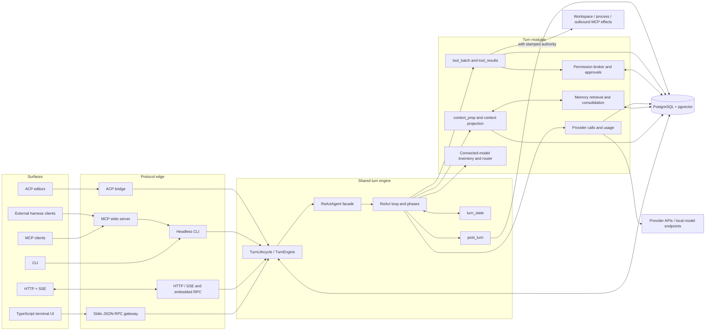
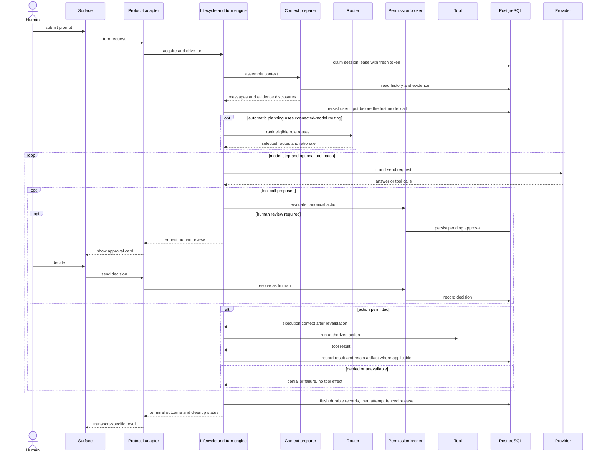

# Machina

Machina is a **self-hosted, local-first agent harness** built around a specific
idea: an agent harness is a state-management system. The model is the stateless
part of Machina's turn contract. PostgreSQL holds the conversation, retained
evidence, turn ownership, approvals, jobs, and usage; the Python engine decides
what the model can see and which proposed actions are allowed to run.

If you're comparing Machina with OpenCode, Codex, or Claude Code, evaluate it
on what happens when work is interrupted, context no longer fits, or a reviewed
file changes before execution:

- **Turns have leased, fenced ownership.** Another worker can take over an
  expired claim; the stale token cannot release the successor's claim.
- **Model context is a bounded projection of durable state.** Compaction
  archives displaced history. Reducers can show a test summary, diff excerpt,
  or log slice while a stored artifact lets the agent page the original.
- **Memory has its own lifecycle.** Claims carry provenance and can be reviewed,
  retrieved, or forgotten independently of the transcript.
- **Authority is bound to the reviewed effect.** Digest v3 includes the
  target's base revision for applicable file actions. A different revision or
  material arguments invalidate approval; an approval can only be consumed once.
- **Routing is deterministic for a given inventory, task profile, and policy.**
  Machina ranks eligible connected models by role and constraints without an
  LLM call to choose the route.

One turn engine backs six access paths, including external clients calling
Machina through MCP. The runtime, database, and provider connections are yours
to operate. Machina has no hosted service or SLA and makes no comparative
benchmark claim.

[Get started](#get-started) · [Architecture](#architecture) ·
[Failure semantics](#failure-semantics) · [Security](#security-model-and-limits) ·
[Testing and evidence](#testing-and-evidence) · [Reference](#reference)

## What you get

Counts below are from this checkout’s registries and checked-in files; they describe bundled defaults, not limits on user-added providers, tools, skills, or agents.

| Capability | What it means |
|---|---|
| Providers | 19 built-in provider names, plus user-added named OpenAI-compatible providers. Availability and terms depend on the provider. |
| Tools | 48 built-in tools, plus tools from explicitly connected MCP servers. |
| Skills | 77 bundled `SKILL.md` packages; task selection is catalog-first and bodies load on demand. |
| Agents | 71 bundled ECC specialist definitions plus 3 core built-ins (74 bundled built-ins total); user definitions can add more. |
| Jobs | Durable scheduled jobs, including interval/cron/heartbeat and reviewed script jobs; job execution is at-least-once. |
| Observability | Sanitized audit events, diagnostics, operation metrics, traces, and durable usage accounting. |

## Resident buddy

Machina has a resident session with a stable persona, always-injected core
memory, and scoped autonomy grants. The terminal surface is `/agent`; the
native macOS notch client lives in [`notch/`](notch/) and talks to the same
gateway. Resident methods are local-terminal capabilities; the notch uses a
0600 token and never receives host credentials.

- `machina init` creates `~/.machina/notch.token`.
- `machina serve` exposes the gateway the notch connects to.
- `./notch/bundle.sh` builds `notch/build/MachinaNotch.app`.
- See [`docs/RESIDENT.md`](docs/RESIDENT.md) for the authority model, memory,
  grants, and current limits.

## Get started

The installer bootstraps the checkout and runtime. First-launch Setup collects
or preserves provider configuration, writes `.env`, and provisions and verifies
the database schema on supported paths. It reports when schema setup fails.

**macOS / Linux**

```bash
curl -fsSL https://raw.githubusercontent.com/kiazh/Machina-Harness/main/install.sh | bash
```

**Windows PowerShell (native; no WSL required)**

```powershell
irm https://raw.githubusercontent.com/kiazh/Machina-Harness/main/install.ps1 | iex
```

Open a new terminal after installation so it picks up the launcher path. The
current installers hand off to `machina setup` for first-launch configuration;
open the terminal UI with `machina` after Setup reports the schema is ready.
`machina doctor` checks runtime dependencies, credentials configuration, and
database connectivity. A prompt through the configured provider checks the
end-to-end route.

**Requirements and setup behavior**

- Network access to download the checkout and dependencies. Git and Python 3.11+ are required. Node.js 22.19+ and npm are required for the terminal UI.
- PostgreSQL 16+ with `vector` and `pg_trgm`, or a Docker-backed local database. Installers/setup provision dependencies where their platform path supports it; an existing database can be selected with `DATABASE_URL`.
- The installer creates the Python environment, installs dependencies for the supported runtime and UI path, seeds `.env`, and attempts database initialization. External-harness registration is best-effort. Provider login or third-party consent may still be required.

For manual deployment, upgrades, backups, and configuration, see [Operations](OPERATIONS.md).

## Architecture

The same `TurnLifecycle` → `TurnEngine` → `ReActAgent` path drives Machina turns.
Each access path supplies its transport and approval policy. The MCP server
invokes the headless CLI for chat; outbound MCP calls and delegation to an
external harness are tool effects. An external harness keeps its own runtime
and authority when it executes a delegated task.



### One turn

This is the interactive path: a TUI client can wait for a decision inside an
owned turn. Only the permitted branch reaches the tool.



An interactive wait renews the lease without keeping a database transaction
open. A headless turn can instead return a durable approval request and
release ownership. To continue a reviewed action over HTTP, the client submits
the original tool arguments; Machina reconstructs the proposal, checks it
against the approval row, and executes the tool under a fresh fenced claim.
That continuation does not replay the original model request.

### Deep modules and seams

`ReActAgent.run()` and `run_stream()` are the facade. They wire the engine's
internal modules and present the shared loop as a result or a stream. The
interfaces below include event ordering, error behavior, and authority checks;
those contracts are the seams callers and regression tests rely on.

| Module | Interface and behavior | What it keeps local |
|---|---|---|
| [`agent.py`](machina/core/agent.py) | `run` / `run_stream` wire the shared policy into the two return forms. | The entry points stay stable as internal modules change. |
| [`react_loop.py`](machina/core/react_loop.py) / [`react_phases.py`](machina/core/react_phases.py) | `react_loop` sequences phases and forwards events. The phases prepare, call the model, handle tools and answers, and clean up. | Streaming and non-streaming adapters share repair, stop, and terminal policy. |
| [`context_prep.py`](machina/core/context_prep.py) | `ContextPreparer.prepare` returns a session and assembled messages. | History, images, retrieval, evidence budgets, and retrieval fallback stay together. |
| [`tool_batch.py`](machina/core/tool_batch.py) | `ToolBatchExecutor` plans and authorizes a batch, bounds concurrency, and emits starts in request order and completions as they become ready. | Authorization, cancellation, and provider-order recording rules live beside batch execution. |
| [`tool_results.py`](machina/core/tool_results.py) | `ToolResultRecorder` builds tool messages, records results and artifact views, and retires approvals. | Result recording and artifact retention-before-publication use the same rules in ordinary execution and cleanup. |
| [`llm_calls.py`](machina/core/llm_calls.py) | `LLMCaller.complete` / `stream` own transient retry and usage settlement. | Retry behavior can be tested without constructing an agent. |
| [`turn_state.py`](machina/core/turn_state.py) | `TurnState` and `TurnBudget` track mutable turn progress, counters, budgets, and stop precedence. | Phases share one definition of when a turn must stop. |
| [`post_turn.py`](machina/core/post_turn.py) | `PostTurn` schedules consolidation and learning review. | Maintenance failures are isolated from the turn response. |

**Why this shape:** apply the deletion test to `LLMCaller`: remove it and both
call paths still need to reserve and settle usage and decide whether a failed
request is safe to retry. Remove the tool-result seam and both ordinary and
cancelled batches still need to record completed work without publishing a
false artifact handle. Keeping those rules behind their interfaces gives the
modules depth and gives maintainers locality. See [ADR 0004](docs/adr/0004-god-object-decomposition.md)
and the [decomposition plan](plans/refactor-god-objects/PLAN.md).

**UI integration is in progress.** [`App`](ui/src/app.ts) delegates Activity and
Changes to the status and changes controllers. Bootstrap, commands, events,
and keyboard have standalone modules under [`ui/src/app/`](ui/src/app) with
wiring still to do in this checkout. See the [integration checklist](plans/refactor-god-objects/INTEGRATION.md).

### Engineering map

| Concern | Start here |
|---|---|
| Turn ownership / fencing | [`machina/core/turns.py`](machina/core/turns.py), [`machina/core/turn_engine.py`](machina/core/turn_engine.py) |
| Agent construction | [`machina/core/agent_factory.py`](machina/core/agent_factory.py), [`machina/core/agent_def.py`](machina/core/agent_def.py) |
| Context and compaction | [`machina/core/context_prep.py`](machina/core/context_prep.py), [`machina/core/projection.py`](machina/core/projection.py), [`machina/core/compression.py`](machina/core/compression.py), [`machina/core/artifacts.py`](machina/core/artifacts.py) |
| Memory | [`machina/memory/`](machina/memory) |
| Permissions and approvals | [`machina/permissions/`](machina/permissions), [`machina/core/approval_resume.py`](machina/core/approval_resume.py) |
| Tools and workspace | [`machina/tools/`](machina/tools), [`machina/workspace/`](machina/workspace) |
| Providers and routing | [`machina/core/provider/`](machina/core/provider), [`machina/core/routing/`](machina/core/routing) |
| Protocol and HTTP | [`machina/gateway/`](machina/gateway), [`machina/api/`](machina/api), [`machina/protocol/events.json`](machina/protocol/events.json) |
| Terminal UI | [`ui/src/`](ui/src) |
| Durable schema | [`machina/db/`](machina/db) |

## Context, memory, and model routing

### From stored events to one model request

Session activity is stored as typed context records. Context preparation
assembles history, skills, memory, and document evidence; the request gate
fits messages and tool definitions to the effective model window. It can
disclose omissions or refuse a request that cannot fit without dropping
protected material. Compaction is a separate operation: it archives displaced
chunks and writes a checkpoint to shorten the active history.

For eligible oversized tool output, [reducers](machina/core/reducers.py) select
useful records from tests, diffs, logs, and structured data. The
[artifact view](machina/core/tool_views.py) publishes a recoverable reduced
view only after the exact output has been retained; a session-authorized
`artifact_read` can page that output. If storage fails or quota is exhausted,
the fallback discloses the loss. Retaining output already truncated upstream
does not recover the missing bytes.

### From transcript to durable claims

[Consolidation](machina/memory/consolidator.py) extracts candidates from new
context and scores, deduplicates, and redacts them with source provenance.
Optional review can put candidates in a pending queue before they enter memory.
Retrieval selects relevant claims within a prompt budget. An operator can
inspect, forget, or add a correction without editing conversation history.
Extraction can be wrong, and retrieval can miss evidence; see the
[memory digest design](docs/MEMORY_DIGEST.md).

### From connected inventory to a route

The [router](machina/core/routing/router.py) filters inventory by capabilities
and policy, ranks eligible planner, supervisor, worker, or utility routes, and
returns reasons and fallback candidates. Inputs include credentialed APIs,
subscription connections, configured local endpoints, and named providers.
Role and task scores are policy priors. The same decision inputs produce the
same route; inventory and remaining limits can change between runs. A listed
route does not guarantee authentication, capacity, or uptime. Unknown pricing
and usage remain visible as unknown.

The `opencode-go` provider uses an OpenCode Go subscription rather than an API
key. Sign in with `/login opencode sign-in` in the interactive UI or
`machina auth opencode login` in the CLI; Machina stores and refreshes the
device-flow credentials locally.

## Failure semantics

| Event | What Machina does | What it does not promise |
|---|---|---|
| Process crash | Durable chunks and approvals already committed remain. A turn claim can expire; a successor uses a new fencing token. | It cannot infer whether an external side effect completed immediately before the crash. |
| Turn/tool timeout | Configured deadlines stop the owned operation where cancellation is supported; cleanup and ownership release are attempted. | Python cancellation cannot guarantee termination of resistant tasks, providers, or child processes. |
| Provider 429 or 5xx | The turn-level caller retries 502/503/504 once, only before a stream delta. It adds no retry to an adapter's 429 handling and does not replay a partial stream. Exhausted failures surface as non-success. | Adapter retry behavior can differ. A provider may already have received or billed a request. |
| User cancellation | Stop is surfaced; completed tool results and pending user context use cancellation-safe persistence/cleanup paths. | Cancellation cannot reverse a side effect already performed. If cleanup/release is unconfirmed, the turn is not reported as successful. |
| Approval wait | Interactive turns renew ownership during the wait; headless turns can return a pause with a durable request. The wait holds no database transaction, and execution revalidates the action. | A changed target or an expired or legacy approval requires fresh review. Resuming an approval is not resuming the old model stream. |
| Repeated/no-progress tool calls | Stagnation checks can halt repeated no-progress batches; repair/task policies have separate stop conditions. | There is no universal fixed ReAct iteration limit. |
| Database loss | Failed renewal stops owned work. When durable ownership or authority cannot be confirmed, protected effects fail closed. Failed release can emit `turn.cleanup_pending` instead of terminal success. | An in-flight effect may have happened. Recovery depends on DB restoration and the claim's state or expiry. |

## Security model and limits

Machina runs agent-proposed actions on a host controlled by its operator. The default `ask` mode is an authorization policy, not a host sandbox. Read [SECURITY.md](SECURITY.md) before exposing interfaces or enabling privileged execution.

- **Digest v3 and TOCTOU checks.** The digest covers tool/operation, mode/backend, capabilities, canonical targets, argv or shell payload, working directory, timeout, network declarations, content digest, workspace identity, and applicable file base revision. The durable row separately binds session, agent, and original turn. The broker atomically claims matching approval once; the file implementation rechecks the approved revision before mutation. Regular file revisions through 8 MiB bind a content hash; larger files use size and modification time. Agents cannot resolve human approvals. Earlier digest versions need fresh review.
- **Filesystem and process checks.** Workspace paths are canonicalized with symlink/parent traversal and file-identity defenses. Command parsing distinguishes known project workflows from opaque shell payloads; host execution still runs code with the operator’s privileges unless an actual sandbox backend is selected.
- **SSRF defenses on pinned fetch.** The static extraction path validates resolved public addresses, pins the connection to a validated address, and preserves the HTTP Host and TLS hostname. Each redirect is revalidated; response size, headers, and deadlines are bounded. Other provider and plugin connections have their own network policy.
- **Sandbox is explicit and fail-closed.** Selected container/WASI backends do not silently fall back to host execution when unavailable. The Compose app has no Docker CLI/socket mount, so terminal sandbox execution is unavailable in Compose by design. Isolation depends on the chosen runtime, image, mounts, and network policy.
- **Local-only RPC.** The TUI provisions a gateway token; the standalone gateway entry point mints one if missing. A directly constructed gateway without a token belongs on trusted local stdio. HTTP `/rpc` uses `MACHINA_API_KEY` and refuses `host.credentials` and `interop.run` even with a valid key. Keep PostgreSQL and Docker sockets off untrusted networks; use a trusted TLS edge for remote HTTP.
- **Local-first is not local-only.** Providers receive the prompts/tool results sent to them. Plugins execute in-process with host privileges. Administrators can read process memory and database contents. Redaction cannot identify every unknown, encoded, or transformed secret. Protect `.env`, PostgreSQL, backups, logs, and the workspace.

## Operations

### Docker Compose

Compose starts PostgreSQL 16 with pgvector and the Machina HTTP app. The app port is bound to loopback (`127.0.0.1:8000`); configure `MACHINA_API_KEY` in the operator’s environment before starting it.

```bash
docker compose up --build
```

The Compose app container is read-only except for its application-home volume and temporary storage, runs without Linux capabilities, and does not mount the Docker socket. This is a deployment shape, not a hosted service or a universal sandbox. For Docker sandbox execution, run a host installation with a configured, available sandbox runtime. See [Compose and operations requirements](OPERATIONS.md#configuration-contract).

### Health and readiness

- `GET /health` is a liveness response.
- `GET /ready` verifies database access and the presence of `sessions`, `jobs`, `audit_events`, and `llm_usage`. It does **not** verify a provider, Docker daemon, OAuth login, or external search endpoint.
- `GET /metrics` is authenticated and exports bounded operation metrics plus durable usage aggregates.

### Retention defaults

| Data | Default policy |
|---|---|
| Tool artifacts | 30 days; max 500 live artifacts/session and 2,000,000 characters/artifact by default. Quota refuses new stores rather than evicting live evidence. |
| Audit rows | 365 days |
| Usage rows | 730 days |
| Transcripts, archives, memories, approvals, jobs | Outside the scheduler's age-based pruner; memory has separate forgetting controls |

Setting an operational retention period to `0` disables that scheduler
pruner. For new artifacts, `0` also omits the expiry timestamp. Existing
artifacts with an expiry can still expire. Artifact retention broadens
at-rest retention of tool output; choose limits to match your data policy.

### Backup, restore, and upgrades

Back up the whole PostgreSQL database with `pg_dump -Fc`, encrypt and store it off-host, and protect credentials separately from the dump. A backup is not verified until restored into an isolated database with the required extensions and roles and checked with representative application flows. Choose your own backup schedule, retention, RPO, and RTO; this repository does not claim a backup has been run for your deployment.

Run `machina init` with the migration role before starting new workers. Migrations are additive and transactional where specified; there are **no destructive reverse migrations**. Rollback means stop/drain the new runtime, restore a verified backup into a replacement database, and reinstall the prior matched runtime/UI version. Never run old and new workers concurrently against an unverified schema. See [OPERATIONS.md](OPERATIONS.md#backup-and-restore) and [SECURITY.md](SECURITY.md#cancellation-and-failure).

### Managed local database

On supported local paths, the runtime can manage the installer-owned `machina-db` Docker container. Each local client takes a lease; the last live client release can stop the managed container, and the next client starts it again. This logic applies only to the recognized loopback Machina database. It does not start, create, or stop an external/native PostgreSQL server. Set `MACHINA_DB_MANAGE=0` to opt out. Keep the database volume and backups under operator control.

## Testing and evidence

This checkout collected **923 pytest cases** in `tests/`. Collection is an
inventory, not a passing run. The [CI workflow](.github/workflows/ci.yml)
records which suites are run and how their environments are provisioned.

| Evidence | What is checked | Limits |
|---|---|---|
| Repository suite | CI runs `tests/` with locked dependencies, PostgreSQL/pgvector, and a 40% coverage floor. [`test_turn_transports.py`](tests/test_turn_transports.py) exercises pause and ownership loss across gateway and HTTP; [`test_edit_base_revision.py`](tests/test_edit_base_revision.py) exercises refusals after reviewed file state changes. | Coverage is a CI gate. |
| Pinned DevTools suite | CI runs the external backend regression suite against this source checkout with PostgreSQL; the workflow pins the suite revision and excludes `ui_integration` and `workflow_trial` in that job. | Results apply to the selected tests at that revision. |
| [Turn golden traces](tests/test_golden_turns.py) | 12 scripted-provider scenarios compare normalized event order, content hashes, usage, and terminal outcomes for paths including concurrency, approvals, retry, and cancellation. This file passed all 16 tests in the checkout. | No live-provider calls. |
| [UI golden frames and replay](ui/test/golden-ui.test.ts) | 36 rendered frames across chat, activity, changes, and approval states; 14 keyboard replay checkpoints for Activity, Changes, and approval. | Fixtures cover selected states and terminal sizes; wiring and live gateway behavior have separate tests. |
| [Architecture ratchet](tools/architecture_report.py) | CI checks tracked file and method lengths against the baseline and reports import cycles. | This checkout flags two overruns: `tool_batch.py` and `agent.py::_finalize_completed_tools`. |

Live provider behavior, platform-specific isolation, alert delivery, and a
verified restore still depend on the actual deployment.

## Reference

### Common commands

| Command | Purpose |
|---|---|
| `machina` | Open the terminal UI |
| `machina chat` | Run a headless turn |
| `machina setup` | Configure first run and initialize/verify schema |
| `machina doctor` | Check dependencies, configuration, and database connectivity |
| `machina init` | Initialize/update the database schema |
| `machina serve` | Run the HTTP API (loopback by default) |
| `machina acp` | Run the ACP editor bridge |
| `machina mode` | Inspect/set the persistent default for new sessions; full host authority requires explicit session activation |
| `machina harnesses` | Inspect/configure supported external-harness interop |

See [`machina/cli/`](machina/cli) for the command implementation and `machina --help` for the installed command set. Scheduled job management is available through `jobs.*` RPC methods.

### Further reading

- [Product context](PRODUCT.md) and [design principles](DESIGN.md)
- [Security model](SECURITY.md)
- [Operations and recovery](OPERATIONS.md)
- [ADR 0001: Harness as state machine](docs/adr/0001-harness-as-state-machine.md)
- [ADR 0002: One core, many surfaces](docs/adr/0002-single-core-many-surfaces.md)
- [ADR 0003: Digest-bound approvals](docs/adr/0003-digest-bound-approvals.md)
- [ADR 0004: Decompose by seams](docs/adr/0004-god-object-decomposition.md)
- [Token/context design notes](docs/TOKEN_EFFICIENCY.md)

## Appendices

### Appendix A: RPC catalog

The gateway has 14 core JSON-RPC methods and 166 registered feature methods
(180 total). This is the stdio registry; authenticated HTTP `/rpc` exposes a
subset, with turns using the HTTP prompt stream. Names come from the
registries in this checkout.

**Core methods:** `initialize`, `session.create`, `session.list`, `session.family`, `session.resume`, `usage.get`, `prompt.submit`, `prompt.cancel`, `prompt.steer`, `prompt.steering`, `question.answer`, `shell.jobs`, `config.set`, `shutdown`.

| Namespace | Methods |
|---|---|
| `agents` | `agents.list`, `agents.save`, `agents.delete`, `agents.run`, `agents.history` |
| `approvals` | `approvals.list`, `approvals.resolve` |
| `auth` | `auth.chatgpt.status`, `auth.chatgpt.login`, `auth.chatgpt.logout`, `auth.chatgpt.importCodex`, `auth.grok.status`, `auth.grok.login`, `auth.grok.logout`, `auth.copilot.status`, `auth.copilot.login`, `auth.copilot.importGh`, `auth.copilot.logout`, `auth.opencode.status`, `auth.opencode.login`, `auth.opencode.logout`, `auth.kiro.status`, `auth.kiro.start`, `auth.kiro.stop`, `auth.kiro.setup`, `auth.kiro.usage`, `auth.kiro.fallback`, `auth.hermes.status`, `auth.hermes.start`, `auth.hermes.stop`, `auth.hermes.setup` |
| `changes` | `changes.list`, `changes.diff` |
| `config` | `config.get` |
| `context` | `context.get`, `context.compress` |
| `growth` | `growth.get`, `growth.teach`, `growth.feedback`, `growth.forget`, `growth.installPolicy`, `growth.rollback` |
| `host` | `host.status`, `host.plan`, `host.setup`, `host.setup.start`, `host.setup.status`, `host.setup.cancel`, `host.setup.resume`, `host.addKey`, `host.openUrl`, `host.start`, `host.stop`, `host.restart`, `host.credentials`, `host.instructions` |
| `interop` | `interop.status`, `interop.enable`, `interop.disable`, `interop.list`, `interop.run`, `interop.jobs`, `interop.communications` |
| `jobs` | `jobs.create`, `jobs.list`, `jobs.setEnabled`, `jobs.resume`, `jobs.delete` |
| `learning` | `learning.list`, `learning.approve`, `learning.reject`, `learning.revert` |
| `mcp` | `mcp.catalog`, `mcp.list`, `mcp.config`, `mcp.status`, `mcp.configure`, `mcp.remove`, `mcp.preview`, `mcp.connect`, `mcp.disconnect`, `mcp.tools`, `mcp.oauth.preview`, `mcp.oauth.start`, `mcp.oauth.status`, `mcp.oauth.url`, `mcp.oauth.open`, `mcp.oauth.cancel`, `mcp.oauth.forget` |
| `memory` | `memory.list`, `memory.search`, `memory.share`, `memory.add`, `memory.forget`, `memory.pending`, `memory.approve`, `memory.reject`, `memory.approveAll`, `memory.rejectAll`, `memory.stats` |
| `meta` | `meta.route`, `meta.harnesses` |
| `mode` | `mode.get`, `mode.set`, `mode.revoke` |
| `model` | `model.route`, `model.inventory` |
| `models` | `models.list`, `models.setEffort` |
| `nowplaying` | `nowplaying.get`, `nowplaying.command` |
| `operations` | `operations.start`, `operations.get`, `operations.cancel` |
| `profile` | `profile.get`, `profile.set`, `profile.list` |
| `providers` | `providers.list`, `providers.add`, `providers.remove` |
| `review` | `review.start`, `review.get`, `review.cancel` |
| `runtime` | `runtime.capabilities`, `runtime.selectWorkspace` |
| `secrets` | `secrets.list`, `secrets.set`, `secrets.clear` |
| `session` | `session.fork`, `session.delete`, `session.rename`, `session.setGoal`, `session.setModel`, `session.search`, `session.history`, `session.recall`, `session.recall.window`, `session.export` |
| `skills` | `skills.list`, `skills.marketplace.search`, `skills.marketplace.discover`, `skills.marketplace.preview`, `skills.marketplace.install`, `skills.show`, `skills.learn`, `skills.delete`, `skills.curator`, `skills.search`, `skills.preview_route`, `skills.section` |
| `status` | `status` |
| `workspace` | `workspace.open`, `workspace.changes`, `workspace.diff`, `workspace.list`, `workspace.read`, `workspace.save`, `workspace.documentOpen`, `workspace.documentChange`, `workspace.documentClose`, `workspace.quickOpen`, `workspace.quickOpenCancel`, `workspace.intelligence`, `workspace.lspStatus`, `workspace.lspControl`, `workspace.close` |

### Appendix B: Built-in tool catalog

There are 48 built-in tool names in the registry. Descriptions and parameter schemas are defined at their registration sites; MCP tools are additional and appear after connection.

| Area | Tools |
|---|---|
| Files and workspace | `read_file`, `write_file`, `edit_file`, `list_files`, `search_files`, `code_intelligence`, `learn_directory` |
| Terminal and jobs | `terminal`, `terminal_job`, `harness_job` |
| Agents and delegation | `delegate`, `delegate_status`, `list_agents`, `harness_delegate`, `harness_features`, `harness_status` |
| Context and memory | `artifact_describe`, `artifact_read`, `artifact_search`, `recall`, `remember`, `learn_personality`, `share_memory`, `session_recall`, `session_recall_window` |
| Skills and discovery | `skill_list`, `skill_read`, `skill_resource`, `tool_load`, `harness_catalog` |
| MCP | `mcp_call`, `mcp_connect`, `mcp_describe`, `mcp_disconnect`, `mcp_list` |
| Documents and web | `index_document`, `search_documents`, `web_search`, `web_extract`, `web_research`, `web_crawl`, `browser_verify`, `web_verify` |
| Routing and interaction | `model_inventory`, `route_explain`, `ask_user`, `repo_stage`, `repo_activate` |

The tool broker uses effect declarations and the permission policy; tool names themselves are not treated as authority. Inspect the current schemas with `tool_load`/`harness_catalog` or the source under [`machina/tools/`](machina/tools).

### Appendix C: Configuration keys

`machina/core/config.py` defines 146 defaults. The supported precedence and secret handling are documented in [OPERATIONS.md](OPERATIONS.md#configuration-contract). This inventory names all default keys in this checkout; the Python source is authoritative for values and types.

| Group | Keys |
|---|---|
| Model, routing, and budgets | `model`, `provider`, `context_budget`, `turn_timeout`, `agent_id`, `temperature`, `max_tokens`, `max_delegate_concurrency`, `worker_count`, `max_worker_routes`, `delegate_inline_wait_seconds`, `orchestration_mode`, `model_selection`, `worker_transport`, `cost_tier`, `auto_parallel_delegation`, `single_model_auto_parallel`, `browser_verification`, `reasoning_effort`, `rate_limit_calls_per_minute`, `usage_session_token_limit`, `usage_session_request_limit`, `usage_agent_token_limit`, `usage_agent_request_limit` |
| Memory, persona, and skills | `memory_enabled`, `memory_digest_enabled`, `memory_digest_max_chars`, `memory_digest_max_facts`, `memory_digest_candidates`, `personality_growth_enabled`, `rsi_enabled`, `persona_description`, `persona_memory_enabled`, `persona_default_emotion`, `learning_review_enabled`, `learning_review_max_per_session`, `learning_review_auto_apply`, `learning_review_auto_apply_per_day`, `skills_disclosure_planner`, `memory_graph_enabled`, `memory_approval_enabled`, `memory_consolidation_enabled`, `memory_forgetting_enabled`, `memory_eviction_threshold`, `memory_max_per_agent`, `memory_rerank_enabled` |
| Retrieval and providers | `rag_enabled`, `embedding_backend`, `embedding_model`, `embedding_base_url`, `reranker_backend`, `reranker_local_model`, `reranker_http_url`, `reranker_http_model`, `reranker_timeout`, `rrf_keyword_weight`, `rrf_dense_weight`, `prompt_cache_enabled`, `openrouter_api_key`, `openai_api_key`, `anthropic_api_key`, `google_api_key`, `mistral_api_key`, `groq_api_key`, `together_api_key`, `deepseek_api_key`, `xai_api_key`, `opencode_api_key`, `kimi_api_key`, `kiro_api_key`, `hermes_proxy_api_key`, `kiro_base_url`, `kiro_gateway_command`, `kiro_gateway_dir`, `kiro_autostart`, `kiro_fallback`, `hermes_proxy_autostart`, `hermes_proxy_port`, `hermes_proxy_provider`, `custom_base_url`, `custom_api_key`, `opencode_base_url`, `cohere_api_key`, `database_url`, `searxng_url`, `firecrawl_autostart`, `firecrawl_stop_on_exit`, `firecrawl_home` |
| Storage, context, and execution | `machina_home`, `tmpdir`, `temp`, `compression_enabled`, `compression_threshold`, `compression_target_ratio`, `compression_preserve_recent`, `compression_llm_summarize`, `artifacts_enabled`, `artifact_retention_days`, `artifact_max_per_session`, `artifact_max_chars`, `reducers_enabled`, `request_projection_enabled`, `retrieval_selection_enabled`, `retrieval_token_budget`, `output_policy`, `meta_harness_enabled`, `meta_harness_hint`, `pricing_table_json`, `execution_mode`, `workspace_root`, `snapshots_enabled`, `formatter`, `terminal_sandbox`, `terminal_image`, `terminal_wasm_module`, `approval_timeout`, `dynamic_tool_loading`, `skill_query_expansion_enabled`, `audit_retention_days`, `usage_retention_days`, `auto_compaction_enabled`, `eviction_max_tokens` |
| Optimization and UI | `optimization_emergency_disabled`, `optimization_semantic_cache_mode`, `optimization_semantic_cache_similarity_threshold`, `optimization_semantic_cache_ttl_seconds`, `optimization_semantic_cache_max_entries`, `optimization_semantic_cache_allow_cross_session_aux`, `optimization_warmers_startup_enabled`, `optimization_warmers_prompt_cache_mode`, `optimization_warmers_min_prefix_tokens`, `optimization_compression_mode`, `optimization_compression_backend`, `optimization_compression_min_trigger_tokens`, `optimization_compression_trigger_ratio`, `optimization_compression_target_ratio`, `optimization_compression_min_ratio`, `optimization_compression_min_embedding_similarity`, `optimization_compression_max_latency_ms`, `optimization_shadow_retention_days`, `theme`, `transparent_background`, `workspace_ui_state`, `ui_preferences`, `keybindings`, `nowplaying_enabled` |

### Appendix D: Protocol events

The protocol is version 2 and declares 29 event names in [`machina/protocol/events.json`](machina/protocol/events.json). `?` marks optional fields.

| Event | Payload fields |
|---|---|
| `message.start` | — |
| `turn.started` | — |
| `message.delta` | `text` |
| `message.stopping` | `reason` |
| `tool.start` | `id`, `name`, `args` |
| `tool.complete` | `id`, `name`, `result`, `isError`, `truncated?`, `outcome?` |
| `usage` | `tokens`, `contextTokens?`, `contextPercent?`, `creditsUsed?` |
| `context.compacted` | — |
| `growth.status` | `stage`, `detail?` |
| `agent.child` | `childSessionId`, `phase`, `value` |
| `steering.update` | `items`, `delivered` |
| `question.asked` | `requestId`, `question`, `options`, `allowOther` |
| `shell.job` | `job` |
| `harness.job` | `job` |
| `message.complete` | `text`, `tokens`, `iterations`, `toolCalls`, `cancelled`, `needsApproval?` |
| `error` | `message` |
| `needs_approval` | `requestId`, `operation`, `target`, `argv`, `cwd`, `backend`, `capabilities`, `tool?`, `shell?`, `timeout?`, `network?`, `contentDigest?`, `contentPreview?`, `contentLength?`, `fileDiff?`, `durable?`, `status?`, `originTurnId?` |
| `approval.resolved` | `requestId`, `status`, `originTurnId?` |
| `approval.resumed` | `requestId`, `originTurnId` |
| `turn.ownership_lost` | `reason?` |
| `turn.cleanup_pending` | `reason?` |
| `auth.chatgpt.completed` | `account_id`, `expiry` |
| `auth.chatgpt.failed` | `reason` |
| `auth.grok.completed` | `account_id`, `expiry` |
| `auth.grok.failed` | `reason` |
| `auth.copilot.completed` | `account_id`, `token_family` |
| `auth.copilot.failed` | `reason` |
| `auth.opencode.completed` | `account_id`, `expiry`, `org_id` |
| `auth.opencode.failed` | `reason` |

### Appendix E: Data and implementation references

Checkout inventory: **394 Python files and 140,906 physical lines** under
`machina/`, and **34 distinct table declarations** in `machina/db/*.sql`.
In the turn core, `agent.py` is 641 lines, the `react_loop` function is 136
lines (190 for its file), and `react_phases.py` is 735 lines.

- SQL schema and additive migrations: [`machina/db/`](machina/db)
- Permission policy and digest construction: [`machina/permissions/policy.py`](machina/permissions/policy.py)
- Gateway feature registry: [`machina/gateway/features/`](machina/gateway/features)
- API routes: [`machina/api/routes/`](machina/api/routes)
- Local smoke tests: [`tests/`](tests)
- Turn trace fixtures: [`tests/golden/turns/`](tests/golden/turns)
- UI golden fixtures: [`ui/test/golden/`](ui/test/golden)
- Architecture baseline and report: [`tools/architecture_baseline.json`](tools/architecture_baseline.json), [`tools/architecture_report.py`](tools/architecture_report.py)

## License

See [LICENSE](LICENSE).
