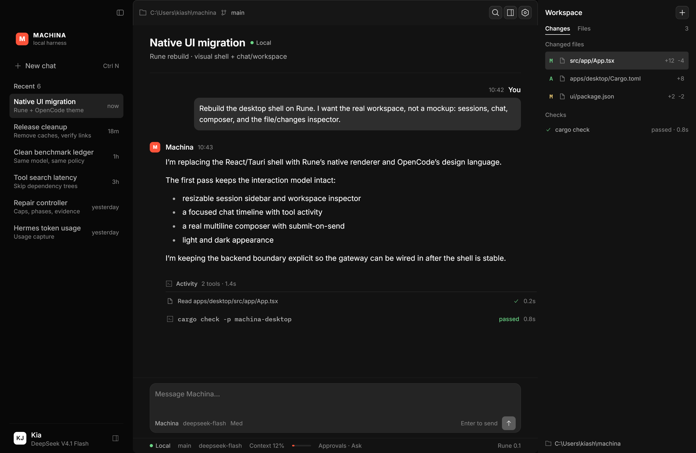

# Machina Desktop

Machina's native desktop workspace. It is a Rust application built with
[Rune](https://github.com/anomalyco/rune), rendered by Rune's GPU shell and
styled with OpenCode's `@opencode/ui` design language.

The layout follows Nous Research's Hermes Desktop philosophy: chat is the home
surface, panels are flat rather than boxed, tool activity is compact, and a
quiet status bar carries model, context, and approval state. Machina keeps its
own ember mark and voice.

The old React/Tauri implementation was removed during the Rune migration. Its
history remains available in Git. The backend gateway is not wired into this
shell yet; the first milestone is the visual workspace below.



## Run

From the repository root:

```bash
cargo run --manifest-path apps/desktop/Cargo.toml
```

The app is pinned to Rune `dev` revision
`7dfaa8fb1fa8281e6e2ccc92568d95262e9c6f3c` and Rust `1.99.1`.

## Check

From `apps/desktop` (so the pinned toolchain file is picked up):

```bash
cargo test --locked
cargo fmt --check
cargo clippy --locked --all-targets -- -D warnings
```

Headless snapshots are part of Rune. They need no window:

```bash
cargo run --manifest-path apps/desktop/Cargo.toml -- \
  --snap apps/desktop/docs/rune-shell-dark.png
cargo run --manifest-path apps/desktop/Cargo.toml -- \
  --scene light --snap apps/desktop/docs/rune-shell-light.png
```

## Current milestone

- OpenCode-themed Rune application shell with Machina's ember identity.
- Chat-first layout, resizable session sidebar, and workspace inspector.
- Flat activity rows, user-message surface, and a compact lower status bar.
- Multiline composer with draft clearing, send button, and keyboard submit.
- Dark and light appearances with a headless scene for each.
- Seeded shell state behind an explicit boundary for the gateway port.

Next: connect the composer and transcripts to Machina's JSON-RPC gateway,
then port sessions, approvals, jobs, memory, and settings into native Rune
surfaces.
