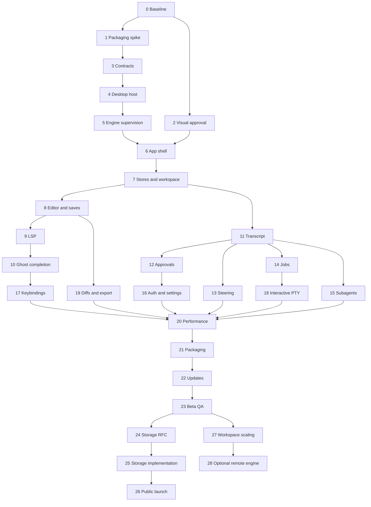

# Machina Desktop Implementation Plan for OpenCode

> **For agentic workers:** REQUIRED SUB-SKILL: Use superpowers:executing-plans
> to implement this plan task-by-task when that skill is available. Native
> execution is the default; delegate only when explicitly authorized. If the
> skill is unavailable, follow the execution contract below without pretending
> a skill was loaded. Steps use checkbox (`- [ ]`) syntax for tracking.

**Goal:** Deliver a polished, responsive Windows/macOS graphical code editor
with the existing Machina harness, a small honestly measured desktop client,
and a path from engineering preview to a maintainable public product.

**Architecture:** A Tauri 2 Rust host supervises an existing Python engine over
authenticated stdio JSON-RPC. A React/TypeScript renderer uses CodeMirror 6 and
feature-scoped stores. Preserve the existing terminal client; migrate shared
contracts and services incrementally, with packaging and storage as separate gates.

**Tech Stack:** Tauri 2; Rust; React; TypeScript; Vite; CodeMirror 6; a small
accessible primitive set; selector-based stores; measured virtualization;
xterm.js/portable-pty for human terminals; existing Python/asyncpg/PostgreSQL.

**Spec:** [MACHINA_DESKTOP_SPEC.md](MACHINA_DESKTOP_SPEC.md). Read it in full.

**Status:** Proposed plan only. No desktop application has been implemented.
The user asked to undo the terminal style collection; do not restore it.
OpenCode is the executor of this plan, not a shipped application dependency.

## Global constraints

1. Windows and macOS are first-class. No WSL, Bash or GNU-only utilities are
   required for the normal Windows development/build/test path.
2. Preserve existing harness behavior, data and credentials. No broad Rust rewrite.
3. Preserve the terminal client's ability to run throughout the desktop preview.
4. UI fonts and code fonts are controlled separately in the desktop application.
5. No daily F-key defaults. Do not bind pane navigation to OS word-motion keys.
6. Enter queues steering during work; Escape uses the focused interaction's
   precedence before interrupting the agent. Background never reruns a command.
7. All visual directions are proposals until the user approves the actual
   direction/prototype. Protocol and packaging spikes can continue independently.
8. Client <=10 MiB compressed is a goal, not a verified claim. Investigate >15 MiB.
   Measure client, engine, OS prerequisites and total installation separately.
9. A public release must not require manual Python/Node/Rust/Docker installation.
   Engineering previews may explicitly use the existing development environment.
10. No claim of hallucination-free AI. Show real evidence and explicit unknown states.
11. Do not persist ephemeral subagent chats after safe report transfer. Closing an
    inspection view must not cancel a working child or erase its report.
12. Use checked-in lockfiles and reproducible platform builds. Resolve exact
    supported package versions in Task 1; avoid copying moving upstream ranges.
13. Separate desktop UI state from `interface_style`; that rejected terminal
    preference has been removed. Do not reintroduce a four-style menu by default.

## Review focus

- Older/stale callbacks: new workspace or document versions must fence old LSP,
  file-save, job and agent callbacks. Test in Tasks 4, 8, 9, 10 and 15.
- User work during failures: renderer reload, engine crash, update and dirty
  file conflicts must retain drafts and never silently replay mutations. Tasks
  5, 8, 13, 16 and 22 own those tests.
- OS differences: IME, keyboard layout, clipboard, CRLF, case rules, process
  trees and native webview behavior must be tested on Windows and macOS, not
  inferred from a Linux/browser pass. Tasks 8, 10, 17, 18, 21 and 23.
- Truthful scale claims: installer size, idle CPU, whole-process RAM and long-chat
  input latency must include the actual runtime/components being advertised.
  Tasks 1, 20, 21, 23 and 26 produce the evidence.
- Authority and ownership: agent output cannot grant itself human PTY authority,
  approve its own tools or stop another engine's jobs. Tasks 3, 5, 12, 14 and 18.

## Execution contract for OpenCode

### Before any modification

- Read this plan and the spec. Read applicable `AGENTS.md` files before editing.
- Record `git status --short`, the branch, HEAD and staged state. Current planning
  baseline is HEAD `86dd783`, but the working tree contains later steering/job
  work. HEAD alone is not the implementation baseline.
- Inspect local changes before creating an isolated workspace. Do not lose the
  pending steering/background work by starting from a clean old HEAD.
- Do not stash, clean, reset, format or commit unrelated user files. The existing
  `.pytest-run-20261026/` is unrelated; leave it alone.
- If Git requires a safe-directory override, use a per-command
  `git -c safe.directory=<resolved repo> ...`; avoid a global config mutation.
- Record available Node/Python/Rust versions and platform-native toolchains.
  A missing tool is a setup result, not permission to claim its checks passed.

### Work in deliverable-sized increments

For each task: inspect its dependencies; add a behavior test that fails for the
missing behavior; implement; run its targeted checks; run the relevant broader
checks; record evidence and a focused commit when the working-tree ownership
permits it. Do not commit the user's other pending work accidentally.

Maintain `docs/plans/desktop-progress.md` with: task, files changed, exact command,
exit status, artifact paths, measured values, remaining risks and next step.
Label facts, proposals and untested assumptions separately. Never claim a native
platform is verified from a browser-only test or a build on another OS.

Do not stop after scaffolding, mock screens or green unit tests. Continue to a
working vertical slice with the actual local engine, packaged application and
long-session measurements. Pause only for the visual approval gate, destructive
data operations, external publishing/signing credentials, or a real unresolved
product decision that changes the approved scope.

### Plan boundaries

Tasks 0–23 deliver the desktop preview/beta path. Tasks 24–28 are explicit scale
workstreams with their own gates, not prerequisites for drawing the first window.
An instruction to execute the desktop preview does not automatically authorize
the database port, remote hosting, billing or a marketplace.

## Delivery map

| Gate | Tasks | Concrete proof |
|---|---|---|
| G0: approved foundation | 0–2 | Baseline, measured packaging spike, approved visual prototype |
| G1: honest desktop shell | 3–6 | Native window connects to real engine; failures recover visibly |
| G2: actual editor | 7–10 | Explorer, edit/save/undo, LSP and Tab ghost completion |
| G3: actual harness | 11–15 | Long transcript, steering, approvals, jobs, temporary child inspection |
| G4: complete daily workflow | 16–19 | Auth/models/settings/keys/PTY/diffs/export/native ergonomics |
| G5: desktop beta | 20–23 | Performance evidence, packaged Windows/macOS, safe updates and QA |
| G6: public local product | 24–26 | Storage choice, migration parity and clean-machine first run |
| G7: future scale | 27–28 | Workspace isolation and optional remote architecture independently approved |



## Proposed repository boundaries

Paths below are intended additions, unless marked existing. Do not claim they
already exist. Create only the files needed by the current task.

```text
package.json                         new npm workspace for desktop/contracts only
package-lock.json                    new lock; keep ui/package-lock.json intact
packages/contracts/
  package.json
  src/{events,rpc,workspace,errors,index}.ts
  test/contracts.test.ts
apps/desktop/
  package.json, package-lock policy inherited from root workspace
  vite.config.ts, tsconfig.json, index.html
  src/
    app/{App,bootstrap,routes}.tsx
    bridge/{types,tauri,fixture}.ts
    state/{connection,workspace,sessions,transcript,activity}.ts
    features/
      editor/{EditorPane,CodeMirrorHost,documentSync,positions,completion,ghost}.*
      explorer/{Explorer,treeStore,quickOpen}.*
      harness/{Harness,Transcript,MessageRow,Composer,SteeringQueue}.*
      approvals/{ApprovalDock,approvalStore}.*
      jobs/{JobStrip,JobOutput,jobStore}.*
      agents/{AgentInspect,agentStore}.*
      settings/{Settings,Providers,Models,Keybindings,Appearance}.*
      terminal/{TerminalPane,ptyClient}.*
      review/{DiffView,reviewStore}.*
    design/{tokens.css,base.css,components.css}
    commands/{registry,bindings,resolveKey}.ts
  src-tauri/
    Cargo.toml, Cargo.lock, tauri.conf.json, build.rs
    capabilities/main.json
    src/{main,lib,commands}.rs
    src/engine/{mod,supervisor,rpc,framing,manifest,install}.rs
    src/pty/{mod,manager,protocol}.rs
    src/platform/{mod,windows,macos}.rs
  test/{unit,integration,e2e,fixtures}/
tools/desktop/                        tracked tooling, not ignored scripts/*
  capture.mjs, perf.mjs, size.mjs, verify-release.py, smoke.py
docs/plans/{desktop-progress,desktop-decisions}.md
docs/verification/desktop/             redacted reports and shareable evidence
```

`ui/` remains the current pi-tui application. Do not turn it into a web frontend
in place. Shared packages must not import `pi-tui`, Node child-process APIs,
React or Tauri. Do not move terminal components into the shared package.

## Proposed interfaces and invariants

The following names are proposed internal interfaces. Backend additions must be
explicitly implemented, registered, documented and tested before frontend use.

```ts
type ConnectionState =
  | 'not-installed' | 'installing' | 'starting' | 'ready'
  | 'disconnected' | 'incompatible' | 'stopping' | 'failed';

interface EngineRef { id: string; generation: number }
interface RequestOptions { signal?: AbortSignal; timeoutMs?: number }
interface RuntimeIdentity {
  engineVersion: string; protocolVersion: number;
  capabilities: string[]; storageProfile: 'postgres' | 'embedded';
}
interface DesktopEvent {
  engine: EngineRef; sequence: number;
  payload: GatewayEvent | WorkspaceEvent;
}
interface DesktopBridge {
  request<T>(engine: EngineRef, method: RpcMethod, params: unknown,
    options?: RequestOptions): Promise<T>;
  subscribe(engine: EngineRef, listener: (event: DesktopEvent) => void): () => void;
  state(engine: EngineRef): ConnectionState;
}
```

`GatewayEvent` derives from `machina/protocol/events.json`. `WorkspaceEvent`
derives from the existing workspace contract after dependency extraction.
`RpcMethod` is a generated or centrally declared allowlist of actual registered
methods plus reviewed desktop additions. Generic typing is not runtime validation.
Reject arbitrary method names and invalid params at the host boundary.

Package names: `@machina/contracts` and `@machina/desktop`. Use one root npm
lockfile for these new workspaces. `ui/package-lock.json` remains independent.
DOM-specific `AbortSignal` and the renderer bridge live in `bridge/types.ts`,
not the platform-neutral data-contract package.

Rust-facing commands: `engine_start(EngineLaunchSpec) -> EngineRef`,
`engine_request(EngineRef, RpcRequest) -> RpcResult`,
`engine_snapshot(EngineRef) -> RuntimeSnapshot`, and
`engine_stop(EngineRef, StopReason) -> ShutdownReport`.
The host mints IDs/tokens/generations; the renderer cannot choose them.

Define the host payloads in Task 4 and their runtime implementation in Task 5:

```ts
interface EngineLaunchSpec {
  workspaceRoot: string;
  componentVersion?: string;
  developmentInterpreter?: string; // only explicit development builds/settings
}
interface RpcRequest { id: number; method: RpcMethod; params: Record<string, unknown> }
type RpcResult = { result: unknown } | { error: { code: number; message: string } };
type StopReason = 'window-close' | 'workspace-switch' | 'update' | 'user-restart';
interface ShutdownReport { graceful: boolean; forced: boolean; remainingOwnedPids: number[] }
interface RuntimeSnapshot {
  engine: EngineRef; identity: RuntimeIdentity; state: ConnectionState;
  activeTurns: Array<{ sessionId: string; turnId: string; state: string }>;
  pendingApprovalIds: string[];
  jobs: Array<{ sessionId: string; id: string; status: string }>;
  continuity: 'same-process' | 'restarted' | 'unknown';
}
```

The request ID namespace is host-owned: rewrite renderer correlation IDs as
needed before writing gateway frames, then route results to the correct caller.
`DesktopBridge.request<T>` unwraps `RpcResult` or throws a typed error. PIDs in a
shutdown report are host diagnostics, not a process-control capability. A caller
cannot use a PID from the report to kill an arbitrary process.

Initial host limits: 4 MiB maximum RPC frame, 64 pending requests per engine,
4 MiB bounded inbound staging queue and 256 KiB redacted diagnostic tail.
Validate actual existing frame sizes in Task 3. Large artifacts use chunked or
paginated APIs. Backpressure must not discard lifecycle events. If a queue cannot
drain within its bound, detach the affected subscriber and require a snapshot;
do not silently lose an approval/completion or block engine stdout indefinitely.

### Proposed backend additions

| New contract | Purpose / semantics |
|---|---|
| `runtime.capabilities` | Version and optional-feature negotiation; no inferred support |
| `runtime.snapshot` | Active turns, pending approvals and job metadata scoped to authorized context |
| `session.history.page` | Stable cursor pagination, limit 1–200; no embeddings; parent/child ownership checks |
| `shell.output` | Job ID, offset/revision and <=64 KiB chunk; explicit truncation/gap indicator |
| `prompt.submit` idempotency extension | Optional client request key, atomic claim and receipt lookup before retries |
| `prompt.steer` idempotency extension | Optional queue request key preventing duplicated steering on retries |

`runtime.capabilities` accepts no operation-changing parameters and still
requires the host token. It works before DB initialization so the host can
diagnose incompatible engines. `runtime.snapshot` is called after initialization
with the current session/workspace context, validates ownership, and includes
only that authorized context's state. A DB outage is returned as a degraded
capability/status, never fabricated empty durable state.

Implement only contracts needed by an active task. The runtime snapshot must
distinguish durable state from gateway-local state lost on engine restart.
Do not manufacture replay for events not actually persisted. Initially disable
automatic mutation retries; add replay only after the idempotency tests pass.

## Task 0: baseline and ownership audit

**Files:** create `docs/plans/desktop-progress.md`,
`docs/verification/desktop/baseline.md`; read existing source and CI.

**Interfaces:** consumes the actual working tree; produces a recorded baseline,
feature parity matrix and an explicit list of pending changes being preserved.

- [ ] Record Git state, tool versions, environment capability checks and the exact
  engine launcher currently used. Do not print secrets or database URLs.
- [ ] Run `npm ci` then `npm run check` inside `ui/`; run
  `python -m pytest tests -q -p no:cacheprovider` from the repository with a unique
  temporary `--basetemp` if default Windows temp permissions are broken.
- [ ] Read `.github/workflows/ci.yml` and classify Machina-DevTools tests as
  portable/native or Unix-wrapper-only. Keep the Unix wrapper in Linux CI;
  invoke portable Python tests directly on Windows with an explicit import path.
- [ ] Record expected editor/auth/provider/steering/job/agent behavior and current
  known failures. A prior report of green tests is not a new verification result.
- [ ] Add no desktop source yet. Save baseline evidence and a task ledger entry.

**Exit:** Current application behavior and pending user changes are known. No data
or functionality disappeared while preparing the migration.

## Task 1: native feasibility and size spike

**Files:** create a disposable spike under a documented isolated directory;
produce `docs/verification/desktop/feasibility.md` and
`docs/plans/desktop-decisions.md`. Do not ship the spike as the product.

**Interfaces:** produces pinned toolchain recommendations, measured client/engine
size breakdown, tested host/engine startup and minimum supported OS versions.

- [ ] Build a minimal Tauri 2 + React window natively on Windows x64 and macOS
  arm64. Build macOS x64 separately or document the explicit support decision.
- [ ] Measure stripped release executable, compressed installer, installed app,
  WebView prerequisites and all processes' idle working sets. Compare like units.
- [ ] Connect the spike to the existing gateway with a host-generated token.
  Verify `initialize` and a read-only status call with a real database.
- [ ] Measure an engine package using locked Python dependencies and a one-folder
  frozen distribution. Compare startup to a managed standalone-Python layout;
  choose the smaller reliable candidate, recording import/plugin/SSL failures.
- [ ] Confirm Python native extension and credential-store imports on clean
  machines. Do not include optional embeddings, browser engines or ML runtimes
  unless needed by the chosen feature profile.
- [ ] Pin compatible Rust/Tauri/React/CodeMirror/Vite/TypeScript/test-driver
  versions; generate lockfiles. Record licenses for runtime and font assets.
- [ ] Write exact size budgets for the engine/offline bundle from measurements.
  If a 10 MiB total installation is impossible with retained services, say so.

**Exit:** The architecture runs on both platforms and has a defensible size and
startup baseline. No claim that a minimal hello-world size is Machina's size.

## Task 2: visual direction and interactive prototype

**Files:** create `docs/design/DESKTOP_BRIEF.md` and visual evidence under
`docs/verification/desktop/design/`; disposable prototype as needed.

**Interfaces:** consumes user/editor/harness requirements; produces an explicitly
approved direction, state inventory, reusable tokens and responsive layout rules.

- [ ] Read PRODUCT.md/DESIGN.md as current terminal context; do not treat the
  rejected terminal styles as approved desktop directions.
- [ ] Show 2–3 directions differing in workspace topology, typography, density,
  disclosure and interaction. Include actual editor text, tool evidence, a diff,
  queued prompts and subagent inspection. No dashboard replacing the editor.
- [ ] Generate direction probes if image tools are available. If unavailable,
  use real interactive UI probes and record the limitation honestly.
- [ ] Implement the leading direction as an interactive prototype with 50+ rows
  of realistic content, empty/loading/failure states, keyboard focus and resizing.
- [ ] Inspect 1440×900, 1280×800 and 1024×768; verify 200% zoom, reduced motion,
  long provider names, font substitution and high-contrast/focus visibility.
- [ ] Obtain approval of the visual brief/prototype before production visual
  implementation. Record chosen design and corrections, not just a style name.

**Exit:** The user has seen and approved the actual direction. This is the
deliberate approval gate that prevents another palette-and-ASCII-only redesign.

## Task 3: shared contracts without terminal dependencies

**Files:** create `packages/contracts/`; modify existing `ui/src/events.ts`,
`ui/src/protocol.ts`, `ui/src/workspace/protocol.ts` as compatibility facades;
add `tools/desktop/generate-contracts.py` if generation requires a command.

**Interfaces:** exports `GatewayEvent`, `WorkspaceEvent`, `RpcMethod`, shared
result types, runtime validators and `ProtocolError`; preserves old UI imports.

- [ ] Add failing tests for canonical event parity, two event families, unknown
  versions, invalid nested values, oversized frames and browser-safe imports.
- [ ] Extract only pure data contracts. Audit every transitive import for
  Node/pi-tui/React/Tauri dependencies; fail the package build if one enters.
- [ ] Define the centrally registered method allowlist from the real gateway.
  Document generation vs hand-maintained maps and test for drift.
- [ ] Preserve existing TypeScript import paths with re-exports. Do not rewrite
  the whole terminal app or change wire spellings for aesthetic reasons.
- [ ] Add root npm workspace configuration for `packages/*` and `apps/desktop`.
  Keep the terminal `ui/` install and lockfile independent for this migration.
- [ ] Run contract tests, browser bundling/type checks and the existing UI suite.

**Exit:** Both UIs can consume the same contracts; old clients still build.

## Task 4: Tauri host and bounded RPC bridge

**Files:** create `apps/desktop/src-tauri/`, `src/bridge/{types,tauri,fixture}.ts`,
Rust `engine/{rpc,framing}.rs`; add bridge unit/integration tests.

**Interfaces:** implements `DesktopBridge` and `engine_request`; emits ordered
`DesktopEvent` envelopes with engine identity and receive sequence.

- [ ] Add failing tests for split UTF-8 bytes, multiple frames per chunk, partial
  JSON, malformed JSON, oversized frames, duplicate response IDs, unsolicited
  responses, request timeout and channel-close rejection of all pending promises.
- [ ] Register listeners before startup snapshots/requests; test that an early
  `tool.start` or completion between subscribe and initialize is not lost.
- [ ] Inject the gateway token in Rust. Never return it in runtime identity,
  frontend errors, devtools state dumps or normal logs.
- [ ] Implement queue/pending limits from the interface section, cancellation of
  local waits and generation fencing after engine replacement. A canceled wait
  is not automatically a canceled engine operation.
- [ ] Add a fixture transport implementing exactly the same interface, with
  deterministic event scheduling; no mock-specific branches in product code.
- [ ] Verify bridge tests and a real read-only initialize/status round trip on
  each native OS. Fail unsupported protocol versions with an actionable screen.

**Exit:** A bounded, authenticated bridge works with real stdio and rejects stale
engine events. No renderer network port or arbitrary shell execution API.

## Task 5: engine supervision and database lifecycle

**Files:** add Rust `engine/{supervisor,manifest}.rs`, platform ownership helpers;
add `machina/desktop/{__init__,__main__,bootstrap}.py` as a narrow engine launcher;
reuse `machina/db/lifecycle.py`; create `machina/gateway/features/runtime.py` and
register its two methods in the existing feature registry; add
`tests/test_desktop_bootstrap.py` and `tests/test_desktop_runtime.py`.

**Interfaces:** implements `engine_start`, `engine_snapshot`, `engine_stop` and
the connection-state machine. A launch spec selects an installed engine component
or an explicit development interpreter, never a model-supplied executable path.

- [ ] Test missing interpreter/component, unsupported runtime, DB unavailable,
  first-run managed-DB startup, engine crash and startup stderr containing noise.
- [ ] Implement `runtime.capabilities` and `runtime.snapshot` with the exact
  pre-initialize/authorized-context semantics above. Test wrong token, wrong
  session, DB outage and gateway-local queues lost after a real engine restart.
- [ ] Implement the desktop bootstrap: acquire a `desktop` DB lease when the
  existing policy permits management; launch/serve the gateway; release only
  this launcher's lease in a guaranteed shutdown path. Do not stop external DBs.
- [ ] Keep stdout exclusively framed RPC. Redact/bound stderr separately.
- [ ] On Windows use hidden process startup and process-tree ownership compatible
  with the engine's own shell Job Objects. On macOS manage process groups and
  intentional descendant termination. Test nested jobs, not just launcher PID.
- [ ] Test graceful shutdown, cancellation-resistant work, force-close escalation,
  process exit before readiness and multiple stop requests racing each other.
- [ ] On crash retain renderer drafts and present retry/restart. Do not replay
  prompt submission or interpret a lost connection as successful completion.
- [ ] Document preview-only DB prerequisites and engine component version mismatch.

**Exit:** Desktop starts/stops the actual engine correctly and does not orphan
commands or kill another client's managed database lease.

## Task 6: production application shell from the approved design

**Files:** add `src/app/`, `src/design/`, shared accessible primitives and the
minimal `features/editor`, `features/harness` shells.

**Interfaces:** consumes approved DESKTOP_BRIEF and bridge connection state;
produces the retained workspace regions and command focus ownership.

- [ ] Add interaction tests for region resizing, collapsed explorer/harness,
  keyboard focus restoration, modal dismissal and OS titlebar controls.
- [ ] Implement approved typography, spacing, surfaces, icon set and hierarchy;
  independently configurable UI/code fonts. Self-host only required font files.
- [ ] Start with real startup/connection states and a usable untitled buffer.
  Engine unavailability must not freeze the window or erase typed text.
- [ ] Preserve component/editor instances when opening settings or resizing.
  Never remount CodeMirror because a chat token arrived.
- [ ] Implement reduced motion and native minimize/maximize/close behavior;
  verify draggable titlebar areas exclude buttons and text selection.
- [ ] Capture actual browser and native frames, critique against the approved
  prototype, fix defects and recapture. No mock screenshots as completion proof.

**Exit:** The graphical shell matches the approved design and stays interactive
through engine startup, failure and panel changes.

## Task 7: normalized state and workspace/explorer integration

**Files:** add `src/state/`, `features/explorer/`, workspace feature adapter;
reuse `packages/contracts` and existing Python workspace handlers.

**Interfaces:** state is keyed by engine generation, workspace identity/epoch,
session ID, turn ID and entity ID as applicable. Export selectors and explicit
commands; no mutable global singleton containing all application text.

- [ ] Test stale workspace events, root switches with pending list/read calls,
  untrusted paths, unreadable directories and large/paginated file trees.
- [ ] Implement `workspace.open`, listing, lazy expansion and quick open using
  existing server-issued binding/epoch, not frontend-computed authorization.
- [ ] Virtualize large lists; cancel or drop superseded search results. Load
  icons/languages lazily instead of bundling every possible asset at startup.
- [ ] Record update/render counters: streaming into one message cannot notify
  every document, tree item or session-list subscriber.
- [ ] Preserve selection and tree anchors across refresh; handle paths with
  spaces, Unicode, Windows drives/UNC and case differences through backend rules.

**Exit:** A real workspace opens and searches while the code/harness state stays
isolated. Nothing falls back to unrestricted renderer filesystem access.

## Task 8: CodeMirror editing, document sync and safe saves

**Files:** add `features/editor/{CodeMirrorHost,documentSync,positions}.*` and
tests; preserve `machina/workspace/{files,documents,service}.py` semantics.

**Interfaces:** `DocumentController.open(uri)`, `applyLocalChange(transaction)`,
`flush(documentId)`, `save(documentId)` and `close(documentId, decision)`;
adapter versions use the existing document mirror protocol.

- [ ] Test read/edit/undo/redo, tabs, dirty close, save-all with partial failure,
  external modifications, read-only files, deleted files and revision conflicts.
- [ ] Add conversion tests for UTF-16 LSP positions against CodeMirror offsets:
  emoji, combining characters, non-BMP characters, CRLF and final empty lines.
- [ ] Edit immediately in CodeMirror; batch incremental mirror changes in order.
  Save and intelligence flush changes first; reject stale acknowledgments.
- [ ] Preserve existing atomic-save/expected-revision protection. Never resolve a
  conflict by overwriting disk without the user choosing that resolution.
- [ ] Verify switching tabs, session views, settings and panel layout preserves
  local edits, cursor, undo history, selections and scroll.
- [ ] Test engine disconnect while typing/saving. Retain the buffer and show
  unsaved/unknown outcome until reconciliation establishes what reached disk.

**Exit:** Real files can be edited and saved safely with versioned synchronization.
This is an actual editor, not a textarea with syntax coloring.

## Task 9: language intelligence through the existing LSP service

**Files:** add `features/editor/completion.ts`, diagnostics/navigation adapters;
extend only demonstrated gaps in `machina/workspace/intelligence.py` or `lsp.py`.

**Interfaces:** `requestIntelligence(operation, documentSnapshot, signal)` returns
version/epoch/generation-bound results from existing `workspace.intelligence`.

- [ ] Test missing/starting/ready/crashed servers, restart generations, diagnostics,
  completion, hover, definition and references. Show real missing-server states.
- [ ] Integrate CodeMirror completion UI and diagnostic decorations. Convert
  ranges at the single positions adapter, not separately in every feature.
- [ ] Validate multi-file edits and edits with mixed versions before applying.
  Preserve all affected undo histories and preview unsupported edits honestly.
- [ ] Test slow responses arriving after edits, root/tab switch, server restart,
  and closing a document. None may alter the new document or wrong cursor.
- [ ] Native smoke on Python and TS/JS projects, with actual installed servers
  on both OSes. Tool installation is separately consented and progress-visible.

**Exit:** LSP completion/navigation/diagnostics work against the actual buffer.

## Task 10: ghost completion and unambiguous Tab behavior

**Files:** add `features/editor/ghost.ts`, completion policy and backend completion
adapter if needed; add focused UI and request-cancellation tests.

**Interfaces:** `GhostController.request(snapshot)`, `accept()`, `dismiss()`;
snapshot binds document version, cursor, selected model/provider and workspace epoch.

- [ ] Write a Tab precedence test: IME composition is untouched; selected LSP
  completion is accepted; eligible ghost text is accepted; otherwise indent.
- [ ] Test stale/out-of-order completion, document closure, selection changes,
  multiple cursors and text already containing the proposed suffix.
- [ ] Render ghosts as decorations, never as buffer content until accepted.
  Undo after accept must restore the previous document in one expected step.
- [ ] Debounce requests, cancel superseded work, limit context/tokens and avoid
  fetching the whole repository. Keep the setting opt-in with clear availability.
- [ ] Keep completion latency independent of chat token traffic; budget and
  rate-limit completion separately from planner/subagent calls.
- [ ] Test keyboard/IME behavior natively on Windows and macOS. Do not claim
  smooth completion using only canned fixture text.

**Exit:** Tab and ghost suggestions behave predictably and never insert stale text.

## Task 11: virtualized transcript and paginated history

**Files:** add `features/harness/{Transcript,MessageRow}.*`,
`state/transcript.ts`; create `machina/gateway/features/history.py`, register
`session.history.page`; add backend cursor and frontend virtualization tests.

**Interfaces:** `loadHistoryPage(sessionId, cursor?, limit=200)` returns ordered
items, opaque next cursor and explicit end-of-history; event reducers update
only the addressed entity.

- [ ] Add backend tests for equal timestamps, cursor boundaries, deletion,
  concurrent new messages, ownership checks, limit bounds and no duplicated rows.
- [ ] Test a user/assistant/tool turn split across page boundaries. Preserve
  tool identity/outcome and message grouping without requiring every preceding
  page to remain hydrated; the response includes the needed stable record IDs.
- [ ] Implement history projection without embeddings or eagerly loading every
  artifact. Reuse canonical serializers and stable event ordering where available.
- [ ] Test variable-height virtualization, expanding old output, code font changes,
  image dimensions and prepend pagination preserving the scroll anchor.
- [ ] Freeze completed Markdown; batch streaming updates into one frame; move
  costly parsing/highlighting off hot input paths and use workers when measured.
- [ ] Do not force-scroll when the user is reading older messages. Offer a clear
  return-to-latest action. Search uses backend/history indexes, not mounted DOM.
- [ ] Enforce 1,000 hydrated records/250 mounted message rows by default, with
  paging and refetch for unloaded history. Record behavior for expanded artifacts.
- [ ] Load the real Monster Hunter session read-only for local verification;
  use generated shareable 10,000-message fixtures in CI.

**Exit:** History length no longer scales per-keypress rendering work. The UI
shows actual canonical messages and paginates older history without loss.

## Task 12: approvals and truthful tool outcomes

**Files:** add `features/approvals/`, tool-row presentation; use existing broker
and `approvals.*` gateway handlers; extend contracts only for actual missing data.

**Interfaces:** approval view keyed by request/session/turn/action identity;
`resolveApproval(requestId, verdict)` sends the existing bound request.

- [ ] Test awaiting/running/success/error/denied/interrupted/unknown states.
  A transport close or missing completion never renders a green success mark.
- [ ] Test queued approvals, external resolution, stale action IDs, partial
  evidence loading and restricted approval choices. Model text cannot approve.
- [ ] Show concise ordinary tools with expandable args/output; show critical
  evidence and destructive action targets before user approval.
- [ ] Keep focus on the pending approval while unrelated settings/management RPCs
  finish. Escape denies/dismisses according to the explicit approval interaction,
  not a hidden blanket action against the entire session.
- [ ] Display only user-visible plans/progress, never invented internal reasoning.

**Exit:** A person can assess and authorize the same exact action the engine
will execute, with honest tool completion state.

## Task 13: steering, draft durability and idempotent submission

**Files:** add `features/harness/{Composer,SteeringQueue}.*`, draft storage;
extend `machina/core/steering.py`, gateway submit/steer handlers and storage receipt
repository for explicit idempotency support; add behavioral race tests.

**Interfaces:** composer has independent `draft`, `submitting`, `queued`,
`delivered`, `failed` states. The queue item ID is distinct from a turn ID.
Request keys are scoped to the authorized session and operation.

- [ ] Test Enter idle starts a turn; Enter running queues; a tool boundary
  delivers queued text once; editing/removing a queue item does not mutate sent text.
- [ ] Test Enter/turn-complete race, submit receipt loss, duplicate request keys,
  reconnect, cancellation and overlapping queue snapshots. No dropped drafts.
- [ ] Add atomic request receipts for submit/steer before enabling automatic
  retries. Same key/different payload is rejected. Old clients without keys retain
  existing behavior. Store minimal payload hashes/IDs with an explicit retention policy.
- [ ] Persist local drafts atomically and recover corrupted draft storage without
  leaking text into diagnostics. Never persist provider keys with UI drafts.
- [ ] Implement Escape precedence and no automatic turn restart after interruption.
  Keep retained queued messages visibly pending with explicit retry/send actions.
- [ ] Test IME composition, paste, multiline input, large input limits and request
  failure while a new draft is being edited.

**Exit:** Steering and retries are lossless from the user's perspective and
side effects are not repeated after an ambiguous network/process outcome.

## Task 14: background command controls and bounded live output

**Files:** add `features/jobs/`; extend `machina/core/shell_jobs.py` and gateway
`shell.output` only as needed; preserve current `shell.jobs` controls.

**Interfaces:** `JobStore` keyed by engine/session/job identity;
`readOutput(jobId, offset, revision)` returns <=64 KiB plus next offset,
truncation/gap metadata and real state/exit code.

- [ ] Test Background on an existing foreground command preserves PID/process
  identity and approved deadline, releases its waiter and never executes it twice.
- [ ] Explain the deadline in the control state. An explicitly background-launched
  command can be unlimited; moving a bounded one does not silently extend authority.
- [ ] Test Output/Stop during running/stopping/completed/failed states; enforce
  session ownership and monotonic state under stale list responses.
- [ ] Stream bounded output only to an open visible subscriber, or poll at a
  bounded rate with one request in flight. Hidden viewers stop consuming output.
- [ ] Test >10 MiB output, missing pipe close, detached descendants, shell launcher
  exit, stop races, engine shutdown and Windows child-tree cleanup.
- [ ] Preserve output offsets across a truncated tail; indicate a gap instead
  of rendering duplicated or silently missing output as a complete log.

**Exit:** Visible controls work with actual jobs, and noisy commands cannot
freeze chat or inflate renderer memory without bound.

## Task 15: live subagent inspection and safe retirement

**Files:** add `features/agents/`; audit existing `machina/core/orchestrator.py`,
`machina/tools/agents.py`, child event serializers and export projection.

**Interfaces:** a worker has explicit created/running/reporting/waiting/retired/
failed states. Inspection views are projections, not independent chat owners.

- [ ] Test a temporary live tab appears during delegation, updates only its
  own output and closes at retirement. Idle view close remains available.
- [ ] Verify child final findings, tool evidence references and failure outcome
  attach to the parent before deleting the ephemeral child session.
- [ ] Test closing a view while the child is working, parent switching sessions,
  report persistence failure, child failure, follow-up work and duplicate events.
- [ ] Test export includes all delegated findings/evidence without requiring
  archived child chats to remain as permanent sessions.
- [ ] Preserve existing concise worker prompts, scoped memory retrieval and
  waiting-for-orchestrator behavior. Do not add personas or repeated chat summaries.
- [ ] Test the main orchestrator continues useful independent work and can issue
  follow-up tasks rather than stopping solely because it has delegated.
- [ ] Run 1/4/8-agent fixtures and a live low-cost integration case, tracking
  UI event volume, retained buffers, model latency and token use separately.

**Exit:** Users can see real delegated work without babysitting or accumulating
permanent child chats, and the parent retains every material result.

## Task 16: auth, models, providers, settings and runtime recovery

**Files:** add `features/settings/` and connection recovery screens;
reuse existing `machina/gateway/features/auth_*`, providers/models/config handlers.

**Interfaces:** one model selection determines provider routing; one credential/
endpoint manager edits actual backend state; settings use typed validated writes.

- [ ] Test subscription auth, API keys, custom compatible endpoints, invalid URLs,
  missing credentials, key removal, token expiry and logout while requests run.
- [ ] Use existing backend credential persistence and locking. Mask secrets in
  the form; never mirror OAuth tokens into renderer storage.
- [ ] Launch auth URLs through a scoped native opener. Validate supported schemes
  and callback state. Login cancellation leaves truthful reconnectable status.
- [ ] Show model catalog source/freshness/context/effort constraints from backend
  facts. A failed live catalog is explicitly a cached fallback, not a silent success.
- [ ] Provide one model picker; no redundant default-model selector or competing
  provider selector. Existing providers expose Edit/Remove/Back; Add creates one.
- [ ] Build searchable settings for workspace/editor, harness, keys/providers,
  fonts/appearance and shortcuts. Preserve user drafts and active work on changes.
- [ ] Test engine restart/auth failure while forms are open; recover without
  submitting a secret to the wrong provider or deleting the user's configuration.

**Exit:** Existing auth/catalog/provider behavior works in the real app with
one coherent settings flow and no secret leakage.

## Task 17: command registry, keyboard settings and native ergonomics

**Files:** add `src/commands/` and `features/settings/Keybindings.*`;
use existing keybinding configuration as an import source, not terminal byte codes.

**Interfaces:** commands have stable IDs, labels, enabled predicates, contexts
and configurable key sequences. `resolveKey(event, focusContext)` returns at
most one action or an explicit recorded conflict policy.

- [ ] Test platform Primary maps to Cmd on macOS and Ctrl on Windows without
  stealing OS word navigation, text selection, IME or standard editor shortcuts.
- [ ] Keep routine defaults off F keys. Define the default table in the approved
  brief and test it for unintended overlaps in simultaneously active contexts.
- [ ] Build centered searchable shortcut settings: command left, capture field
  right, replace-on-record behavior, explicit save/cancel and clear/reset actions.
- [ ] Warn about overlapping custom bindings but allow the user to keep them.
  Define deterministic precedence; never execute both destructive actions.
- [ ] Test Escape recording/cancel behavior so a recorded Escape is possible
  through an explicit capture control rather than an unescapable trap.
- [ ] Verify native clipboard paste, keyboard layouts, accent dead keys, trackpad
  scrolling, zoom, high DPI and screen-reader labels on both OSes.

**Exit:** The shortcut model is understandable and editable, and normal typing
continues to work inside every focused editor/form.

## Task 18: human interactive terminal, distinct from agent jobs

**Files:** add Rust `src/pty/`, `features/terminal/` and native PTY tests.

**Interfaces:** `pty_create(workspaceBinding, shellProfile, rows, columns)`,
`pty_write(ptyId, bytes)`, `pty_resize(ptyId, rows, columns)`,
`pty_close(ptyId)`; host-generated IDs scoped to the owning window/context.

- [ ] Test pwsh/cmd on Windows and the configured login shell on macOS;
  support spaces/non-ASCII working directories without command concatenation.
- [ ] Use portable-pty and xterm.js initially. Load terminal code only when
  opened; profile before adopting a WebGPU/libghostty integration.
- [ ] Bound output buffers and default scrollback to 5,000 lines; coalesce writes
  without dropping data silently. Suspend hidden terminal rendering, not its process.
- [ ] Label this as a user terminal. Agents continue to execute via the permission
  broker and shell-job lifecycle; do not expose this primitive as an agent tool.
- [ ] Test ANSI/OSC hyperlink, clipboard and title sequences against explicit
  permissions; terminal output cannot write clipboard or privileged app state silently.
- [ ] Test resize storms, pasted multiline commands, interrupt, launcher exit with
  children, window close and process ownership on both operating systems.

**Exit:** A real embedded terminal works, and adding it does not create a new
unrestricted execution route for the model.

## Task 19: diffs, artifact inspection, export and command discoverability

**Files:** add `features/review/`, command palette and export UI; reuse artifact
and session export backend services.

**Interfaces:** diff operations bind source revision/document version and a
specific proposed change; artifact reads are paginated/bounded by reference.

- [ ] Test accepting/rejecting hunks, stale source revision, overlapping edits,
  multi-file failure, undo and files changed externally during review.
- [ ] Show large tool output and artifacts on demand rather than eagerly mounting
  every result in the transcript. Explain unavailable/truncated evidence.
- [ ] Expose existing important slash actions through a searchable palette;
  retain slash entry in the composer where meaningful. Avoid duplicate menus.
- [ ] Test export of parent/subagent work, queued vs delivered prompts, failed
  tools and background job outcome metadata. Use a native save dialog.
- [ ] Preserve sanitization and do not auto-open untrusted exported HTML/content.

**Exit:** Users can inspect evidence, review changes and export a complete
session without navigating temporary subagent chats.

## Task 20: sustained performance and leak gates

**Files:** add `tools/desktop/{perf,capture}.mjs`, synthetic fixtures and
`docs/verification/desktop/performance.md`; add a native performance runner hook
only in test builds when required.

**Interfaces:** `perf.mjs --app <path> --fixture <name> --output <dir>` produces
JSON metrics, trace, process-tree memory and redacted screenshots; no model calls
unless the selected workload explicitly requests them.

- [ ] Implement scenarios for 10,000 messages, large Markdown/code/diffs, eight
  agents, five noisy jobs, repeated settings/tab cycles and 100,000-entry indexing.
- [ ] Measure input-to-paint and scroll frame distributions in a release build,
  not just reducer timings or request duration. Record p50/p95/p99 and outliers.
- [ ] Profile CPU allocation/render commits; verify a single stream updates only
  the active row/subscribers. Remove whole-transcript scans from hot paths.
- [ ] Enforce spec budgets for DOM rows, hydrated records, output tails, long tasks,
  CPU, memory and growth over 100 open/close cycles after comparable GC/warm-up.
- [ ] Run the real Monster Hunter session read-only locally. Store only metrics
  and redacted images; never commit user transcripts or send typing as prompts.
- [ ] Fix failures, rerun the failing scenario, then repeat the full stress pass
  on Windows and macOS without concurrent builds/test suites.

**Exit:** Performance is demonstrated in actual app workloads. A small download
does not substitute for evidence of responsiveness or memory efficiency.

## Task 21: reproducible client and engine distribution

**Files:** add `tools/desktop/{size.mjs,verify-release.py}`, engine freeze/build
configuration, Rust `engine/install.rs`, CI build workflow and runtime manifest schema.

**Interfaces:** signed component manifest identifies version, target triple,
compatibility range, compressed/unpacked bytes, digest, signature and entry point.
Installation is staged and atomic; development interpreter fallback is explicit.

- [ ] Test missing/corrupt manifest, wrong architecture, bad signature, truncated
  download, disk full, interrupted unpack, path traversal and denied install directory.
- [ ] Produce Windows x64, macOS arm64 and macOS x64 artifacts natively, unless
  macOS x64 is explicitly excluded in the approved support table.
- [ ] Package the engine separately without development/tests/optional model packs.
  Verify native libraries, CA roots, keyring, provider SDK and plugin imports.
- [ ] Use the system webview strategy deliberately: online Windows bootstrap and
  an offline installer option; show missing prerequisites before setup starts.
- [ ] Display total additional download and installed bytes before engine install.
  No hidden pip installs, arbitrary package execution or unversioned runtime fetches.
- [ ] Sign/notarize release artifacts with CI-managed credentials. Do not request
  private signing keys in chat or embed them in the repository.
- [ ] Emit size reports covering all categories in the spec; investigate client
  threshold failures and attribute each large dependency or asset.

**Exit:** A clean machine can install the tested beta package with a transparent
dependency story and no dependency on the developer's home directory.

## Task 22: safe updates and compatibility rollback

**Files:** add desktop update controller, engine component compatibility checks,
update manifest generation and `test/e2e/update.*`.

**Interfaces:** update states are available/downloading/verified/staged/applying/
failed; application is separate from checking/downloading. Client/engine pair
is validated before activation.

- [ ] Test bad signatures, missing target, stale channel, proxy/offline failures,
  engine/client version mismatch and partial update interruption.
- [ ] Download/stage in the background. Ask for an explicit restart when dirty
  documents, active turns, pending approvals or running jobs make restart material.
- [ ] Save recoverable drafts/layout, gracefully stop owned processes and apply
  only after work is safe. Canceling restart keeps the current application usable.
- [ ] Retain the last verified compatible engine/client activation record and
  recover from failed activation. Do not promise automatic installer rollback
  unless that exact installer path has been proven.
- [ ] Keep schema migrations additive/backward-compatible over the documented
  compatibility window. Refuse unsupported downgrades rather than corrupt data.
- [ ] Test an actual signed update between two packaged test releases on both OSes.

**Exit:** Auto-update is a verified workflow, not merely an updater dependency
listed in the manifest.

## Task 23: native acceptance, CI and beta release gate

**Files:** add platform CI matrix, packaged e2e suite, native test-only driver
configuration and `docs/verification/desktop/release-checklist.md`.

**Interfaces:** root desktop scripts: `desktop:check`, `desktop:build`,
`desktop:test`, `desktop:e2e`, `desktop:perf`, `desktop:size`; preserve existing CI jobs unchanged
unless a specific reviewed integration needs modification.

- [ ] Run frontend unit/integration checks, contracts, Rust tests/clippy/format,
  Python regression tests and existing terminal UI tests.
- [ ] Run renderer browser tests plus packaged native tests on WebView2 and
  WKWebView. Evaluate the currently documented WebdriverIO embedded driver;
  compile test plugins only into isolated test builds, never production artifacts.
- [ ] Verify WebView2 prerequisites, macOS signing/notarization, permissions,
  keychain/login, font fallback, DPI and minimum supported OS versions.
- [ ] Exercise install/open project/edit/complete/save/start agent/approve/queue/
  background/inspect child/export/restart/update/uninstall on clean machines.
- [ ] Verify uninstallation does not silently erase workspaces, credentials or
  user data; any optional user-data removal is explicit and accurately scoped.
- [ ] Review the entire branch once with a fresh reviewer if available; fix
  critical/material findings with failing regression tests and rerun checks.
- [ ] Publish only when requested. Attach actual artifact sizes, platform matrix,
  performance distributions and remaining limitations to the release candidate.

**Exit:** Desktop beta is demonstrably usable on both supported OSes. Unsupported
or untested cases are named; no universal compatibility claim.

## Task 24: local-storage scale decision and repository contracts

This is a separate project after the desktop preview works. It requires approval
of the storage RFC before data migration code. Recommended path is an embedded
local profile; keeping managed PostgreSQL is the fallback with an honest heavier
installation requirement, not a hidden dependency.

**Files:** create `docs/design/DESKTOP_STORAGE_RFC.md`,
`machina/storage/{contracts,capabilities}.py`, repository contract tests.

**Interfaces:** domain repositories for sessions/context, approvals/grants,
artifacts/usage, memory/retrieval, agent state and scheduled jobs. Do not create a
generic SQL-string compatibility shim pretending dialects share semantics.

- [ ] Inventory every direct database call and PostgreSQL-specific operation:
  pgvector/pg_trgm, JSONB, advisory locks, row locks, sequences, upserts, migrations
  and transaction isolation. Include modules outside `machina/db/`.
- [ ] Define observable domain contracts, transaction boundaries and lock scope.
  Add concurrent claim/reservation/approval tests before changing storage.
- [ ] Benchmark embedded candidates on indexing, history pagination, memory search,
  cancellation/recovery and eight-agent write contention. Measure extension size.
- [ ] Choose vector/keyword retrieval capabilities explicitly: an unavailable
  vector index is an exposed capability state, never silent semantic degradation.
- [ ] Specify backup, restore, migration/import, schema versioning and downgrade
  behavior. Preserve original PostgreSQL data until import is verified.
- [ ] Approve the RFC and revised full-install budgets before Task 25.

**Exit:** There is a justified, tested local-storage direction and a precise
inventory of semantic work; no naive search-and-replace SQL port.

## Task 25: embedded profile implementation and migration parity

**Files:** add repository-specific embedded implementations and migrations under
`machina/storage/`; migrate domain access incrementally; add shared backend tests.

**Interfaces:** the same approved repository contracts run against PostgreSQL and
the embedded profile. Capability negotiation exposes intentional feature differences.

- [ ] Port one domain at a time, starting with sessions/history. For each domain,
  run the same tests against both stores and test interrupted transactions.
- [ ] Implement correct turn claims, usage reservations, permission decisions and
  memory approval atomics under concurrent workers. No double execution after restart.
- [ ] Verify context order, embedding-space metadata, provenance, artifacts, child
  report ownership, export and scheduled-job recovery on the embedded backend.
- [ ] Implement explicit import with counts/digests and source-retention. Test
  malformed/large archives, permission-denied paths, disk full and canceled import.
- [ ] Test crash recovery, backup/restore, concurrent reads/writes, growth and
  corruption diagnostics on Windows/macOS filesystems.
- [ ] Keep PostgreSQL compatibility for existing operators and run its suite too.

**Exit:** Local installation can avoid Docker/PostgreSQL without losing the
required harness semantics or silently changing retrieval behavior.

## Task 26: public first-run and product-scale release

**Files:** implement setup/recovery flows, support bundle generator and public
installation docs; finalize installer/component manifest categories.

**Interfaces:** setup reports client, engine, storage and optional-feature readiness
independently, with repair actions and no secret-bearing diagnostic exports.

- [ ] Validate install/open folder/sign in/edit/agent workflow with no development
  toolchain on a fresh Windows and macOS machine.
- [ ] Make engine setup predictable, cancellable and resumable. Show storage
  location, additional downloads and optional model/tool packs before installing.
- [ ] Keep mandatory setup minimal. Provider auth can be deferred while local
  editing works; model/embedding downloads are separate explicit actions.
- [ ] Add opt-in redacted diagnostics and a support bundle preview. No default
  upload of project text, prompts, auth files, environment variables or raw logs.
- [ ] Repeat all size/CPU/RAM/performance gates with the exact public package.
  Set a full-install budget from measured dependencies and document its exclusions.
- [ ] Publish only with explicit authorization and a tested recovery channel.

**Exit:** A small-client claim is honest and ordinary installation works without
the developer setup that was acceptable for the engineering preview.

## Task 27: multiple workspaces/windows without state leakage

**Files:** extend host engine registry, workspace routing and feature stores;
audit backend runtime globals before sharing a process between workspaces.

**Interfaces:** a window binds to a host-minted context; operations always carry
that context. Capacity limits include per-context DB pools, PTYs, LSP servers,
agents and event buffers.

- [ ] Test two workspaces containing identically named files/sessions/jobs. Events,
  credentials, layout writes and approval responses must reach only their owner.
- [ ] Test close/reopen with late events, one engine crashing, cross-window dirty
  files and managed DB lease ownership.
- [ ] Choose measured per-workspace processes or an explicitly scoped multiplexed
  engine. Do not share current `RuntimeServices`/configuration globals blindly.
- [ ] Bound active contexts and idle resource retention. Never open unlimited
  engine processes or one DB pool per background tab without a capacity budget.
- [ ] Re-run long-session/eight-agent performance with two active contexts.

**Exit:** Multiworkspace is isolated and measured, not just a second window
pointing at the same mutable global backend state.

## Task 28: optional remote engine and organizational scale

This is a separately approved roadmap, not desktop MVP work.

**Files:** design a remote transport/server context RFC using existing HTTP/SSE
as a reference; do not simply expose the local stdio token over the network.

**Interfaces:** authenticated identities, per-user/workspace authorization,
versioned transport capability negotiation, request receipts and replay cursors.

- [ ] Establish threat model, tenant isolation, credential boundaries, project
  authorization and quotas. Local UI trust assumptions do not transfer to HTTP.
- [ ] Audit `machina/api/routes/rpc.py` shared gateway/config state before allowing
  multiple principals. Workspace and model changes must be context-scoped.
- [ ] Define resumable streams, idempotency, artifact transport, backpressure,
  rate limiting and behavior during uncertain side-effect outcomes.
- [ ] Add workload scheduling limits and observability without logging private
  prompts or treating every agent as a separate service deployment.
- [ ] Design PostgreSQL server scaling, connection pools and background workers
  against measured concurrent use. Add account/team/billing only if requested.

**Exit:** A remote product is evaluated as its own security/capacity project;
the local desktop remains usable without an account with Machina itself.

## Verification commands and ownership

Before Task 3 adds root scripts, the current commands are:

```text
cd ui
npm ci
npm run check

cd <repository>
python -m pytest tests -q -p no:cacheprovider --basetemp <unique writable temp dir>
python -m ruff check machina/ tools/
python -m ruff format --check machina/ tools/
git diff --check
```

Once the planned desktop scripts exist:

```text
npm ci
npm run desktop:check
npm run desktop:build
npm run desktop:e2e -- --app <packaged test application>
npm run desktop:perf -- --app <release application> --fixture long-chat
npm run desktop:size -- --artifacts <release artifact directory>
cargo test --manifest-path apps/desktop/src-tauri/Cargo.toml --locked
cargo clippy --manifest-path apps/desktop/src-tauri/Cargo.toml --locked --all-targets -- -D warnings
cargo fmt --manifest-path apps/desktop/src-tauri/Cargo.toml --check
```

Commands with placeholders must be resolved to the actual artifact paths. Do not
report a command as passed if the script has not been implemented. Use the current
CI's pinned Machina-DevTools checkout for external backend regressions; distinguish
Linux-only wrapper tests from portable underlying tests, as recorded in Task 0.

## Task-specific regression targets

Create these tests with their owning tasks. They are proposed test paths, not
existing files. Frontend `desktop:test` delegates to the desktop workspace's
`vitest run`, accepting a test-file path. Use DOM fixtures for fast component
tests and the native e2e suite for real webview/editor/IME behavior.

| Task | Primary regression target | Required assertion |
|---|---|---|
| 3 | `packages/contracts/test/contracts.test.ts` | Canonical parity, browser-safe imports, runtime validation |
| 4 | `apps/desktop/test/unit/bridge.test.ts` | Split UTF-8/framing, response correlation, stale generation fencing |
| 5 | `tests/test_desktop_bootstrap.py`; `tests/test_desktop_runtime.py`; Rust supervisor tests | Lease ownership, no orphan trees, restart continuity/authorization |
| 6 | `apps/desktop/test/integration/shell.test.tsx` | Retained editor/draft, keyboard focus, disconnected window remains usable |
| 7 | `apps/desktop/test/unit/workspace.test.ts` | Root-switch late response cannot affect new tree or document |
| 8 | `apps/desktop/test/integration/editor.test.tsx` | Versioned sync, conflict refusal, Unicode/CRLF, undo retention |
| 9 | `apps/desktop/test/integration/lsp.test.tsx` | Superseded server/document generations never apply stale edits |
| 10 | `apps/desktop/test/integration/ghost.test.tsx` | IME/LSP/ghost/indent Tab precedence and one-step accept undo |
| 11 | `tests/test_history_pagination.py`; `apps/desktop/test/integration/transcript.test.tsx` | Cursor stability, cross-page turns, anchor retention, row limits |
| 12 | `apps/desktop/test/integration/approvals.test.tsx` | Bound action identity, externally resolved queue, unknown outcome |
| 13 | `tests/test_prompt_idempotency.py`; `apps/desktop/test/integration/steering.test.tsx` | Lost response retry never duplicates submit/queue, drafts survive |
| 14 | `tests/test_shell_output.py`; existing `tests/test_shell_jobs.py`; job UI tests | Same-process detach, gap metadata, real exit status, ownership |
| 15 | `apps/desktop/test/integration/agents.test.tsx`; child report/export backend tests | Report transfers before deletion and inspection close does not cancel |
| 16 | `apps/desktop/test/integration/settings.test.tsx` | Auth binding, secret masking, model routes provider, no duplicate defaults |
| 17 | `apps/desktop/test/unit/bindings.test.ts`; native keyboard e2e | Conflicts deterministic, user override allowed, OS/IME behavior retained |
| 18 | Rust PTY tests; native terminal e2e | Resize/interrupt/tree retirement, model cannot access user PTY authority |
| 19 | `apps/desktop/test/integration/review.test.tsx` | Stale hunks refuse, multi-file outcomes preserved, full export |
| 20 | `apps/desktop/test/e2e/performance.*` | Actual input-to-paint, bounded history, no sustained retained growth |
| 21 | Rust installer tests; `tools/desktop/verify-release.py` | Signed correct-target components; reject zip traversal/corruption |
| 22 | `apps/desktop/test/e2e/update.*` | Staged signed update retains work; failed activation stays recoverable |
| 23 | `apps/desktop/test/e2e/daily-workflow.*` | Entire clean packaged install-to-workflow on both native platforms |
| 24–25 | `tests/storage_contracts/` | Identical domain semantics on PostgreSQL and approved embedded profile |
| 26 | Packaged first-run e2e | No manual development runtime install or hidden downloads |
| 27 | `apps/desktop/test/e2e/workspace-isolation.*` | Identical IDs/filenames cannot leak state across contexts |
| 28 | Future authenticated transport contract tests | Cross-principal isolation and ambiguous mutation retry correctness |

Example per-task cycle, once its scripts and test file exist:

```text
npm run desktop:test -- test/integration/ghost.test.tsx
# First run: fails for the absent/wrong Tab or stale-snapshot behavior.
# Implement the smallest correct change.
npm run desktop:test -- test/integration/ghost.test.tsx
# Second run: passes all targeted behavioral cases.
npm run desktop:check
# Type/lint/unit/integration checks all pass before recording the task as done.
```

Test commands alone are insufficient for visual acceptance: retain the native
screenshots and actual packaged workflow/performance results required above.

## Required failure matrix

| Input or event | Expected behavior | Primary tasks |
|---|---|---|
| Long chat + typing | No all-history parse/render on input | 11, 20 |
| Eight child agents streaming | Scoped updates, bounded buffers, responsive editor | 7, 15, 20 |
| Engine dies mid-tool | Unknown/interrupted status, retained draft, no fake success | 5, 12, 13 |
| Late LSP result after edit/root switch | Discard safely | 8–10 |
| Parent report cannot persist | Keep child evidence until transfer succeeds | 15 |
| Existing provider edited during login | Bind auth to its original provider or cancel safely | 16 |
| Foreground command sent to background | Same process; deadline retained | 14 |
| Huge output or long code block | Bounded buffers, lazy disclosure, stable scroll | 11, 14, 20 |
| User drags pane or changes fonts | Retain buffer/undo/draft/scroll | 6, 8, 11 |
| Update during work | Stage; preserve work; explicit restart | 22 |
| Extra runtime download required | Show bytes and purpose before install | 21, 26 |
| Corrupt runtime or wrong architecture | Refuse activation; show repair | 5, 21 |
| File changed externally before save | Conflict UI; no silent overwrite | 8, 19 |
| Cmd/Ctrl, IME or non-US layout | Native behavior and clear shortcut precedence | 10, 17 |
| Terminal OSC requests clipboard access | Deny or explicitly authorize scoped operation | 18 |
| Old client/new engine protocol mismatch | Clear incompatible state | 3–5, 22 |
| SQLite migration interrupts | Original DB retained; resumable/rollback-safe import | 24, 25 |
| Second window closes | Other workspace stays alive and authorized | 27 |

## Definition of done and handoff report

A milestone is done only when its working behavior, tests, native screenshots,
performance/size evidence where relevant and known limits are recorded. No
placeholder buttons, fake job states, invented agent results or completion demo
that works only with a fixed suggestion.

The implementation handoff must contain:

1. What a user can actually do now, and which gate is complete.
2. Branch/commits and pending user changes preserved.
3. Test commands, counts, native platform coverage and skipped cases.
4. Actual client/engine/total download and installed sizes.
5. Input-to-paint, scroll, CPU and process-tree memory distributions.
6. Screenshots of approved design states and defects fixed after inspection.
7. Compatibility/update/backup/recovery behavior tested.
8. Remaining material risks and the next uncompleted task.

Do not mark this entire plan complete when only a frontend scaffold runs.
Do not publish, push, change storage or delete production data solely because
this planning file contains those later tasks.
