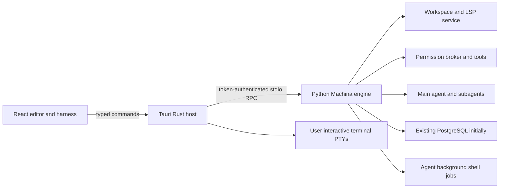

# Machina Desktop: product and architecture proposal

Status: proposed planning document, 2026-10-29. Implementation is not authorized
by this document alone. The user requested an in-depth OpenCode handoff and
explicitly requested reverting the terminal interface styles.

Companion: [OpenCode execution plan](MACHINA_DESKTOP_OPENCODE.md).

## 1. Outcome

Build an installable Windows/macOS code editor with Machina's agent harness
beside the code. The application must feel responsive with long conversations,
several working agents and noisy commands. It must have an intentional graphical
design, real completion, readable diffs and visible execution controls.

The desktop application replaces the presentation layer incrementally. The
existing Python harness, permission broker, authentication, sessions, tools,
memory and workspace service remain authoritative during migration.

OpenCode is the implementation agent for this proposal, not a replacement model
provider or a new dependency of the shipped application.

## 2. What the user actually asked for

- A code editor is the primary workspace, with an integrated agent harness.
- Windows and macOS must both work; mobile is outside this effort.
- Typing, scrolling and animation must stay responsive after very long chats.
- Completion must appear and Tab must accept the applicable suggestion.
- Enter during an agent turn queues steering for a safe tool boundary.
- Escape cancels the closest transient interaction; at the normal composer it
  interrupts the active turn. It must not interrupt a turn while dismissing a
  completion popup or a settings dialog.
- Background commands must expose Output and Stop. Moving an existing command
  to background must never start it again.
- Subagents are concise workers. Show live progress in temporary inspection
  tabs. On retirement close the tab and remove the ephemeral child chat after
  its report/evidence is safely associated with the parent.
- Provider follows the selected model. Provider configuration manages keys,
  endpoints and removal; it does not introduce a competing active-provider mode.
- Bindings are editable, searchable, cross-platform, conflict-aware and do not
  default routine actions to F keys or fragile modified-arrow combinations.
- Interface design needs real differences in composition, typography, spacing
  and interactions. The rejected Paper/Blueprint/Signal terminal styles must
  not be restored or mechanically translated into the desktop app.

## 3. Scope and delivery boundaries

### Engineering preview

One window, one active workspace, a local engine, existing PostgreSQL, provider
login, file editing, session streaming, steering, approvals, jobs and subagents.
Developers may use their existing Python/database installation. This is not
advertised as a frictionless public installer.

### Desktop beta

A signed application and managed engine distribution, update compatibility,
long-session performance evidence and packaged native tests on both OSes.
Database setup remains clearly disclosed if still required.

### Public release

A normal person can install and open a project without installing Node, Rust,
Python or Docker themselves. This requires a separately gated local-storage
decision. Recommended long-term direction: an embedded local storage profile
and PostgreSQL for server/operator deployments, after complete semantics tests.
Do not pretend changing asyncpg calls to SQLite is a small desktop task.

### Later, separately approved

Multiple windows/workspaces, an authenticated remote engine, team accounts,
collaboration, plugin marketplace, Linux support and optional local model packs.
Architect for these boundaries; do not build a SaaS platform or microservice
fleet before the local product works.

## 4. Proposed technology decisions

| Responsibility | Proposal | Reason / constraint |
|---|---|---|
| Desktop host | Tauri 2, Rust | Native lifecycle and OS integration without bundling Chromium |
| Renderer | React + TypeScript + Vite | Feature modules, direct reuse of pure TS contracts, browser iteration |
| Code editor | CodeMirror 6 | Modular editor; load languages/extensions on demand |
| UI primitives | Small accessible primitive set + owned CSS tokens | Avoid an uncontrolled component dependency tree |
| State | Normalized feature stores with selector subscriptions | A token must not rerender the editor or every transcript row |
| Transcript lists | Measured variable-height virtualization | History size must not determine frame work |
| Interactive terminal | xterm.js initially + portable-pty | Separate from background tool jobs; adopt another renderer only after evidence |
| Harness | Existing Python gateway | Preserve working policy, providers, tools and agent lifecycle |
| Local transport | Authenticated JSON-RPC over child stdio | No listening network port for the initial desktop client |
| Packaging | Small client + versioned engine component; offline bundle option | Report aggregate size, not just bootstrap size |
| Storage initially | Existing PostgreSQL | Keep desktop work independent of a database rewrite |
| Storage for broad distribution | Separate repository-contract project | Embedded profile only after safety, migration and search parity gates |

These are recommendations for plan approval, not claims that these packages
are installed in Machina. Pin compatible stable versions in the first spike;
do not copy Terax's moving main-branch version ranges.

## 5. Size: a measurable target, not a slogan

Terax release v0.9.0 asset metadata checked 2026-10-29:

| Asset | Compressed download, MiB |
|---|---:|
| Windows x64 setup.exe | 4.82 |
| Windows x64 MSI | 5.96 |
| macOS arm64 DMG | 6.92 |
| macOS x64 DMG | 7.31 |
| Linux AppImage | 91.82 |

Source: [release assets](https://github.com/crynta/terax-ai/releases/tag/v0.9.0),
queried through GitHub's release API. A MiB is 1,048,576 bytes. These values do
not establish installed footprint, RAM consumption or the size of every format.
Terax's README describes about 7–8 MB on disk; do not mix that statement with
the compressed artifact figures above.

Tauri uses system webviews: WebView2 on Windows and WKWebView on macOS.
Dependency availability is part of the real installation experience.
Machina additionally has a Python engine, Python dependencies, database storage,
optional embedding/reranker models, LSP servers and user data. Tauri does not
make those disappear.

Proposed client-only goals: <=10 MiB compressed desirable; <=15 MiB investigation
threshold on each first-class platform. Do not block necessary correctness fixes
to hit a cosmetic threshold. Full-engine and offline-bundle budgets are fixed
only after a clean build is measured in milestone 1. No invented total-size promise.

Every release publishes bytes for: client download; installed client; initial
engine download; installed engine; first-run additional downloads; optional
models/LSP packs; offline bundle; fresh application data; runtime working set.
The installer shows additional downloads before starting them. A tiny installer
followed by a large hidden download does not meet the size objective.

## 6. Process and authority model

The host owns child process lifecycle, secure runtime installation, window state,
native dialogs and IPC. The engine owns model calls, authorization, job state,
workspace revision checks and agent work. The renderer owns editor interaction,
selection, scroll position and graphical presentation.

One active workspace per window for the first milestone. One owned engine context
per active workspace for the preview, with no automatic unlimited process pool.
Agent concurrency is not implemented as one Python interpreter per subagent.
Multiple workspace engines and database pool limits require an explicit measured
capacity gate before shipping multiwindow support.

Browser-rendered content is not allowed to bypass the engine's authorization.
The renderer never receives the engine token or gains an unrestricted process
spawn primitive. Human typing in an explicitly labeled interactive terminal is
user authority; model tools do not acquire that authority through the PTY API.

## 7. Existing code to reuse and code to leave behind

| Existing location | Role in migration |
|---|---|
| `machina/gateway/__main__.py` | Existing bounded stdio reader/writer and shutdown |
| `machina/gateway/server.py` | Gateway initialization, turn and job methods |
| `machina/gateway/features/` | Auth, models, providers, sessions, workspace, approvals, MCP |
| `machina/protocol/events.json` | Canonical chat/agent event schema |
| `communications/ui-gateway-protocol.md` | Current RPC/event semantics |
| `machina/workspace/` | File containment, revisions, document mirrors and LSP ordering |
| `machina/permissions/` | Single tool authorization authority |
| `machina/core/steering.py`, `shell_jobs.py` | Steering and agent-job lifecycle |
| `machina/db/lifecycle.py` | Existing managed DB lease behavior, missing in a naive gateway launcher |
| `ui/src/protocol.ts`, `workspace/protocol.ts` | Extract reusable contracts carefully |
| `ui/src/gateway.ts` | Reference for RPC correlation and token injection; Node spawn is not browser code |
| `ui/src/workspace/gateway.ts` | Reusable typed workspace adapter after dependency audit |
| `ui/src/editor/`, `components/`, `app.ts` | Behavioral references and regression evidence; do not transplant the terminal renderer |
| `ui/test/`, `tests/`, Machina-DevTools CI | Preserve existing checks; add desktop checks separately |

The gateway's current initialize path connects to PostgreSQL and applies runtime
schema work. The desktop host must acquire/release the correct DB lease before
using a managed database. Merely spawning `python -m machina.gateway` does not
reproduce the existing launcher's setup behavior.

Current workspace services hold an authoritative server-side client binding,
epoch and document version. Preserve all three. Existing LSP ranges are UTF-16.
CodeMirror offsets must be converted at the adapter boundary, including emoji,
combining marks and CRLF. Do not reinterpret Python character indices as JS offsets.

## 8. Event, recovery and history contracts

Preserve canonical protocol v2 and both event families. Chat events carry session
and turn identity. Workspace events carry workspace/epoch identity and are not
fabricated as chat events. An internal desktop envelope may add connection
generation and receive sequence, without silently changing the backend schema.

The engine is authoritative for running/retired turns and command completion.
Transport disconnection is not success and is not proof a command stopped.
Pending submit has a separate state; never retry a side-effecting submit blindly.

Add narrow contracts for paginated transcript reads, bounded output reads,
runtime status snapshots and, before automatic mutation retries, idempotency.
Pagination uses a stable persisted ordering cursor; timestamps alone are not a
safe tie-breaker. Normal updates cannot copy or parse the entire session.

Desktop reload must first reconcile jobs, pending approvals and active turns.
If continuity cannot be proven, show interrupted/unknown state. Persist drafts
atomically outside engine transcripts, with credentials excluded. Version and
validate draft/layout storage; recover or quarantine corrupted files.

## 9. Editor and completion behavior

The editor is locally responsive and does not await an RPC for each keypress.
Changes use versioned incremental synchronization; operations that depend on
fresh text flush that chain first. A stale LSP response never mutates a newer
buffer. Save uses existing expected-revision conflict checks. No silent overwrite
of external changes, symlinks or multi-edit documents.

Tab precedence: active IME composition first; selected completion second;
eligible ghost completion third; ordinary indentation otherwise. A newer edit,
selection movement, document switch, epoch change or provider change invalidates
an in-flight ghost completion. No ghost suggestion inserts unrequested newlines
or stale suffixes. LSP and model completion are distinguishable sources.

Model completion is opt-in and budgeted; do not send a request on every keypress.
Text prediction, language server availability and actual engine failures have
clear states. Missing tooling is reported, not disguised with canned suggestions.

## 10. Graphical design process

The user rejected the previous terminal style collection. Produce two or three
meaningfully different desktop directions before implementation: topology,
typographic hierarchy, density, tool disclosure and editor/harness interaction
must differ. A palette or icon swap is insufficient.

Use native image generation for direction probes if available, then an interactive
prototype using realistic long content, a diff, a running command and a temporary
subagent inspection. Obtain approval of one direction and its state inventory.
This planning document is not that approval. Do not block nonvisual protocol,
profiling or packaging research while the visual choice is pending.

One excellent base workspace precedes optional alternate designs. No new style
selector ships until the base design is accepted and different designs can be
shown to be meaningfully different. UI fonts and code fonts are independently
controlled inside the graphical application and support user overrides.

## 11. Performance acceptance targets

These are proposed release gates on documented reference machines, not achieved
results and not universal promises. Measure release builds with no concurrent
test suite, profiler, dev server or synthetic mock replacing the actual backend.

| Metric | Proposed gate |
|---|---|
| Text input to painted editor/composer glyph | p95 <=32 ms, p99 <=50 ms |
| Scroll frame work in long chat | p95 <=16.7 ms, p99 <=33.3 ms at 60 Hz |
| Main-thread tasks during sustained typing | No task >50 ms after warm-up |
| Warm local shell visible and editable | <=1 second, engine loading independent |
| Cold shell visible and editable | <=2 seconds on the reference SSD machine |
| Idle app CPU after warm-up | <=1% averaged over 60 s, platform cores normalized |
| Client process-tree RAM, excluding engine | <=200 MiB empty; <=300 MiB stress target |
| Memory after repeated open/close cycles | <=10% retained growth after warm-up and comparable GC |
| History window | Initial 200 records; cap hydrated records at 1,000 with cursor reload |
| Transcript DOM | <=250 mounted message rows outside explicit expanded views |
| Terminal scrollback | Default 5,000 lines per PTY, configurable bounded maximum |
| Job output UI tail | <=64 KiB per live job unless explicit chunked history view |
| Streaming renderer updates | Coalesce to <=1 visible update per animation frame |

Include the current Monster Hunter parent session in a local read-only run.
Never commit its private text or submit a model prompt during a performance run.
Use synthetic shareable fixtures in CI: 10,000 messages, multi-megabyte tool
output, long code blocks, variable heights, eight working agents, five noisy
jobs and a 100,000-entry repository index. Distinguish app frame time, actual
input-to-paint, IPC time, model latency, CPU, RAM and disk size.

## 12. Reliability and security acceptance

- No model text can change approval state; resolve approvals against request,
  session, turn and original action identity.
- Tokens and secrets stay in the existing backend credential system and host
  process memory where needed, not localStorage, logs or HTML attributes.
- Treat Markdown, diffs, repository text, filenames, terminal escape sequences
  and model output as untrusted display content. No privileged remote webview.
- A root/workspace switch fences all late file, LSP and agent callbacks.
- Signed updates are staged; active work and dirty files survive cancellation
  of restart. No routine update interrupts an active turn automatically.
- Engine and client updates share an explicit compatibility contract; a newer
  client cannot silently corrupt an older engine's state.
- Do not promise hallucination-free agents. Show evidence, tool outcomes,
  uncertainty and verified exit status; never manufacture progress or tests.
- No loss of parent reports when deleting child sessions or closing idle tabs.

## 13. Source references

These support architecture research, not proof that Machina implements it:

- [Terax frontend manifest](https://github.com/crynta/terax-ai/blob/main/package.json)
- [Terax Rust manifest](https://github.com/crynta/terax-ai/blob/main/src-tauri/Cargo.toml)
- [Terax release assets](https://github.com/crynta/terax-ai/releases/tag/v0.9.0)
- [Tauri webviews](https://v2.tauri.app/reference/webview-versions/)
- [Tauri size configuration](https://v2.tauri.app/concept/size/)
- [Tauri Python/external sidecars](https://v2.tauri.app/develop/sidecar/)
- [Tauri Windows installers](https://v2.tauri.app/distribute/windows-installer/)
- [Tauri capabilities](https://v2.tauri.app/security/capabilities/)
- [Tauri updater](https://v2.tauri.app/plugin/updater/)
- [Tauri native testing](https://v2.tauri.app/develop/tests/webdriver/)
- [CodeMirror source](https://github.com/codemirror/dev)

The native-testing documentation currently describes WebdriverIO's embedded
Tauri driver for macOS as well as Windows. Keep test plugins out of production
binaries and recheck compatibility during the pinned-version spike. A passing
Chromium browser test alone is not a native WKWebView test.
